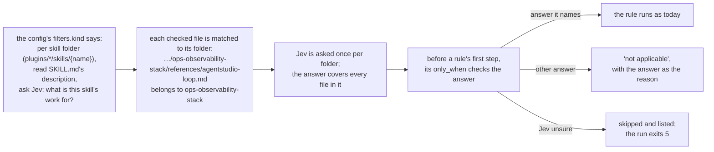

# Deliverable 1: the engine asks each skill's kind once

## The problem

A rule about general skills, like "don't send agents into one product's own debug loop", is wrong on a product's own skill, where that loop is the point. Today the engine runs every rule on every skill, so on 1 Nov the product-workflow rule gave 9 wrong nudges out of 11, four of them on product skills' own text.

## How it works after this deliverable



## The config, as a rule writer writes it

One new section in the rules config, and one line on a rule:

```json
"filters": {
  "kind": {
    "per": "plugins/*/skills/{name}",
    "reads": { "file": "SKILL.md", "kind": "skill", "field": "description" },
    "question": { "type": "choice", "task": "What is this skill's work for?",
                  "criteria": { "general": "…", "role": "…", "domain": "…", "tool_manual": "…", "repo_specific": "…" } },
    "min_probability": 0.7
  }
}
```

```json
"only_when": { "kind": ["general", "role", "domain"] }
```

- **`per`:** ask once for each folder that matches; every checked file inside it shares the answer.
- **`reads`:** what Jev reads to answer: the `description` field of the `skill` piece in `SKILL.md`.
- **`question`:** a normal Jev choice question; its criteria labels are the only answers it may give.
- **`min_probability`:** below this, the answer is unsure, and gated rules skip the folder.
- **`only_when`** on a rule: run this rule only where the answer is one of these.

The engine knows none of these names: `kind`, the folder pattern and the five answers are this repository's. A code repository could write `"per": "packages/{name}"` and ask what each package is for.

## One more change: an ast-grep rule can be written inline

An evidence kind still names an ast-grep rule kept in `evidence/rules/*.yml`, or it can write a one-off rule inline, as a one-line YAML string inside the JSON config. Today's `rule-question` rule, written inline:

```json
"rule_question": {
  "inline_rule": "{ language: Json, files: ['**/rules/*.rules.json'], rule: { kind: pair, inside: { kind: object, inside: { kind: pair, has: { field: key, regex: '^\"questions\"$' } } } } }",
  "fields": { "body": { "from": "remainder" } }
}
```

Both forms match exactly the same way. Inline suits a short one-off; a rule with nesting or quoting like this one reads better in its file. The config stays JSON, so it keeps its schema check (your choice, 4 Nov). A kind gives one or the other, never both.

## An example

A run over two folders:

| Folder | Jev's answer | What a general-skill rule does there |
| --- | --- | --- |
| `plugins/sunstack-dev/skills/ops-observability-stack` | `general`: a practice for any repository | runs, and nudges line 17 (AgentStudio's debug loop) |
| `plugins/agentstudio/skills/agentstudio` | `tool_manual`: how to use one app | gives no nudge; the report says "not applicable: filter kind: tool_manual" |

The engine asks two questions, one per folder, however many files and rules each folder has. If Jev had been only 50% sure about one folder, the rule would skip that folder, the report would list it with Jev's answers, and the run would exit 5 so nothing passes silently.

## What changes in the engine

| Part | Change |
| --- | --- |
| Config | one new section, `filters`; an evidence kind may give `inline_rule` instead of `rule` |
| Rules | an optional gate on a rule: which answers it judges (`only_when`) |
| A run | one new step that asks each folder's question once, before any rule runs |
| The report | each folder's answer and how sure; each skip; the reason on each "not applicable" |
| Bad config | refused with the exact field, before anything runs |

Nothing about skills is written into the engine: the folders, the question and its answers all come from the caller's config. Released as sunstack 0.7.0.

## How we'll know it works

- Two rules over three files of one folder cause exactly one question to Jev.
- A run given only a skill's reference file still reads that skill's description.
- On a folder whose answer the rule doesn't name, neither a mechanical nor a model-judged rule starts.
- An unsure answer gives no result, one listed skip, and exit 5; a failed question gives exit 3.
- The same ast-grep rule, inline and in a rule file, collects exactly the same pieces.
- Existing rulebooks without gates give the same results as before.
- Each bad config is refused with its field.

## Not in this deliverable

Using the gates in this repository's rules (deliverable 3). The engine's older skill-aware file loader (later work, your decision 9).

## Where it's defined

The engine's own design: [Requirements](../../../../../../sunstack-tools.feat-owner-assessment/docs/specs/2026-11-04-owner-assessment/requirements.html), [Specification](../../../../../../sunstack-tools.feat-owner-assessment/docs/specs/2026-11-04-owner-assessment/specification.html), [Program Design](../../../../../../sunstack-tools.feat-owner-assessment/docs/specs/2026-11-04-owner-assessment/program-design.html), [Verification Design](../../../../../../sunstack-tools.feat-owner-assessment/docs/specs/2026-11-04-owner-assessment/verification-design.html). In the big design: [the engine feature](../../program-design.html#pd--the-engine-feature-filters), and the needs [U11](../../requirements.html#req-rule-making--u11-the-engine-stays-generic), [U13](../../requirements.html#req-skill-kinds--u13-the-kind-of-a-skill-is-what-its-work-is-for-judged-once), [U14](../../requirements.html#req-skill-kinds--u14-an-unsure-kind-is-skipped-and-listed). Plan: [deliverable 1's plan](../../d1-plan.html).
