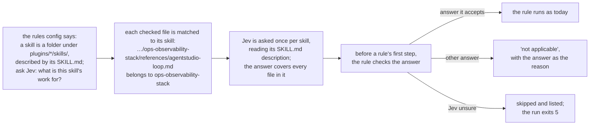

# Deliverable 1: the engine asks each skill's kind once

## The problem

A rule about general skills, like "don't send agents into one product's own debug loop", is wrong on a product's own skill, where that loop is the point. Today the engine runs every rule on every skill, so on 1 Nov the product-workflow rule gave 9 wrong nudges out of 11, four of them on product skills' own text.

## How it works after this deliverable

## An example

A run over two folders:

| Folder | Jev's answer | What a general-skill rule does there |
| --- | --- | --- |
| `plugins/sunstack-dev/skills/ops-observability-stack` | its work is for any repository | runs, and nudges line 17 (AgentStudio's debug loop) |
| `plugins/agentstudio/skills/agentstudio` | one app's own procedures | gives no nudge; the report says "not applicable: assessment work_scope: one_app_procedures" |

The engine asks two questions, one per folder, however many files and rules each folder has. If Jev had been only 50% sure about one folder, the rule would skip that folder, the report would list it with Jev's answers, and the run would exit 5 so nothing passes silently.

## What changes in the engine

| Part | Change |
| --- | --- |
| Config | two new sections: the skill folders (`owners`) and the question (`assessments`) |
| Rules | an optional gate on a rule: which answers it judges (`requires`) |
| A run | one new step that asks each folder's question once, before any rule runs |
| The report | each folder's answer and how sure; each skip; the reason on each "not applicable" |
| Bad config | refused with the exact field, before anything runs |

Nothing about skills is written into the engine: the folders, the question and its answers all come from the caller's config. Released as sunstack 0.7.0.

## How we'll know it works

- Two rules over three files of one folder cause exactly one question to Jev.
- A run given only a skill's reference file still reads that skill's description.
- On a folder the rule doesn't accept, neither a mechanical nor a model-judged rule starts.
- An unsure answer gives no result, one listed skip, and exit 5; a failed question gives exit 3.
- Existing rulebooks without gates give the same results as before.
- Each bad config is refused with its field.

## Not in this deliverable

Using the gates in this repository's rules (deliverable 3). The engine's older skill-aware file loader (later work, your decision 9).

## Where it's defined

The engine's own reviewed design: [Requirements](../../../../../../sunstack-tools.feat-owner-assessment/docs/specs/2026-11-04-owner-assessment/requirements.html), [Specification](../../../../../../sunstack-tools.feat-owner-assessment/docs/specs/2026-11-04-owner-assessment/specification.html), [Program Design](../../../../../../sunstack-tools.feat-owner-assessment/docs/specs/2026-11-04-owner-assessment/program-design.html), [Verification Design](../../../../../../sunstack-tools.feat-owner-assessment/docs/specs/2026-11-04-owner-assessment/verification-design.html). In the big design: [the engine feature](../../program-design.html#pd--the-engine-feature-owner-assessment), and the needs [U11](../../requirements.html#req-rule-making--u11-the-engine-stays-generic), [U13](../../requirements.html#req-skill-kinds--u13-the-kind-of-a-skill-is-what-its-work-is-for-judged-once), [U14](../../requirements.html#req-skill-kinds--u14-an-unsure-kind-is-skipped-and-listed). Plan: [deliverable 1's plan](../../d1-plan.html).
