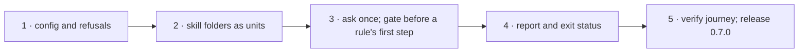

# Deliverable 1 plan: the engine asks each skill's kind once

Five steps in sunstack-tools, one pull request, ending in release 0.7.0. Each step leaves the engine working and tested.

Design: [deliverable 1](../../d1-design.html). Planned at sunstack-tools `feat/owner-assessment` `9116442`. Merge and release: the Lead (owner grant, 30 Oct). Tracking: none.

## The steps



## At a glance

| Step | What it does | How we'll know it worked | Waits on |
| --- | --- | --- | --- |
| 1 · Config and refusals | the config can name skill folders and the question; rules can carry a gate; bad config is refused | each bad declaration is refused with its field | nothing |
| 2 · Skill folders as units | every checked file is matched to its skill folder; the skill's description is read even when only a reference file is checked | a run over one reference file still reads its skill's description | step 1 |
| 3 · Ask once, then gate | the question is asked once per folder; each gated rule checks the answer before its first step | one question per folder; a rule outside its answers never starts; unsure is skipped | step 2 |
| 4 · Report and exit status | answers, skips and reasons appear in the report; an unsure answer exits 5, a failed one exits 3 | the exit codes and report on a real run | step 3 |
| 5 · Verify and release | the verification journey gains this case; changelog; release 0.7.0 | the journey passes on the release build; nothing skill-specific added | step 4 |

One pull request; I merge and release it (your 30 Oct grant). Deliverable 3 starts using it after the release.

## Detail for the agents: files, commands and proof for each step

### E1 · Engine config and admission (contract; consumer E2)

- **Reads:** engine Specification E1–E5, R6; Program Design "Where each entity lives", "Interfaces: Admission"; current-system map Q1–Q2.
- **Writes:** `sunstack-lint/src/configuration_loading/config_contracts.rs` (owners, assessments), `config_validation.rs`; `sunstack-rules/src/rulebook_planning/rulebook_entry_wire.rs` (`requires`), `rulebook_admission.rs` (registry input), `rule_definitions/strict_decoding.rs` (safe fields); new `owner_assessment/assessment_plan.rs`.
- **Earns:** engine V6 (OC) by `cargo nextest run -p sunstack-rules -p sunstack-lint` plus `sunstack lint --check` on each refusal fixture.
- **Focused proof:** each R6 refusal with its field path; wrong behavior: a root with `**` or two captures, an unknown assessment or option, accepted silently. Oracle: engine R6.
- **Existing tests:** keep all admission tests; add cases beside them.
- **Stop:** an admission need that changes `AdmissionRefusal`'s shape.

### E2 · Owner units and context files (vertical)

- **Reads:** engine R2; Program Design "Interfaces: Units, Build"; map Q3, Q6.
- **Writes:** new `sunstack-lint/src/lint_execution/owner_units.rs`; `lint_run.rs` (context inputs, change dependencies at change selection and final picking); `evidence_piece_picking.rs`.
- **Earns:** engine V2 (OA, OB) by `cargo nextest run -p sunstack-lint` integration targets.
- **Focused proof:** a member-only run reads the describing file; a describing-file change selects members, including a selected-kind member that must reach the selection question. Wrong behavior: the dependency added only at final picking. Oracle: engine R2.
- **Stop:** the context catalog cannot stay apart from rule-picked pieces without changing `EvidenceBuild`'s public shape.

### E3 · Assessment stage, gate, reasons and skips (vertical)

- **Reads:** engine R1, R3, R4, R5; Program Design "Interfaces: Assessment stage, Gate", `NotApplicableReason`; map Q3–Q4.
- **Writes:** new `sunstack-rules/src/owner_assessment/assessment_run.rs`; `rulebook_planning/rulebook_run.rs` (`gate_for` before the first walk; skip collector keyed by rule, file, assessment); `decision_walking.rs` (`NotApplicableReason`, `basis()` exception only).
- **Earns:** engine V1, V3, V4, V5 (OA) by `cargo nextest run -p sunstack-rules` (integration `owner_assessment.rs` with `ControlledServer`).
- **Focused proof:** one question per unit and assessment (two runs in one process ask twice); outside `accept` → not_applicable, basis judged, no walk (test-only walk counter); selected option {A: 0.3, B: 0.7} at 0.7 is unsure, exactly 0.7 is judged; one skip per rule and file. Wrong behaviors: per-piece questions, cached answers, walk-then-discard, B substituted. Oracle: engine R1, R3, R4 and E3.
- **Existing tests:** keep `decision_walking_test`; add the ungated choice→not_applicable basis case (must stay judged).
- **Stop:** the dispatcher needs a second backend (contradicts decision 8).

### E4 · Report, status, schema and activation (vertical)

- **Reads:** engine R1, R4; Program Design "Interfaces: Report, Model activation"; map Q5.
- **Writes:** `sunstack-lint/src/lint_reporting/report_contracts.rs`, `outcome.rs`, `formats.rs`; `lint_run.rs` `model_work`.
- **Earns:** engine V4 (OB process journey: unsure → exit 5, failed assessment → exit 3), activation row (mechanical-only gated rulebook prepares the backend; no key refuses before acquisition) by `cargo nextest run -p sunstack` e2e.
- **Focused proof:** status precedence; schema regenerated and validated by the existing schema test. Wrong behavior: unsure run exiting 0. Oracle: engine R4.
- **Existing tests:** keep `schema_limits_usage`; repair its expected schema.

### E5 · Verify journey, changelog, release 0.7.0 (integration)

- **Reads:** engine Verification Design OD, OE; `.agents/skills/verify-sunstack-rule/`.
- **Writes:** `scripts/verify/sunstack-rule/rulebook/rulebook-lint.ts` (an `owner-assessment` case), CHANGELOG, version 0.7.0.
- **Earns:** engine V5 (existing journeys unchanged with units declared), V7 (OE: no skill word added) by the verify-sunstack-rule journey on the release candidate and a diff read.
- **Gate:** clippy, fmt, nextest, signing (Developer ID per the release rule); the engine PR merged; release published. The Lead accepts.

## Changed from

The one plan for all the work (`plans/2026-11-04-skill-rules.md`) is split by deliverable, as the owner asked on 4 Nov ("big design 4 -> eadch delviermable is design document plus plan that refrences th othe rone"). This plan keeps that plan's slices for this deliverable unchanged; the other deliverables' slices wait on the [delivery map](../../delivery.html) for their own plans. Nothing completed is invalidated: no slice had started.

## Canonical record

```text
plan path: docs/specs/2026-11-03-skill-rules/deliverables/1-engine-asks-kind-once/plan.md
originating planner: plan-implementation
supersedes: docs/specs/2026-11-03-skill-rules/plans/2026-11-04-skill-rules.md
planning result: ready
governing planning basis:
  kind: reviewed-four-document-design
  sunstack-tools docs/specs/2026-11-04-owner-assessment/{requirements,specification,program-design,verification-design}.md; review tmp/design-workflows/2026-11-04-owner-assessment/review/report.md … report-round-4.md (converged); within the ai-tools set at 47b3a025 (Program Design: the engine feature)
  current applicability anchors: ai-tools 47b3a025; sunstack-tools 9116442 (base origin/main 4aa594a)
delivery context:
  requested terminal: pr-ready-unmerged
  delivery grouping: single:engine-asks-kind-once
  PR topology: one-pr
  repositories: ShravanSunder/sunstack-tools
```

Design: [deliverable 1](../../d1-design.html). Planned at sunstack-tools `feat/owner-assessment` `9116442`. Merge and release: the Lead (owner grant, 30 Oct). Tracking: none.
