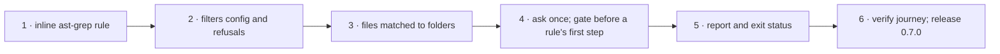

# Deliverable 1 plan: the engine asks each skill's kind once

Six steps in sunstack-tools, one pull request, ending in release 0.7.0. Each step leaves the engine working and tested.

Design: [deliverable 1](../../d1-design.html). Planned at sunstack-tools `feat/owner-assessment`. Merge and release: the Lead (owner grant, 30 Oct). Tracking: none.

## The steps



## At a glance

| Step | What it does | How we'll know it worked | Waits on |
| --- | --- | --- | --- |
| 1 · Inline ast-grep rule | an evidence kind can write its rule inline as a one-line YAML string instead of naming one in a file | the same rule inline and in a file collects the same pieces; both, neither, or an inline `id` is refused | nothing |
| 2 · Filters config and refusals | the config can declare a filter (`per`, `reads`, `question`); rules can carry `only_when`; bad config is refused | each bad declaration is refused with its field | step 1 |
| 3 · Files matched to folders | every checked file is matched to its folder; the `reads` file is read even when only a reference file is checked | a run over one reference file still reads its skill's description | step 2 |
| 4 · Ask once, then gate | the question is asked once per folder; each gated rule checks the answer before its first step | one question per folder; a rule whose answer isn't named never starts; unsure is skipped | step 3 |
| 5 · Report and exit status | answers, skips and reasons appear in the report; an unsure answer exits 5, a failed one exits 3 | the exit codes and report on a real run | step 4 |
| 6 · Verify and release | the verification journey gains this scenario; changelog; release 0.7.0 | the journey passes on the release build; nothing skill-specific added | step 5 |

One pull request; I merge and release it (your 30 Oct grant). Deliverable 3 starts using it after the release.

## Detail for the agents: files, commands and proof for each step

### E0 · Inline ast-grep rule (vertical)

- **Reads:** engine Specification E6, R6 (inline refusals), R8; Program Design "Interfaces: Inline rules".
- **Writes:** `sunstack-evidence/src/evidence_planning/evidence_kind_contracts.rs` (`KindMatcher`, closed wire with `rule` xor `inline_rule`), `evidence_project_loading.rs` (inline rules decoded through the rule-file path, kind name as `id`, config file joins `inputs`), callers in `sunstack-lint/src/configuration_loading/config_validation.rs`.
- **Earns:** engine V8 (OF) and V6's inline refusals (OC) by `cargo nextest run -p sunstack-evidence -p sunstack-lint`.
- **Focused proof:** inline and named listings byte-identical, including a field reading the inline kind through `enclosing` and a kind `within` it; an inline edit changes the inputs. Wrong behaviors: a differing piece; an inline kind unusable as a source; an inline `id` silently accepted; a rule file reusing the kind's name accepted. Oracle: the named-rule run.
- **Existing tests:** keep every evidence test; existing `rule` kinds must decode unchanged.
- **Stop:** the inline string needs a schema the rule-file decoder doesn't accept.

### E1 · Filters config and admission (contract; consumer E2)

- **Reads:** engine Specification E1–E5, R6; Program Design "Where each entity lives", "Interfaces: Admission"; current-system map Q1–Q2.
- **Writes:** `sunstack-lint/src/configuration_loading/config_contracts.rs` (`filters`), `config_validation.rs`; `sunstack-rules/src/rulebook_planning/rulebook_entry_wire.rs` (`only_when`), `rulebook_admission.rs` (filter registry input), `rule_definitions/strict_decoding.rs` (safe fields); new `filters/filter_plan.rs`.
- **Earns:** engine V6 (OC) by `cargo nextest run -p sunstack-rules -p sunstack-lint` plus `sunstack lint --check` on each refusal fixture.
- **Focused proof:** the documented positive config (the `kind` filter exactly as D1's design shows it, `instructions` plus five criteria) is admitted by the native Choice decoder; each R6 refusal with its field path, including a top-level `task` and a malformed inline rule reported at its own `inline_rule` path; a `reads.field` named `folder` keeps both values in the request; wrong behavior: a `per` with `**` or two captures, an `only_when` with two filters, an unknown filter or answer, accepted silently. Oracle: engine R6.
- **Existing tests:** keep all admission tests; add scenarios beside them.
- **Stop:** an admission need that changes `AdmissionRefusal`'s shape.

### E2 · Filter folders and context files (vertical)

- **Reads:** engine R2; Program Design "Interfaces: Folders, Build"; map Q3, Q6.
- **Writes:** new `sunstack-lint/src/lint_execution/filter_folders.rs`; `lint_run.rs` (context inputs, change dependencies at change selection and final picking); `evidence_piece_picking.rs`.
- **Earns:** engine V2 (OA, OB) by `cargo nextest run -p sunstack-lint` integration targets.
- **Focused proof:** a member-only run reads the `reads` file; a change to it selects members, including a selected-kind member that must reach the selection question. Wrong behavior: the dependency added only at final picking. Oracle: engine R2.
- **Stop:** the context catalog cannot stay apart from rule-picked pieces without changing `EvidenceBuild`'s public shape.

### E3 · Filter stage, gate, reasons and skips (vertical)

- **Reads:** engine R1, R3, R4, R5; Program Design "Interfaces: Filter stage, Gate", `NotApplicableReason`; map Q3–Q4.
- **Writes:** new `sunstack-rules/src/filters/filter_run.rs`; `rulebook_planning/rulebook_run.rs` (`gate_for` before the first walk; skip collector keyed by rule, file, filter); `decision_walking.rs` (`NotApplicableReason`, `basis()` exception only).
- **Earns:** engine V1, V3, V4, V5 (OA) by `cargo nextest run -p sunstack-rules` (integration `filters.rs` with `ControlledServer`).
- **Focused proof:** one question per folder and filter (two runs in one process ask twice); answer not named → not_applicable, basis judged, no walk (test-only walk counter); selected answer {A: 0.3, B: 0.7} at 0.7 is unsure, exactly 0.7 is judged; one skip per rule and file. Wrong behaviors: per-piece questions, cached answers, walk-then-discard, B substituted. Oracle: engine R1, R3, R4 and E3.
- **Existing tests:** keep `decision_walking_test`; add the ungated choice→not_applicable basis scenario (must stay judged).
- **Stop:** the dispatcher needs a second backend (contradicts decision 8).

### E4 · Report, status, schema and activation (vertical)

- **Reads:** engine R1, R4; Program Design "Interfaces: Report, Model activation"; map Q5.
- **Writes:** `sunstack-lint/src/lint_reporting/report_contracts.rs`, `outcome.rs`, `formats.rs`; `lint_run.rs` `model_work`.
- **Earns:** engine V4 (OB process journey: unsure → exit 5, failed filter question → exit 3), activation row (mechanical-only gated rulebook prepares the backend; no key refuses before acquisition) by `cargo nextest run -p sunstack` e2e.
- **Focused proof:** status precedence; schema regenerated and validated by the existing schema test. Wrong behavior: unsure run exiting 0. Oracle: engine R4.
- **Existing tests:** keep `schema_limits_usage`; repair its expected schema.

### E5 · Verify journey, changelog, release 0.7.0 (integration)

- **Reads:** engine Verification Design OD, OE; `.agents/skills/verify-sunstack-rule/`.
- **Writes:** `scripts/verify/sunstack-rule/rulebook/rulebook-lint.ts` (a `filters` scenario, one kind using `inline_rule`), CHANGELOG, version 0.7.0.
- **Earns:** engine V5 (existing journeys unchanged with filters declared), V7 (OE: no skill word added) by the verify-sunstack-rule journey on the release candidate and a diff read.
- **Gate:** clippy, fmt, nextest, signing (Developer ID per the release rule); the engine PR merged; release published. The Lead accepts.

## Changed from

The one plan for all the work (`plans/2026-11-04-skill-rules.md`) is split by deliverable, as the owner asked on 4 Nov ("big design 4 -> eadch delviermable is design document plus plan that refrences th othe rone"). On 4 Nov the owner settled the final config ("filter+folters sure"; "yes stay on json ok inline or yaml referenc eok?"), so this plan uses the `filters` names in every step and adds step 1, the inline ast-grep rule. Nothing completed is invalidated: no slice had started.

## Canonical record

```text
plan path: docs/specs/2026-11-03-skill-rules/deliverables/1-engine-asks-kind-once/plan.md
originating planner: plan-implementation
supersedes: docs/specs/2026-11-03-skill-rules/plans/2026-11-04-skill-rules.md (its engine slices)
planning result: ready for E1–E5 (E0 done, ad0acfd). Held from 4 Nov until the kind experiment; released 5 Nov: the owner chose the description as the filter's input (one text field, as R9 already designs) and the 70% bar, which lives in this repository's config, not the engine; two rounds, 331 Jev calls, showed one Choice is enough and no decision graph is needed (jev-advisor/kind-decision-model-2026-11-04.md, kind-experiment-round-2-2026-11-05.md)
governing planning basis:
  kind: four-document-design
  sunstack-tools docs/specs/2026-11-04-owner-assessment/{requirements,specification,program-design,verification-design}.md reviewed to convergence: rounds 1–4 to 9116442, then rounds 5–8 over the filters rename, R8 and R9 to dd92e2c, 0 open (tmp/design-workflows/2026-11-04-owner-assessment/review/report-round-8.md); within the ai-tools set (Program Design: the engine feature)
  current applicability anchors: sunstack-tools dd92e2c; ai-tools 006e57e3
delivery context:
  requested terminal: pr-ready-unmerged
  delivery grouping: single:engine-asks-kind-once
  PR topology: one-pr (the engine is its own repository's PR; owner, 4 Nov: one PR per deliverable)
  repositories: ShravanSunder/sunstack-tools
```
