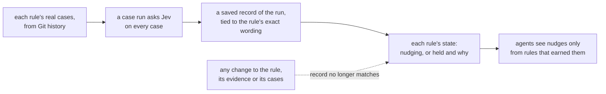

# Deliverable 2: rules that earn their nudges

## The problem

Today a rule nudges agents as soon as it's written, whether or not it has ever been shown to catch a real mistake; its thresholds are the untuned 0.7/0.3; its tests mostly check that it stays quiet; and the runner's own tests use made-up skills. You can't tell from a rule why it exists or whether to trust it.

## How it works after this deliverable

## An example

What the case report shows for two rules (illustration of the format, not a real run):

| Rule | State | Why |
| --- | --- | --- |
| `load-call.names-when-where-and-result` | nudging | 3 real mistakes, 3 good texts, 3 near misses, all passing; held-back set passing; bars tuned from its cases |
| `skill-branch.names-an-observable-condition` | held | 2 of 3 real mistakes; its question changed after the last case run |

And a nudge an agent gets now carries every part: where, what was noticed, the standard it rests on with its line, what to read next (places the rule read, places it didn't, the same rule elsewhere), the model's answers, and whether anything was cut.

## What changes

| Part | Change |
| --- | --- |
| Test cases | the 245 old expectations move into one case file per rulebook, nothing lost; dropped rules' cases are kept but never run |
| Case-run record | saved beside each rulebook; a rule nudges only if its record matches its current wording, evidence and cases |
| Rule state | worked out on every run; held rules are listed with what they lack |
| Rule names | the 12 kept rules get your new names; the 6 dropped rules are removed |
| The branch rule | reads a line ending in ":" together with its block |
| Runner tests | read real skills pinned to a commit, not made-up ones |
| What the agent sees | the full nudge, gaps listed apart from exclusions |

## How we'll know it works

- Every old expectation is found in the new case files with the same meaning.
- Change a rule's question after a passing case run, and the rule is held until it passes again.
- A threshold left at the default, or changed after it was set, holds the rule.
- The dropped rules give no result.
- A colon-ended `IF` with its block passes; an `IF` naming nothing still gets a nudge.
- The runner's tests pass on real skills.

## Not in this deliverable

The kind gates and the general-skill rules (deliverable 3); entering the mined cases and labels (deliverable 3); the review evals (deliverable 4); the teaching skills (deliverable 5).

## Where it's defined

In the big design: [the case files](../../program-design.html#pd--the-rule-record-and-the-case-record), [the case-run record](../../program-design.html#pd--the-case-run-receipt), [rule state](../../program-design.html#pd--the-derived-rule-state-runner), [the nudge](../../program-design.html#pd--the-nudge-as-the-agent-reads-it), [the rules after this change](../../program-design.html#pd--the-rules-after-this-change); obligations [R1](../../specification.html#spec-rule-making--r1-a-nudging-rule-names-its-reason), [R2](../../specification.html#spec-rule-making--r2-the-rule-set-matches-what-the-owner-decided), [R6](../../specification.html#spec-nudges--r6-a-nudge-carries-its-parts), [R8](../../specification.html#spec-nudges--r8-gaps-are-shown-apart-from-exclusions), [R9](../../specification.html#spec-nudges--r9-a-nudge-never-fails-a-run), [R18](../../specification.html#spec-rule-tests--r18-a-judged-rule-nudges-only-after-its-floor)–[R21](../../specification.html#spec-rule-tests--r21-cases-are-real-skill-text), [R22](../../specification.html#spec-what-rules-read--r22-a-rule-declares-its-chunk-and-edges), [R24](../../specification.html#spec-what-rules-read--r24-the-chunk-of-a-rule-is-the-size-of-its-standard); proof rows in [the Verification Design](../../verification-design.html#vd--the-rows). Plan: [deliverable 2's plan](../../d2-plan.html).
