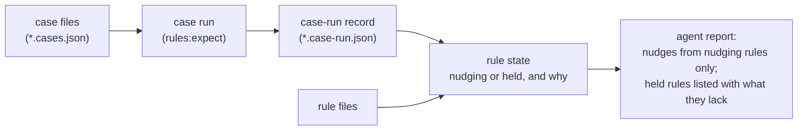

# Deliverable 2: rules that earn their nudges

**When it's done, you can see:** run the case report, and every rule shows its state (nudging or held) and why: what mistake it exists for, how many real cases it has against the 3/3/3 floor, where its bars came from, and whether its last case run still matches it. Renamed rules carry their new names, the dropped rules are gone, and the runner's own tests read real pinned skills instead of made-up ones. A nudge shows every part an agent needs.

**Part of:** the [big design](../../index.html). This page names what this deliverable delivers and links to where each part is defined; it copies none of it.

## What it delivers

| Need | Obligations | What changes |
| --- | --- | --- |
| [U9](../../requirements.html#req-rule-making--u9-a-rule-names-the-mistake-it-catches), [U10](../../requirements.html#req-rule-making--u10-the-rule-list-follows-what-the-owner-decided-rule-by-rule) | [R1](../../specification.html#spec-rule-making--r1-a-nudging-rule-names-its-reason), [R2](../../specification.html#spec-rule-making--r2-the-rule-set-matches-what-the-owner-decided) | each rule names its reason; the rule list matches your decisions (renames and drops) |
| [U1](../../requirements.html#req-nudges--u1-a-rule-result-is-a-nudge), [U3](../../requirements.html#req-nudges--u3-what-was-not-read-is-shown-apart-from-what-was-decided), [U4](../../requirements.html#req-nudges--u4-a-nudge-never-fails-a-run) | [R6](../../specification.html#spec-nudges--r6-a-nudge-carries-its-parts), [R8](../../specification.html#spec-nudges--r8-gaps-are-shown-apart-from-exclusions), [R9](../../specification.html#spec-nudges--r9-a-nudge-never-fails-a-run) | the nudge's parts, gaps and exit status in the agent's report |
| [U17](../../requirements.html#req-rule-tests--u17-real-cases-come-before-any-nudge), [U18](../../requirements.html#req-rule-tests--u18-each-rule-sets-its-own-bars), [U19](../../requirements.html#req-rule-tests--u19-cases-are-real-skill-text-never-made-up) | [R18](../../specification.html#spec-rule-tests--r18-a-judged-rule-nudges-only-after-its-floor), [R19](../../specification.html#spec-rule-tests--r19-labels-say-where-they-came-from), [R20](../../specification.html#spec-rule-tests--r20-bars-are-tuned-per-rule-from-its-development-cases), [R21](../../specification.html#spec-rule-tests--r21-cases-are-real-skill-text) | case files, case-run records, rule state; runner tests on real pinned skills |
| [U20](../../requirements.html#req-what-rules-read--u20-a-rule-names-its-chunk-and-its-edges), [U22](../../requirements.html#req-what-rules-read--u22-a-wrong-reading-is-fixed-where-the-text-was-collected) | [R22](../../specification.html#spec-what-rules-read--r22-a-rule-declares-its-chunk-and-edges), [R24](../../specification.html#spec-what-rules-read--r24-the-chunk-of-a-rule-is-the-size-of-its-standard) | rules declare what they read; the branch rule reads a colon line with its block |

**Not in this deliverable:** the kind gates and the general-skill family (deliverable 3, after the engine release); entering the mined cases and labels (deliverable 3); the review evals (deliverable 4); the teaching skills (deliverable 5).

## What it touches

- The case files and their schema: [the rule record and the case record](../../program-design.html#pd--the-rule-record-and-the-case-record).
- The committed case-run record: [the case-run receipt](../../program-design.html#pd--the-case-run-receipt).
- How the runner works out each rule's state: [the derived rule state](../../program-design.html#pd--the-derived-rule-state-runner), [the states of a rule](../../program-design.html#pd--the-states-of-a-rule).
- What the agent reads: [the nudge, as the agent reads it](../../program-design.html#pd--the-nudge-as-the-agent-reads-it), [gaps](../../program-design.html#pd--gaps-reportgaps-existing-extended).
- The rule files: [the rules after this change](../../program-design.html#pd--the-rules-after-this-change).
- Entities: [E3 Rule](../../specification.html#spec-entities--e3-rule), [E7 Nudge](../../specification.html#spec-entities--e7-nudge), [E8 Case](../../specification.html#spec-entities--e8-case), [E9 Bar](../../specification.html#spec-entities--e9-bar), [E10 Gap](../../specification.html#spec-entities--e10-gap), [E13 Run](../../specification.html#spec-entities--e13-run).

## How it flows

## How it is proven

| Proof row | What this deliverable earns of it |
| --- | --- |
| [U10 · R2](../../verification-design.html#vd--the-rows) | dropped rules give no result |
| [U3 · R8](../../verification-design.html#vd--the-rows) | gap variants (focused runner tests) |
| [U4 · R9](../../verification-design.html#vd--the-rows) | forced boundary runs on real pinned skills, except the kind part |
| [U17 · R18, R19](../../verification-design.html#vd--the-rows) | rule state and the admission checks (a change after a passing run holds the rule) |
| [U18 · R20](../../verification-design.html#vd--the-rows) | bar values must match their recorded values |
| [U19 · R21](../../verification-design.html#vd--the-rows) | every old expectation survives migration |
| [U22 · R24](../../verification-design.html#vd--the-rows) | the branch repair |

**Plan:** [deliverable 2's plan](../../d2-plan.html).
