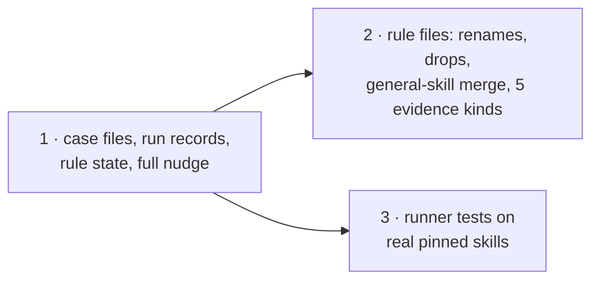

# Deliverable 2 plan: rules that earn their nudges

Three steps in ai-tools (#188). The first sets up the case files and rule state; the other two can run in either order after it.

Design: [deliverable 2](../../d2-design.html). Planned at ai-tools `skills/rules-as-nudges` `61f10679`. The owner merges. Tracking: none.

## The steps



## At a glance

| Step | What it does | How we'll know it worked | Waits on |
| --- | --- | --- | --- |
| 1 · Case files and rule state | moves the 245 old expectations into case files; saves a record of each case run; works out each rule's state; shows the full nudge | every old expectation is found with the same meaning; a rule changed after a passing run is held | nothing |
| 2 · Rule files and evidence cleanup | gives the 12 kept rules their new names; removes the 6 dropped rules; merges the three general-skill rules into one rulebook; removes `steering`; trims 12 evidence kinds to 5; the branch rule reads a colon line with its block | dropped rules give no result; kept rules' cases collect the same text; the branch rule passes a colon-ended IF with its block | step 1 |
| 3 · Runner tests on real skills | the runner's own tests read real skills pinned to a commit; the made-up sample skills are removed | the tests pass on real skills, and forced failures exit with the right status | step 1 |

Steps 2 and 3 touch some of the same test files, so they run one after the other. You merge #188.

## Detail for the agents: files, commands and proof for each step

### A1 · Case files, receipts, rule state, nudge rendering (contract; consumers A2–A8)

- **Reads:** Specification R1, R2, R6, R8, R9, R18–R21, E7–E10; Program Design "The rule record and the case record", "The case-run receipt", "The derived rule state", "The nudge, as the agent reads it", "Gaps"; migration map.
- **Writes:** `tests/skills/lib/skill-rules/` new `cases.ts` (schema), `case-run-receipt.ts`, `rule-state.ts`; `report.ts` (`formatLintReport` parts, `ReportGaps`, held filter); `expectation-run.ts` → case run writing receipts; migration script `scripts/migrate-expectations-to-cases.ts`; every `*.expect.json` → `*.cases.json` (hard cutover, name map, retired cases, `legacy_independent`).
- **Earns:** U3·R8 (OD part), U17·R18/R19 (OD, OG), U18·R20 (OD), U19·R21 (OD migration comparison) by `pnpm --dir tests/skills test` and `pnpm --dir tests/skills typecheck`.
- **Focused proof:** every old expectation compared with its migrated case (a description case with no selector; a section case whose finding line differs from its first line; a Sol-settled case kept `legacy_independent`); every `HeldReason`, with `needs_engine` detected from the report schema (a report carrying `filter_answers` and `filter_skips`, even empty, is supported; one without them holds gated rules); a fingerprint change after a passing run holds the rule (OG); a starting bar holds; a dropped rule's case never runs. Oracle: Program Design shapes and R18–R21.
- **Existing tests:** `expectations.test.ts`, `expectation-scoring.test.ts`, `current-accounts.test.ts` → repair onto `cases.json`; `report.test.ts` → repair (new parts and gaps); `pinned-source.test.ts`, `source-repositories.test.ts` → keep.

### A2 · Rule files: renames, drops, merge, evidence cleanup (vertical)

- **Reads:** Requirements U10 (rule table), U22; Specification R2, R17, R22–R24; Program Design "The rules after this change" and its evidence-kinds paragraph.
- **Writes:** the `*.rules.json` files and their standards' markers (12 renames; six entries and markers removed); the three `general-skill.*` entries and markers moved into new `general-skill.rules.json` beside new `references/general-skill.md` (the merged standard's teaching text is written by the Opus skill writer; the Implementer moves entries, markers and cases); `steering.rules.json` and its rulebook pair removed; `skill-rules.config.json` (rulebook list; evidence kinds trimmed to `skill`, `section`, `load`, `branch`, `rule_question`; `skill` keeps only `description`; `load` resolves targets `as_kind: "skill"`; `load` and `branch` read `enclosing` the `section-heading` rule instead of `step`; `branch` block field; `section` table rows); `evidence/rules/*.yml` rules no kept kind uses removed; case files follow their rules to the new rulebook names.
- **Earns:** U10·R2 (OA list matches U10), U22·R24 (branch repair cases), U20·R22 (OE declarations) by `pnpm --dir tests/skills rules:expect` (keyed, through the key wrapper) and `rules --check`.
- **Focused proof:** the dropped rules give no result; every kept rule's migrated cases collect the same subject text before and after the trim (the enclosing heading replaces the step's heading, compared case by case); `rules --check` passes with five kinds and no `steering`; a colon-ended `IF` with its block passes; a real `IF` naming nothing fires. Oracle: U10, R17, R24.
- **Stop:** an evidence change the engine refuses (route to an engine gap, not a workaround).

### A5 · Runner tests on real pinned skills (repair; decision 5)

- **Reads:** Requirements open meaning 3 (settled); Specification R21; Verification Design OF, OG.
- **Writes:** `tests/skills/lib/skill-rules/tests/*.test.ts`; remove `tests/skills/fixtures/run-skill-rules/sample/` and `completion/` once each test reads Git-pinned real skills through `pinned-source.ts`; keep `cancel-engine.ts` (an engine stand-in for cancellation, not skill text).
- **Earns:** U4·R9 and U14·R15 forced-boundary runs (OF: controlled provider on pinned real skills; uncertain → 5, incomplete, cancelled, invalid; unsure skill skipped and listed — the filters part after deliverable 1's release) by `pnpm --dir tests/skills test`.
- **Existing tests:** `run-skill-rules.test.ts`, `skill-rules-kit-selection.test.ts`, `skill-rules-mechanical-edges.test.ts`, `skill-rules-report-gaps.test.ts` → repair (real pinned skills, new names); `skill-rules-cancellation.test.ts` → keep; `skill-rules-severity-policy.test.ts` → keep (reads delivered rule files). Removing the sample fixtures is proven by a dead contract: no test reads them after the repairs (grep shows no reference).

## Changed from

The one plan for all the work (`plans/2026-11-04-skill-rules.md`) is split by deliverable, as the owner asked on 4 Nov ("big design 4 -> eadch delviermable is design document plus plan that refrences th othe rone"). On 4 Nov the owner settled the final config, so step 2 also trims the evidence kinds, removes `steering` and merges the general-skill rules ("yes remember the genral ksills part ok?"); otherwise this plan keeps that plan's slices for this deliverable; the other deliverables' slices wait on the [delivery map](../../delivery.html) for their own plans. Nothing completed is invalidated: no slice had started.

## Canonical record

```text
plan path: docs/specs/2026-11-03-skill-rules/deliverables/2-rules-earn-their-nudges/plan.md
originating planner: plan-implementation
supersedes: docs/specs/2026-11-03-skill-rules/plans/2026-11-04-skill-rules.md
planning result: ready
governing planning basis:
  kind: reviewed-four-document-design
  ai-tools docs/specs/2026-11-03-skill-rules/ (requirements, specification, program-design.md, verification-design.md) at 47b3a025; review tmp/2026-11-03-skill-rules-review/report.md … report-round-6.md (converged)
  current applicability anchors: ai-tools 47b3a025; sunstack-tools 9116442 (base origin/main 4aa594a)
delivery context:
  requested terminal: pr-ready-unmerged
  delivery grouping: single:rules-earn-their-nudges
  PR topology: one-pr
  repositories: ShravanSunder/sunstack (ai-tools)
```

Design: [deliverable 2](../../d2-design.html). Planned at ai-tools `skills/rules-as-nudges` `61f10679`. The owner merges. Tracking: none.
