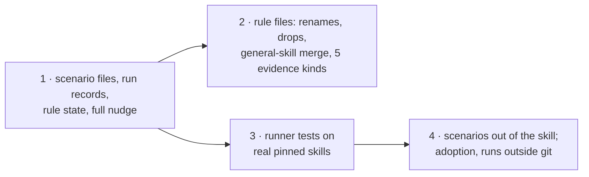

# Deliverable 2 plan: rules that earn their nudges

Three steps in ai-tools (#188). The first sets up the scenario files and rule state; the other two can run in either order after it.

Design: [deliverable 2](../../d2-design.html). Planned at ai-tools `skills/rules-as-nudges` `61f10679`. The owner merges. Tracking: none.

## The steps



## At a glance

| Step | What it does | How we'll know it worked | Waits on |
| --- | --- | --- | --- |
| 1 · Scenario files and rule state | moves the 245 old expectations into scenario files; saves a record of each scenario run; works out each rule's state; shows the full nudge | every old expectation is found with the same meaning; a rule changed after a passing run is held | nothing |
| 2 · Rule files and evidence cleanup | gives the 12 kept rules their new names; removes the 6 dropped rules; merges the three general-skill rules into one rulebook; removes `steering`; trims 12 evidence kinds to 5; the branch rule reads a colon line with its block | dropped rules give no result; kept rules' scenarios collect the same text; a colon-ended IF reaches Jev with its block and the question judges them together | step 1 |
| 3 · Runner tests on real skills | the runner's own tests read real skills pinned to a commit; the made-up sample skills are removed | the tests pass on real skills, and forced failures exit with the right status | step 1 |
| 4 · Scenarios out of the skill, adoption | moves every scenario file to `tests/skills/evals/rule-scenarios/<rulebook>/<rule>.scenario.json` (retired ones to `retired/`), renames case → scenario in code and data, deletes the five `*.case-run.json`, adds `evals:scenarios` (keyed; results in `tests/skills/tmp/scenario-runs/`) and `evals:adopt`, and makes rule state read `adopted.json` | the skill's `rules/` folder holds only config, rules and evidence; an adopted rule nudges, an unadopted or changed one is held, in both printouts | steps 1–3 |

Steps 2 and 3 touch some of the same test files, so they run one after the other. You merge #188.

## Detail for the agents: files, commands and proof for each step

### A1 · Scenario files, receipts, rule state, nudge rendering (contract; consumers A2–A8)

- **Reads:** Specification R1, R2, R6, R8, R9, R18–R21, E7–E10; Program Design "The rule record and the scenario record", "The case-run receipt", "The derived rule state", "The nudge, as the agent reads it", "Gaps"; migration map.
- **Writes:** `tests/skills/lib/skill-rules/` new `scenarios.ts` (schema), `case-run-receipt.ts`, `rule-state.ts`; `report.ts` (`formatLintReport` parts, `ReportGaps`, held filter); `expectation-run.ts` → scenario run writing receipts; migration script `scripts/migrate-expectations-to-scenarios.ts`; every `*.expect.json` → `*.scenario.json` (hard cutover, name map, retired scenarios, `legacy_independent`).
- **Earns:** U3·R8 (OD part), U17·R18/R19 (OD, OG), U18·R20 (OD), U19·R21 (OD migration comparison) by `pnpm --dir tests/skills test` and `pnpm --dir tests/skills typecheck`.
- **Focused proof:** every old expectation compared with its migrated scenario (a description scenario with no selector; a section scenario whose finding line differs from its first line; a Sol-settled scenario kept `legacy_independent`); every `HeldReason`, with `needs_engine` detected from the report schema (a report carrying `filter_answers` and `filter_skips`, even empty, is supported; one without them holds gated rules); a fingerprint change after a passing run holds the rule (OG); a starting bar holds; a dropped rule's scenario never runs. Oracle: Program Design shapes and R18–R21.
- **Existing tests:** `expectations.test.ts`, `expectation-scoring.test.ts`, `current-accounts.test.ts` → repair onto `scenario.json`; `report.test.ts` → repair (new parts and gaps); `pinned-source.test.ts`, `source-repositories.test.ts` → keep.

### A2 · Rule files: renames, drops, merge, evidence cleanup (vertical)

- **Reads:** Requirements U10 (rule table), U22; Specification R2, R17, R22–R24; Program Design "The rules after this change" and its evidence-kinds paragraph.
- **Writes:** the `*.rules.json` files and their standards' markers (12 renames; six entries and markers removed); the three `general-skill.*` entries and markers moved into new `general-skill.rules.json` beside new `references/general-skill.md` (the merged standard's teaching text is written by the Opus skill writer; the Implementer moves entries, markers and scenarios); `steering.rules.json` and its rulebook pair removed; `skill-rules.config.json` (rulebook list; evidence kinds trimmed to `skill`, `section`, `load`, `branch`, `rule_question`; `skill` keeps only `description`; `load` resolves targets `as_kind: "skill"`; `load` and `branch` read `headings` (`enclosing` the `section-heading` rule) instead of `step`; `branch` gains `block`, `next` the new `colon-block` matcher (list, table or fenced code), count 1; `section` table rows); the two questions that named the numbered step (`load-call.names-when-where-and-result`, `skill-branch.names-an-observable-condition`) rewritten to say what `headings` holds and, for branches, to read `block` only when the line ends in ":"; `evidence/rules/workflow-sections.yml`, `evidence/utils/` and the five unused matchers in `skill-steps.yml` removed. Start from the checked scratch proof in `tmp/2026-11-04-config-proof/` (`--check` exit 0 on 0.6.0). scenario files follow their rules to the new rulebook names.
- **Earns:** U10·R2 (OA list matches U10), U22·R24 (branch repair scenarios), U20·R22 (OE declarations) by `pnpm --dir tests/skills rules:expect` (keyed, through the key wrapper) and `rules --check`.
- **Focused proof:** the dropped rules give no result; every kept rule's migrated scenarios collect the same subject text before and after the trim (the enclosing heading replaces the step's heading, compared scenario by scenario); `rules --check` passes with five kinds and no `steering`; an `--evidence branch` run over every skill gives all colon-ended branches their block (26 of 26 on 4 Nov); evidence prints of the rewritten questions' fields on a numbered list, a heading-based skill, a reference file and a colon block are read before the old kinds are deleted; a colon-ended `IF` reaches the model-visible state with its exact block and both branch questions check line and block together; a real `IF` naming nothing fires. Oracle: U10, R17, R24. Whether the colon scenario then passes moves to deliverable 3 (see Changed from).
- **Stop:** an evidence change the engine refuses (route to an engine gap, not a workaround).

### A5 · Runner tests on real pinned skills (repair; decision 5)

- **Reads:** Requirements open meaning 3 (settled); Specification R21; Verification Design OF, OG.
- **Writes:** `tests/skills/lib/skill-rules/tests/*.test.ts`; remove `tests/skills/fixtures/run-skill-rules/sample/` and `completion/` once each test reads Git-pinned real skills through `pinned-source.ts`; keep `cancel-engine.ts` (an engine stand-in for cancellation, not skill text).
- **Earns:** U4·R9 and U14·R15 forced-boundary runs (OF: controlled provider on pinned real skills; uncertain → 5, incomplete, cancelled, invalid; unsure skill skipped and listed — the filters part after deliverable 1's release) by `pnpm --dir tests/skills test`.
- **Existing tests:** `run-skill-rules.test.ts`, `skill-rules-kit-selection.test.ts`, `skill-rules-mechanical-edges.test.ts`, `skill-rules-report-gaps.test.ts` → repair (real pinned skills, new names); `skill-rules-cancellation.test.ts` → keep; `skill-rules-severity-policy.test.ts` → keep (reads delivered rule files). Removing the sample fixtures is proven by a dead contract: no test reads them after the repairs (grep shows no reference).

### A6 · Scenarios out of the skill; adoption replaces receipts (owner, 5 Nov)

- **Reads:** Program Design "Scenario runs and the adoption file" (new), "The derived rule state" (`not_adopted` replaces `no_matching_case_run`; `unsure_cases` and `failing` move to the scenario run's report), Specification R18 (adoption); the owner's words quoted in that Program Design section.
- **Writes:** `git mv` each `plugins/skill-authoring/skills/domain-skill-crafting/rules/*.cases.json` into one file per rule at `tests/skills/evals/rule-scenarios/<rulebook>/<rule-name>.scenario.json` (record + that rule's scenarios; retired scenarios to `rule-scenarios/retired/<rulebook>.scenario.json`); delete the five `*.case-run.json`; new `tests/skills/evals/rule-scenarios/adopted.json` (`{}`: nothing adopted yet); rename `cases.ts`→`scenarios.ts`, `case-run-receipt.ts`→ an adoption module, and case→scenario in the runner, its tests, scripts, `tests/skills/README.md` and the changelog reference; scenario ids inside the data keep their values (no id churn); new scripts `evals:scenarios` (keyed; writes `tests/skills/tmp/scenario-runs/<UTC>/report.json` + `raw/`, never in git) and `evals:adopt <rule> --report <path>` (refuses unless the report is complete and that rule's scenarios all got their labels with none unsure); `rules:expect` removed (hard cutover).
- **Earns:** R18 (adoption path) by `pnpm --dir tests/skills test`: an adopted rule at its fingerprint nudges; a missing entry or a fingerprint change holds it (`not_adopted`), in the main printout and accounts; `evals:adopt` refuses an incomplete or unsure report. `git ls-files plugins/skill-authoring/skills/domain-skill-crafting/rules` lists only config, `*.rules.json` and `evidence/`. Scenario count stays 245 (180 active, 65 retired), compared against 1bdec8db.
- **Stop:** anything needing the engine to read `adopted.json` (it doesn't: the runner does).

## Changed from

The one plan for all the work (`plans/2026-11-04-skill-rules.md`) is split by deliverable, as the owner asked on 4 Nov ("big design 4 -> eadch delviermable is design document plus plan that refrences th othe rone"). On 4 Nov the owner settled the final config, so step 2 also trims the evidence kinds, removes `steering` and merges the general-skill rules ("yes remember the genral ksills part ok?"); otherwise this plan keeps that plan's slices for this deliverable; the other deliverables' slices wait on the [delivery map](../../delivery.html) for their own plans. Nothing completed is invalidated: no slice had started.

**4 Nov, scope update (Lead, sequencing):** the semantic pass of the colon-ended branch scenario (main-path-k001-case-001, skill-creation line 33) moves to deliverable 3. Two keyed runs of all 21 branch scenarios, before and after the question was corrected to judge line and block together, gave the same 15 caught / 2 false nudges / 4 unsure, with the block present and uncut. The remaining question is what the standard means: whether a branch that names a criterion defined elsewhere ("the core's security condition holds") is an observable condition. That is decided with deliverable 3's mined scenarios, not by another wording guess. The rule stays held meanwhile, so no false nudge reaches an agent.

**5 Nov, owner direction (A6):** scenarios move out of the skill ("no schearniso shoudl be in skill file only rules and runtime stuff"; "it shodul be in /tests/evals and proper organziaiton"), "case" is called "scenario", run results never go in git, and the owner adopts a passing rule in `tests/skills/evals/rule-scenarios/adopted.json` ("put it in root case directory?"). The A1 receipts are replaced by A6; A1–A5 otherwise stand.

## Canonical record

```text
plan path: docs/specs/2026-11-03-skill-rules/deliverables/2-rules-earn-their-nudges/plan.md
originating planner: plan-implementation
supersedes: docs/specs/2026-11-03-skill-rules/plans/2026-11-04-skill-rules.md
planning result: ready
governing planning basis:
  kind: reviewed-four-document-design
  ai-tools docs/specs/2026-11-03-skill-rules/ (requirements, specification, program-design.md, verification-design.md) reviewed to convergence: rounds 1–6 to 47b3a025, then rounds 7–9 over the final config, five kinds, evidence trim and merge to 85ecf2c7, 0 open (tmp/2026-11-03-skill-rules-review/report-round-9.md; O1 fixed at 006e57e3)
  current applicability anchors: ai-tools a815d170 (006e57e3 merged with origin/main); sunstack-tools dd92e2c
delivery context:
  requested terminal: pr-ready-unmerged
  delivery grouping: single:rules-earn-their-nudges
  PR topology: stacked (owner, 4 Nov: 'One PR per deliverable, stacked'); this deliverable is the bottom layer, PR #188 on skills/rules-as-nudges; deliverables 3–5 stack on it with gh stack
  repositories: ShravanSunder/sunstack (ai-tools)
```

Design: [deliverable 2](../../d2-design.html). Planned at ai-tools `skills/rules-as-nudges` `61f10679`. The owner merges. Tracking: none.
