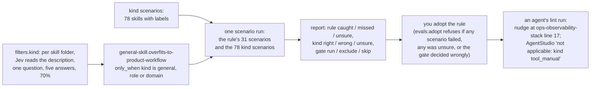

# Deliverable 3: one rule, end to end

## The problem

The engine can now ask each skill's kind once and gate a rule on the answer (sunstack 0.7.0), and #188 gave every rule scenarios, scenario runs outside git and your adoption file. But nothing uses the gate yet. So the product-workflow rule still judges the AgentStudio skill's own text as if it were a general skill, it stays held because nobody has adopted it, and an agent gets no nudge from it anywhere, including the one real leak it was written for: `ops-observability-stack` line 17, which sends agents into AgentStudio's own debug loop.

This deliverable takes that one rule all the way: gated by kind, its scenarios passing, adopted by you, nudging an agent at line 17, quiet on AgentStudio. The other rules follow in 3b once this path is proven.

## How it works after this deliverable

## An example

What an agent sees after you adopt the rule (from the scenarios, not a real run yet):

| Where | Kind answer | What the rule does |
| --- | --- | --- |
| `sunstack-dev/skills/ops-observability-stack/SKILL.md` line 17 | general, 0.91 | nudges: this routes the agent into one product's own workflow (AgentStudio's debug loop) |
| `agentstudio/skills/agentstudio/SKILL.md` | tool_manual, 0.95 | not applicable: kind tool_manual |
| a skill Jev is unsure about | below 0.70 | skipped and listed with Jev's answers; the run exits 5 |

## What changes

| Part | Change |
| --- | --- |
| Engine pin | `tests/skills` uses `@sunstack/cli` 0.7.0 (signed release) |
| Rules config | new `filters.kind`: `per: plugins/*/skills/{name}`, reads the `skill` piece's `description` in `SKILL.md`, Jev's one choice question with the five criteria, `min_probability` 0.7 |
| The rule | `general-skill.overfits-to-product-workflow` gets `only_when: {kind: [general, role, domain]}`; its question and bars are unchanged |
| Kind scenarios | new `tests/skills/evals/kind-filter/skill-kind.scenario.json`: the 78 skills from the experiment, pinned at `cbcaec0`, with their labels (independent labellers, your three rulings; `scaffold-project` and `audit-security-review` kept but unscored until you settle them) |
| The rule's scenarios | expectations follow the gate: three scenarios that said "must pass" in folders the gate excludes (`agentstudio`, `agent-collaboration`, and `practices-verification-maintenance` after your repo_specific ruling) now expect "not applicable", the gate's own outcome; the quiet result is the same, and nothing else changes |
| Scenario run | for a gated rule, `evals:scenarios <rule>` also runs the kind scenarios and reports both in one report |
| Adoption | `evals:adopt` refuses a gated rule unless that report's kind section has zero wrong gate decisions; changing the filter's question, criteria or bar holds the rule again (it's in the fingerprint already) |

## The filter's criteria: decided by one more measured run

You chose description only at 70%. The description-only numbers you saw used the round-1 criteria; your `gh` point ("gh is world standard") only exists in the round-2 criteria, which were measured with description plus opening. Description only with the round-2 criteria has never run, and it matters here: under the round-1 criteria, four of this rule's scenario folders were unsure (`peekaboo`, `domain-typescript`, `implementation-pr-wrapup`, `practices-verification-maintenance`), and a skipped scenario blocks adoption.

So the Jev Advisor runs description only with the round-2 criteria on the same 78 skills (round 3, commissioned 5 Nov). The shipped criteria are whichever of the two makes zero wrong gate decisions and leaves the fewest of this rule's scenarios skipped. If both leave scenarios skipped, that is a decision for you (better descriptions on those skills, or reading the opening too, which is an engine change), brought as a decision page, not a lowered bar or a per-skill override.

**Result (round 3, 5 Nov):** zero wrong gate decisions, 7 of the rule's 31 scenarios skipped (9 with the round-1 wording), so your wording ships. The 7 come from three skills whose descriptions don't say what they're for (`peekaboo`, `domain-decision-models`) or whose meaning is still open with you (`practices-verification-maintenance`): [your decision](../../d3-kind-skips-decision.html).

## The rule's trust evidence

Adopting the rule isn't enough on its own: a judged rule also needs a named reason, at least 3 real mistakes, 3 good texts and 3 near misses labelled by two independent agents, a held-back set frozen before its bars are tuned, and bars tuned from the development set (R18–R21). Its 31 old scenarios carry one settler's labels and no kind, so none count yet. This deliverable mines real scenarios from skill text, labels them blind, freezes a held-back set and tunes the bars.

## How we'll know it works

- The scenario run reports every rule scenario caught (the 31 old ones, re-labelled, and the mined ones), none unsure, and the kind section has zero wrong gate decisions.
- You adopt the rule with `evals:adopt`; it then nudges in a normal `pnpm --dir tests/skills rules` run at `ops-observability-stack/SKILL.md` line 17, and the AgentStudio skill shows "not applicable: kind tool_manual".
- An unsure folder is listed with Jev's answers and the run exits 5; nothing passes silently.
- Changing one word of the filter's criteria holds the adopted rule.
- The other 11 rules give the same results as before (they have no gate).

## Not in this deliverable

The other two general-skill rules, the branch rule's colon scenario, the kind meanings still open with you (domain vs subject review, repo_specific vs a portable practice, `scaffold-project`), and the skill kind's inline rule: 3b. The review evals: 4. The teaching skills: 5.

## Where it's defined

In the big design: [the engine feature](../../program-design.html#pd--the-engine-feature-filters), [scenario runs and adoption](../../program-design.html#pd--scenario-runs-and-the-adoption-file), [the whole config](../../program-design.html#pd--the-whole-config-after-this-change); needs [U13](../../requirements.html#req-skill-kinds--u13-the-kind-of-a-skill-is-what-its-work-is-for-judged-once), [U14](../../requirements.html#req-skill-kinds--u14-an-unsure-kind-is-skipped-and-listed), [U16](../../requirements.html#req-skill-kinds--u16-the-general-skill-rules-judge-general-skills-only-and-know-an-example-from-a-leak); obligations [R18](../../specification.html#spec-rule-tests--r18-a-judged-rule-nudges-only-after-its-floor)–[R21](../../specification.html#spec-rule-tests--r21-scenarios-are-real-skill-text). Experiment data: `memory-logs/…/jev-advisor/kind-experiment-round-2-2026-11-05.md` and round 3 when it lands. Plan: [deliverable 3's plan](../../d3-plan.html).
