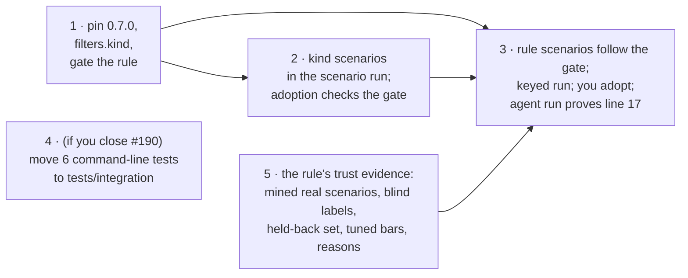

# Deliverable 3 plan: one rule, end to end

Three steps in ai-tools, one PR on `skills/one-rule-end-to-end` from main `24fa3d92`. A fourth, small step joins only if you say yes to closing #190. You adopt the rule; the PR waits for that before its last proof.

Design: [deliverable 3](../../d3-design.html). Planned at ai-tools main `24fa3d92`, engine sunstack 0.7.0. The owner merges and adopts. Tracking: none.

## The steps



## At a glance

| Step | What it does | How we'll know it worked | Waits on |
| --- | --- | --- | --- |
| 1 · Filter and gate | pins `@sunstack/cli` 0.7.0; adds `filters.kind` (criteria from the round-3 result); gives the product-workflow rule `only_when: {kind: [general, role, domain]}` | `rules --check` passes on 0.7.0; a lint run over `ops-observability-stack` and `agentstudio` asks Jev twice and reports general / tool_manual; the gated rule is no longer held as `needs_engine` | round 3's criteria choice |
| 2 · Kind scenarios and adoption | adds the 78 kind scenarios; a gated rule's scenario run also scores them (kind right / wrong / unsure, gate run / exclude / skip); `evals:adopt` refuses a gated rule with any wrong gate decision | keyless tests: a recorded report with one wrong exclusion is refused, a clean one is accepted, an unsure folder is listed and never counted as right | step 1 |
| 3 · Rule end to end | re-expects the rule's scenarios in excluded folders as "not applicable"; the Lead runs `evals:scenarios` for the rule (keyed); you adopt; a normal `rules` run is the proof | every scenario caught (the 31 old ones and the mined ones), none unsure, zero wrong gate decisions; after adoption the agent's printout nudges `ops-observability-stack/SKILL.md:17` and shows AgentStudio "not applicable: kind tool_manual" | steps 1, 2 and 5, your adoption, and your answer on the [skipped scenarios](../../d3-kind-skips-decision.html) |
| 5 · Trust evidence | the rule's record names its reasons; real scenarios are mined from skill text and labelled blind by two agents, at least 3 each of real mistake, good text and near miss for development, plus a held-back set frozen before the bars are tuned; the bars are tuned from the development set | the rule's derived state lacks nothing but your adoption (no `no_reason`, `floor`, `no_held_back`, `untuned_bar` or `held_back_not_independent`) | nothing (runs alongside 1 and 2) |
| 4 · Test layout (optional) | moves `tests/skills/lib/skill-rules/tests/*.test.ts` (6 files) to `tests/skills/tests/integration/`, the leftover of #190 | `pnpm --dir tests/skills test` passes with the same count | your yes on #190 |

## Detail for the agents: files, commands and proof for each step

### B1 · Filter and gate (vertical)

- **Reads:** this design; deliverable 1's design (config shape); engine 0.7.0 config reference (`sunstack lint --check` errors name the field); Jev Advisor rounds 2 and 3 reports (`memory-logs/…/jev-advisor/kind-experiment-round-{2,3}-2026-11-05.md`, `round-2-spec.json` / `round-3-spec.json` hold the exact question and criteria).
- **Writes:** `tests/skills/package.json` and lockfile (`@sunstack/cli` 0.7.0); `plugins/skill-authoring/skills/domain-skill-crafting/rules/skill-rules.config.json` (`filters.kind`, criteria copied byte-for-byte from the chosen spec, `min_probability` 0.7); `general-skill.rules.json` K002 (`only_when`).
- **Earns:** U13·R (one question per folder), U14 (unsure skipped and listed) by `pnpm --dir tests/skills rules -- --check` and one keyed lint run over two folders (Lead runs it through the key wrapper).
- **Stop:** the engine refuses the config shape (route to an engine gap, never bend the config); the criteria choice is not settled by round 3 (owner decision page).

### B2 · Kind scenarios in the scenario run; adoption checks the gate (contract)

- **Reads:** `tests/skills/lib/skill-rules/{scenarios,scenario-run,scenario-scoring,scenario-adoption,report}.ts`; the experiment's `round-2-corpus.json` (78 skills, paths, labels and provenance) and `label-disagreements.md`.
- **Writes:** `tests/skills/evals/kind-filter/skill-kind.scenario.json` (78 records: pinned source `self@cbcaec0d` `SKILL.md`, `expect: {kind}` or `unknown`, label basis `owner_decided` for the three rulings, `agents_agreed` for the 73 agreed, `disputed` for `scaffold-project` and `audit-security-review` (so 76 scored); `set` from the experiment's split); a kind-scenario schema and loader beside `scenarios.ts`; the scenario run, for a rule with `only_when`, runs the engine over the pinned kind-scenario `SKILL.md` files with the same config and scores `filter_answers` (exact kind; gate run / exclude / skip against the rule's `only_when`); the scenario report gains that section; `evals:adopt` refuses a gated rule unless the section is complete (all 78 kind scenarios answered; missing, incomplete or never asked blocks) with zero wrong run or wrong exclude decisions over the 76 labelled scenarios; a valid unsure answer is listed as a skip, never counted right or wrong, and does not block; the rule's own scenarios must all be caught with none unsure.
- **Earns:** R18 (gated adoption) by `pnpm --dir tests/skills test` and `typecheck`: recorded reports (one wrong exclusion → refused; unsure folder → listed, not right, not wrong; disputed → unscored; complete and clean → accepted).
- **Oracle:** the experiment's analyzer replays the gate algebra over the same labels; the analyzer scores 77 because it counts `audit-security-review` both ways, so compare with it at 76 (both disputed skills unscored); the new scorer must give the same counts on round 3's receipts.

### B3 · Rule end to end (vertical; consumer of B1 and B2)

- **Writes:** `tests/skills/evals/rule-scenarios/general-skill/general-skill.overfits-to-product-workflow.scenario.json`: the three scenarios in excluded folders that still say `must_pass` (`agentstudio` case-010, `agent-collaboration` case-011, `practices-verification-maintenance` acct-a46) expect `not_applicable`, each with a label note quoting why (the gate's kind, or your repo_specific ruling); the six already expecting `not_applicable` (acct-a40 and the five `peekaboo` scenarios) stay; after your adoption, `adopted.json` gets the entry `evals:adopt` writes.
- **Proof:** the Lead runs `pnpm --dir tests/skills evals:scenarios general-skill.overfits-to-product-workflow` through the key wrapper; the report shows every scenario caught and the kind section clean; you adopt; the Lead runs `pnpm --dir tests/skills rules` and reads the line-17 nudge and the AgentStudio exclusion in the printout.
- **Stop:** any scenario missed, false-nudged or unsure: bring the scenario and Jev's answers back, never edit an expectation to match a run.

### B5 · The rule's trust evidence (data; independent of the build)

- **Why:** `deriveRuleState` (`tests/skills/lib/skill-rules/rule-state.ts`) holds a judged rule unless its record names a reason, it has at least 3 eligible development scenarios of each kind (real mistake, good, near miss), at least one eligible held-back scenario frozen before the bars, and tuned bars citing development scenarios. Eligible means classified and labelled by someone other than one legacy settler. All 31 of this rule's scenarios are `legacy_independent` and `unclassified`, so none count today (Verifier, 5 Nov).
- **Mining (📚 Researcher, Sol, with Luna operators):** candidate passages from real skill text only: this repository's skills now and in Git history, sunstack-tools' skills, and the upstream collections in `ai-dev-skills`. Each candidate is a pinned source (repository, commit, path, lines). Target: at least 4 of each kind for development and at least 2 of each kind held back, so the floor holds after disputes drop out.
- **Labels:** two independent Luna labellers who see only the standard's text and the passage (never the rule's questions, Jev's answers or the other labeller): finding or not, and which kind. Agreed → `agents_agreed`; split → `disputed` and brought to you, never settled by the model. The 31 old scenarios are re-labelled the same way; each keeps its id.
- **Freeze and tune:** the held-back set is committed (its `frozen.commit`) before any bar is tuned; bars are tuned on the development set only, recorded with the scenario ids and the commit; the held-back set is then scored once.
- **Reasons:** the rule record cites the owner's keep decision (U10 and the reviews it names), the standard it rests on (`references/general-skill.md`, K002) and the 1 Nov run where it gave 9 wrong nudges of 11 on product skills (the reason the gate exists).
- **Earns:** R18–R21 for this rule: `pnpm --dir tests/skills test` (scenario file validation) and the keyed scenario run's summary showing the rule's state lacks only adoption.
- **Stop:** fewer than 3 agreed scenarios of a kind after labelling (bring the gap; never relabel to fill it).

### B4 · Test layout (repair; only with your yes on #190)

- Moves the six files with `git mv`, fixes imports, keeps `tests/skills/vitest.config.ts` globs covering `tests/integration`. Proof: the same test count before and after.

### Release bookkeeping

`skill-authoring` plugin version bump (the rules config ships in `domain-skill-crafting`), one changelog entry, README of `tests/skills` (new command behaviour). Codex/Claude cache refresh after merge.

## Canonical record

```text
plan path: docs/specs/2026-11-03-skill-rules/deliverables/3-one-rule-end-to-end/plan.md
originating planner: plan-implementation
planning result: ready once round 3 settles the criteria (B1 waits on it; B2 can start now)
governing planning basis:
  kind: reviewed-four-document-design
  ai-tools docs/specs/2026-11-03-skill-rules/ (reviewed to convergence, 0 open at 85ecf2c7/006e57e3), merged in #188 → main 24fa3d92; engine design sunstack-tools docs/specs/2026-11-04-owner-assessment/, released as 0.7.0 (00a0cad7)
delivery context:
  requested terminal: pr-ready-unmerged
  delivery grouping: single:one-rule-end-to-end
  PR topology: one PR on main (#188 merged, so nothing to stack on)
  repositories: ShravanSunder/sunstack (ai-tools)
```

## Changed from

**5 Nov, after the first commission (Lead):** the Verifier showed that adopting the rule alone can't make it nudge: its record and scenarios lack the trust evidence `deriveRuleState` requires. Step 5 adds it, using the mechanism the owner already agreed (R18–R21); B3 now waits on it. Round 3 (description only with the owner's `gh` wording) made zero wrong gate decisions and skipped 7 of the rule's 31 scenarios against 9 for the round-1 wording, so the round-2 criteria ship with the description-only instruction. The 7 skipped scenarios are an owner decision ([page](../../d3-kind-skips-decision.html)); only the final adoption waits on it.
