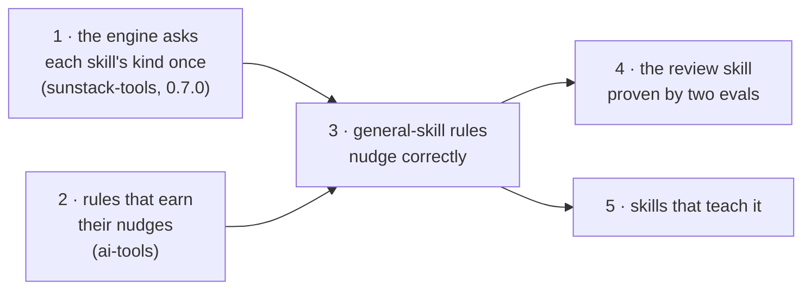

# Delivery map

The [big design](../index.html) is built in five deliverables. Each one is something you can see working. Each gets its own short design and its own plan when its turn comes; the ones not started yet are one line here.

| # | Deliverable | You can see | Waits on | Design | Plan |
| --- | --- | --- | --- | --- | --- |
| 1 | The engine asks each skill's kind once | a general-skill rule gives no result on a product skill, and says why; an unsure skill is listed | nothing | [design](../d1-design.html) | [plan](../d1-plan.html) |
| 2 | Rules that earn their nudges | the scenario report shows every rule's state and why; renames and drops done; runner tests on real skills | nothing | [design](../d2-design.html) | [plan](../d2-plan.html) |
| 3 | General-skill rules nudge correctly | a run over every skill nudges line 17 and stays quiet on product skills; real scenarios and blind labels entered; the five kinds' criteria written and checked against the census, with the skill kind switched to its inline rule; the branch rule's colon scenario decided (does naming a criterion defined elsewhere count as observable?) | 1 and 2 | when it starts | when it starts |
| 4 | The review skill proven by two evals | a Luna agent reviews #187 and PR166 and passes; a fake review fails | 3 | when it starts | when it starts |
| 5 | Skills that teach it | each teaching skill has its worked example | 3 | when it starts | when it starts |

Pull requests: open with the owner (one per deliverable as a stack, recommended, or deliverables 2–5 together in #188).
