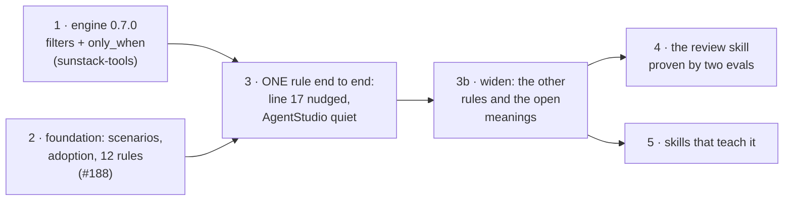

# Delivery map

The [big design](../index.html) is built in steps you can each see working. Re-sequenced on 5 Nov at the owner's go ("ok dkoesnt your seqkeueicin feel off ?" … "yes"): one rule end to end first, then widen. Each step gets its own short design and plan when it starts.

| # | Step | You can see | Waits on | Design | Plan |
| --- | --- | --- | --- | --- | --- |
| 1 | Engine 0.7.0 (released 5 Nov): inline ast-grep rules (done, `ad0acfd`), `filters`, `only_when`, one question per folder, report and exit codes | a gated rule gives no result on a folder whose answer it doesn't name, and says why; an unsure folder is listed | nothing (filter input: the description, one text field, owner 5 Nov) | [design](../d1-design.html) | [plan](../d1-plan.html) |
| 2 | Foundation (#188, merged 5 Nov): scenarios out of the skill, owner adoption, scenario runs outside git, 12 renamed rules, 5 evidence kinds | every judged rule is held until adopted; the scenario report shows why | its A6 check | [design](../d2-design.html) | [plan](../d2-plan.html) |
| 3 | One rule end to end: `filters.kind` (Jev's one question, five criteria, 70%, description only) + the kind scenarios (78 labelled skills, owner rulings) + `general-skill.overfits-to-product-workflow` gated `only_when: [general, role, domain]` with its real scenarios → scenario run → owner adopts | an agent's run nudges `ops-observability-stack` line 17 and stays quiet on the AgentStudio skill | 1 released and 2 merged (both done 5 Nov) | [design](../d3-design.html) | [plan](../d3-plan.html) |
| 3b | Widen: the other two general-skill rules; the branch rule's colon scenario (does naming a criterion defined elsewhere count?); the kind meanings (domain vs subject review, repo_specific vs portable practice, `scaffold-project`); the skill kind switched to its inline rule | the rest of the rules earn adoption one by one | 3 | when it starts | when it starts |
| 4 | The review skill proven by two evals | a Luna agent reviews #187 and PR166 and passes; a fake review fails | 3b | when it starts | when it starts |
| 5 | Skills that teach it | each teaching skill has its worked example | 3b | when it starts | when it starts |

Pull requests: one per step, stacked on #188 (owner, 4 Nov); the engine is its own repository's PR.
