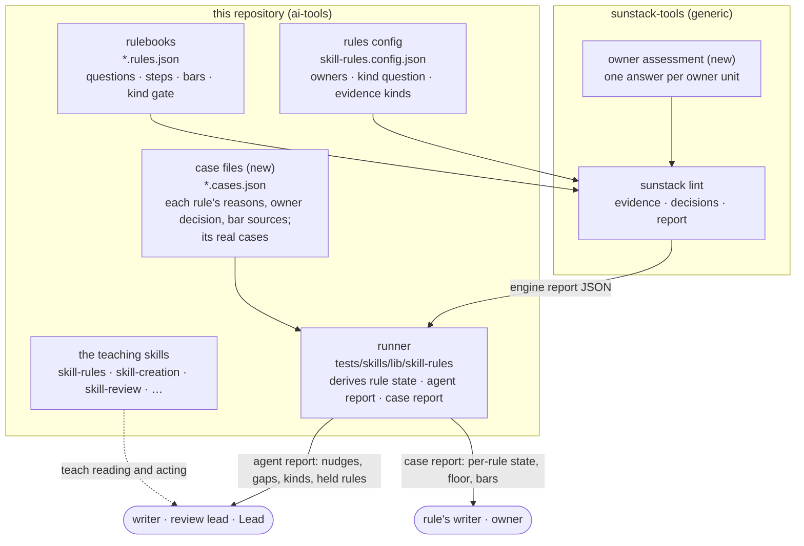
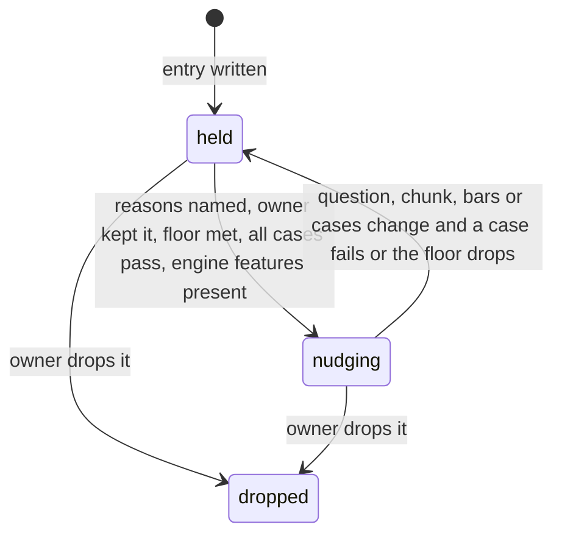

# Program Design: skill rules

3 Nov 2026. Author: 🦁 Lead. Status: draft, not reviewed. Answers to the [Specification](specification/index.md) (R1–R24, E1–E13). Base: #188 branch `3d8c207d`, engine `sunstack` v0.6.0 (`sunstack-tools` `1a87fd7`, whose engine source equals the v0.6.0 tag). One file: its parts share the rule files and the runner, so a change to either edits most sections.

## How it works, in one picture



**Who owns what.** The engine owns collection, model questions, decisions and the report, and knows nothing about skills (R5). This repository owns what a skill is (the owner units in config), the kind question, the rules, the cases and every rule's reason and owner decision. The runner owns one derived truth: each rule's state (`nudging` or `held`), computed from the owner's decision and the latest case results, and it is the only place an agent sees nudges.

## What exists today

| Behavior | Today, anchored | Changes / stays |
| --- | --- | --- |
| run rules on current skills | `pnpm --dir tests/skills rules` → `scripts/run-skill-rules.ts` → `lib/skill-rules/engine-runner.ts` spawns `sunstack lint` with `skill-rules.config.json` → `report.ts` `formatLintReport` prints nudges, unread gaps (`unreadGaps`, from `denominators.ts`) and cut gaps | stays; gains kinds, held rules, `kind unsure` gaps |
| run expectations | `pnpm --dir tests/skills rules:expect` → `scripts/run-rule-expectations.ts` → `expectation-run.ts` `runExpectations` checks each pinned case (`pinned-source.ts` extracts the file at its commit) → `expectation-scoring.ts` | changes: reads case files, reports per-rule floor, sets, bar sources, derived state |
| what a rule is | `*.rules.json` entries keyed by marker: `name`, `evidence`, `questions`, `decision.steps` with `min_probability` or `yes_at_or_above`/`no_at_or_below`, `severity` | gains a kind gate (engine feature); nothing else |
| what a case is | `*.expect.json` `expectations[]`: `id`, `rule`, `source{repository, commit, path}`, lines, `expect` (`must_fire` 28, `must_pass` 191, `not_applicable` 26), `kind` (`regression_example` 173, `worth_reading` 69, `breach` 3), `basis`, `decided_by{how: independent}`, `added` | replaced by `*.cases.json` (hard cutover); every expectation migrates |
| held-back set | 35 held-out cases frozen in `tests/skills/evals/rule-strata.json` (commit `74e18127`), labelled blind (`429a3a88`) | moves into each case's `set` |
| which skills a rule judges | none: every rule judges every file its evidence kind matches. `select` is noul-only and `as_kind` refuses selected kinds (the Advisor's 3 keyless probes on v0.6.0) | engine feature: owner assessment |
| nudge parts | v0.6.0 report: location, basis, related locations from canonical paths (`ad7dd96`), JSON lint with declared grammars (`2129d77`) | stays |

## The choice, and what it costs

**The crux** is where the one kind judgment per skill lives, so that every rule's gate can read it.

| Option | What it does | Gains | Costs | Verdict |
| --- | --- | --- | --- | --- |
| **A. Engine owner assessment** | the config declares owner units (a skill folder) and one assessment question; the engine asks it once per owner and gives each rule's gate the answer | one judgment per skill (78 calls at most, not one per rule and piece); every gate sees the same answer; unsure and missing owners are reported by the engine; no workaround | an engine feature and release first; this repository waits on it for kind-gated rules | **selected** |
| B. Runner filter after the run | the runner judges kinds itself, then drops results of rules on the wrong kinds | no engine change | the engine still runs every rule on product skills (cost); gates can't see the kind; the owner's standing rule forbids bending the runner around an engine gap | rejected |
| C. A kind question in every rule | each rule asks "what is this skill for" as its first step | no new feature | the same question asked per rule and piece (up to P calls instead of S); rules can disagree on one skill; a reference has no description to ask about | rejected |

The smaller structure suffices for everything else: the case files and the runner already exist and gain fields; no new store, service or command. **Debt we accept:** until the engine release lands, rules that declare kinds stay `held` (they don't run kind-gated). The rule's writer pays that in time. **Reopens the choice:** if one assessment per skill can't be made reliable from the description (the kind cases in V13 fail), the assessment's input must widen (to the skill's opening section) before any rule relies on it.

A second, smaller choice: **where a rule's reason, owner decision and bar sources live.** In the case file beside the rulebook (selected), because the case file is already this repository's own record of why a rule is trusted, and the engine must not carry skill metadata (R5). Rejected: a third file per rulebook (one more thing to keep in step), and engine-side metadata fields (the engine would store meaning it never uses).

## Where each entity lives

| E | Owner | Home (new / modified / existing) | Shape and boundary | Persisted? |
| --- | --- | --- | --- | --- |
| [E1 Skill](specification/entities.md#e1) | this repository's config | `skill-rules.config.json` `owners` (new section, engine-generic): `{ "skill": { "root": "plugins/*/skills/{owner}", "members": ["SKILL.md", "references/**/*.md"], "describe": { "kind": "skill", "field": "description" } } }` | owner id = `<plugin>/<skill>` captured from the path; crosses into the engine as an owner unit | persisted (config) |
| [E2 Standard](specification/entities.md#e2) | the standards' authors | existing: `K` markers in `domain-skill-crafting/references/*.md`, `domain-decision-models/SKILL.md` | marker id + `path:line` in every nudge (v0.6.0) | persisted |
| [E3 Rule](specification/entities.md#e3) | rulebook author (questions, bars) and owner (decision) | existing `*.rules.json` entry (modified: optional `requires`); new `*.cases.json` `rules[name]` record | see the rule record below | persisted |
| [E4 Mistake](specification/entities.md#e4) | the Lead, from the inventory and git | `*.cases.json` `rules[name].reasons[]` (new) | `{ type: "inventory" \| "commit" \| "pull_request" \| "written_standard", locator: string, quote?: string }` | persisted |
| [E5 Kind judgment](specification/entities.md#e5) | the engine (asks), the config (defines) | engine report `assessments[]` (new, engine); question in `skill-rules.config.json` `assessments.work_scope` (new) | `{ owner: string, assessment: string, state: "judged" \| "unsure" \| "incomplete", answer?: string, probability?: number, model: string }` | derived per run |
| [E6 Chunk](specification/entities.md#e6) | config evidence kinds | existing `evidence.kinds`; modified: `guidance` kind (new, whole guidance section) replaces `sentence` for `guidance.positive`; `section` gains table rows | v0.6.0 piece + `evidence_seen` + cut flag | derived per run |
| [E7 Nudge](specification/entities.md#e7) | the engine | existing v0.6.0 report result | existing | derived per run |
| [E8 Case](specification/entities.md#e8) | the Lead (labels), the owner (disputes) | `*.cases.json` `cases[]` (new file, replaces `*.expect.json`) | see the case record below | persisted |
| [E9 Bar](specification/entities.md#e9) | rulebook author | values: existing step fields in `*.rules.json`; sources: `*.cases.json` `rules[name].bars[step]` (new) | `{ status: "starting" \| "tuned", cases: string[] }` | persisted |
| [E10 Gap](specification/entities.md#e10) | the runner (unread, held), the engine (cut, unresolved, kind unsure) | `report.ts` `ReportGaps` (modified: gains `kindUnsure`, `noOwner`) | closed variant below | derived per run |
| [E11 Behavior-test candidate](specification/entities.md#e11) | the Lead | `tests/skills/evals/behavior-candidates.json` (new; a list, nothing runs it) | `{ id, episode, records: string[], behavior: string, teaching_rule?: string }` | persisted |
| [E12 Disposition](specification/entities.md#e12) | the agent acting on the nudge | existing reporting surfaces taught by the skills (self-check, review findings, acceptance); modified teaching | text: rule, place, disposition, what was checked | in the agent's report |
| [E13 Run](specification/entities.md#e13) | engine (exit), runner (state) | existing `engine-runner.ts`, `report.ts` | existing exit statuses (uncertain = 5) | derived |

### The rule record and the case record (`*.cases.json`)

TypeScript with zod, as the runner's existing schemas (`report.ts`, `expectations.ts`) are:

```ts
const ownerDecision = z.enum(["keep", "rework_first", "held_by_owner", "dropped", "undecided"]);
const reason = z.object({
  type: z.enum(["inventory", "commit", "pull_request", "written_standard"]),
  locator: z.string().min(1),          // SM017, a commit sha, a PR URL, or a K marker
  quote: z.string().optional(),        // the owner's exact words when type is inventory
});
const barSource = z.object({ status: z.enum(["starting", "tuned"]), cases: z.array(z.string()) });
const ruleRecord = z.object({
  basis: z.enum(["mechanical", "judged"]),
  decision: ownerDecision,
  decided: z.string(),                 // where the owner decided it: review id or date
  reasons: z.array(reason),
  bars: z.record(z.string(), barSource), // step name → where its bars came from
});

const caseRecord = z.object({
  id: z.string(),
  rule: z.string(),
  source: z.object({ repository: z.string(), commit: z.string().regex(/^[0-9a-f]{40}$/), path: z.string() }),
  lines: z.object({ piece_first: z.number().int(), field: z.number().int().optional() }),
  expect: z.enum(["must_fire", "must_pass", "not_applicable"]),
  case_kind: z.enum(["real_mistake", "good", "near_miss", "unclassified"]),
  set: z.enum(["development", "held_back"]),
  fix_pair: z.string().optional(),     // shared by a fix's before and after
  label: z.object({
    basis: z.enum(["owner_fix", "owner_words", "agents_agreed", "owner_decided"]),
    state: z.enum(["labelled", "disputed"]),
    who: z.array(z.string()),
    note: z.string(),
  }),
  added: z.string(),
});
const casesFile = z.object({ rules: z.record(z.string(), ruleRecord), cases: z.array(caseRecord) });
```

`unclassified` exists only for migrated expectations not yet adjudicated by the case mining; it counts toward no floor. `expect` keeps today's three values; `case_kind` is new and separate (a good text and a near miss are both `must_pass`).

### The derived rule state (runner)

```ts
type RuleState =
  | { state: "nudging" }
  | { state: "held"; lacks: HeldReason[] }
  | { state: "dropped" };
type HeldReason =
  | { kind: "no_reason" }                                     // R1
  | { kind: "owner"; decision: "rework_first" | "held_by_owner" | "undecided" } // R2
  | { kind: "floor"; case_kind: "real_mistake" | "good" | "near_miss"; have: number; need: 3 } // R18
  | { kind: "no_held_back" }                                  // R18
  | { kind: "failing"; set: "development" | "held_back"; cases: string[] } // R18
  | { kind: "split_fix_pair"; fix_pair: string }               // R18
  | { kind: "needs_engine"; feature: "owner_assessment" };      // R14 before the release
```

Mechanical rules (`basis: "mechanical"`) are `nudging` once they name a `written_standard` reason and the owner kept them; floor and held-back reasons apply to judged rules only.

### The engine feature: owner assessment

Its full design is a separate Program Design part in `sunstack-tools`; this is the contract this repository needs from it, in generic terms.

- **Config:** `owners.<unit>` declares how checked files group into owner units (a root pattern with one capture, member patterns, and which evidence kind and field describe the owner). `assessments.<name>` declares one choice question about an owner unit's description, its options, `min_probability`, and the decision model.
- **Rule gate:** a rule entry may declare `requires: { "assessment": "<name>", "accept": ["<option>", …] }`. Before its steps, the engine reads the owner's answer. `accept` contains the answer → steps run. Answer outside `accept` → `not_applicable`, reason `assessment:<answer>`. `unsure` or `incomplete` → no result for that rule on that owner, and the report lists it.
- **Report:** `assessments[]` (E5's shape), and per gated rule the owners excluded by answer and those skipped as unsure.
- **Guarantees:** each owner is asked once per run; a reference file reaches its owner's answer through `members`; a file matching no owner gets no answer, and gated rules report it as a `no owner` gap; the answer is bound to the run (source revision, question, model), never cached across runs.

Our config sets `assessments.work_scope` with options `any_repository`, `one_tool_or_platform`, `one_app_procedures`, and the question wording from [U13](requirements/skill-kinds.md#u13).

## The rules after this change

| Rule (entry) | Evidence | Gate | Change |
| --- | --- | --- | --- |
| `description.opener`, `.length-warning`, `.length-limit` | `skill` | none | case record only (mechanical) |
| `description.loading-moment`, `.trigger-only`, `.always-earned` | `skill` | none (R16) | cases from history; `always-earned` `held_by_owner` |
| `product-leak` (was `placement.product-workflow`, K003 in calls-and-placement) | `section` with table rows and loaded openings | `work_scope ∈ {any_repository}` | renamed; cases from U16's rows; quiet cases from general skills |
| `product-leak.description` (was `description.product-loading`, K007) — *if A-2 accepted* | `skill` | `work_scope ∈ {any_repository}` | renamed into the product-leak standard; otherwise stays as is, held |
| `rule.generalization` (K001 generalization) — *merged into `product-leak`'s body question if A-2 accepted* | `section` | `work_scope ∈ {any_repository}` | redone with its filter (owner) |
| `call.completeness`, `branch.condition` | `load`, `branch` | none | cases from history |
| `reference.teaching-depth`, `main-path.spine`, `completion.criterion` | `reference_section`, `skill_body`, `step` | none | `rework_first`: evidence fix (R24), then cases |
| `guidance.positive` | `guidance` (new: whole guidance section) | none | evidence fix (R24), then cases |
| `question.names-field` | — | — | dropped: entry and marker removed |
| `question.one-proposition`, `question.criteria-match` | `rule_question` | none | `held_by_owner` until old rule files give cases |

## The path from line 17 to the agent

```mermaid
sequenceDiagram
  participant A as agent (writer)
  participant R as runner (run-skill-rules.ts)
  participant L as sunstack lint
  participant J as decision model
  A->>R: pnpm --dir tests/skills rules
  R->>L: lint with skill-rules.config.json
  L->>J: work_scope? ops-observability-stack description (once)
  J-->>L: any_repository, with how sure
  L->>L: product-leak gate: accept → run steps
  L->>J: section piece with line 17 + agentstudio-loop.md opening
  J-->>L: routes into one product's own workflow
  L-->>R: report JSON: result warn, judged, related places; assessments[]
  R->>R: derive rule states from *.cases.json + last case run
  R-->>A: nudge at SKILL.md:17 (product-leak is nudging); kinds; gaps; held rules
  A->>A: read places, decide; record disposition (R11)
```

*Current path:* the same up to `lint`, minus the assessment and gate; the runner prints every rule's results, held or not. *Added edges:* the assessment call, the gate, the runner's state derivation and held filter. *Unchanged and critical:* severity `warn` for judged paths, and the engine's exit statuses.

## A rule's states



Owner: the runner derives the state on every run from the case file and the last case run; nobody writes it. Illegal: `nudging` with a failing case or a disputed case counted (the derivation can't produce it); a held rule's result in the agent report (the report filters by state).

## When things go wrong

| Failure | Detected by | What happens | Owner |
| --- | --- | --- | --- |
| the decision model is unreachable or malformed for an owner | engine | assessment `incomplete`; gated rules give no result for that owner; the run is `incomplete` | engine |
| an owner's answer is below its bar | engine | `unsure`; gated rules skip it; `kind unsure` gap (R15) | engine |
| a checked file belongs to no owner | engine | `no owner` gap for gated rules on that file | engine |
| a case's commit or path no longer resolves | runner (`pinned-source.ts`) | case reported broken; its rule `held` (`failing`) | runner |
| a fix pair's two cases sit in different sets | runner | rule `held` (`split_fix_pair`) | runner |
| the engine release lacks owner assessment | runner (config check fails or report lacks `assessments`) | gated rules `held` (`needs_engine`) | runner |

No concurrency: a run is one process over one commit. No migration of stored user data; the `*.expect.json` → `*.cases.json` cutover is a one-time, reviewed rewrite in the same pull request, every expectation kept.

## Cross-cutting

- **Cost:** one assessment per skill per run (at most 78 on today's tree), against up to one per rule and piece under option C. Measured, not claimed, in Verification Design.
- **Public repository:** case reasons may quote the owner's words and cite local paths (owner's standing rule); no credentials, account details or private notes. The OpenRouter key stays in the existing runner wrapper.
- **Security, privacy beyond that, accessibility, performance targets:** not applicable; nothing user-facing or networked changes.

## The skills that teach it

| Skill (run) | Teaches | Requirements |
| --- | --- | --- |
| `skill-rules` | the making order: mistake → standard → kinds → chunk → cases → tree → bars → gate; the case file; reading the case report; #187 worked example | R1, R2, R13–R24, R12 |
| `domain-decision-models` | rule-file standards (two things asked; criteria mismatch); `names-field` removed | R4 |
| `decision-model-review` | reviewing a rule: its reason, cases, bars' sources, chunk size | R18–R22 |
| `skill-creation` | the writer's self-check: run rules, read nudges, record dispositions | R6–R11 |
| `skill-review` | the review lead's first pass: nudges as leads, dispositions, gaps | R6–R11 |
| `skill-design` | a skill design names which rules will judge the change | R12 |
| `domain-skill-crafting` | the product-leak standard and U16's cases; the kind words | R17 |
| `skill-orchestrator` | assessing a writer's dispositions before review | R11 |
| `skill-audit` | reading kinds and nudges read-only | R13 |

## Trace

| U | R | E | Owner | Interface | Shape and home | State | Failure | Proof seam |
| --- | --- | --- | --- | --- | --- | --- | --- | --- |
| U9 | R1 | E3, E4 | runner | rule state derivation | `ruleRecord.reasons` in `*.cases.json` | `held: no_reason` | no reason → held | case report per rule |
| U10 | R2 | E3 | owner via case file | `ruleRecord.decision` | `ownerDecision` enum | held / dropped | undecided → held | case report vs U10 |
| U12 | R3 | E4, E11 | Lead | list file | `behavior-candidates.json` | listed | — | inventory vs list |
| U8 | R4 | E3, E7 | rulebook `domain-decision-models` | lint over `*.rules.json` (v0.6.0 JSON lint) | existing `rule_question` kind | — | JSON parse failure isolated (v0.6.0) | real rule-file cases |
| U11 | R5 | none: engine boundary | engine | owner assessment config + `requires` | generic config sections | — | — | engine diff and release |
| U1 | R6 | E7, E2 | engine | v0.6.0 report | existing result | — | — | line-17 run |
| U2 | R7 | E7 | rulebook routes | route `finding` text | existing | — | — | routes' text |
| U3 | R8 | E10, E13 | runner + engine | `ReportGaps` | closed gap variant | — | — | silent-coverage case |
| U4 | R9 | E13 | engine + runner | exit status | existing (uncertain = 5) | run states | invalid/cancelled/incomplete reported | exit codes |
| U5 | R10 | none: teaching | skills | skill text | — | — | — | skills' text |
| U6 | R11 | E12 | agents, taught by skills | reporting surfaces | disposition text | E12 states | narrow fix not `fixed` | skills' text; #187 |
| U7 | R12 | none: teaching | skills | skill text | — | — | — | skills' text |
| U13 | R13 | E1, E5 | engine (asks), config (defines) | owner assessment | `assessments[]` | judged / unsure / incomplete | incomplete → run incomplete | kind cases on every skill |
| U13 | R14 | E3, E5 | engine gate | `requires` | `{assessment, accept}` | — | outside accept → not_applicable | 1 Nov product-skill nudges |
| U14 | R15 | E5, E10 | engine + runner | gap list | `kindUnsure` gap | unsure | skip + list | boundary skills |
| U15 | R16 | E1 | rulebook | no `requires` on description rules | — | — | — | hidden skills' results |
| U16 | R17 | E3, E5 | rulebooks calls-and-placement (+ descriptions, generalization if A-2) | `product-leak` entries | rule entries + cases | per rule | — | U16's rows as cases |
| U17 | R18 | E3, E8 | runner | rule state derivation | `RuleState`, `HeldReason` | held / nudging | broken case → held | case report |
| U17 | R19 | E8 | Lead; owner for disputes | `caseRecord.label` | enum basis + state | labelled / disputed | disputed counts toward nothing | case report |
| U18 | R20 | E9 | rulebook author | step bar fields + `ruleRecord.bars` | `barSource` | starting / tuned | — | case report; no override key in schema |
| U19 | R21 | E8 | runner | `pinned-source.ts` | `caseRecord.source` | — | unresolvable → held | case resolution |
| U20 | R22 | E6 | config evidence kinds | evidence kind declaration | existing kinds | — | cut reported | rule files; report |
| U21 | R23 | E6 | config `section` kind | piece building | `section` with table rows | — | — | lines 17 and 40 |
| U22 | R24 | E6 | config | `guidance` kind | new evidence kind | — | — | 30 Oct guidance dispositions |

## Order of work

1. Engine: owner assessment and `requires`, released (its own design and PR in `sunstack-tools`).
2. This repository: `*.cases.json` cutover with every expectation migrated; runner state derivation and held filter; evidence fixes (`guidance`, table rows); `names-field` removed; product-leak rename; mined cases added; config `owners` and `work_scope` once the release is pinned.
3. The teaching skills (the table above).

## Deviations and unresolved

- A-2 (merge into product-leak) and A-3 (labelled example line) are proposed; the rule table shows both outcomes.
- The engine feature's internal design is not here; it is owed as `sunstack-tools`' own Program Design part.
- The case mining is in flight; until it lands, migrated expectations are `unclassified` and judged rules stay `held` on the floor.
