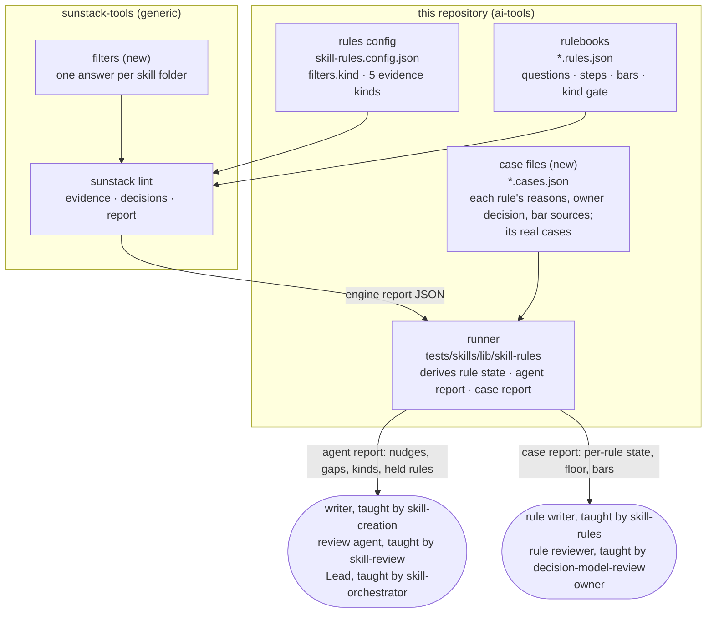
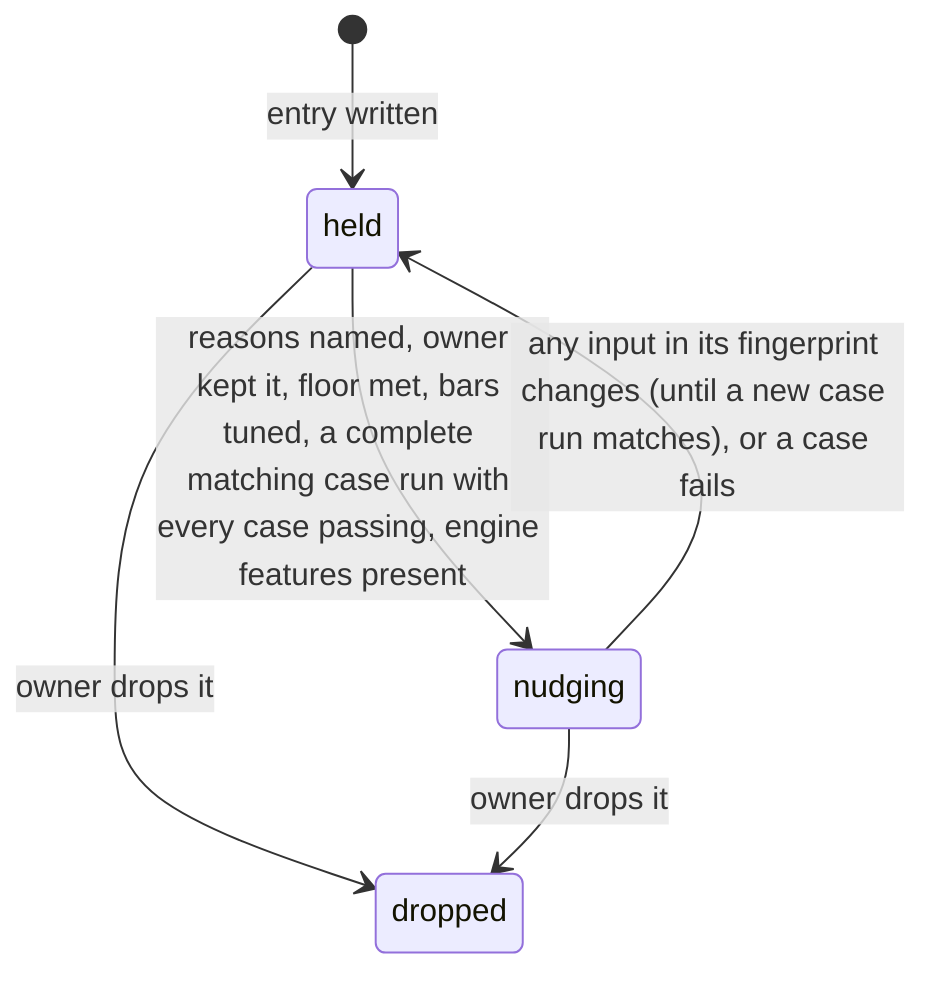
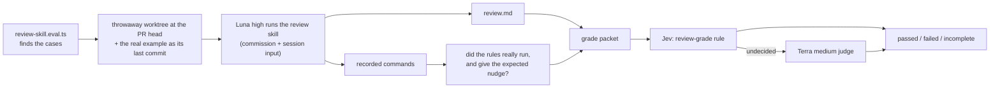

# Program Design: skill rules

3 Nov 2026. Author: 🦁 Lead. Status: draft, not reviewed. Answers to the [Specification](specification/index.md) (R1–R24, E1–E13). Base: #188 branch `3d8c207d`, engine `sunstack` v0.6.0 (`sunstack-tools` `1a87fd7`, whose engine source equals the v0.6.0 tag). One file: its parts share the rule files and the runner, so a change to either edits most sections.

## How it works, in one picture



**Who owns what.** The engine owns collection, model questions, decisions and the report, and knows nothing about skills (R5). This repository owns what a skill is (the `filters.kind.per` folder pattern in config), the kind question, the rules, the cases and every rule's reason and owner decision. The runner owns one derived truth: each rule's state (`nudging` or `held`), computed from the owner's decision and the latest case results, and it is the only place an agent sees nudges.

## What exists today

| Behavior | Today, anchored | Changes / stays |
| --- | --- | --- |
| run rules on current skills | `pnpm --dir tests/skills rules` → `scripts/run-skill-rules.ts` → `lib/skill-rules/engine-runner.ts` spawns `sunstack lint` with `skill-rules.config.json` → `report.ts` `formatLintReport` prints nudges, unread gaps (`unreadGaps`, from `denominators.ts`) and cut gaps | stays; gains kinds, held rules, `kind unsure` gaps |
| run expectations | `pnpm --dir tests/skills rules:expect` → `scripts/run-rule-expectations.ts` → `expectation-run.ts` `runExpectations` checks each pinned case (`pinned-source.ts` extracts the file at its commit) → `expectation-scoring.ts` | changes: reads case files, reports per-rule floor, sets, bar sources, derived state |
| what a rule is | `*.rules.json` entries keyed by marker: `name`, `evidence`, `questions`, `decision.steps` with `min_probability` or `yes_at_or_above`/`no_at_or_below`, `severity` | gains a kind gate (engine feature); nothing else |
| what a case is | `*.expect.json` `expectations[]`: `id`, `rule`, `source{repository, commit, path}`, lines, `expect` (`must_fire` 28, `must_pass` 191, `not_applicable` 26), `kind` (`regression_example` 173, `worth_reading` 69, `breach` 3), `basis`, `decided_by{how: independent}`, `added` | replaced by `*.cases.json` (hard cutover); every expectation migrates |
| held-back set | none today. The 35 cases once held out (`74e18127`, blind-labelled in `429a3a88`) were migrated by the accepted D24 amendment into the expectation files as regression examples, and `rule-strata.json` was removed; each says it "is a regression example, not a fresh holdout" (e.g. `calls-and-placement.expect.json:172`) | every current case migrates as `development`; a new held-back group is frozen before any bar is tuned |
| which skills a rule judges | none: every rule judges every file its evidence kind matches. `select` is noul-only and `as_kind` refuses selected kinds (the Advisor's 3 keyless probes on v0.6.0) | engine feature: filters |
| nudge parts | engine v0.6.0: each finding carries location, basis, answers and path, and related places built from the standard's line and the piece's declared fields (`report_contracts.rs:73–105`, `outcome.rs:189–229`); it never joins other results. The runner's `formatLintReport` (`report.ts:347–377`) prints message, basis, anchor and read places only | the runner's formatter gains the standard's wording, the answers and path, the cut flag and the same rule's nudges elsewhere; the engine is unchanged for this |

## The choice, and what it costs

**The crux** is where the one kind judgment per skill lives, so that every rule's gate can read it.

| Option | What it does | Gains | Costs | Verdict |
| --- | --- | --- | --- | --- |
| **A. Engine filters** | the config declares one filter: `per` a skill folder, `reads` its description, one choice question; the engine asks it once per folder and gives each rule's `only_when` gate the answer | one judgment per skill (78 calls at most, not one per rule and piece); every gate sees the same answer; unsure answers and files in no folder are reported by the engine; no workaround | an engine feature and release first; this repository waits on it for kind-gated rules | **selected** |
| B. Runner filter after the run | the runner judges kinds itself, then drops results of rules on the wrong kinds | no engine change | the engine still runs every rule on product skills (cost); gates can't see the kind; the owner's standing rule forbids bending the runner around an engine gap | rejected |
| C. A kind question in every rule | each rule asks "what is this skill for" as its first step | no new feature | the same question asked per rule and piece (up to P calls instead of S); rules can disagree on one skill; a reference has no description to ask about | rejected |

The smaller structure suffices for everything else: the case files and the runner already exist and gain fields; no new store, service or command. **Debt we accept:** until the engine release lands, rules that declare kinds stay `held` (they don't run kind-gated). The rule's writer pays that in time. **Reopens the choice:** if one answer per skill can't be made reliable from the description (the kind cases in V13 fail), the filter's `reads` must widen (to the skill's opening section) before any rule relies on it.

A second, smaller choice: **where a rule's reason, owner decision and bar sources live.** In the case file beside the rulebook (selected), because the case file is already this repository's own record of why a rule is trusted, and the engine must not carry skill metadata (R5). Rejected: a third file per rulebook (one more thing to keep in step), and engine-side metadata fields (the engine would store meaning it never uses).

## Where each entity lives

| E | Owner | Home (new / modified / existing) | Shape and boundary | Persisted? |
| --- | --- | --- | --- | --- |
| [E1 Skill](specification/entities.md#e1-skill) | this repository's config | `skill-rules.config.json` `filters.kind` (new section, engine-generic): `{ "per": "plugins/*/skills/{name}", "reads": { "file": "SKILL.md", "kind": "skill", "field": "description" }, "question": …, "min_probability": 0.7 }`; every checked file under the folder is a member | folder = `plugins/<plugin>/skills/<skill>`, `{name}` its display name; crosses into the engine as a filter folder | persisted (config) |
| [E2 Standard](specification/entities.md#e2-standard) | the standards' authors | existing: `K` markers in `domain-skill-crafting/references/*.md`, `domain-decision-models/SKILL.md` | marker id + `path:line` in every nudge (v0.6.0) | persisted |
| [E3 Rule](specification/entities.md#e3-rule) | rulebook author (questions, bars) and owner (decision) | existing `*.rules.json` entry (modified: optional `only_when`); new `*.cases.json` `rules[name]` record | see the rule record below | persisted |
| [E4 Mistake](specification/entities.md#e4-mistake) | the Lead, from the inventory and git | `*.cases.json` `rules[name].reasons[]` (new) | `{ type: "inventory" \| "commit" \| "pull_request" \| "written_standard", locator: string, quote?: string }` | persisted |
| [E5 Kind judgment](specification/entities.md#e5-kind-judgment) | the engine (asks), the config (defines) | engine report `filter_answers[]` (new, engine); question in `skill-rules.config.json` `filters.kind.question` (new), criteria `general`, `role`, `domain`, `tool_manual`, `repo_specific` | `{ filter: "kind", folder: string, state: "judged" \| "unsure" \| "incomplete", answer?: string, probability?: number, model: string }` | derived per run |
| [E6 Chunk](specification/entities.md#e6-chunk) | config evidence kinds | existing `evidence.kinds`, trimmed from 12 to 5 (`skill`, `section`, `load`, `branch`, `rule_question`); modified: `load` and `branch` read their enclosing heading instead of a `step`; `branch` gains a colon block; `section` gains table rows | v0.6.0 piece + `evidence_seen` + cut flag | derived per run |
| [E7 Nudge](specification/entities.md#e7-nudge) | the engine (result), the runner (what the agent reads) | existing v0.6.0 finding; modified `report.ts` `formatLintReport` | the nudge rendering below | derived per run |
| [E8 Case](specification/entities.md#e8-case) | the Lead (labels), the owner (disputes) | `*.cases.json` `cases[]` (new file, replaces `*.expect.json`) | see the case record below | persisted |
| [E9 Bar](specification/entities.md#e9-bar) | rulebook author | values: existing step fields in `*.rules.json`; recorded values and sources: `*.cases.json` `rules[name].bars[step]` (new) | `barSource` below | persisted |
| [E10 Gap](specification/entities.md#e10-gap) | the runner (unread, held), the engine (cut, unresolved, kind unsure, no folder) | existing `report.ts` `ReportGaps` (modified, no parallel schema) | `Gap` below | derived per run |
| [E11 Behavior-test candidate](specification/entities.md#e11-behavior-test-candidate) | the Lead | `tests/skills/evals/behavior-candidates.json` (new; a list, nothing runs it) | `{ id, episode, records: string[], behavior: string, teaching_rule?: string }` | persisted |
| [E12 Disposition](specification/entities.md#e12-disposition) | the agent acting on the nudge | existing reporting surfaces taught by the skills (self-check, review findings, acceptance); modified teaching | text: rule, place, disposition, what was checked | in the agent's report |
| [E13 Run](specification/entities.md#e13-run) | engine (exit), runner (state) | existing `engine-runner.ts`, `report.ts` | existing exit statuses (uncertain = 5) | derived |
| [E14 Eval](specification/entities.md#e14-eval) | the eval entry | `tests/skills/evals/review-skill.eval.ts` (new) and `evals/review-skill/` (new) | `reviewEvalCase` in, verdict `passed \| failed \| incomplete` out (see The two evals) | cases persisted; runs derived |

### The rule record and the case record

Both live in the new `*.cases.json` beside each rulebook.

TypeScript with zod, as the runner's existing schemas (`report.ts`, `expectations.ts`) are:

```ts
const ownerDecision = z.enum(["keep", "rework_first", "held_by_owner", "dropped", "undecided"]);
const reason = z.object({
  type: z.enum(["inventory", "commit", "pull_request", "written_standard"]),
  locator: z.string().min(1),          // SM017, a commit sha, a PR URL, or a K marker
  quote: z.string().optional(),        // the owner's exact words when type is inventory
});
const barValues = z.object({ yes_at_or_above: z.number().optional(), no_at_or_below: z.number().optional(), min_probability: z.number().optional() });
const barSource = z.object({
  status: z.enum(["starting", "tuned"]),
  values: barValues,                   // the values the cases justified; must equal the step's current values
  cases: z.array(z.string()),          // development case ids only
  recorded_at: z.string().regex(/^[0-9a-f]{40}$/), // the commit where these values were set
});
const ruleRecord = z.object({
  basis: z.enum(["mechanical", "judged"]),
  decision: ownerDecision,
  decided: z.string(),                 // where the owner decided it: review id or date
  reasons: z.array(reason),
  bars: z.record(z.string(), barSource), // step name → where its bars came from
});

const positiveLine = z.number().int().positive();
const caseRecord = z.object({
  id: z.string(),                      // kept from the old expectation
  rule: z.string(),
  source: z.object({
    repository: z.string(),
    commit: z.string().regex(/^[0-9a-f]{40}$/),
    path: z.string(),
    context: z.array(z.string()).min(1), // what is pinned with it at the same commit (loaded files; the owner's SKILL.md for a reference)
  }),
  select: z.object({ piece_first_line: positiveLine.optional(), field_line: positiveLine.optional() }).optional(), // which piece, only when the file has several
  expect: z.enum(["must_fire", "must_pass", "not_applicable", "unknown"]),
  finding_lines: z.array(positiveLine).min(1).optional(), // required for must_fire, absent otherwise; a finding elsewhere is a wrong locator, reported apart
  kind: z.enum(["breach", "worth_reading", "regression_example"]), // kept as today
  case_kind: z.enum(["real_mistake", "good", "near_miss", "unclassified"]),
  status: z.enum(["active", "retired"]),   // retired: its rule was dropped; kept for history, never run, counts toward nothing
  retired_because: z.string().optional(),  // required when retired: the owner's drop, quoted
  set: z.enum(["development", "held_back"]),
  frozen: z.object({ commit: z.string().regex(/^[0-9a-f]{40}$/), date: z.string() }).optional(), // required for held_back
  fix_pair: z.string().optional(),     // shared by a fix's before and after
  label: z.object({
    basis: z.enum(["owner_fix", "owner_words", "agents_agreed", "owner_decided", "legacy_independent"]),
    state: z.enum(["labelled", "disputed"]),
    who: z.array(z.string()),
    note: z.string(),
  }),
  added: z.string(),
});
const casesFile = z.object({ rules: z.record(z.string(), ruleRecord), cases: z.array(caseRecord) });
```

`unclassified` exists only for migrated expectations not yet adjudicated by the case mining; it counts toward no floor, and neither does `expect: unknown`. `legacy_independent` keeps an old label's history as it was (some were blind labels that agreed, some were settled by an independent agent after the labellers disagreed); it counts toward no floor until the case is labelled again under R19. `expect`, `kind`, the selector and the finding lines keep today's meaning; `case_kind` is new and separate (a good text and a near miss are both `must_pass`).

**Migration, one format, no compatibility reader.** Each old expectation becomes one case with the same `id`, `rule`, `source` (with its `context`), `expect` and `kind`; `piece_first_line`/`field_line` → `select`; `lines` → `finding_lines`; `basis` → `label.note`; `decided_by.who` → `label.who`; `decided_by.how: independent` → `label.basis: legacy_independent`, `label.state: labelled`, keeping `who` (blind labellers, and any independent settler) and the original note word for word; `case_kind: unclassified`; `set: development` for every one, since all current cases are exposed regression material; `added` kept. The migration is checked by comparing every old entry with its new one (Verification Design, OD).

**Rule names in the migration.** A migrated case keeps its identity, labels, sources and expected behavior; its `rule` is translated by this map, the one place old names live. Case runs, receipts and reports use only current names.

| Old name | Current name |
| --- | --- |
| `description.opener` | `skill-description.starts-with-use-when` |
| `description.length-warning` | `skill-description.longer-than-225-characters` |
| `description.length-limit` | `skill-description.longer-than-300-characters` |
| `description.loading-moment` | `skill-description.names-the-loading-moment` |
| `description.trigger-only` | `skill-description.states-triggers-not-workflow-steps` |
| `placement.product-workflow` | `general-skill.overfits-to-product-workflow` |
| `description.product-loading` | `general-skill.description-overfits-to-one-product` |
| `rule.generalization` | `general-skill.taught-rule-overfits-to-one-project` |
| `call.completeness` | `load-call.names-when-where-and-result` |
| `branch.condition` | `skill-branch.names-an-observable-condition` |
| `question.one-proposition` | `rule-question.asks-exactly-one-thing` |
| `question.criteria-match` | `rule-question.criteria-answer-the-same-question` |

A case whose rule was dropped (`question.names-field`, `description.always-earned`, `reference.teaching-depth`, `guidance.positive`, `main-path.spine`, `completion.criterion`) migrates with `status: retired` and `retired_because` quoting the owner's drop; the case run skips it, and it counts toward no floor.

**A held-back case** carries `frozen`: the commit that froze its group. That commit must come before every `bars[*].recorded_at` of its rule, and no held-back id may appear in any `bars[*].cases`. Otherwise the rule is held.

### The case-run receipt

A new committed file, `*.case-run.json`, beside each rulebook.

Written only by `rules:expect` beside each rulebook, so an ordinary run (no model key needed for this check) can tell whether a rule's current definition passed its cases:

```ts
const caseRunReceipt = z.object({
  engine_version: z.string(),
  model: z.string(),
  complete: z.boolean(),               // false when the run was cancelled, incomplete or any case errored
  rules: z.record(z.string(), z.object({
    fingerprint: z.string(),           // sha256 over the rule's inputs, below
    development: z.object({ passed: z.number(), failed: z.array(z.string()), unsure: z.array(z.string()) }),
    held_back: z.object({ passed: z.number(), failed: z.array(z.string()), unsure: z.array(z.string()) }),
  })),
});
```

A rule's fingerprint covers, conservatively, everything that can change what its cases collect or how they are judged: its rulebook entry (questions, decision, bars, severity, `only_when`); the whole rules config file (every evidence kind, so kinds it reads through `within`, `same_file` or `target`, inline ast-grep rules, `filters` and limits are all inside); the bytes of every file in the evidence project (`evidence/sgconfig.yml` and every AST rule and utility it loads); its case records; the engine version and model. Any collection change therefore holds every judged rule until a matching case run exists; precision is traded for never missing a dependency. On every ordinary run the runner recomputes it. No receipt, `complete: false`, a different fingerprint, or any failed or unsure case → `held`.

### The derived rule state (runner)

```ts
type RuleState =
  | { state: "nudging" }
  | { state: "held"; lacks: HeldReason[] }
  | { state: "dropped" };
type HeldReason =
  | { kind: "no_matching_case_run"; why: "missing" | "incomplete" | "changed_since" } // R18, F2
  | { kind: "unsure_cases"; cases: string[] }                 // R18
  | { kind: "untuned_bar"; step: string }                      // R20
  | { kind: "bar_changed"; step: string }                      // R20: current value ≠ recorded value
  | { kind: "held_back_not_independent" }                       // R18: frozen after tuning, or cited by a bar
  | { kind: "no_reason" }                                     // R1
  | { kind: "owner"; decision: "rework_first" | "held_by_owner" | "undecided" } // R2
  | { kind: "floor"; case_kind: "real_mistake" | "good" | "near_miss"; have: number; need: 3 } // R18
  | { kind: "no_held_back" }                                  // R18
  | { kind: "failing"; set: "development" | "held_back"; cases: string[] } // R18
  | { kind: "split_fix_pair"; fix_pair: string }               // R18
  | { kind: "needs_engine"; feature: "filters" };               // R14 before the release
```

Mechanical rules (`basis: "mechanical"`) are `nudging` once they name a `written_standard` reason and the owner kept them; case-run, floor, bar and held-back reasons apply to judged rules only.

### The nudge, as the agent reads it

Rendered by `report.ts`.

| R6 part | Comes from |
| --- | --- |
| where | engine finding `file`, `line` (the locator inside the chunk) |
| what | engine finding `message` (the route's authored text, which also carries any never-read pointer) |
| why | the runner reads the standard's line text at the finding's `standard` related place |
| basis, severity, outcome | engine finding |
| read next: read places | engine `related` places, labelled |
| read next: same rule elsewhere | the runner joins this run's findings with the same rule name, listed as "same rule also nudged" |
| answers and path | engine finding answers and path |
| cut | the piece's model-visible state in the engine report |

### Gaps (`ReportGaps`, existing, extended)

```ts
type Gap =
  | { kind: "nothing_read"; rule: string; file: string }
  | { kind: "cut"; rule: string; file: string; line: number }
  | { kind: "unresolved"; selection: string; file: string; line: number }
  | { kind: "incomplete"; rule: string; reason: string }
  | { kind: "kind_unsure"; folder: string; answers: Record<string, number> }
  | { kind: "no_folder"; rule: string; file: string };
```

### The engine feature: filters

Its full design is a separate four-document set in `sunstack-tools` (`docs/specs/2026-11-04-owner-assessment/`); this is the contract this repository needs from it, in generic terms.

- **Config:** `filters.<name>` declares `per` (a folder pattern of literal, `*` and one `{name}` segments, no `**`), `reads` (one file in the folder, one evidence kind, one field), one choice `question` whose criteria labels are the answers, and `min_probability`. The run's one decision model answers it (owner decision 8).
- **Rule gate:** a rule entry may declare `only_when: { "<filter>": ["<answer>", …] }`. Before its first step, the engine reads the file's folder answer. Answer named → steps run. Answer not named → `not_applicable`, reason `filter <name>: <answer>`, basis judged. `unsure` or `incomplete` → no result for that rule on that file, and the report lists a skip.
- **Inline ast-grep rule:** an evidence kind gives either `rule` (a named rule in `evidence/rules/*.yml`) or `inline_rule`, a one-line YAML string such as `"{ language: Markdown, rule: { kind: section } }"`; the config stays JSON (owner, 4 Nov).
- **Report:** `filter_answers[]` (E5's shape) and `filter_skips[]`, and per gated rule the files excluded by answer.
- **Guarantees:** each folder is asked once per run; a reference file reaches its folder's answer because every checked file under the folder is a member; a file in no folder gets no answer, and gated rules report it as a `no folder` gap; the answer is bound to the run (source revision, question, model), never cached across runs.

Our config:

```json
"filters": {
  "kind": {
    "per": "plugins/*/skills/{name}",
    "reads": { "file": "SKILL.md", "kind": "skill", "field": "description" },
    "question": { "type": "choice", "instructions": { "task": "What is this skill's work for?" },
                  "criteria": { "general": "…", "role": "…", "domain": "…", "tool_manual": "…", "repo_specific": "…" } },
    "min_probability": 0.7
  }
}
```

The criteria carry U13's five definitions ([U13](requirements/skill-kinds.md#u13-the-kind-of-a-skill-is-what-its-work-is-for-judged-once)), and the three general-skill rules carry `"only_when": { "kind": ["general", "role", "domain"] }`.

## The rules after this change

| Rule (entry) | Evidence | Gate | Change |
| --- | --- | --- | --- |
| `skill-description.starts-with-use-when`, `skill-description.longer-than-225-characters`, `skill-description.longer-than-300-characters` | `skill` | none | case record only (mechanical) |
| `skill-description.names-the-loading-moment`, `skill-description.states-triggers-not-workflow-steps` | `skill` | none (R16) | cases from history |
| `description.always-earned` | — | — | dropped (owner): entry and marker removed; nothing flags "Always" |
| `general-skill.overfits-to-product-workflow` (was `placement.product-workflow`, K003 in calls-and-placement) | `section` with table rows and loaded openings | `only_when: { kind: [general, role, domain] }` | renamed; the family's section check; cases from U16's rows; quiet cases from general skills; moves into `general-skill.rules.json` |
| `general-skill.description-overfits-to-one-product` (was `description.product-loading`, K007) | `skill` | `only_when: { kind: [general, role, domain] }` | renamed; the general-skill standard's description check (owner decision 2); moves into `general-skill.rules.json` |
| `general-skill.taught-rule-overfits-to-one-project` (was `rule.generalization`, K001) | `section` | `only_when: { kind: [general, role, domain] }` | renamed; the family's taught-rule check, redone with its filter (owner decision 2, merge both); moves into `general-skill.rules.json` |
| `load-call.names-when-where-and-result`, `skill-branch.names-an-observable-condition` | `load`, `branch`, each with its enclosing heading (was its `step`) | none | cases from history |
| `completion.criterion` | — | — | dropped for now (owner decision 7); a follow-up rethinks it |
| `reference.teaching-depth`, `guidance.positive`, `main-path.spine` | — | — | dropped for now (owner): entries and markers removed |
| `skill-branch.names-an-observable-condition` (repair) | `branch` plus, for a line ending in ":", the block it introduces | none | a `block` field added to the `branch` kind |
| `question.names-field` | — | — | dropped: entry and marker removed |
| `rule-question.asks-exactly-one-thing`, `rule-question.criteria-answer-the-same-question` | `rule_question` | none | `held_by_owner` until old rule files give cases |

**Evidence kinds and rulebooks after this change.** The config keeps five evidence kinds: `skill` (the description only), `section`, `load`, `branch` and `rule_question`. Seven go, because no kept rule reads them: `sentence`, `standards_section`, `reference_section`, `skill_body`, `skill_target` (folded into `skill`: `load` resolves its targets `as_kind: "skill"`), and `step` with `workflow_section`. `load` and `branch` used `step` only for context, so each reads its enclosing heading (`enclosing` the `section-heading` rule) instead; this is the Lead's call, recorded on the decisions page for the owner to undo. The `steering` rulebook goes, since none of its rules remain. The three general-skill rules move into one pair, `references/general-skill.md` with `general-skill.rules.json` (owner, 4 Nov: "yes remember the genral ksills part ok?"); their standards' text merges there. AST rules no kept kind uses are deleted with their kinds.

## The path from line 17 to the agent

```mermaid
sequenceDiagram
  participant A as agent (writer)
  participant R as runner (run-skill-rules.ts)
  participant L as sunstack lint
  participant J as decision model
  A->>R: pnpm --dir tests/skills rules
  R->>L: lint with skill-rules.config.json
  L->>J: kind? ops-observability-stack description (once)
  J-->>L: general, with how sure
  L->>L: only_when kind names general → run steps
  L->>J: section piece with line 17 + agentstudio-loop.md opening
  J-->>L: routes into one product's own workflow
  L-->>R: report JSON: result warn, judged, related places; filter_answers[]
  R->>R: derive rule states: case files, rule files, matching case-run receipt (fingerprint)
  R-->>A: nudge at SKILL.md:17 (the general-skill rules are nudging); kinds; gaps; held rules
  A->>A: read places, decide; record disposition (R11)
```

*Current path:* the same up to `lint`, minus the filter question and gate; the runner prints every rule's results, held or not. *Added edges:* the filter question, the gate, the runner's state derivation and held filter. *Unchanged and critical:* severity `warn` for judged paths, and the engine's exit statuses.

## The states of a rule



Owner: the runner derives the state on every run from the case file, the rule files and the matching case-run receipt; nobody writes it. Illegal: `nudging` with a failing case or a disputed case counted (the derivation can't produce it); a held rule's result in the agent report (the report filters by state).

## When things go wrong

| Failure | Detected by | What happens | Owner |
| --- | --- | --- | --- |
| the decision model is unreachable or malformed for a folder | engine | answer `incomplete`; gated rules give no result on that folder's files; the run is `incomplete` | engine |
| a folder's answer is below its bar | engine | `unsure`; gated rules skip it; `kind unsure` gap (R15) | engine |
| a checked file lies in no folder | engine | `no folder` gap for gated rules on that file | engine |
| a case's commit or path no longer resolves | runner (`pinned-source.ts`) | case reported broken; its rule `held` (`failing`) | runner |
| a fix pair's two cases sit in different sets | runner | rule `held` (`split_fix_pair`) | runner |
| the engine release lacks filters | runner (`rules --check` refuses the `filters` config section, or the report has no `filter_answers` and `filter_skips` fields; empty arrays mean the feature is present) | gated rules `held` (`needs_engine`) | runner |

No concurrency: a run is one process over one commit. No migration of stored user data; the `*.expect.json` → `*.cases.json` cutover is a one-time, reviewed rewrite in the same pull request, every expectation kept.

## Cross-cutting

- **Cost:** one filter question per skill per run (at most 78 on today's tree), against up to one per rule and piece under option C. Measured, not claimed, in Verification Design.
- **Public repository:** case reasons may quote the owner's words and cite local paths (owner's standing rule); no credentials, account details or private notes. The OpenRouter key stays in the existing runner wrapper.
- **Security, privacy beyond that, accessibility, performance targets:** not applicable; nothing user-facing or networked changes.

## The two evals



| Step | Owner and home | Contract |
| --- | --- | --- |
| entry | `tests/skills/evals/review-skill.eval.ts` (new); script `evals:review` = `vitest run evals/review-skill.eval.ts --config vitest.config.ts` | finds `evals/review-skill/cases/*/case.json` and validates each with the zod `reviewEvalCase` schema; no cases, or a malformed one, fails the eval rather than passing with nothing run. The existing pressure entry `skill-pressure.eval.ts` is unchanged (its missing-scenario exit predates this work, README) |
| case | `evals/review-skill/cases/<id>/case.json` (new; `187-line-17`, `166-storage-rule`) | `{ id, example: { repository, commit, paths }, commission, session_input, expected: { rule, file, line, broader_question } }`; `rule` uses a current name; `commission` and `session_input` are the real text from the session |
| workspace | `evals/review-skill/prepare-review-workspace.ts` (new) | a throwaway Git worktree at the PR head under test, so the skills, rules, runner and pinned engine are the ones being delivered; then one commit that sets `example.paths` to their text at `example.commit`, so the change under review is `HEAD~1..HEAD`. Installed plugin caches are not read: the subject's skill discovery points at the worktree's `plugins/` (the renderer already prefers repo-local skills, `render-subject-prompt.ts:102–106`) |
| subject | `evals/review-skill/run-review-subject.ts` (new) over `acpx-codex-agent-runner.ts` (modified, two options, both defaulting to today's behavior so every existing caller is unchanged: `agentMode` `read-only` by default, and `permissionMode` gaining a third value `approve-all` that maps to acpx `--approve-all`; `runtime-configuration/skill-pressure-runtime-configuration.ts` widens its union to match) | this eval alone sets `agentMode: workspace-write` with the throwaway worktree as the only writable root, `permissionMode: approve-all`, and network access on in its Codex sandbox config so the rules command can reach the decision model; the sandbox, not the approval policy, confines writes to the worktree. The engine reads its model key from the OS credential store (`sunstack-tools` #94), so no key is put in the prompt or the subject's environment; if the rules run inside the sandbox cannot reach Jev, the run's report says incomplete and the case is `incomplete`, never passed. Model `gpt-6-luna`, effort `high`; prompt = the commission and session input, plus where to write `review.md`; the expected answer is never in the prompt; returns the review path and the runner's retained raw events |
| rule-run proof | `evals/review-skill/rule-run-evidence.ts` (new) | from the raw events, not the review: the rules command the subject ran (`pnpm --dir tests/skills rules` or `sunstack lint`), its exit status, and its JSON report; `{ ran, report_path, expected_nudge_present }`, where the last checks the report's findings for `expected.rule` at `expected.file:expected.line`. No run → the case fails; unreadable events or report → incomplete |
| grade packet | `evals/review-skill/build-grade-packet.ts` (new) | `grade-packet.md` with three headed sections: Expected (rule, file, line, broader question), Rule run (command, exit, nudge present), Review (the subject's text). Both judges read this same packet |
| Jev grade | rulebook in `evals/review-skill/grading/` (new): `review-grade.md` (the standard, marker K001: a review reports the expected nudge and decides the broader question), `review-grade.rules.json` (one judged choice rule `review-grade.decides-the-broader-question` over an evidence kind `grade_packet` whose fields are the three sections), `review-grade.config.json` (the pair, the packet as the only checked file, Jev) | run through the existing `lint/engine-runner.ts`; result: pass → pass, finding → fail, `uncertain` → Terra, invalid or incomplete → incomplete |
| Terra judge | existing `evaluators/semantic/acpx-judge-harness.ts` | runs only on Jev `uncertain`; model Terra, effort `medium`; prompt = the same packet plus the rule's question and criteria text; output validated by zod `{ verdict: "pass" \| "fail", reason }`; malformed output → incomplete |
| verdict | `review-skill.eval.ts` | `passed` only when `ran`, `expected_nudge_present` and the judge's pass all hold; `failed` when any is false; `incomplete` on a run, provider or schema failure (E14) |

Unit tests beside the new modules cover the schema, the workspace commit, the evidence extraction (including events with no rules command), the packet, and the verdict mapping (including Jev `uncertain` reaching Terra), using recorded events and recorded judge outputs; they run no model.

## The skills that teach it

| Skill (run) | Teaches | Requirements |
| --- | --- | --- |
| `skill-rules` | the making order: mistake → standard → kinds → chunk → cases → tree → bars → gate; the case file; reading the case report; #187 worked example | R1, R2, R13–R24, R12 |
| `domain-decision-models` | rule-file standards (two things asked; criteria mismatch); `names-field` removed | R4 |
| `decision-model-review` | reviewing a rule: its reason, cases, bars' sources, chunk size | R18–R22 |
| `skill-creation` | the writer's self-check: run rules, read nudges, record dispositions | R6–R11 |
| `skill-review` | the review lead's first pass: nudges as leads, dispositions, gaps | R6–R11 |
| `skill-design` | a skill design names which rules will judge the change | R12 |
| `domain-skill-crafting` | the general-skill standard and U16's cases; the kind words | R17 |
| `skill-orchestrator` | assessing a writer's dispositions before review | R11 |
| `skill-audit` | reading kinds and nudges read-only | R13 |

## Trace

| U | R | E | Owner | Interface | Shape and home | State | Failure | Proof seam |
| --- | --- | --- | --- | --- | --- | --- | --- | --- |
| U9 | R1 (rule-making) | E3, E4 | runner | rule state derivation | `ruleRecord.reasons` in `*.cases.json` | `held: no_reason` | no reason → held | case report per rule |
| U10 | R2 (rule-making) | E3 | owner via case file | `ruleRecord.decision` | `ownerDecision` enum | held / dropped | undecided → held | case report vs U10 |
| U12 | R3 (rule-making) | E11, E14 | the eval entry | `review-skill.eval.ts` → workspace → subject → rule-run proof → packet → Jev (Terra on undecided) | `reviewEvalCase`, `grade-packet.md`, verdict | E14 states | subject, provider or schema failure → incomplete; no rules run → failed | the two evals; the controls in Verification Design |
| U8 | R4 (rule-making) | E3, E7 | rulebook `domain-decision-models` | lint over `*.rules.json` (v0.6.0 JSON lint) | existing `rule_question` kind | — | JSON parse failure isolated (v0.6.0) | real rule-file cases |
| U11 | R5 (rule-making) | none: engine boundary | engine | filters config + `only_when` | generic config sections | — | — | engine diff and release |
| U1 | R6 (nudges) | E7, E2 | runner formatter over the engine finding | `formatLintReport` | the nudge rendering table | — | — | line-17 run plus a second real nudge and a non-nudged control |
| U2 | R7 (nudges) | E7 | rulebook routes | route `finding` text | existing | — | — | routes' text |
| U3 | R8 (nudges) | E10, E13 | runner + engine | `ReportGaps` | closed gap variant | — | — | silent-coverage case |
| U4 | R9 (nudges) | E13 | engine + runner | exit status | existing (uncertain = 5) | run states | invalid/cancelled/incomplete reported | exit codes |
| U5 | R10 (nudges) | none: teaching | skills | skill text | — | — | — | skills' text |
| U6 | R11 (nudges) | E12 | agents, taught by skills | reporting surfaces | disposition text | E12 states | narrow fix not `fixed` | skills' text; #187 |
| U7 | R12 (nudges) | none: teaching | skills | skill text | — | — | — | skills' text |
| U13 | R13 (skill-kinds) | E1, E5 | engine (asks), config (defines) | filters | `filter_answers[]` | judged / unsure / incomplete | incomplete → run incomplete | kind cases on every skill |
| U13 | R14 (skill-kinds) | E3, E5 | engine gate | `only_when` | `{ kind: [general, role, domain] }` | — | answer not named → not_applicable | 1 Nov product-skill nudges |
| U14 | R15 (skill-kinds) | E5, E10 | engine + runner | gap list | `kindUnsure` gap | unsure | skip + list | boundary skills |
| U15 | R16 (skill-kinds) | E1 | rulebook | no `only_when` on description rules | — | — | — | hidden skills' results |
| U16 | R17 (skill-kinds) | E3, E5 | the merged `general-skill` rulebook pair (`references/general-skill.md`, `general-skill.rules.json`; deliverable 2) | the three `general-skill.*` entries, each with `only_when: { kind: [general, role, domain] }` | rule entries + cases | per rule | — | U16's rows as cases; no result on a product skill or tool manual |
| U17 | R18 (rule-tests) | E3, E8 | runner | rule state derivation + case-run receipt | `RuleState`, `HeldReason`, `caseRunReceipt` | held / nudging | missing, incomplete or changed receipt → held | case report; a change after a passing run |
| U17 | R19 (rule-tests) | E8 | Lead; owner for disputes | `caseRecord.label` | enum basis + state | labelled / disputed | disputed counts toward nothing | case report |
| U18 | R20 (rule-tests) | E9 | rulebook author; runner checks | step bar fields + `ruleRecord.bars` | `barSource` with values | starting / tuned | starting or changed → held | values vs recorded values; no override key |
| U19 | R21 (rule-tests) | E8 | runner | `pinned-source.ts` | `caseRecord.source` | — | unresolvable → held | case resolution |
| U20 | R22 (what-rules-read) | E6 | config evidence kinds | evidence kind declaration | existing kinds | — | cut reported | rule files; report |
| U21 | R23 (what-rules-read) | E6 | config `section` kind | piece building | `section` with table rows | — | — | lines 17 and 40 |
| U22 | R24 (what-rules-read) | E6 | config evidence kinds + rulebooks | `branch` block | modified kind | — | — | its 30 Oct wrong nudges |

## Order of work

1. Engine: filters and `only_when`, released (its own design and PR in `sunstack-tools`).
2. This repository: `*.cases.json` cutover with every expectation migrated; runner state derivation and held filter; evidence fixes (branch block, table rows); `names-field`, `always-earned`, `reference.teaching-depth`, `guidance.positive`, `main-path.spine` and `completion.criterion` removed; general-skill rename; mined cases added; config `filters` (`per`) and `kind` once the release is pinned.
3. The runner's tests move off made-up sample skills: `tests/skills/fixtures/run-skill-rules/` is replaced with Git-pinned real skills, read through `pinned-source.ts` like the rule cases (owner decision 5, in this change).
4. The two evals of the review skill.
5. The teaching skills (the table above).

## Deviations and unresolved

- The engine feature's internal design is not here; it is owed as `sunstack-tools`' own Program Design part.
- Migrated expectations are `unclassified` until the mined cases and their blind labels are entered; judged rules stay `held` on the floor until then.
