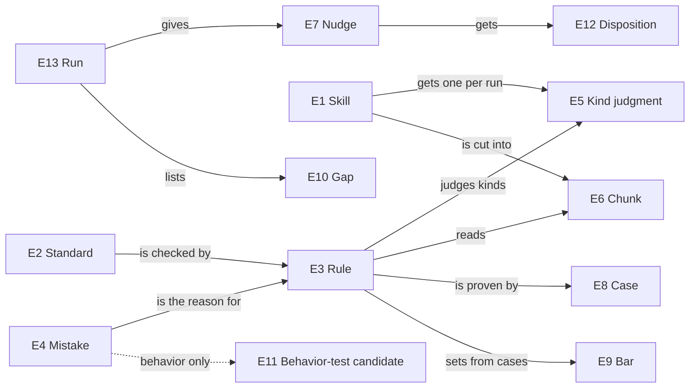

# Entities: the nouns every obligation is about

**Reader:** every reader of this set. **Question:** what is a rule, a nudge, a case, a kind, and when are two of them the same one? **Changes when:** the meaning of one of these nouns changes, which touches every capability.

Each table is the definition; the picture only shows how they relate. No entity names a type, file format, schema or engine structure; that binding is Program Design's.

### E1: Skill

`kind: entity · status: authorized · basis: U13, U15, U21`

| Slot | Meaning |
| --- | --- |
| identity rule | one owning plugin plus one skill folder name; its `SKILL.md`, description and references are parts of that one skill. A skill renamed or moved to another plugin is a new skill for rule results; its history stays with the old one |
| relationships | has exactly one description; has 0..n references; has exactly one kind judgment per run (E5); is cut into 1..n chunks per rule (E6) |
| invariants | a hidden skill is still a skill (U15) |
| observable states | none this design changes |
| canonicalizes | "skill", "skill text"; excludes an `AGENTS.md` file, which is out of scope here |

### E2: Standard

`kind: entity · status: authorized · basis: U1, U9`

| Slot | Meaning |
| --- | --- |
| identity rule | one taught standard at one marker in the skill-crafting standards; the same marker is the same standard even when its wording is edited |
| relationships | checked by 0..n rules (E3); quoted with its line in every nudge it grounds (E7) |
| invariants | a nudge always names its standard's wording and line |
| observable states | none this design changes |
| canonicalizes | "standard", "policy", "K-id marker" |

### E3: Rule

`kind: entity · status: authorized · basis: U9, U10, U12, U13, U17, U18, U20`

| Slot | Meaning |
| --- | --- |
| identity rule | one rule name (such as `skill-description.states-triggers-not-workflow-steps`). A renamed rule keeps its identity when its standard and question stay the same (placement → the general-skill rules); a rule whose question changes enough that its old cases no longer label it is a reworked rule that must pass its cases again |
| relationships | exists because of 1..n mistakes or exactly one written standard (E4); checks exactly one standard (E2); declares 1..3 kinds it judges (E5); declares one chunk shape (E6); has its cases (E8) and one bar per decision step (E9) |
| invariants | a judged rule nudges no one while held; no bar is overridden from outside the rule |
| observable states | `proposed` → `held` (named mistake, cases incomplete or failing) → `nudging` (passes its cases); `nudging` → `held` when its question, chunk or cases change; any → `dropped` by owner decision. Mechanical rules (count, pattern) go straight to `nudging` once their written standard is named |
| canonicalizes | "rule", "check", "lint rule"; excludes the standard itself and the model's answers |

### E4: Mistake

`kind: entity · status: authorized · basis: U9, U12`

| Slot | Meaning |
| --- | --- |
| identity rule | one source locator: an inventory record, a commit or pull request that fixed skill text, or a written standard's marker. Several owner records about the same rejected change are one episode, and one episode is one mistake |
| relationships | is the reason for 0..n rules; yields 0..n real-mistake cases (E8); a behavior-only mistake yields one behavior-test candidate (E11) instead of a rule |
| invariants | quotes the owner's exact words when it is an owner correction |
| observable states | `text-checkable` (skill text shows it) or `behavior-only` (only the session or action record shows it); a mistake is `partly` when text shows it only with outside context, and rules treat it as text-checkable only for the part the text shows |
| canonicalizes | "real mistake", "real failure", "owner correction" |

### E5: Kind judgment

`kind: entity · status: authorized · basis: U13, U14, U16`

| Slot | Meaning |
| --- | --- |
| identity rule | one skill, in one run, at one version of its description; re-running on the same description is the same question and must give the same kind within its bar |
| relationships | belongs to exactly one skill (E1); read by every rule that declares kinds |
| invariants | made once per skill per run; no rule re-asks it; the answer is one of `general`, `role`, `domain`, `tool_manual`, `repo_specific` (U13) |
| observable states | `judged` (an answer above its bar, with how sure) or `unsure` (no answer reaches its bar) |
| canonicalizes | "skill kind", "the filter", "general skill" (= `general`, `role` or `domain`, the kinds the general-skill rules judge), "product skill" and "tool manual" (= `tool_manual`), "repo-specific skill" (= `repo_specific`) |

### E6: Chunk

`kind: entity · status: authorized · basis: U20, U21, U22`

| Slot | Meaning |
| --- | --- |
| identity rule | one rule, one subject span in one file at one commit, plus the edges that rule declares; the same span read by two rules is two chunks |
| relationships | belongs to exactly one rule and one skill; includes 0..n followed spans (enclosing section, siblings, loaded files' openings) |
| invariants | collected text and model-visible text are both known and reported apart |
| observable states | `complete`, `cut` (model saw less than collected), `unresolved` (a selection didn't resolve) |
| canonicalizes | "piece", "evidence", "what the rule read" |

### E7: Nudge

`kind: entity · status: authorized · basis: U1–U6`

| Slot | Meaning |
| --- | --- |
| identity rule | one rule's result about one place (file and line) in one run. The same rule at the same place in a later run is a new nudge about the same place |
| relationships | belongs to one run (E13) and one rule; grounded in one standard; points to 0..n related places in three kinds (read, never read, same rule elsewhere); gets 0..n dispositions (E12) |
| invariants | what was observed is kept apart from the standard; its basis is `mechanical` or `judged`; a judged nudge keeps its answers |
| observable states | outcome `finding` or `uncertain`; severity `error` or `warn`; passes and gate exclusions are results but not nudges |
| canonicalizes | "nudge", "finding", "rule result"; excludes the agent's decision about it |

### E8: Case

`kind: entity · status: authorized · basis: U17, U19`

| Slot | Meaning |
| --- | --- |
| identity rule | one rule, one real text span at one repository, path and commit. The before and after of one fix are two cases of one fix pair, kept in the same set (development or held-back) |
| relationships | belongs to one rule; cites its source; may cite the mistake (E4) it came from |
| invariants | real skill text only; carries its label (`fire` or `quiet`), its kind (`real mistake`, `good`, `near miss`), and the label's basis (owner's fix or words; blind agent labels; owner's decision on a disagreement) |
| observable states | `development` or `held-back`; `labelled` or `disputed` (agents disagreed, awaiting the owner) |
| canonicalizes | "test case", "eval case", "fixture" (only for real skill text) |

### E9: Bar

`kind: entity · status: authorized · basis: U18`

| Slot | Meaning |
| --- | --- |
| identity rule | one decision step of one rule; its yes-bar and no-bar (or minimum for a choice) |
| relationships | belongs to exactly one rule's step; set from that rule's development cases |
| invariants | recorded beside the cases that set it; nothing outside the rule overrides it |
| observable states | `starting` (a default not yet tuned) or `tuned` (set from cases, with the cases cited) |
| canonicalizes | "threshold", "bar", "cut-off" |

### E10: Gap

`kind: entity · status: authorized · basis: U3, U14`

| Slot | Meaning |
| --- | --- |
| identity rule | one run, one rule, one file or piece, one gap kind |
| relationships | belongs to one run; names the rule and the place |
| invariants | a gap is never shown as a pass; a gate exclusion is not a gap |
| observable states | gap kinds: `nothing read` (in scope), `cut`, `unresolved`, `incomplete or skipped`, `kind unsure` |
| canonicalizes | "coverage gap", "unread" |

### E11: Behavior-test candidate

`kind: entity · status: proposed · basis: U12`

| Slot | Meaning |
| --- | --- |
| identity rule | one behavior-only mistake episode (E4) |
| relationships | cites its inventory records and sources; may name the text rule that checks the skill teaches the behavior |
| invariants | listed, never built in this change |
| observable states | `listed` |
| canonicalizes | "behavior replay", "behavioral scenario" |

### E14: Eval

`kind: entity · status: authorized · basis: U12`

| Slot | Meaning |
| --- | --- |
| identity rule | one real example change plus one subject run of the review skill on it |
| relationships | has one subject (Luna, high effort), one real commission and session input, one review it writes, one verdict |
| invariants | the subject starts the way a Lead launches a review agent; the example is a real change at a pinned commit |
| observable states | `passed`, `failed`, `undecided` (Jev undecided and the Terra judge not yet run), `incomplete` (the run or a judge failed) |
| canonicalizes | "eval", "integration test" (the owner's correction: "this is a normal eval not integraiton test") |

### E12: Disposition

`kind: entity · status: authorized · basis: U6`

| Slot | Meaning |
| --- | --- |
| identity rule | one agent's decision about one nudge |
| relationships | belongs to one nudge |
| invariants | says what the agent checked and concluded |
| observable states | `fixed`, `kept` (with reason), `routed` (to the owner of the broader concern), `open` (naming the evidence lacked) |
| canonicalizes | "account", "what the agent did with the nudge" |

### E13: Run

`kind: entity · status: authorized · basis: U3, U4`

| Slot | Meaning |
| --- | --- |
| identity rule | one invocation of the rules over one set of files at one commit |
| relationships | gives 0..n nudges; lists 0..n gaps; holds one kind judgment per skill checked; lists every held rule with what it lacks |
| invariants | a nudge never makes it fail (U4) |
| observable states | `clean`, `uncertain` (decisions owed), `failed` (an `error`), `invalid`, `cancelled`, `incomplete` |
| canonicalizes | "rule run", "lint run" |
