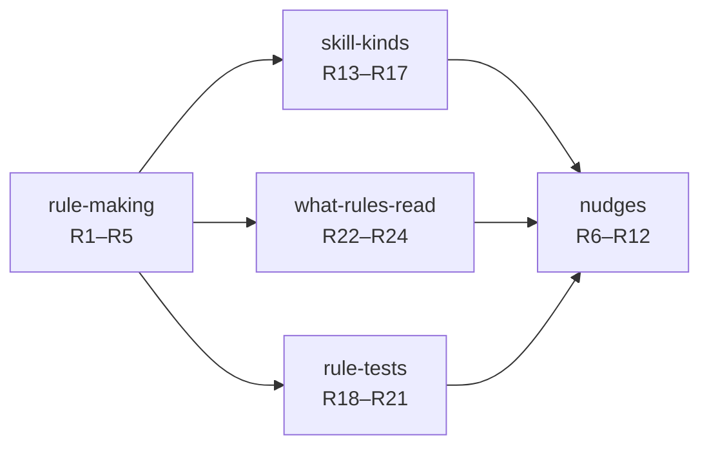
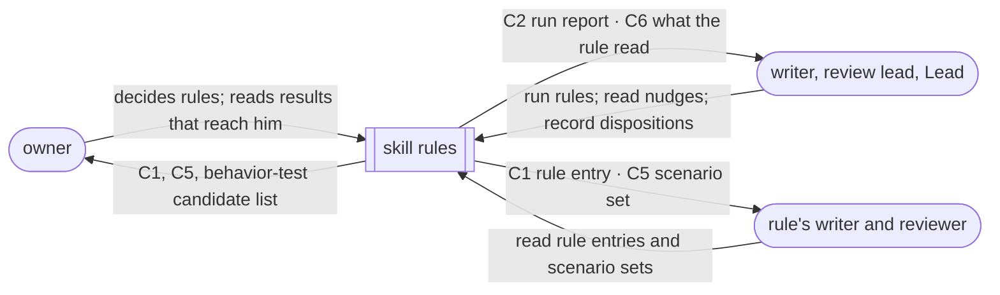

# Specification: skill rules

3 Nov 2026. Author: 🦁 Lead. Status: draft, not reviewed. Answers to [the Requirements](../requirements/index.md). Replaces `docs/wip/skills-authoring/2026-10-31-rules-as-nudges/specification.md` and its `revision-2/` parts.

## The contract in one line

Every rule names the real mistake or written standard it exists for, judges only the kinds of skills its standard is about, reads the text that standard is about, passes real scenarios before it nudges anyone, and gives the agent a nudge with where, what, why, where else to read and what it couldn't see. The agent reads those places and decides.

## Capabilities and their obligations

- **rule-making** ([chunk](rule-making.md)): R1 a nudging rule names its reason · R2 the rule set matches the owner's decisions · R3 behavior-only mistakes are listed · R4 rule files get nudges · R5 the engine knows nothing about skills
- **nudges** ([chunk](nudges.md)): R6 a nudge carries its parts · R7 a nudge may point without deciding · R8 gaps apart from exclusions · R9 a nudge never fails a run · R10 a pass says one property held · R11 every nudge gets a disposition · R12 each skill teaches its part
- **skill-kinds** ([chunk](skill-kinds.md)): R13 one kind judgment per skill · R14 a rule judges only its declared kinds · R15 an unsure kind skips and is listed · R16 description rules judge every skill · R17 the general-skill rules' answer in each scenario
- **rule-tests** ([chunk](rule-tests.md)): R18 a judged rule nudges only after its floor · R19 labels say where they came from · R20 bars tuned per rule · R21 scenarios are real skill text
- **what-rules-read** ([chunk](what-rules-read.md)): R22 a rule declares its chunk and edges · R23 generalization and the general-skill rules read every section · R24 a rule's chunk is the size of its standard

Entities for every capability: [entities.md](entities.md), E1–E13.

## Who sees what

Outside this system: the engine's internals (a generic dependency, R5), behavior scenarios beyond the two review evals (later), and where product content moves to (parked).

## Coverage

| Capability | U | E | P · O | R | C | V |
| --- | --- | --- | --- | --- | --- | --- |
| rule-making | U9 | E3, E4 | P1 · O1 | R1 | C1 | V1 |
| | U10 | E3 | | R2 | C1 | V2 |
| | U12 | E4, E11, E14 | | R3 | — | V3 |
| | U8 | E3, E7 | | R4 | C2 | V4 |
| | U11 | — | | R5 | — | V5 |
| nudges | U1 | E7, E2 | P2 · O2 | R6 | C2 | V6 |
| | U2 | E7 | | R7 | C2 | V7 |
| | U3 | E10, E13 | | R8 | C2 | V8 |
| | U4 | E13 | | R9 | C2 | V9 |
| | U5 | — | | R10 | — | V10 |
| | U6 | E12 | | R11 | C3 | V11 |
| | U7 | — | | R12 | — | V12 |
| skill-kinds | U13 | E1, E5 | P3 · O3 | R13, R14 | C2, C1 | V13, V14 |
| | U14 | E5, E10 | | R15 | C2 | V15 |
| | U15 | E1 | | R16 | — | V16 |
| | U16 | E3, E5 | | R17 | — | V17 |
| rule-tests | U17 | E3, E8 | P4 · O4 | R18, R19 | C1, C5 | V18, V19 |
| | U18 | E9 | | R20 | C1 | V20 |
| | U19 | E8 | | R21 | C5 | V21 |
| what-rules-read | U20 | E6 | P5 · O5 | R22 | C1, C6 | V22 |
| | U21 | E6 | | R23 | C6 | V23 |
| | U22 | E6 | | R24 | C6 | V24 |

Gaps: none open with the owner. Every row is authorized.
