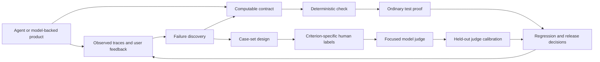
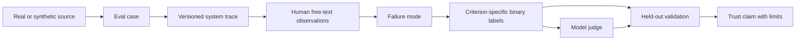

# Product eval skills for AI agents and model-backed systems

Status: proposal for owner discussion. This document proposes skill and plugin boundaries; it does not authorize runtime skill edits or claim a reviewed Requirements / Specification / Program Design set.

## Decision in one page

Create one focused **`ai-evals`** plugin first. Its job is to help a developer turn observed product behavior into trustworthy, product-specific evaluations. Begin with four owned workflows: discover failures in traces, construct a case set, design a focused evaluator, and validate a model-based evaluator. Add a short router and an audit skill when those workflows have stable entrypoints and artifacts. Keep RAG guidance as a conditional reference or later skill after a real RAG use case proves it needs its own trigger. Keep binary-label review-interface guidance inside evaluator design unless other annotation jobs justify a standalone skill. Do not copy upstream text or code into this public repository while its reuse license is unspecified.

Treat broader **agent building** and **model systems** plugins as adjacent proposals, not part of this first implementation. The source repository teaches evaluation of applications built with models; it does not teach agent architecture, model training, serving, or infrastructure. A second plugin could own agent execution and tool-contract design only after its consumers and current projects are studied. A third could own model selection and deployment only after its intended scope is clarified. Both can call into `ai-evals` without duplicating evaluator guidance.

The owner needs to settle what “jev” means, which agent/model systems the plugins should serve first, and whether the desired plugin split is one eval plugin plus later adjacent plugins or multiple plugins in the first delivery. Until then, the recommendation is a proposal, not an accepted implementation commission.

The diagram shows two proof routes. A computable contract can become a deterministic check with ordinary test proof, even before a failure is observed. A subjective failure found in traces needs criterion-specific human labels before a model judge can be trusted. Production collection, regression integration, and release decisions need separate evidence and ownership before they become skills.

## Sources and scope

- Upstream: [`ai-evals-course/evals-skills` at `2edbc5b1`](https://github.com/ai-evals-course/evals-skills/tree/2edbc5b1b0dc91f74fcfa8fd8f7eaeb302e052ab), inspected 2026-09-22. The [README](https://github.com/ai-evals-course/evals-skills/blob/2edbc5b1b0dc91f74fcfa8fd8f7eaeb302e052ab/README.md#L1-L15) explicitly targets product-specific AI evals rather than foundation-model benchmarks.
- Local baseline: `ai-tools` `19d0a820` on `main`; current plugin inventory in `plugins/README.md`, `plugins/shravan-dev-workflow/skills/`, and the three marketplace manifests. No current local skill owns the end-to-end product-evaluation job.
- Evidence class: source inspection. The upstream repository contains eight `SKILL.md` files, one `review-loop.md`, Codex display metadata, and plugin manifests. It supplies no runnable evaluation implementation or bundled behavior tests. The pinned tracked tree has no `LICENSE`, `COPYING`, or `NOTICE`; a separate GitHub API check on 2026-09-22 returned a null license field. This proposal therefore draws on ideas with attribution and calls for original local wording and proof.
- DeepWiki lookup returned “Repository not found”; the pinned Git checkout is the primary source. No upstream skill was executed against a real dataset during this research.
- The local `tests/skills` harness already combines deterministic criteria and a semantic model judge to evaluate whether agents follow workflow skills. That is useful implementation experience but a different evaluation target: it does not provide product-trace error discovery or human-calibrated application judges. See [`tests/skills/README.md`](../../../../tests/skills/README.md) and [`semantic-criteria-evaluator.ts`](../../../../tests/skills/lib/skill-pressure-evaluation/evaluators/semantic/semantic-criteria-evaluator.ts).
- The existing shared observability contract deliberately excludes prompts, payloads, raw paths, raw errors, tokens, passwords, and API keys from OTLP export. Its telemetry is useful for operational signals, but it is not a source of full reviewable agent traces. See [`ops-observability-stack`](../../../../plugins/shravan-dev-workflow/skills/ops-observability-stack/SKILL.md#L43-L50). A separate owner-approved, redacted case source is needed for real-path evaluation proof.

## What each upstream skill does

| Upstream skill | Actual work and distinctive value | Integration judgment |
| --- | --- | --- |
| [`evals-start`](https://github.com/ai-evals-course/evals-skills/blob/2edbc5b1b0dc91f74fcfa8fd8f7eaeb302e052ab/skills/evals-start/SKILL.md#L10-L24) | Routes from traces, existing pipeline, known failure mode, judge, absent traces, labeling UI, or RAG to a specialized skill. It contains no evaluation method itself. | **Adapt** as a short router inside `ai-evals`; keep direct invocation of specific skills and avoid a generic “eval anything” trigger. |
| [`eval-audit`](https://github.com/ai-evals-course/evals-skills/blob/2edbc5b1b0dc91f74fcfa8fd8f7eaeb302e052ab/skills/eval-audit/SKILL.md#L16-L34) | Inspects artifacts across error analysis, evaluator design, judge validation, human review, labeled data, and pipeline hygiene; returns prioritized findings. Its diagnostic questions are a useful trust review. | **Adapt later** as an `eval-audit` skill once the local eval artifacts and evidence contract are defined. Avoid checklist-only findings and hard-coded infrastructure assumptions. |
| [`error-discovery`](https://github.com/ai-evals-course/evals-skills/blob/2edbc5b1b0dc91f74fcfa8fd8f7eaeb302e052ab/skills/error-discovery/SKILL.md#L22-L68) + [`review-loop.md`](https://github.com/ai-evals-course/evals-skills/blob/2edbc5b1b0dc91f74fcfa8fd8f7eaeb302e052ab/skills/error-discovery/review-loop.md#L5-L13) | Inspects full traces, designs a domain-shaped review UI, samples cluster representatives plus random records, and alternates breadth/depth with human free-text notes and agent-suggested failure modes. The human confirms suggestions. | **Highest-value adaptation.** Preserve observed failure discovery, representative-plus-random selection, full trace, criteria-drift re-review, and human confirmation. Do not require its elaborate UI, map, treemap, background polling, or subagent-per-mode design for every dataset. |
| [`generate-synthetic-data`](https://github.com/ai-evals-course/evals-skills/blob/2edbc5b1b0dc91f74fcfa8fd8f7eaeb302e052ab/skills/generate-synthetic-data/SKILL.md#L16-L20) | Defines failure-oriented variation dimensions, has the domain owner check scenario tuples, generates natural-language inputs separately, filters unrealistic cases, and runs them through the full pipeline. | **Adapt** into case-set design as a branch for sparse real traces and hypothesized gaps. Preserve provenance and separate synthetic from real cases. Treat “20 tuples” and “100 traces” as heuristics, not acceptance thresholds. |
| [`write-judge-prompt`](https://github.com/ai-evals-course/evals-skills/blob/2edbc5b1b0dc91f74fcfa8fd8f7eaeb302e052ab/skills/write-judge-prompt/SKILL.md#L11-L19) | Requires an observed failure mode and human labels; prefers code checks for objective criteria; builds a single-criterion Pass/Fail judge with definitions, disjoint few-shot examples, structured output, and only necessary context. | **Adapt** as evaluator design. Retain the code-first decision and leakage guard. A binary decision is a good default for a named failure, not a ban on every ranking or graded-relevance task. |
| [`validate-evaluator`](https://github.com/ai-evals-course/evals-skills/blob/2edbc5b1b0dc91f74fcfa8fd8f7eaeb302e052ab/skills/validate-evaluator/SKILL.md#L14-L20) | Separates few-shot/train, iterative dev, and held-out test data; examines judge/human disagreements; reports TPR/TNR and optionally corrects an aggregate pass estimate. | **Adapt with statistical review.** Keep disjoint splits, error inspection, prevalence-aware metrics, and model/prompt versioning. Do not import fixed 80/90% gates or the sample bootstrap and correction recipe without validating assumptions and uncertainty. |
| [`evaluate-rag`](https://github.com/ai-evals-course/evals-skills/blob/2edbc5b1b0dc91f74fcfa8fd8f7eaeb302e052ab/skills/evaluate-rag/SKILL.md#L12-L31) | Splits retrieval from generation diagnosis; pairs queries with relevant chunks; uses recall for first pass, ranking metrics for reranking, then judges faithfulness and answer relevance. It includes synthetic QA, adversarial distractor questions, two-hop retrieval coverage, and chunking experiments. | **Conditional adaptation** for a real RAG consumer. Keep component-level attribution and source-grounded case construction; avoid universal “fix retrieval first” and fixed `k` prescriptions. Rechunking needs comparable relevance labels across changed chunk boundaries. |
| [`build-review-interface`](https://github.com/ai-evals-course/evals-skills/blob/2edbc5b1b0dc91f74fcfa8fd8f7eaeb302e052ab/skills/build-review-interface/SKILL.md#L9-L37) | Builds a domain-shaped single-trace browser UI with Pass/Fail/Defer, notes, full trace, persistence, and navigation, then requests functional and visual proof. | **Use as a conditional reference for criterion-specific binary labeling** within evaluator design. Its structured labels differ from discovery's free-text-first notes; a standalone skill is justified only when other annotation jobs recur. Follow this repo's native UI proof route rather than copying its Playwright-only instruction. |

### Upstream mechanics worth preserving

1. **Observed failure before a subjective judge.** Upstream places error analysis before judge design and treats generic “helpfulness” or “coherence” labels as weak evidence. A computable contract can be checked directly with code and ordinary tests. See [`eval-audit`](https://github.com/ai-evals-course/evals-skills/blob/2edbc5b1b0dc91f74fcfa8fd8f7eaeb302e052ab/skills/eval-audit/SKILL.md#L36-L74) and [`validate-evaluator`](https://github.com/ai-evals-course/evals-skills/blob/2edbc5b1b0dc91f74fcfa8fd8f7eaeb302e052ab/skills/validate-evaluator/SKILL.md#L4-L7).
2. **Discovery sampling and measurement sampling serve different questions.** Cluster representatives plus a random tranche help discover kinds of failure; prevalence claims require a representative sample and uncertainty accounting. See [`error-discovery`](https://github.com/ai-evals-course/evals-skills/blob/2edbc5b1b0dc91f74fcfa8fd8f7eaeb302e052ab/skills/error-discovery/SKILL.md#L189-L197) and [`validate-evaluator`](https://github.com/ai-evals-course/evals-skills/blob/2edbc5b1b0dc91f74fcfa8fd8f7eaeb302e052ab/skills/validate-evaluator/SKILL.md#L126-L149).
3. **Human judgment remains the source of labels.** The agent groups free-text observations and proposes possible instances; the reviewer accepts or dismisses them. See [`review-loop.md`](https://github.com/ai-evals-course/evals-skills/blob/2edbc5b1b0dc91f74fcfa8fd8f7eaeb302e052ab/skills/error-discovery/review-loop.md#L30-L51).
4. **Prefer a deterministic check when the outcome can be computed.** Use model judges for interpretation and validate those judges against human labels. See [`write-judge-prompt`](https://github.com/ai-evals-course/evals-skills/blob/2edbc5b1b0dc91f74fcfa8fd8f7eaeb302e052ab/skills/write-judge-prompt/SKILL.md#L15-L19) and [`eval-audit`](https://github.com/ai-evals-course/evals-skills/blob/2edbc5b1b0dc91f74fcfa8fd8f7eaeb302e052ab/skills/eval-audit/SKILL.md#L70-L80).
5. **Review the whole agent trajectory when the failure can arise before the answer.** Tool calls, results, retrieved context, and final output belong in the human review surface. See [`build-review-interface`](https://github.com/ai-evals-course/evals-skills/blob/2edbc5b1b0dc91f74fcfa8fd8f7eaeb302e052ab/skills/build-review-interface/SKILL.md#L15-L26).

### Transfer limits and corrections

- The upstream discovery UI records full traces, including reasoning blocks, in local files and browser views. Local adaptation needs an explicit sensitive-data import/display boundary before using real Agent Studio, Router, VM, or customer traces. Source selection and redaction should happen before content becomes model-visible or browser-visible. Its separate `build-review-interface` skill asks for HTML sanitization, but neither skill defines access, retention, or redaction policy for trace content. The local OTel stack intentionally omits payloads, so reusing it as a full-trace source would silently weaken the evaluation.
- The discovery UI is a concrete one-off app architecture in skill prose: Python server, JSON files, PCA/UMAP map, treemap, polling, and background agents. These are optional mechanisms, not evidence that each eval task needs them. A compact review surface should be selected from the actual dataset and existing UI foundation.
- The upstream fixed counts (`~100` traces, `20 Pass/20 Fail`, 80/90% judge thresholds) are helpful planning examples, but data difficulty, class balance, and the decision cost determine needed sample size. Any local validation report should show observed class counts and uncertainty rather than convert heuristics into universal readiness gates.
- The optional Rogan–Gladen correction assumes transportable sensitivity/specificity from labeled test data to the population being estimated. The provided bootstrap holds the production observed pass fraction fixed; it therefore does not include its sampling uncertainty. A local skill should say when correction is valid and use a statistically reviewed procedure before reporting calibrated aggregate rates.
- Upstream also claims improving TPR narrows the corrected-rate confidence interval more than improving TNR. Its displayed denominator is symmetric in those two rates; the relative effect depends on prevalence, class-specific uncertainty, and sample allocation. Do not transfer that claim as a universal optimization rule.
- Upstream `generate-synthetic-data` says real-data sampling should not be random, while `error-discovery` keeps random picks alongside clusters. The local model should state the intended use: stratification improves coverage, and a random tranche guards against missing unknown regions. Synthetic cases expose possibilities; they do not estimate live prevalence.
- RAG relevance in the upstream example attaches to exact chunks, while its chunking experiment changes chunk boundaries and reindexes. If that experiment is adopted, preserve a source-grounded relevance judgment across configurations or remap labels before comparing metrics. The upstream instructions do not supply this mapping.
- Its eight skills have no scripts or tests in the pinned repository. They demonstrate agent instructions and process concepts, not a validated local execution path. The `ai-tools` pressure scenarios and real-path proof would have to be authored independently.

## Proposed plugin ownership

| Plugin boundary | Owns | Does not own yet | Why this boundary |
| --- | --- | --- | --- |
| **`ai-evals`** (first) | Product-specific trace review, failure taxonomy, case selection, evaluator choice/design, judge calibration, and audit. | Trace platform, production monitoring, CI wiring, release policy, model benchmarking. | One lifecycle and artifact chain; multiple agent and model products can consume it. |
| **`ai-agent-systems`** (later discovery) | Candidate: agent task/tool contracts and end-to-end trajectory reasoning for builders. It consumes `ai-evals` cases and results. | A duplicate judge or annotation workflow. | Agent execution has a separate reason to change from evaluation methodology. The concrete skill set needs project evidence. |
| **`ai-model-systems`** (later discovery) | Candidate: model selection, adaptation, serving, and operational tradeoffs, if the owner wants that scope. It consumes `ai-evals` results. | Product-specific failure discovery and judge calibration. | Model lifecycle and deployment are not taught by this upstream source; a new source and consumer study is required. |

The first plugin is the first candidate for named-skill design. Its specific skill contracts remain a proposal until owner decisions and one named-skill `skills-creation` run per accepted target. Existing `shravan-dev-workflow` owns generic design, implementation, review, agent management, and skill authoring; it should not absorb domain-specific eval methods. `agent-router` remains collaboration transport. `ops-observability-stack` owns the shared local OTel/Victoria infrastructure, not evaluator methodology.

## Candidate `ai-evals` skill surface

| Candidate | Trigger / job | Compact `SKILL.md` | Conditional depth | Script need | Pressure proof |
| --- | --- | --- | --- | --- | --- |
| `evals-route` | Unclear product-eval request, with no more specific match. | Situation-to-owner route and stop conditions. | None initially. | None. | New route/near-miss scenario. |
| `eval-discover-failures` | Existing traces or model outputs need human error analysis. | Inspect trace shape; select coverage samples; human notes; synthesize observed modes; distinguish discovery from prevalence. | Trace display/sampling, human review loop, sensitive-data boundary. | Only if a repeatable importer or sample selector is proven useful. | New real trace set plus privacy and criteria-drift cases. |
| `eval-design-cases` | Known failure hypotheses or sparse traces require a useful case set. | Select real versus synthetic source, variation dimensions, owner review, provenance, and execution through actual system. | RAG-specific case mapping only when applicable. | Optional deterministic dataset validation. | New realism, leakage, and provenance scenarios. |
| `eval-design-evaluator` | A computable contract needs a check, or an observed subjective failure needs a model judge. | Route deterministic checks to ordinary tests. For a subjective judge, define one criterion, collect criterion-specific binary labels from a domain reviewer, select train-only examples, and preserve a held-out boundary. | Conditional binary-label review interface, judge prompt craft, and task-specific context selection. | None for prose; any evaluator runner is separate product code. | New code-first, known-mode-without-labels, vague-criterion, and leakage scenarios. |
| `eval-validate-judge` | A model judge must be assessed before its measurements are trusted. | Human-label provenance; split discipline; disagreement analysis; class-conditional metrics; report uncertainty and limits. | Statistical methods and aggregate correction, only when reporting rates. | A reviewed, deterministic calculation tool if the skill promises numeric output. | New imbalanced-data, leakage, and invalid-correction scenarios. |
| `eval-audit` | Existing evaluation pipeline trust is in question. | Inspect actual artifacts, prioritize supported findings and next owner. | RAG / agent / operational checks by predicate. | None. | New missing-evidence and checklist-only scenarios. |

This is a portfolio recommendation under `skill-audit`. `skills-creation` will later take exactly one accepted named skill per run and design its trigger, main path, references, proof, and review. A multi-run proposal can sequence these runs; it does not let a helper author all six skills at once.

## Candidate data and proof contract

The important relationship is provenance, not a mandated schema:

For every case and trace, the future skill should preserve which system/prompt/model version produced it, whether it came from real or synthetic input, and whether it was used for discovery, prompt examples, development, held-out testing, or population measurement. One trace may be read in several contexts; a held-out test label must not leak into prompt examples or iterative tuning. The proof claim must identify the source population and uncertainty. These are candidate observable obligations, not chosen file formats or a new registry.

## Options and tradeoffs

| Option | Gain | Cost and risk | Recommendation |
| --- | --- | --- | --- |
| Install upstream plugin as-is | Fast trial of its process. | No detected license for copying; instructions assume a generated server/UI and prescribe fixed thresholds; no local pressure or runtime proof. | Useful as an isolated trial on non-sensitive sample data, but not the shipped local solution. |
| Copy all eight skills into one local plugin | Preserves upstream shape and route. | Duplicated one-off UI mechanism, statistical claims, tool assumptions, and maintenance burden. | Reject. |
| Adapt selected mechanics into one `ai-evals` plugin | Coherent reusable evaluation lifecycle, testable trigger boundaries, cross-product use. | Requires original authoring, source-specific proof, and owner decisions about data/privacy. | **Recommended first delivery.** |
| Build agent, model, and eval plugins in one change | Broad coverage from day one. | Agent/model scope lacks source evidence and is likely to invent workflows. | Defer until specific project use cases establish consumers and repeated work. |

## Decisions and proof needed before implementation

1. **Owner meaning:** Clarify “jev” and name the first concrete agent/model-backed systems and primary builder/operator. Is the first delivery one `ai-evals` plugin or multiple plugins? Which owner-approved, redacted traces or cases may be used in a proof run, given that the OTel stack excludes payloads? This affects scope and sensitive-data handling.
2. **Source and license:** Confirm whether the upstream authors publish reuse terms. Until then, use only original local expression of general ideas and cite the source; do not vendor upstream files.
3. **One named skill at a time:** Start with `eval-discover-failures` because it changes what gets measured. Use `skills-creation` for its accepted proposal, trigger design, pressure scenario, and implementation proof. Sequence the remaining skills after the first real case validates the artifact chain.
4. **Real-path validation:** Exercise a representative non-sensitive agent trace from input through human review, observed failure, case selection, and an evaluator decision; confirm that the trace remains interpretable and provenance survives. Add a separate judge-calibration dataset before claiming rate estimation.
5. **Packaging:** When a plugin change is authorized, add marketplace entries and manifests for the intended Codex/Claude/Cursor surfaces, bump versions, update `docs/changelog/`, run repo pressure evals plus platform validators, then perform main assessment and independent package review. Do not treat plugin installation or static validation as behavioral proof.

## Review question

Can a skeptical reader trace every proposed local skill to a distinct recurring job and source-backed failure mode, see what the upstream repository actually provides, and identify which owner decisions and proof gaps prevent implementation readiness? Review should challenge both unnecessary new plugin boundaries and any missing agent/model evaluation need that the proposed `ai-evals` lifecycle would fail to serve.
