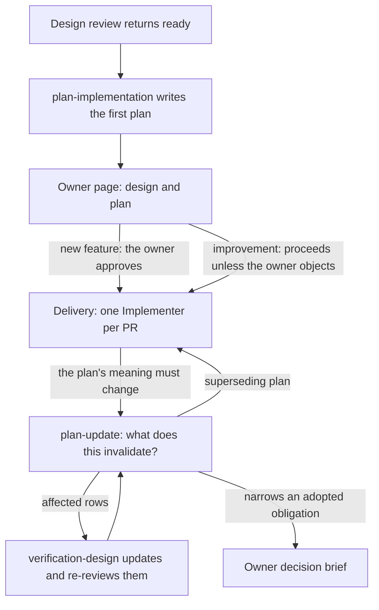

# Planning lifecycle: the first plan, plan updates and PR shape

Status: **proposed**. Lead: 🦁 claude-local `68844339`. Focus 2, part A. Builds on the batched-delivery spec (`../2026-10-22-batched-delivery-rounds/spec.md`, committed at `b2aef990`), and replaces runs R1–R4 and R7 of `../2026-10-24-design-cycle-owner-review/spec.md`.

The design cycle ends with a plan that the owner reviews beside the design. During delivery, any change to what the plan means goes through a new `plan-update` skill, whose main step asks what the change invalidates: slices, dependency edges, PR shape and Verification Design rows. PR shape is a planning decision recorded in the plan. The global prompt only says how to run `gh stack` once a plan has chosen a stack.

## Requirements

The owner's words, grouped by need.

- **The first plan and plan updates are separate, and each orchestrator owns one**
  - "I want to move the implementation planning and sequencing into the orchestrator. They can exist in both, but the initial plan is separate from updating the plan, so maybe that's the separation between the two orchestrators and separate skills." (2026-10-24)
  - "two skilsl but woudl liek to know why kwhy not" (2026-10-24, answering Q2)
- **The owner reviews the plan inside the design cycle**
  - "i think plans shoudl be reviweable by me so part of orchsetrator design" (2026-10-23)
- **The Verification Design moves with the plan**
  - "why dhte fuck did you not amake a kupdated verficaiton desgin / its part of the orchestration process" (2026-10-24, to the Fleet Lead)
- **PR shape is decided in planning, not in the global prompt**
  - "ok 2 needs to be done in planning so its not cohesvie so we didn tundand each other" (2026-10-24, on devfiles PR #21)
- **Agents know what to do in each PR and slice**
  - "it shoudl compose documesnt with the walkt thyorughcunaionaty to allow great user uksndancablity while allowing agents to knwo what to do while buidlign a feature thorugh diffent prs and slices" (2026-10-24, answering Q1)
- **Check the design's claims before building** (waiting on the owner)
  - "i want to think of htis" (2026-10-23)

Evidence from the retrospective (`retro-2026-10-24/account.md`, outcomes 2 and 7): remote wakes, a library repin and a changed proof ladder became plan amendments while the Verification Design stayed at its old revision; the final target was narrowed to save time and disk without keeping its obligations. The planner the session actually loaded was installed 2.80.0, which admitted three design documents and returned no Verification Design gap. Today's `plan-implementation` admits four and rejects a stale one (`SKILL.md:15–17`), but nothing classifies a mid-delivery change as stale proof, so no route fires.

## Situations

A reader can check each of these once the change lands.

1. **New feature.** The design review returns `ready`. In the same cycle the Lead loads `plan-implementation`, writes the first plan and gives the owner one page over the design and the plan. Nothing is implemented until the owner approves or changes the plan. The approval is recorded on the work thread, never in the plan file.
2. **Improvement or mechanical work.** The Lead shows the same page and proceeds unless the owner objects; the page and the decision to proceed go on the work thread.
3. **A dependency changes what a row observes.** Mid-delivery, a library is repinned or a capability is added. The Lead loads `plan-update`. It lists the Verification Design rows the change affects and returns `verification-design-gap`; `verification-design` updates those rows and they are reviewed. `plan-update` then writes the superseding plan. Completed slices whose proof used the changed dependency are requalified; others keep their evidence.
4. **A review finding is a plan defect.** The finding returns `plan-defect`, and the Lead loads `plan-update`, not the first-plan skill.
5. **A design correction mid-delivery.** A slice exposes a Program Design gap. `orchestrator-design` corrects and re-reviews the affected document, then `plan-update` takes the design change and writes a superseding plan that keeps the completed slices that still hold.
6. **A PR becomes too big to review in one pass.** `plan-update` splits it, records the reason and the stack layout in the plan, and the Implementers use `gh stack` as the global prompt describes.
7. **An Implementer starts a slice.** Its commission's required reads are the slice's reads: the anchors the plan lists for that slice. The owner's page shows the same anchors as that slice's walkthrough.
8. **Failure: the owner doesn't answer a new-feature gate.** The gate holds. The Lead keeps working on anything the plan doesn't touch and starts no Implementer.
9. **Failure: an update would narrow an adopted obligation.** An update that drops a required observation, moves a required capability to backlog or narrows a target to save work stops with an owner decision brief.
10. **Not an update.** A choice inside one slice's write scope, or a repair that keeps the slice's proof, stays with `implement-plan`.

## Design: runs

Each run names one skill target. A shared reference rides with the run that changes its meaning.

### R1 orchestrator-design

When the review returns `ready`, the design terminal is chosen by an observable entry context.

- **No current delivery plan** (a first design cycle): the Lead loads `plan-implementation`, writes the first plan, and gives the owner one page over the design and the plan (part B builds it).
  - For a new feature, the terminal waits for the owner, then returns `ready-for-implementation` with the four design identities and the plan path.
  - For improvement work, the Lead records the page and proceeds.
- **An existing delivery plan** (a design correction during delivery, such as situation 5): the cycle writes no plan. It returns the corrected, reviewed design identities and the existing plan's path to the delivery caller, which loads `plan-update`. Completed slices are judged there. D6's owner boundary applies as written: the update reaches the owner when it changes an approved outcome, scope or an owner-chosen PR shape.
- **Design only**, as the owner asked: `ready-for-planning`, unchanged.

The Design Terminal section and routing table gain these three cases.

The description becomes: "Use when a user asks to run, resume, or finish one design cycle: Requirements, Specification, Program Design, Verification Design, their independent review, and the first implementation plan reviewed with them. Not for a direct design phase, changing a plan during delivery, implementation delivery, or PR work."

### R2 plan-implementation, the first plan

- The description and `SKILL.md:10` narrow from "writing or revising" to writing the first plan for a ready design or admitted improvement. The description becomes: "Use when writing the first repository-grounded implementation plan for a reviewed four-document design (Requirements, Specification, Program Design, Verification Design), an admitted improvement finding, or a direct planning request. Not for changing an existing plan during delivery (plan-update) or audit-only discovery (plan-improve-repo)."
- The owner-review gate is a caller input; the plan never records approval.
- The PR-shape rule from the batched-delivery spec stays, and gains the stack layout when a split is chosen.
- Each slice lists its reads (D9).
- The pinned phrase "invokes `implement-plan` without another generic approval question" stays.

### R3 plan-update, a new skill

Description: "Use when a ready implementation plan's meaning must change during delivery: a design correction, a plan-defect finding, a slice that must split or merge, a changed dependency or proof target, or a PR that must re-split. Not for the first plan (plan-implementation) or choices inside one slice (implement-plan)." Main path:

1. Admit the current plan and the change, with its evidence.
2. List what the change invalidates: slices, dependency edges, PR shape, Verification Design rows, and completed proofs whose dependencies changed.
3. Return `verification-design-gap` for affected rows before anything else is ready.
4. Stop with an owner brief when the change narrows an adopted obligation.
5. Write the superseding plan at a new path, with `supersedes` and a "Changed from" section, and return `ready | revision-requested | blocked`.

It loads `plan-implementation`'s `references/slice-and-proof-design.md` for re-slicing rather than keeping a copy.

### R4 canonical-implementation-plan.md

Rides with R3.

- `originating planner` gains `plan-update`, and stays provenance: it says who wrote this plan, not who corrects it.
- The record gains `supersedes: none | <plan path>`.
- A superseding plan carries a "Changed from" section: each change, with what it invalidates. That is meaning lineage, not progress or approval.
- In Preserve and Admit, a correction to an existing ready plan (`route`, a discrepancy) goes to `plan-update`, whatever the plan's origin. A genuine upstream gap in Requirements, Specification, Program Design or Verification Design goes to its semantic owner first, then to `plan-update`.
- The plan home follows D8.

### R5 orchestrator-implementation-goal

With `references/goal-contract-and-routing.md` and `shared-references/phase-return-tokens.md`.

- The goal admits an owner-reviewed plan from the design cycle.
- A goal that starts without one (improvement or direct delivery) loads `plan-implementation`. For a new feature, that plan passes the same owner gate before any Implementer is commissioned.
- During delivery, `plan-defect` and any change of plan meaning route to `plan-update`, and `verification-design-gap` routes before dependent work continues.
- A design-cycle return that carries an existing plan's path (R1's second case) goes to `plan-update`.
- `phase-return-tokens.md`'s `plan-defect` row keeps its payload. Its owner becomes `plan-update` for any existing plan, with the originating planner kept as provenance.

### R6 verification-design

A short staleness list:

- a changed target, platform or configuration;
- a changed or dropped journey or test matrix;
- a changed obligation;
- a required capability descoped;
- a changed dependency that a row's observation uses;
- plan scheduling that a row depends on.

A stale row is updated and re-reviewed. `plan-update`'s affected-row list is an input.

### R7 implement-plan

With `references/execution-and-proof.md`.

- Admission's `revision-requested` (`SKILL.md:20`) and the stop at "the recorded originating planner" (`execution-and-proof.md:85`) route an existing plan's correction to the Lead for `plan-update`.
- Its replan routes (a stand-in that would change a contract, a slice too large to prove) do the same.
- A slice commission's required reads are the slice's reads.

### R8 the global prompt (ancillary)

Moved to the coordination record as ancillary work W6 ([coordination.md](coordination.md)). The PR-shape decision leaves the global prompt, which keeps three things:

- worktrees for independent tracks;
- "the implementation plan decides PR shape";
- the `gh stack` how-to once a stack is chosen.

A subagent makes the change, never the Lead. PR #21 is held until the owner chooses the timing (D7).

### R9 program-design claim check

Written but not implemented until the owner decides (D10).

### R10 implementation-review

With `references/finding-and-reduction.md` and `README.md`. Cause routing (`finding-and-reduction.md:80`) sends a slice, sequence, dependency, collision, write-scope or plan-proof finding on an existing plan to `plan-update`, instead of to the plan's originating planner. Requirements, contract and structural findings still go to their semantic owners first.

## How it will be proven

The owner said the tests come later and there is no pressure testing. This names the proof route only.

- **Static:**
  - the existing contract tests (`pnpm --dir tests/skills test`), with the pinned phrases kept;
  - `claude plugin validate .`;
  - a source search showing every `plan-defect` mapping names `plan-update`, no description still says "writing or revising", and every caller of `ready-for-planning` and `ready-for-implementation` still routes;
  - a check that no skill writes approval into a plan file.
- **Behavior, later:** a fresh Lead given a mid-delivery library repin returns the affected rows to `verification-design` before driving; an unrelated wording change reuses its observation; a new-feature cycle stops at the owner gate with a page.
- **Unverified until then:** that agents classify a mid-delivery change as a plan update at all. That is the failure the retrospective found, and static proof cannot show it.

## Decisions

The owner may strike any row. Rows marked **owner** wait for the owner.

| # | Decision | Reason |
| --- | --- | --- |
| D1 | Two skills: `plan-implementation` writes the first plan, `plan-update` changes it | Different inputs (a reviewed design versus a plan plus delivery evidence), gates (owner review versus Lead call) and risks (a coverage gap versus drift). Today's "writing or revising" lets the revising half go unclassified. Cost: one more description in context, and slicing rules that need one shared home (R3 loads the existing reference) |
| D2 | The design cycle owns the first plan; delivery uses `plan-update`. The delivery orchestrator loads `plan-implementation` only when a goal starts without a design-cycle plan | The owner's "separation between the two orchestrators", without stranding improvement goals |
| D3 | A mid-delivery design correction updates the plan rather than replanning from scratch | Completed slices carry forward. This corrects the Lead's chat answer of 2026-10-24, which sent a design change to a fresh first plan |
| D4 | An update writes a new plan path with `supersedes`; plans stay immutable | Keeps the canonical plan's rule that a meaning change creates a new path, and makes lineage readable |
| D5 | Narrowing an adopted obligation stops for the owner | Retrospective outcome 7: an adopted capability was treated as negotiable backlog |
| D6 | The owner's gate is on new features; improvement work is visible and proceeds. An update reaches the owner only when it changes an approved outcome, scope or an owner-chosen PR shape | The owner asked to review plans; a gate on every update would bring back the per-change waiting rejected in the batched-delivery spec |
| D7 | **owner** — PR shape lives in the plan; the global prompt keeps only `gh stack` mechanics. Timing: change the global prompt now (a smaller PR replacing #21), or with this focus | Now: no contradiction once the batched-delivery PR merges. Later: one devfiles change, but agents keep being told to stack until then. Lead recommends now |
| D8 | **Owner decided, 2026-10-24:** a design-set plan lives with its spec, at `docs/specs/<set>/plans/<yyyy-mm-dd>-<slug>.md`, tracked, instead of ignored `tmp/plan-workflows/`. The `plans/` folder holds plan files only: each plan is immutable, and a superseding plan sits beside the one it replaces. No interim files go there: no progress, tracking, status, ledger or scratch files. Those live in the trace, or in `tmp/`. | Owner: "colocated with spec specs are not permenantdockuemtns" and "but the plan fodler does not contian itnerm files for track etc ok?". Specs and their plans share the two-month retention rule, and the canonical plan already forbids progress and approval in a plan file |
| D9 | Each slice lists its reads: the anchors (headings, rows, diagram nodes) it realizes or earns. That one list is the Implementer's required reads and the slice's walkthrough | One home for "what this slice is about", serving the agent and the owner |
| D10 | The claim check is written but waits for the owner | "i want to think of htis" |
| D11 | The new skill is named `plan-update` | The owner's word ("updating the plan"), namespace-first |

## Coordination

- **Base:** after the batched-delivery PR merges; this focus is its own deliverable, one PR. Re-check every target line at that base.
- **Contract-test strings to keep:** the batched-delivery spec's list, plus "invokes `implement-plan` without another generic approval question" (`tests/skills/lib/minimal-planning-delivery-contract.test.ts:57`).
- **Callers to cut over** (hard cutover, no alias):
  - every `plan-defect` mapping;
  - every route chosen by the plan's originating planner, which are `canonical-implementation-plan.md:72`, `implement-plan/SKILL.md:20`, `execution-and-proof.md:85`, `finding-and-reduction.md:80`, `phase-return-tokens.md:12`, `orchestrator-implementation-goal/SKILL.md:23` and `implementation-review/README.md:33`;
  - every "writing or revising" description;
  - the AGENTS.md skill table, `plugins/sunstack-dev/README.md`, and the skill index in the global prompt (devfiles, by subagent).

  `plan-improve-repo`'s own routes (`validation-checklist.md:23`, `reconcile-backlog.md:20`) correct its backlog plans before delivery and stay with it.
- **Run allocation, ancillary work, security decisions and release:** [coordination.md](coordination.md).
- **Review:** one spec review round over the whole focus 2 set.
