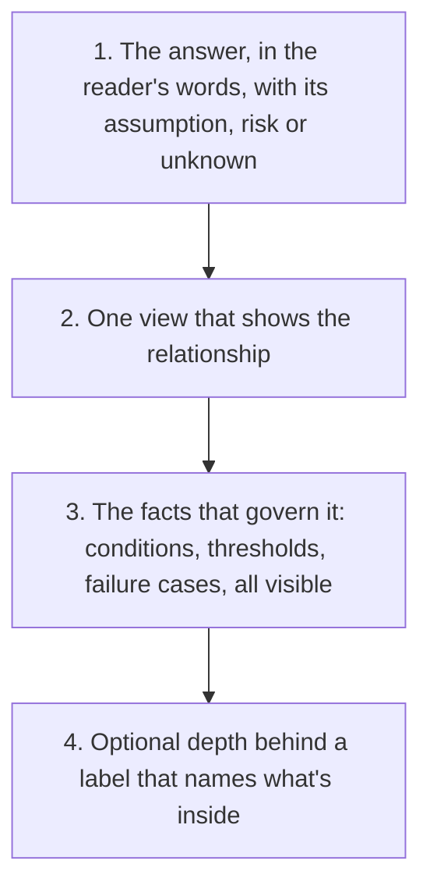

# Progressive disclosure for people, and the checks for it

Status: **proposed**. Lead: 🦁 claude-local `68844339`. Focus 2, part E. Research: Researcher Sidekick `01a16ed1`, `disclosure-2026-10-24/progressive-disclosure-report.md` in the work's scratch root, pinned to `origin/main` `ca7e9d2f` and sunstack-tools `c49d2f2f`.

People understand a design faster when it comes in layers: the answer first, then one view that shows the relationship, then the facts that govern it, then optional depth they can open. This part teaches that as one judgment, in `principle-write-for-the-reader` and a reference beneath it, so every skill that writes for a person cites one home. It also says which parts of the judgment a sunstack rule can check, which need a judge, and which only a reviewer or the owner can tell.

## Requirements

- **Understand how progressive disclosure helps people, and write it that way**
  - "lets stqart focus 2. this includex realy udntand how progress discosures help hjumans and hwo to write this and the skill and rule checks for all of them we need a spec for this" (2026-10-24)
- **Layers like a cake, the same inside a file and from a skill to its reference**
  - "when you lay out from top down it's the same in a file, and the same from skill → references, same concept … increasing layers of detail like building a cake." (2026-10-12)
- **People can choose to dive in; agents always read it all**
  - "Agent detail stays in the documents, in its own parts, so a person can choose to dive in while an agent always reads it." and "No text walls." (owner directions, 21 October)
  - "Requirements and tables don't really help, so that needs to be fixed" (2026-10-22)
- **Walkthroughs are for questions that cross documents**
  - "im surpraise deiciosn has a walkt thorugh its just a file? you aslo are consued what whatlkthorughs are" (2026-10-24)

## What the evidence says

From the research report, section A. The strength of each source is stated there.

- **Three different things.** Ordering an answer from broad to detailed, splitting an explanation into meaningful pieces, and hiding optional pieces behind a control or a link. Evidence for one doesn't prove the others.
- **Ordering and splitting.** A web-writing experiment found concise, scannable, objective writing improved finding time, errors, memory and satisfaction. A meta-analysis of 56 studies found meaningful segments improved learning and lowered overall cognitive load. Neither tested collapsed engineering documents.
- **Hiding has costs.** NN/g and GOV.UK: show what most readers need, hide only what some need, and write labels that predict what's inside. Hidden content is less visible and costs a click. When readers compare sections, they need them visible together.
- **The honest claim.** Less irrelevant material to scan, and a clearer path to the next idea, with depth still within reach. Whether a page actually helped is shown by the owner reading it, not by a passing check.

## Where our skills stand

From the report, section C, at `ca7e9d2f`:

- **Already present.** `principle-write-for-the-reader` has the answer first, one view per question, and risks and unknowns near the top. `diagram-semantics.md` has the map → slice → ledger → detail sequence. `presentation-html` has the answer first, focused views, optional depth and descriptive disclosure titles. `design-documents.md` keeps the Markdown complete and the page free of its own normative prose.
- **The gap.** There is no one writing shape inside a chunk that separates a useful opening, the governing facts, the view and the optional depth. A paragraph being present is weaker than a paragraph that explains.
- **Two ambiguities in part B's D8.6.**
  - **What "visible" means.** Trace tables are "visible" in D8.6, but part B also puts coverage views "one action away". The fix: visible means shown inside the chunk, not collapsed; one action away means a tab or section on the page.
  - **What may be collapsed.** D8.6 keeps error cases out of collapsed detail, yet asks summaries to name the failure cases inside. The fix: a failure obligation stays visible, and only rationale or evidence about it may be collapsed, under a summary that names the case it explains.
- **Agent context is a separate concern.** `skill-creation`'s progressive disclosure (what an agent loads, and when) stays as it is. This part is about people.

## Situations

1. **An agent writes a design chunk.** It opens with the answer to the chunk's question in the reader's words, naming any assumption, risk or unknown. Then the one view that fires for it, then the governing rows, all visible. Rationale, evidence, derivations and examples follow in `
` blocks whose summaries say what's inside.
2. **A chunk carries a failure obligation.** The obligation and its threshold stay visible. Only the evidence or reasoning behind it may be collapsed, with a summary that names the failure case.
3. **A reader compares options.** The compared facts sit side by side, visible together, never in separate collapsed blocks.
4. **An agent builds a page.** Walkthroughs exist only for a question whose answer crosses documents, or that needs an order the documents don't give. A path through one file's own headings in their order is an outline, so the page's outline and Pages menu do that job. A single-file page, such as a decisions page, gets no walkthrough.
5. **An agent writes a skill.** The same layering holds from the description to `SKILL.md` to a reference: the decision every use needs stays in `SKILL.md`, and the reference is the next layer down, in the same order.
6. **A rule runs over a design chunk.** A mechanical rule flags an explanatory section whose first block is a table or a child heading. A judge, when one is calibrated, asks whether the opening actually answers the question. Whether something may be hidden at all is a review question.
7. **Failure: a page hides what the reader needed.** The owner reports it, and the fix goes to the chunk's opening or visibility, not to more page prose.

## Design: runs

### E·R1 principle-write-for-the-reader

A short "Layer the detail" judgment in `SKILL.md`, at the decision it informs: order, split, then hide only what is optional for this reader. It adds a new reference, `references/layered-detail.md`, that holds:

- the four-layer chunk shape in the diagram above;
- what never hides: governing conditions, thresholds, failure obligations, risks, unknowns, and facts the reader compares;
- disclosure labels that name their contents ("Evidence for the 250 ms budget", never "More");
- staged diagrams that help the reader assemble the model rather than multiply figures;
- the same layering from a skill's description to `SKILL.md` to its reference (the owner's cake);
- walkthrough versus outline (situation 4);
- worked examples, good and bad: the single-file decisions page given a walkthrough as the bad case, and the 1,700-line design already in the principle.

The `SKILL.md` line loads the reference under its predicate: when writing a document a person reads in layers.

### E·R2 design-documents.md: the chunk shape

Rides with part B's R1, which already changes this file (B·R5). The chunk-shape default (B·D8.6) cites the principle's reference for the shape instead of restating it, and resolves the two ambiguities above in one sentence each.

### E·R3 presentation-html: walkthroughs and labels

In `references/engineering-documents.md` (Lenses) and `references/views.md` (the lens rows), a walkthrough is for a question whose answer crosses documents, or that needs a new order. A path through one file in its own order is never one. Disclosure titles follow the principle's label rule. Rides with part B's R2, which changes the same files.

### E·W1 rule checks for every focus 2 skill (ancillary)

For each skill focus 2 changes, `skill-authoring:skill-rules` classifies the standards it adds, using its decision matrix. The candidates from the research:

| Standard | Classification | Note |
| --- | --- | --- |
| An explanatory chunk's first block is a paragraph, not a table or child heading | mechanical candidate, scoped to designated explanatory sections | Boilerplate passes it, so it's a proxy. The judged rule below carries the meaning |
| The opening answers the chunk's question and introduces what it needs | judged rule | Off until a judge is calibrated |
| A chosen heading-rank cap | mechanical candidate | A policy choice, not a cognitive law |
| A disclosure label predicts its contents | judged rule, inside one Markdown section | Off until calibrated |
| Every HTML `details` has a non-empty `summary`; a walkthrough doesn't stay inside one file | review now; mechanical later through a page checker | The rule engine targets Markdown only (no HTML DOM selector at `c49d2f2f`) |
| What may be hidden; a composed page adds no normative prose | review only | Needs the design's meaning |

Each mechanical rule is proven on the real engine: a selected good case passes and a bad case fails. Judged rules are written and stay off, as in the lint pilot, until a judge is calibrated (T1). Markers and rules land only once the lint pilot (P6) has landed the repository's lint configuration, RuleSet and declared CLI pin. They run the way the pilot runs them: locally, by the agent, in `skill-creation`'s step 7 check, with no CI job (the pilot's D10 and D11).

## How it will be proven

- **Static:** the contract tests, plugin validation and a read-back of the principle's reference.
- **Rules:** each mechanical rule's good and bad cases, run on the real engine and recorded.
- **The real check:** the owner reading the next design page and saying whether it reads in layers. No study or fresh-agent run is claimed.

## Decisions

| # | Decision | Reason |
| --- | --- | --- |
| E-D1 | The craft lives in `principle-write-for-the-reader` and one new reference beneath it, not in a new principle or a shared reference | It is one judgment: writing for the reader. Every writing skill already cites that principle |
| E-D2 | Hiding is for optional depth only. Conditions, thresholds, failure obligations, risks, unknowns and compared facts stay visible | The research: hidden content costs visibility, and readers comparing need things together |
| E-D3 | A walkthrough is for a question that crosses documents or needs a new order, never a file's own outline | The owner's correction on 2026-10-24 |
| E-D4 | Rule checks follow `skill-rules`: mechanical only for structural proxies, judged rules written but off until calibrated, and review for meaning | A word or structure check can't prove a reader understood. The research found no HTML target in the engine today |
| E-D5 | **Decided by the owner, 2026-10-24.** The lint pilot (P6) lands first, and E·W1's rules use its configuration, RuleSet and pin, run locally with no CI | The owner: "something like litnign a sol agent can do", "it shoudl run locally isntead of pukllign ci inti thos first", "why we nee dci now? it amke no snese to start with ci" |
| E-D6 | No claim that layering improves comprehension beyond the evidence; the owner's reading is the check | The research found no controlled study on engineering documents |
