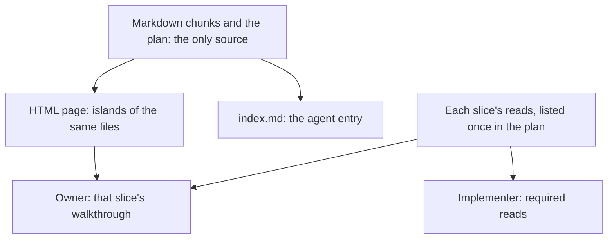

# Readable design sets: pages, walkthroughs and views for the owner

Status: **proposed**. Lead: 🦁 claude-local `68844339`. Focus 2, part B. Replaces `../2026-10-21-design-composition-model/spec.md` (its owner directions carry over; its ten open questions are answered in D8) and runs R5–R6 of `../2026-10-24-design-cycle-owner-review/spec.md`.

Every design set and every document the owner reviews is read as an HTML page built from its Markdown. Agents read the Markdown; the owner reads the same files composed on a page, with walkthroughs that lead through them: one for the feature end to end, one per capability, and one per PR or slice. Each view on the page is chosen by the question it answers for the owner.

## Requirements

The owner's words, grouped by need.

- **Pages compose the documents, with walkthroughs, for the owner and the agents at once**
  - "it shoudl compose documesnt with the walkt thyorughcunaionaty to allow great user uksndancablity while allowing agents to knwo what to do while buidlign a feature thorugh diffent prs and slices" (2026-10-24, answering Q1)
  - "do yo udatne dwhat demsytify and presntation html is capabile of?" (2026-10-24)
- **HTML is how design documents are read**
  - "I want all design docs to be interloop related and using HTML mostly, not the other two." (2026-10-24)
  - "i think use presentation html for specs os i can udnetand them" (2026-10-23)
  - "presentation-html is the main way to show and compose designs for people, using Markdown islands and components. No text walls." (owner direction, 21 October)
- **Diagrams are specified by what the owner needs to understand**
  - "I want proper specifications on what diagrams are used for human understandability, which just means my understandability." (2026-10-24)
  - "Requirements and tables don't really help, so that needs to be fixed" (2026-10-22)
  - "Requirements should be shown as a tree (capability → its rows), not a flat table." (owner direction, 21 October)
- **Agents write for people, and their detail stays in the documents**
  - "Agents write the whole document, so the skills must teach them to write for people." and "Agent detail stays in the documents, in its own parts, so a person can choose to dive in while an agent always reads it." (owner directions, 21 October)
  - "Break information up by document, capability, concept, depth and journey. A concept such as authorization shown only as a column cannot be understood." (owner direction, 21 October)

The Lead's own finding (2026-10-24): the batched-delivery and design-cycle pages restated their specs in page prose, against the rendering reference's rule that the page composes the Markdown and writes no normative prose of its own, and they declared no islands and no walkthroughs.

## What Demistify gives us

Read from the live v1 guide at release 1.12.0 (`c49d2f2f`) on 2026-10-24: `authoring/SKILL.md`, `references/tours.md` and `references/navigation.md`.

- **Markdown islands.** `<ex-markdown src="./requirements.md">` renders a Markdown file in place. Its headings get stable targets, such as `requirements--recovery`, and Mermaid fences inside it get `requirements--diagram-1`, with nodes at `requirements--diagram-1--Registry`.
- **Walkthroughs.** `<ex-presentation>` with `<ex-step to="…">` stops. A stop can be a whole island, a heading inside it, one Mermaid node, or a target on another page; a stop can open in a sidebar. The player reveals hidden tabs and waits for lazy rendering. Narration is short Markdown and adds no fact.
- **A page collection.** `<ex-nav>` with native page links gives a Pages menu, breadcrumbs, a heading outline, and ⌘K search over every page's headings and walkthroughs once `demistify index` has run.
- **Gallery Journeys** for picture-only paths, plus tabs, disclosure, flows, boards, trees, comparisons and Mermaid.
- **Delivery.** `demistify embed` writes a double-click copy with the Markdown embedded; `demistify check` validates the markup. Both run from `~/dev/sunstack-tools` at the release commit, now installed.

## Situations

1. **The owner opens a design set.** The collection has a home page, one page per document and a plan page. Home opens on the answer to the owner's question and one slice, then offers the walkthroughs. Every requirement, obligation and row appears once, in its Markdown island.
2. **The owner follows "the feature, end to end".** The walkthrough stops at the need, the contract, the call path and the proof row, each an island heading or diagram node.
3. **The owner opens a PR's walkthrough.** Its stops are the slice reads the plan lists for that PR's slices (part A, D9), in plan order: what the Implementer was told to read.
4. **A plan update supersedes a slice.** The plan page and that slice's walkthrough follow the superseding plan, and the plan's "Changed from" section shows what changed and what it invalidated.
5. **An agent picks up the work.** It reads `index.md` and the Markdown chunks: the same files, the same order, no page needed.
6. **The owner double-clicks the page.** The embedded copy opens without a server. After any edit, the copy is regenerated and compared byte for byte, and each derived view is rechecked against its chunk.
7. **Failure: a view needs a fact no chunk has.** The page does not invent it. The gap goes back to the document's owner, who adds the fact to its chunk first.
8. **Failure: no browser check.** The page goes to the owner with the exact proof gap named; the Markdown is still the source, so review isn't blocked.
9. **Not a page.** A handoff for another agent, a chat answer or a read-only run stays Markdown or chat.

## The owner's questions and the views that answer them

This is the diagram specification. Each view keeps its existing owner and required fields (`docs/diagram-vocabulary.md`); this table adds the owner's question each one answers and the order the page uses.

| The owner asks | View | Owning document |
| --- | --- | --- |
| What are we building, and for whom? | capability map, as a tree (capability → its rows) | Requirements |
| What will a person see and do? | journey map, with pictures or a Gallery Journey when supplied | Specification |
| What must always hold, and what can go wrong? | context diagram, with the failure cases named in the section title | Specification |
| What are the things the system keeps track of? | entity map | Specification |
| Who does what, and where are the boundaries? | component tree, trust-boundary view | Program Design |
| How does each thing move through its states, and what is never allowed? | state machine/table, with its guards and illegal paths | Program Design |
| What happens when a request comes in? | source-derived call path, or a sequence diagram | Program Design |
| How will we know it works, and what stays unverified? | "proven by" cards | Verification Design |
| How will it be built, in what order, in which PRs? | **delivery map** (new): PRs → slices → each slice's reads and the proof rows it earns, with each proof's layer (focused, integration or journey, and whether the journey drives the normal entry), dependency edges and integration gates | Plan |
| What changed since I last looked? | **plan change view** (new): each change → what it invalidated (slices, rows, PRs) | Plan (a superseding plan's "Changed from" section) |
| What do you need from me? | the decision brief, with today's model drawn before the options | the work thread |

Agents keep the views the documents already require (coverage tables, traces, entity-to-home maps). On the page those sit one action away, behind a tab or a disclosure whose title names what's inside.

## Design: runs

### R1 spec-design

With `shared-references/diagram-rendering-and-fallbacks.md`.

- In the rendering reference, Choose the Document Medium makes the page the default for every design set and every document an owner reviews. Markdown alone stays for agent-only artifacts, and chat, terminal and read-only runs stay as they are.
- `spec-design` writes the capability list as a nested Markdown list (D8.3), puts the human part first in each chunk (D8.6), and writes `index.md` when it starts a set.
- It then has `presentation-html` build or refresh the page.

### R2 presentation-html

With `references/engineering-documents.md`, `references/views.md` and `references/demistify.md`.

- The collection shape: home, one page per document, the plan page.
- Walkthroughs: the end-to-end path, one per `index.md` through-line and task path, and one per PR built from the plan's slice reads.
- The owner's-question table above, as the order in which a page opens.
- The two new views' page forms. The delivery map is an `ex-flow` (or an `ex-tree` when no edges cross); the plan change view is a compare or a list.
- The known tool route: the canonical sunstack-tools checkout at the binding's release commit.

### R3 program-design

Its views gain their owner questions. When it writes or revises a chunk, it updates its `index.md` entry and through-line steps (existing rule) and has the page refreshed.

### R4 verification-design

The same as R3, for the "proven by" cards and coverage rows.

### R5 design-documents.md

Rides with R1. The set layout gains:

- `plans/` (part A, D8);
- the capability tree, as the capability map's Markdown form;
- the chunk defaults in D8.

### R6 plan-implementation, the plan page

Rides with part A's R2. The plan page reads the plan's slices and their reads. No page logic lives in the plan.

### R7 skill-creation

In skill-authoring. A behavior-changing skill spec the owner approves gets a composed page beside it, built with the host's HTML presentation skill when the host provides one. `skill-authoring` names no sunstack-dev skill.

### R8 diagram vocabulary (ancillary)

Moved to the coordination record as ancillary work W5 ([coordination.md](coordination.md)). `docs/diagram-vocabulary.md` adds the delivery map and the plan change view, with their owner and consumers, and the vocabulary contract test updates with it.

### R9 spec-program-review

With `references/lanes/artifact-navigation.md`. The review lane's "tiny-file sprawl" check (`artifact-navigation.md:22–29`) accepts capability chunking as D8.1 sets it: Requirements and Specification chunked by capability by default, confirmed by the split test. A chunk that holds one capability's rows is not sprawl.

### R10 discuss-pathfinding

With `references/user-requirements-extraction.md`. It writes the capability list as the nested-list tree that D8.3 makes the capability map's Markdown form (`user-requirements-extraction.md:25`), so pathfinding and `spec-design` write one shape.

## How it will be proven

- **Static:** the contract tests, including the vocabulary test, plugin validation, and a source search that every caller of the rendering reference reads the new default.
- **On this spec itself:** focus 2 is written this way. Its page composes these chunks as islands, with one walkthrough per run, and `demistify check` passes on the embedded copy. That is a real use of the route, not proof that agents will follow it.
- **Unverified:** that fresh agents build composed pages unprompted, and that the owner finds them readable. The owner reading this page is the first real check.

## Decisions

The owner may strike any row.

| # | Decision | Reason |
| --- | --- | --- |
| D1 | "HTML mostly": a page is the default for every design set and every owner-reviewed document; the Markdown stays the source and the agent entry | Owner direction 2026-10-24; keeps one copy of each fact |
| D2 | A page composes islands and never restates them | The rendering reference already requires this; the Lead's own pages broke it |
| D3 | Walkthroughs: end to end, one per through-line and task path, and one per PR from the plan's slice reads | The owner's Q1 answer: understandable for the owner, and the same reads tell agents what to do |
| D4 | The owner's-question table is the diagram specification; every view keeps its document owner | The owner asked for diagrams specified by their understanding. Ownership stays where `diagram-vocabulary.md` puts it |
| D5 | Two new views, the delivery map and the plan change view, owned by the plan | The owner asked how a feature gets built "through diffent prs and slices"; no view shows that today |
| D6 | Pages bind Demistify v1 and record `version` and `sourceCommit`; the tool route is the canonical sunstack-tools checkout at that commit, built once there | The owner's one-build rule (2026-10-19); avoids per-task copies |
| D7 | Existing pages (batched delivery, design cycle, program) are rebuilt as composed pages when next revised, not now | They are approved or superseded; rebuilding them changes no decision |
| D8 | The design-composition spec's ten open questions get the answers below | It asked for owner decisions; the owner's 2026-10-24 answers settle the direction, and the rest are Lead defaults |

D8 in detail. Each answer is a Lead default the owner may strike.

1. **Chunk default.** Requirements and Specification chunk by capability by default, and the split test confirms each document. Program Design and Verification Design stay whole unless that test splits them. The Worked Set, spec-design's `artifact-and-self-review.md:32,36` and the review lane's "tiny-file sprawl" check change to match.
2. **Shared chunks.** Entities in the Specification's `entities.md`. A cross-cutting obligation stays with the need that asked for it (existing rule). Shared observations go in a Verification Design `observations.md`. The capability list lives in the Requirements entry.
3. **Capability list.** The nested-list tree is the capability map, in Markdown, with one home. `discuss-pathfinding` writes it in that form (cut over).
4. **Naming.** The order dimension is a "reading path" or "through-line", never "journey".
5. **Concept views.** Concept sections are link sections in `index.md`. A concept is selected when two or more capabilities' obligations name it, or the owner names it. The phase writing the owning entry updates it. Its picture is a link, and a missing picture is a gap.
6. **Chunk shape.** The human part comes first, using the views whose predicates fire. Agent detail (rationale, evidence, exact shapes, examples; never conditions, thresholds or error cases) sits in `
` blocks whose summaries name the failure cases inside. Binding, trace and call-path tables stay visible.
7. **Phase returns.** spec-design, program-design and verification-design also return the set layout, chunk shape and `index.md` duty.
8. **Set root.** `orchestrator-design` owns the set root (it already passes the artifact home). The rendering reference decides that a page exists; R1 makes that the default.
9. **Live-page freshness.** Editing any file a page includes, live or embedded, or the `index.md` whose paths it renders, triggers a recheck of the derived views.
10. **Requirements-only runs.** The page default covers them when the owner reviews them.

## Coordination

- **Base:** the same as part A, and in the same PR.
- **Run allocation, ancillary work, security decisions and release:** [coordination.md](coordination.md).
- **Dependencies:** part A's D8 (the plan lives with its spec, owner decided 2026-10-24) and D9 (slice reads) feed the plan page and the PR walkthroughs.
- **Review:** one spec review round over the whole focus 2 set.
