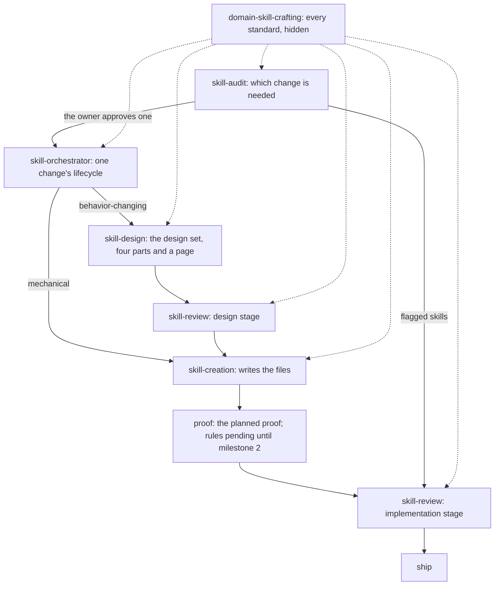

# Project 1, milestone 1: skill design

Draft 2, by the 🦁 Lead, 2026-10-26, revised after review M1 (`tmp/project-1-reviews/review-m1.md`). Part three of milestone 1's design set: [requirements](requirements.md), [specification](specification.md), skill design, [skill verification](skill-verification.md), with the annex [where each standard goes](standards.md). It says which files carry each obligation, what each skill's text becomes, and the runs that make the change. Sources are `ai-tools` `main` at `e427d8c9`.

## The shape



What carries each obligation:

| Skill | Job after milestone 1 | Obligations |
| --- | --- | --- |
| `domain-skill-crafting` (new) | holds every standard for skill text; hidden | R1 to R5, R15's standard |
| `skill-design` (new) | produces the design set for one behavior-changing change | R6 to R10, R15 |
| `skill-creation` | writes the files: inside an accepted design set, or from a mechanical change's classification | R12, R18 |
| `skill-review` | design stage and implementation stage, both loading the root; the transfer check; the first rule pass | R11, R16, R18 |
| `skill-orchestrator` | runs one change's phases | R13, R18 |
| `skill-audit` | decides which changes are needed; composes review for flagged skills | R14, R18 |
| `skill-rules` | how rules are written and run; corrected to the current engine | R19 |
| every run and the cutover | the reviewed boundaries | R17, R20 |

## The root: `domain-skill-crafting`

```text
plugins/skill-authoring/skills/domain-skill-crafting/
  SKILL.md                     core: CORE-1 to CORE-6, then the topic index
                               frontmatter: name, description (below), disable-model-invocation: true
  agents/openai.yaml           display name, short description, default prompt;
                               policy.allow_implicit_invocation: false
  references/
    descriptions-and-invocation.md   DESC-1 to DESC-15
    main-path.md                     MAIN-1 to MAIN-12
    calls-and-placement.md           PLACE-1 to PLACE-43
    steering.md                      STEER-1 to STEER-20
    generalization.md                GEN-1 to GEN-4, and the transfer test (new)
    proof-claims.md                  PROOF-1 to PROOF-19: what evidence may claim
    change-classes.md                CLASS-1 to CLASS-5 (new topic, moved definitions)
    security.md                      the sensitive-surface term set, SEC-1 to SEC-5
    platform.md                      platform facts, PLAT-1 to PLAT-10
    glossary.md                      definitions only
    worked-examples.md               the small end of the size range
```

The annex [where each standard goes](standards.md) gives every standard's sentence and its source line, and says what stays out of the root and where.

**The core.** It holds the mental model (CORE-1 to CORE-3), the rule that standards live here once and how topics open (CORE-4 to CORE-6), and the topic index: one `IF <condition>, load` call per topic, such as *IF writing or judging a description, or choosing whether a skill is model-invocable, load `references/descriptions-and-invocation.md` and return the standards that apply*. For security, the index condition is coarse and observable (anything that executes, reaches the network, comes from a third party, handles credentials or writes outside the repository), and `security.md` owns the exact list. The core's body is at most 1,200 words (R4).

**Each topic** opens with its standards, one sentence each, as paragraphs or list items (R3), then the depth that teaches them: inspection questions, good and bad examples, and when to stop.

**Hiding** uses the two settings `platform-mechanics.md:11` records as the owner's decision for domain skills, now PLAT-2. Callers reach the root by reading `../domain-skill-crafting/SKILL.md`, then the topics they need.

## The lifecycle skills

### `skill-design` (new)

Built from `skill-creation`'s steps 1 to 6 (`SKILL.md:141-224`), in the owner's order: requirements, evidence, generalization, then the design that creation will write.

1. **Classify and name the promise.** MUST load the root's core and `change-classes.md`, and return the change's class with its claim (CLASS-4). A mechanical change gets no design set: return it to the caller with its classification, for `skill-creation`. Otherwise name `create` or `update`, the existing owner of the behavior (or `none`), the reusable behavior in one sentence, the success definition in the owner's words, and who uses the skill and when (R7).
2. **Gather the evidence and the proof posture.** Interview the owner, or read the artifacts the change rests on, and record each signal with its date and source. IF the basis is an observed failure, load `references/proof-runs.md` and return the reproduction result and the decisions the user has (PROOF-2, PROOF-3). Name the proof posture with the root's `proof-claims.md`.
3. **Specify, and generalize.** State what the skill must do and each standard it states, one sentence each (R8). IF the skill states a rule, load the root's `generalization.md` and return each rule with its two transfer cases (R15).
4. **Design the skill.** The trigger, main path, call sites and references, each with the root topic that governs it (R9). IF any sensitive surface is in scope, MUST load `references/security-gate.md` before outlining that surface and return its decision (SEC-1).
5. **Plan verification.** MUST load `../skill-rules/references/decision-matrix.md` and return, for each requirement and standard, the properties it was decided on and its route: mechanical rule, judged rule, eval, review check, or unverified (R10). The matrix's five outcomes map to these routes: deterministic to mechanical rule, model-judged to judged rule, review-only to review check, eval to eval, and prose to no proof needed. Rule routes stay pending until milestone 2 has made the rules.
6. **Present the design set, and have it reviewed.** MUST load `references/design-set.md` and return the four parts with every slot filled or its exact unknown. MUST load `references/design-page.md` and return the page with its inspection results. Then use `skill-review` at its design stage and return its implementation decision, unless the owner named the design review and declined it.

Its references:

| Reference | Owns | From | Consumers |
| --- | --- | --- | --- |
| `design-set.md` | the design set's shape: the four parts' slots, the decisions table, run status, coordination, the review record, and when it is a document | `skill-creation/references/skill-spec.md` | design writes it; creation reads the accepted boundary and runs; review judges it; the orchestrator reads decisions and status |
| `design-page.md` | how to make and inspect the page (new) | new, taught from this set's own page | design |
| `proof-runs.md` | how to reproduce a failure and carry out a proof run | `proof-and-claims.md:7-20, 62-70`, as procedure | design (failing baseline); the orchestrator's proof step |
| `security-gate.md` | how to inspect a sensitive surface and decide before outlining: entry points, untrusted inputs, privileged actions, third-party source, the decision, the return labels, the stop | `security-gate.md:3-5, 25-45` | design; review's `sensitive-surface` check |

**What `design-page.md` teaches.** Its input is the four Markdown parts. The page opens with the answer in plain words, carries each part unchanged from its Markdown file (the page is a view, never a second copy that can drift), walks the four parts in reading order, and explains internal terms where they first appear. IF the host repository's instructions or skills provide an HTML presentation practice, build the page through it and return its checker result; otherwise write one self-contained HTML file whose parts come from the Markdown files, not retyped. The inspections: each part on the page equals its Markdown file; the answer comes first; the walkthrough reaches every part; the page reads at phone width. Stop when every inspection holds and the host's checker, when one ran, reports no errors. The plugin names no skill from another plugin (`plugins/skill-authoring/README.md:13`), so the host practice is found the way `skill-review` finds a host's Reviewer role (`references/reviewers-through-host-practice.md`).

Its description triggers on designing a skill change before files are edited. Its completion blockers are its own conduct: a behavior-changing design without a success definition or basis; an observed failure whose reproduction result is hidden; a sensitive surface outlined before its decision; a design set missing a part, a slot or the page; a design review skipped without the owner naming and declining it.

### `skill-creation`

It keeps one job, writing the files (`SKILL.md:226-228`), with its admission set by change class:

- **Admission.** For a behavior-changing or scoped change, read the accepted design set and take the run's success definition, basis, surface allocation, proof posture and decision rows from it, after checking that `../skill-review/references/design-review.md`'s acceptance binding still covers it (today's `SKILL.md:145`). For a mechanical change, take its classification claim (CLASS-4) and do static validation only; no design set is needed.
- **Write.** MUST load the root's core, and the topics for the surfaces the run touches. A draft shown in the conversation still shows each file under its own path (today's `SKILL.md:220`). IF the write would touch a sensitive surface the design set has no decision for, stop and return the change to `skill-design`.
- **Self-check** (a pending rule site, below).
- **Compare and return.** Compare the diff with the accepted design set, name any deviation, set the run to `implemented`, and return the proof and review still owed.

Its `references/` folder empties: every file moves to the root or to `skill-design`. Its description narrows to writing a skill's files from an accepted design, or a mechanical edit.

### `skill-review`

- `SKILL.md:10` says the checks judge a skill against the root's standards and load its topics by path, so the root's wording governs.
- **Design stage.** `references/spec-review.md` becomes `references/design-review.md`. Its artifact is the design set, whose shape `../../skill-design/references/design-set.md` owns. Its rubric is regrouped under the four parts; its blocker overrides stay (one skill per run among them) and gain two: the page is missing or a part on it differs from its Markdown, and a sensitive surface has no decision. Its teaching reviewer walks `mental-model-fit`, `depth-coverage`, then `transfer`; its structure reviewer walks `trigger-routing`, then `rule-agreement`. The first-required-revision step loads the root's `steering.md` (STEER-11 to STEER-17) in place of `skill-creation/SKILL.md`'s wording table (`spec-review.md:68`), and the shape step loads the root's `calls-and-placement.md` (`spec-review.md:22`). The acceptance binding is unchanged.
- **Implementation stage.** Its purpose is unchanged. It loads the root's topics where it loaded `skill-creation`'s references (`implementation-review.md:19, 31, 45`). Its correction routes name the new owners (`:61`): a design mismatch goes to the design set (`skill-design`), wording or placement to `skill-creation`, proof honesty to whoever ran the proof, an assessment gap to whoever assessed, and the ship surface to shipping. `transfer` is selected whenever a reviewed surface states a rule, and goes to the teaching reviewer. The first rule pass is a pending site.
- **Checks.** `trigger-routing.md:15` loads the root's `descriptions-and-invocation.md`. `sensitive-surface.md:12, 14` loads the root's `security.md` for the term set and standards, and `../../../skill-design/references/security-gate.md` for the inspection it re-walks. `placement-and-calls.md:14` loads the root's `calls-and-placement.md`. `mental-model-fit.md:15` and `rule-agreement.md:15, 39` load the root's `glossary.md`. `claim-vs-evidence.md:12` loads the root's `proof-claims.md`; its `:8` names creation's return, and its overlap note (`:40`) says carrying out proof belongs to `skill-design`'s `proof-runs.md`. Each check is compared, by meaning, with the [standards annex](standards.md): a sentence that restates a root standard is replaced by the load. The new `checks/transfer.md` loads the root's `generalization.md` and, for each rule a reviewed skill states, returns its two transfer cases and a verdict (R16).
- `references/reviewers-through-host-practice.md:34` says *design review* and *the design set at its commit*.

### `skill-orchestrator`

- Its frame (`SKILL.md:8`) names three gates: an accepted design set before files change, proof before review, and an independent review before ship. It doesn't write the design, the files or the review; `skill-design`, `skill-creation` and `skill-review` do.
- **Classify** (`:17-23`): its input is audit's approved recommendation or a change the owner names. A mechanical change goes straight to `skill-creation` with static validation (root `change-classes.md`). An evaluation uses `skill-review`'s design stage for a draft and its implementation stage for files. A slice of an accepted multi-run design set checks `design-review.md`'s acceptance binding (`:23`).
- **Step 2, design:** `skill-design`, ending at its design-review decision (`:33`). **Step 3, write:** `skill-creation` (`:37`). **Step 4, prove:** MUST load `../skill-design/references/proof-runs.md`, run the proof the design set plans, and judge the claim against the root's `proof-claims.md` (`:41`); the rule check is a pending site. **Step 6:** a design mismatch routes to step 2. **Step 7, ship:** IF shipping, load the root's `platform.md` for the facts and run the shipping actions it names for the touched surfaces: validators reported run or not run with their reason, versions in step, the changelog entry, and a refresh only when it is scoped (`:62`).
- The run summary gains a `rules:` line, and its completion blockers say *design review* where they said *spec review* (`:85`).

### `skill-audit`

- It loads the root's core where it judges skill text. `SKILL.md:8` keeps "Audit real workflows before creating skills" and "Prefer updating an existing skill over creating a duplicate"; its two standards move to the root (GEN-2, STEER-20).
- **A new step, after gathering evidence:** collect the flagged skills, those failing the rules (a pending site until milestone 2) or flagged by session evidence. For each, use `skill-review`'s implementation stage as an evaluation of existing files, and use its verdict and findings in the create, update, merge or skip decision. A recommendation for a flagged skill without its review verdict is a completion blocker.
- `SKILL.md:80` keeps its decision (recommend against one shared runtime document for packets whose fields or meanings differ) and loads the root's `calls-and-placement.md` for the standard it applies (PLACE-37, PLACE-41) in place of restating it. The standards at `:82` and `:84` move to the root (PLACE-16 to PLACE-18).

### `skill-rules`

- **Run 1, the engine correction.** In the description (`SKILL.md:3`), no marker and no old engine name (exact text below). `sunstack exec` replaces `sunstack-rule` as the engine's front door (`SKILL.md:22`, `markers-and-rules.md:92`, `check-and-reports.md:7`). The severities become the engine's `error` and `warn`, with `warn` the default, and the band becomes `error_at_or_below` (`markers-and-rules.md:56, 68`); the engine refuses `block` ("severity `block` was renamed to `error`", `sunstack-tools` `crates/sunstack-rules/src/definition_contracts.rs:118-120` at `7403724`). The recommendation to run `check_rules` in CI (`SKILL.md:54`, `check-and-reports.md:90-92`) becomes a local run by the skills, as the governing spec settles ("No CI: runs are local, by the skills"). Every field name it teaches is checked against the engine's rules-object schema at that commit.
- **Run 8, links.** Its links into `skill-creation` (`SKILL.md:8, 34`; `markers-and-rules.md:23-25, 76, 113`; `check-and-reports.md:33`; thirteen sites in `decision-matrix.md`) point to the root's sentences, by the IDs in the annex. *return it for `skill-creation` to rewrite* (`decision-matrix.md:13`) becomes a teaching change to the standard's home, designed with `skill-design` and written with `skill-creation`. A worked example that measured `skill-creation`'s text (the 467-word Call Grammar section, `decision-matrix.md:43`) is measured again on the root's text, or rewritten around the root's equivalent.

### Pending rule sites

Milestone 1 writes the four places that run the rules, and leaves each inert until project unit U5 switches it on (R18):

| Site | Skill and position | Until U5, returns | From U5 |
| --- | --- | --- | --- |
| Self-check | `skill-creation`, after writing and before comparing the diff | `rules: pending`, beside the diff | runs the rules on the changed files; failures are fixed or named as deviations |
| Proof | `skill-orchestrator`, step 4, with the planned proof | `rules: pending` in the proof result and the run summary | the rule check is part of proof |
| First pass | `skill-review`, implementation stage, after admission and before reviewers start | `rules: pending` in the per-check status block | each failed judged rule becomes a candidate finding a reviewer verifies |
| Every skill | `skill-audit`, the flagged-skills step | `rules: pending`; skills are flagged by session evidence only | every skill in scope is checked, and failures add to the flagged skills |

Each site says that a pending check is never reported as passed, and that from U5 a rule has run only when its native report says so, read the way `skill-rules`' `check-and-reports.md` teaches. U5 replaces the pending line at each site with the real call; nothing else in the site changes.

## Exact descriptions

Every description that changes, as it will ship. None carries a token (R5).

| Skill | Description |
| --- | --- |
| `domain-skill-crafting` (new, hidden) | Use when writing, designing, reviewing or auditing a skill's text, especially its description and invocation, its main path, calls and references, its steering and completion criteria, the rules it teaches, its proof claims, and its security and platform surfaces. |
| `skill-design` (new) | Use when a skill change needs its design before any file is edited: a new skill, a behavior change to an existing one, an observed skill failure to fix, or a design set to write or revise for review. Not for writing files from an accepted design (skill-creation), judging a design or a skill (skill-review), carrying a change end to end (skill-orchestrator), or choosing which skills should exist (skill-audit). |
| `skill-creation` | Use when writing or editing one named skill's files from its accepted design set, or making a mechanical edit to a skill: a typo, formatting, a version or metadata. Not for designing a skill change (skill-design), carrying it through proof, review and release (skill-orchestrator), judging a skill (skill-review), or choosing which skills should exist (skill-audit). |
| `skill-review` | Use when reviewing a skill change's design set before its files change, a skill draft shown in the conversation, or changed or existing skill files before they ship, especially when the review must be independent of the author or a skill's quality is in question. Not for reviewing product code or deciding which skills should exist (skill-audit). |
| `skill-orchestrator` | Use when creating, updating, or fixing one skill's behavior end to end: carrying one skill change from need to shipped (design, review, writing, proof, and release), or carrying one run of an accepted multi-run design set. Not for only designing a change (skill-design), only writing files (skill-creation), only judging a skill (skill-review), or deciding which skills should exist (skill-audit). |
| `skill-rules` | Use when deciding which standards in a skill should become checked rules, placing rule markers in skill Markdown, writing or fixing a rules-file entry or a RuleSet's `rule_sources`, proving a mechanical rule on good and bad examples, or reading `check_rules` refusals. Not for writing a skill's teaching (skill-design, skill-creation) or deciding which skills to change (skill-audit). |

`skill-audit`'s description doesn't change. The UI text in each `agents/openai.yaml` follows the same boundaries: `skill-creation`'s short description and default prompt say *write one skill's files from its accepted design* (today *design and write one skill and its spec*, `skill-creation/agents/openai.yaml:3-4`); `skill-orchestrator`'s and `skill-review`'s say *design* where they say *spec*; `skill-design`'s say *design one skill change before its files change*; the root's carry `allow_implicit_invocation: false`.

How the six neighbours split prompts:

| Prompt | Loads | Why not the neighbour |
| --- | --- | --- |
| *Design a skill for quarantining flaky tests; don't write anything yet.* | `skill-design` | the orchestrator would carry it on to files and release |
| *The design set for skill-x is accepted; write run 2's files.* | `skill-creation` | writing only; the orchestrator is for carrying the run through proof and review |
| *Make us a skill that quarantines flaky tests.* | `skill-orchestrator` | end to end, from need to shipped |
| *Is skill-x any good?* | `skill-review` | judging only |
| *Fix the typo in skill-x's description.* | `skill-creation` | mechanical; no design set |
| *Which of our skills should we merge?* | `skill-audit` | which skills should exist |
| *Turn skill-x's standards into checked rules.* | `skill-rules` | rules, not teaching |

The root never routes: it is hidden, and reached only by other skills' load calls.

## Cutover

Every consumer, with its anchor at `e427d8c9` and the run that changes it. Historical records (`docs/changelog/`, the October `docs/specs/` and `docs/wip/` folders, `retired-skills/`) keep their old names as history.

| Consumer | What changes | Run |
| --- | --- | --- |
| `skill-creation/agents/openai.yaml:3-4` | short description and default prompt: write files from an accepted design | 4 |
| `skill-review/SKILL.md:3, 10, 16, 29`; `references/spec-review.md` (renamed `design-review.md`); `references/implementation-review.md:19, 31, 45, 61`; `references/reviewers-through-host-practice.md:34`; `references/checks/trigger-routing.md:15`, `sensitive-surface.md:12, 14`, `placement-and-calls.md:14, 24`, `mental-model-fit.md:15`, `rule-agreement.md:15, 39`, `claim-vs-evidence.md:8, 12, 40`; `agents/openai.yaml` | as in its section above | 5 |
| `skill-orchestrator/SKILL.md:3, 8, 13, 20, 22, 23, 33, 37, 41, 58, 62, 85`; `agents/openai.yaml` | as in its section above | 6 |
| `skill-audit/SKILL.md:8, 80, 82, 84`, a new step and blocker | as in its section above | 7 |
| `skill-rules/SKILL.md:3, 22, 54`; `references/markers-and-rules.md:56, 68, 92`; `references/check-and-reports.md:7, 90-92` | the engine correction | 1 |
| `skill-rules/SKILL.md:8, 34`; `references/markers-and-rules.md:23-25, 76, 113`; `references/check-and-reports.md:33`; `references/decision-matrix.md` (13 sites) | links and the teaching-change route | 8 |
| `AGENTS.md:59, 66, 75, 77, 86, 163` | the root and `skill-design` named; what `skill-creation` now owns; proof claims and platform facts in the root | cutover |
| `plugins/README.md:89`; `plugins/skill-authoring/README.md:7-11, 17` | the skill table gains the root and `skill-design`; the proof paragraph names the root's `proof-claims.md`; `sunstack-rule` becomes `sunstack exec` | cutover |
| `.codex-plugin/plugin.json:8-18, 22-23, 30-36`; `.claude-plugin/plugin.json:8-18`; `.cursor-plugin/plugin.json` keywords | the two new skills in the keywords; the long description; a `skill-design` default prompt, and `skill-creation`'s (`:32`) saying *write* | cutover |
| `docs/architecture/skill-system.md:34, 41, 94, 96, 100`; `docs/architecture/skill-standards-linter.md:78` | the root as the home of standards; links to the root's core and `proof-claims.md`; a dated historical account keeps its old names | cutover |
| `tests/skills/lib/minimal-planning-delivery-contract.test.ts:193-199` | the list of skills that mustn't restate the convergence rule gains `skill-design/SKILL.md` and `domain-skill-crafting/SKILL.md` | cutover |
| version and changelog | `skill-authoring` 0.5.0 to 0.6.0 in all three manifests and the marketplaces; one dated entry under `docs/changelog/`, listed in its `README.md` | cutover |
| the owner's global prompt (devfiles), its skill index | names `skill-design` to design a skill change and `skill-creation` to write it | devfiles PR |

`plugins/sunstack-dev/skills/role-advisor/references/working-with-lead.md:28` and the legacy evaluator fixture stay, as review M1 found: one is an attributed old inspection and the other supplies sample strings.

## Runs and reviewed boundaries

**Units and runs.** The governing spec's project units bundle skills: U2b is two skills and U2c four. A run is narrower: one skill, as today's contract requires (`skill-spec.md:11`). So the units become runs:

| Run | Unit | Target | Kind | Writer | Depends on | Status |
| --- | --- | --- | --- | --- | --- | --- |
| 1 | U0 | `skill-rules`: the engine correction | update | Opus 5.5 high | this set accepted | proposed |
| 2 | U2a | `domain-skill-crafting` | create | Opus 5.5 xhigh | this set accepted | proposed |
| 3 | U2b | `skill-design` | create | Opus 5.5 xhigh | run 2 | proposed |
| 4 | U2b | `skill-creation`: narrowed | update | Opus 5.5 xhigh | runs 2 and 3 | proposed |
| 5 | U2c | `skill-review` | update | Opus 5.5 xhigh | runs 2 and 3 | proposed |
| 6 | U2c | `skill-orchestrator` | update | Opus 5.5 xhigh | runs 3, 4 and 5 | proposed |
| 7 | U2c | `skill-audit` | update | Opus 5.5 xhigh | runs 2 and 5 | proposed |
| 8 | U2c | `skill-rules`: links | update | Opus 5.5 xhigh | runs 1 and 2 | proposed |
| cutover | U2c | the repository documents, manifests, test, version and changelog above | shipping surfaces | Sol | runs 2 to 8 | proposed |
| devfiles | U2c | the owner's global prompt, in the devfiles repository's own PR | outside this repository | a subagent | boundary B accepted | proposed |

Every run is behavior-changing, drafted from the owner's 26 October decisions (user-directed intent), with structural proof and source walks now, and behavior proof on the next real skill change (part four). Each run's success definition is its obligations' rows in the specification; its surface allocation is its section above.

**Why the move is one reviewed state.** Moving a standard into the root and repointing everything that loads it can't be reviewed in pieces. If the root were reviewed alone while `skill-creation` still held the standards, they'd sit in two homes (R1). If `skill-creation`'s references went first, every `skill-review` check that loads them would break until run 5 (R17), and so would a reviewer reading the branch. So runs 2 to 8 and the cutover land as one integration, and the intermediate commits between them are work in progress: never reviewed, never shipped.

**The reviewed boundaries:**

- **A: run 1 alone.** It touches only `skill-rules` and moves nothing, so it is reviewed before run 8 builds on it.
- **B: runs 2 to 8 and the cutover, together.** Every standard has one home and every load path resolves (R20). Each run gets its own implementation review record at this head, covering its own files, and its status moves to `reviewed` on its own result.
- **C: the devfiles PR**, after B is accepted, reviewed in that repository with the owner's approval.

**The reviewer's source at A and B.** `skill-review` and the `skill-creation` references it loads, as they stand at the branch's base commit (`e427d8c9` today), read from a detached checkout of that commit, never from the branch being changed. Those references hold the same standards the root receives: the annex marks the few that are new, and the reviewers judge those against this accepted design set. A reviewer can therefore open every source it needs at every boundary. From B's release, after the owner merges and the installed plugins refresh, changes go through the new lifecycle, including milestone 2's.

## Coordination

- **Base:** `ai-tools` `main` at `e427d8c9`; branch `worktree-project-1-skill-crafting`, in the worktree `.claude/worktrees/project-1-skill-crafting`. Each run checks that base, and any open PR touching `plugins/skill-authoring/`, before it edits.
- **Version and changelog:** one bump, 0.5.0 to 0.6.0, and one dated entry, both in the cutover. The installed caches refresh only after the owner merges, as a release step.
- **Landing:** one PR, unless the owner chooses a split at plan review. Nothing merges without the owner.

## Decisions

Defaults the Lead took inside the settled model, each with its reason; the owner may strike any row.

| # | Decision | Reason |
| --- | --- | --- |
| D1 | Eight one-skill runs and a cutover, with reviewed boundaries A, B and C | today's contract requires one skill per run (review M1, C1), and the move can only be reviewed whole (C2) |
| D2 | The reviewer reads `skill-review` at the base commit | the skill under change can't review its own change, and the base holds the same standards |
| D3 | The change classes become a root topic; each skill keeps its own consequence | four skills classify changes, and the root is the one place all four load |
| D4 | Proof claims in the root; carrying out runs in `skill-design`'s `proof-runs.md` | claims are standards and running is a procedure (C9); `skill-design` reproduces failures and the orchestrator may load a phase's reference, while a phase may not load the orchestrator's |
| D5 | The security term set and standards in the root; the gate's procedure in `skill-design` | the decision must come before a surface is outlined, and `skill-design` outlines (C8) |
| D6 | The page's teaching lives in `skill-design`, with an optional host practice | the plugin names no skill from another plugin (C7) |
| D7 | The core's budget is 1,200 words of body | the hidden domain skills that load the same way run 807 to 1,171 words today (C10) |
| D8 | Platform facts and standards in the root; shipping actions in the orchestrator's ship step | the same standard-or-procedure split as D4 |
| D9 | `skill-authoring` goes to 0.6.0 | two new skills and changed boundaries are user-visible behavior |

## Review record

Review M1, at `9e360e33`: **targeted-revision**, implementation decision **revise-first**, 13 accepted findings (I1 to I3, C1 to C10) and two gaps (G1, G2). Review lead `codex-local/01a179cd`; teaching reviewer `codex-local/01a179cf-00fc`, structure reviewer `codex-local/01a179cf-1e75`. This draft answers each finding; the same review lead verifies the corrected anchors and closes G1.
