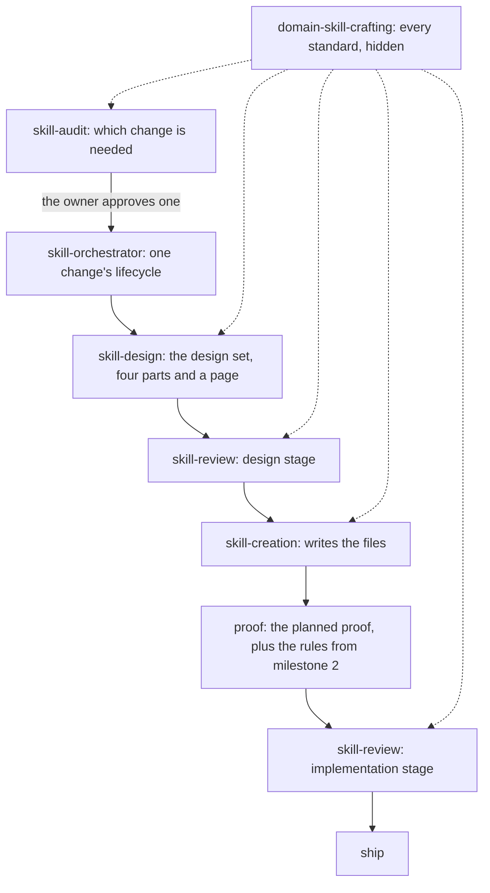

# Project 1, milestone 1: skill design

Draft 1, by the 🦁 Lead, 2026-10-26. Part three of milestone 1's design set: [requirements](requirements.md), [specification](specification.md), skill design, [skill verification](skill-verification.md). It says which files carry each obligation, where every standard moves from, and the runs that make the change. Sources are `ai-tools` `main` at `e427d8c9`.

## The shape



What carries each obligation:

| Skill | Job after milestone 1 | Obligations |
| --- | --- | --- |
| `domain-skill-crafting` (new) | holds every standard for skill text; hidden | R1 to R5, R15's standard |
| `skill-design` (new) | produces the design set for one change | R6 to R10, R15 |
| `skill-creation` | writes the files inside an accepted design set | R12 |
| `skill-review` | design stage and implementation stage, both loading the root; the transfer check | R11, R16 |
| `skill-orchestrator` | runs one change's phases | R13 |
| `skill-audit` | decides which changes are needed; composes review for flagged skills | R14 |
| `skill-rules` | how rules are written and run; corrected to the current engine | (U0) |

## The root: `domain-skill-crafting`

```text
plugins/skill-authoring/skills/domain-skill-crafting/
  SKILL.md                     core: what a skill is, the four surfaces, the topics and when each applies
                               frontmatter: description, disable-model-invocation: true
  agents/openai.yaml           policy.allow_implicit_invocation: false
  references/
    descriptions-and-invocation.md   the trigger surface: what a good description is, invocation capabilities
    main-path.md                     what belongs in SKILL.md; the lens, the route, branches, completion
    calls-and-placement.md           where material goes; the call grammar; progressive disclosure; shared shapes
    steering.md                      leading words, completion criteria, rule strength, the deletion test,
                                     positive shape, the wording table
    generalization.md                a rule teaches the reusable judgment; the transfer test (new)
    proof-claims.md                  the claim ladder, proof by skill type, what counts as a valid run
    security.md                      the sensitive surfaces
    platform.md                      platform facts: hosts, manifests, validators, versioning
    glossary.md                      definitions only
    worked-examples.md               the small end of the range
```

The core's every line is read on every load, so it holds only what every skill-authoring step needs (R4). Each topic reference opens with the standards as one sentence each (R3), then the depth that teaches them. Hiding uses the two settings `platform-mechanics.md:11` already records as the owner's decision for domain skills.

### Where every standard comes from

| From (today) | Becomes | Note |
| --- | --- | --- |
| `skill-creation/SKILL.md:8-10` (what a skill is) and `:20-31` (four surfaces) | root core | |
| `skill-creation/SKILL.md:33-43` (invocation) and `references/frontmatter-design.md` | `descriptions-and-invocation.md` | its name and length limits stay facts, not standards |
| `skill-creation/SKILL.md:45-100` (information hierarchy, call grammar, citations, progressive disclosure), `references/reference-design.md`, `references/shared-shape-design.md` | `calls-and-placement.md` | the hierarchy table's rows become sentences where they're standards (R3) |
| `skill-creation/SKILL.md:102-124` (leading words, steering) and the wording table at `:204-212` | `steering.md` | the table's rows become sentences |
| `skill-creation/SKILL.md:128-139` (what belongs in SKILL.md), the lens and branch rules at `:186-198`, step 4's completion at `:216`, "Depth must teach" at `:220` | `main-path.md` | |
| `skill-audit/SKILL.md:8` ("Skills encode judgment and house style, not task history") | `generalization.md`, with the transfer test (R15) | audit keeps its sentence about evidence before change |
| `skill-creation/references/proof-and-claims.md` | `proof-claims.md` | the "Running" protocol stays here as the standard for a valid run |
| `skill-creation/references/security-gate.md`, the list at `:7-21` | `security.md` | the gate step (decide before writing) moves to `skill-creation` |
| `skill-creation/references/platform-mechanics.md` | `platform.md` | |
| `skill-creation/references/glossary.md`, `references/worked-examples.md` | `glossary.md`, `worked-examples.md` | |

Conduct isn't a standard for skill text, so it stays with the skill that acts: "one named skill per run", "Open the skill's current files before saying anything about them" and "Whoever writes a change never reviews it" stay in `skill-design`, `skill-creation`, `skill-orchestrator` and `skill-review`, where they govern what those agents do.

## The lifecycle skills

- **`skill-design` (new).** Built from `skill-creation`'s steps 1 to 6 (`SKILL.md:141-224`), in the owner's order:
  1. Requirements and evidence (from steps 1 and 2: the promise, success definition, owner, baseline, authoring basis, reproduction, change class).
  2. Specification and generalization (new: the standards the skill states, each one sentence, with the transfer test from the root's `generalization.md`).
  3. Skill design (from steps 3 to 5: trigger, main path, call sites, depth), loading the root's topics for each.
  4. Skill verification (from step 2's proof posture and the proof plan, plus which standards become rules in milestone 2).
  5. The design set and its page, then `skill-review`'s design stage (from step 6).

  `references/design-set.md` replaces `skill-creation/references/skill-spec.md`: the four parts' slots, the page, the decisions table and run status. Its description triggers on designing a skill change before files are edited.
- **`skill-creation`** keeps step 7 (`SKILL.md:226-228`): read the accepted design set, run the security gate for any sensitive surface (loading the root's `security.md`), write inside the boundary, compare the diff with the accepted design, and set the run to `implemented`. Its description narrows to writing a skill's files from an accepted design set.
- **`skill-review`.** `SKILL.md:10` points to the root instead of `skill-creation`. `references/spec-review.md` becomes `references/design-review.md`: its rubric is regrouped under the four parts, and its blocker overrides stay. Every check that loads a `skill-creation` reference loads the root's topic instead. A new `checks/transfer.md` carries R16.
- **`skill-orchestrator`.** Step 2 runs `skill-design` and the design stage; step 3 runs `skill-creation`; step 4's proof loads the root's `proof-claims.md` and names the rule check pending until milestone 2; step 7 loads the root's `platform.md`. Its classification line names its input: audit's approved recommendation or a change the owner names.
- **`skill-audit`.** Loads the root. Its line 8 moves to the root. A new step composes `skill-review` (an evaluation of existing files) for each skill flagged by the rules or by session evidence, and uses the result in its create, update, merge or skip decision.
- **`skill-rules`.** U0 corrects it to the current engine: `sunstack exec` in place of `sunstack-rule`, and `error` and `warn` in place of `block` and `nudge`, in its description, `SKILL.md`, `references/markers-and-rules.md` and `references/check-and-reports.md`. Its links into `skill-creation` (a dozen, mostly in `references/decision-matrix.md`) point to the root's sentences.

## Cutover outside the skills

- `AGENTS.md:59-77, 86, 163`, `plugins/README.md`, `plugins/skill-authoring/README.md`: name the root and `skill-design`, and say what `skill-creation` now owns.
- The plugin's three manifests list the two new skills; the Codex manifest's default prompt line (`.codex-plugin/plugin.json:32`) matches the new boundaries.
- `docs/architecture/skill-system.md` and `docs/architecture/skill-standards-linter.md`: the root as the home of standards.
- `tests/skills/lib/minimal-planning-delivery-contract.test.ts:193-199` keeps review's convergence rule single-homed; the two new skills join its list.
- Version: the `skill-authoring` plugin bumps, with a changelog entry.
- The owner's global prompt (devfiles) names `skill-creation` in its skill index; a devfiles PR, written by a subagent and approved by the owner, changes it to name `skill-design` and `skill-creation` and lands with this milestone.

## Runs

Each run changes one skill or one shared set of documents. The runs land in one PR unless the owner chooses a split at plan review.

| Run | Target | Writer | Depends on |
| --- | --- | --- | --- |
| U0 | `skill-rules`: the engine correction | Opus 5.5 high | none |
| U2a | `domain-skill-crafting` (new) | Opus 5.5 xhigh | this design set accepted |
| U2b | `skill-design` (new) and `skill-creation` narrowed, in one run so no standard or step sits in two homes | Opus 5.5 xhigh | U2a |
| U2c | `skill-review`, `skill-orchestrator`, `skill-audit`, then `skill-rules`' links | Opus 5.5 xhigh | U2b |
| U2d | repository documents, manifests, test, version and changelog | Sol | U2c |
| U2e | the owner's global prompt (devfiles PR) | a subagent, as the owner requires for devfiles | U2c |

The restructure is made with today's `skill-creation` and `skill-review`: this design set is the reviewed spec for all of its runs. From U2c's completion, changes go through the new lifecycle.
