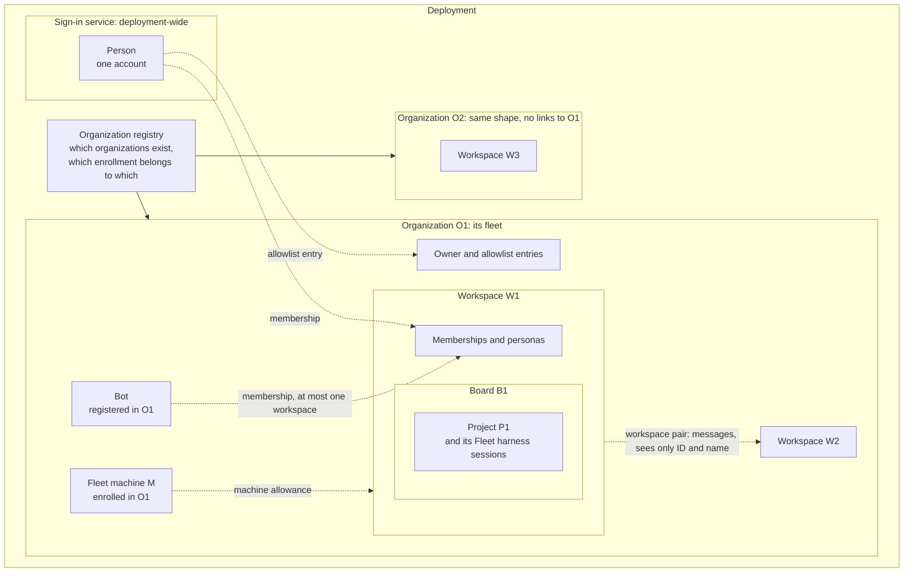

# Readable views standard: requirements

Draft 2, 2026-10-27, by an Opus 5.5 🛠️ Worker for the 🦁 Lead, after the design review's targeted revision (findings F1 to F3 and gap G3, `tmp/project-3-reviews/u2-design-review.md`); draft 1 was `49caeebe`. Written with this branch's `skill-design` (`plugins/skill-authoring/skills/skill-design/SKILL.md` at `66e8adae`). Part one of four: requirements, [specification](specification.md), [skill design](skill-design.md), [skill verification](skill-verification.md). It is Project 3's unit U2; the governing spec is Project 3's spec, revision 2, section 1 and the U2 row (`~/dev/memory-logs/projects/2026/2026-10-skills-and-sessions/scratch-root-01a1635f/project-3/spec.md`). Nothing here is built.

## The change

- **What it does:** one short section in the reference every design phase loads when it draws a view (`plugins/sunstack-dev/shared-references/diagram-rendering-and-fallbacks.md`). The section states seven standards for a view a person can read, one sentence each. It loads `diagram-semantics.md` so the phase picks the right kind of diagram for the question, and `markdown-presentation-baseline.md` when a label would carry a technical name, so that name moves beside the view.
- **Class:** behavior-changing. It adds teaching and two reference calls (`diagram-semantics.md`, `markdown-presentation-baseline.md`) to one shared reference, and makes its completion line require the new standards: it alters the reference's steering, its calls and its completion.
- **Runs:** `update` on the rendering reference (U2); then a mechanical run that adds the rendering reference to `diagram-semantics.md`'s consumer line (U2b).
- **Who already owns parts of this:** the rendering reference owns semantic preservation and the visual check (`:3`, `:77-97`); `diagram-semantics.md` owns choosing the kind of diagram (`:3`, `:17-115`), but no design phase loads it. The rest is scattered as examples: `mermaid-usage.md:17,23,27`, `markdown-presentation-baseline.md:54`, `presentation-html/SKILL.md:48`, `presentation-html/references/views.md`, `principle-write-for-the-reader/SKILL.md:27` and its `references/layered-detail.md:12,24-42`. None states a standard every view must meet, in the file the phases read at the moment they draw.
- **Baseline:** the rendering reference as it stands on this branch at `66e8adae` (118 lines; last changed by focus 2's I4 fix, `52ab5cec`), and `diagram-semantics.md`, unchanged from main `39957959`.
- **Reusable behavior:** this reference helps agents reliably draw views a person can read whenever a skill asks them to show a design relationship.

## The need, in your words

- "I want proper specifications on what diagrams are used for human understandability, which just means my understandability." (24 October, `intent/intent-ledger-addendum-queued.md:13`, L3429)
- "make sure the diagrams are suited and specifeid for human concukmpitons and amek srue agents generate them when skills are used" (25 October, `intent/owner-messages-after-ledger.md:11`)
- "Requirements and tables don't really help, so that needs to be fixed." (22 October, Lead session L47, ledger O002)
- "tehre are standars dthat work well that i dont have to ask for eveyr time." (26 October, on the Project 3 page, `intent/owner-messages-2026-10-26.md:71`)
- "complelyt overfitted slop no generalzieable rules" (25 October, ledger O064): so no standard names a product, tool or incident.
- What you were promised for this unit: "the standard with three good and three bad views from your own past pages, before skills change" (the spec's U2 row).

The `intent/` paths are in the same scratch folder as the governing spec.

**Success definition:** when a skill asks an agent to draw a view, the agent draws one you can understand at a glance: it says which question it answers, shows only what that question needs, in your words, at the size the question needs, beside the text it explains, and it changes what you conclude. A view you'd have to decode is never reported as passing. Each standard is one sentence, so each can later become a checked rule.

## Who reaches it, and when

An agent, through a skill. Every design phase loads this reference with `MUST load` at the step where it draws views: `spec-design/SKILL.md:240`, `program-design/SKILL.md:228`, `verification-design/SKILL.md:93`, `discuss-clarify-mental-models/SKILL.md:68`. `presentation-html` loads it for a design set's page (`SKILL.md:14`, `references/engineering-documents.md:22`), and `docs-maintain` loads it when an edit touches a page (`SKILL.md:77`). No person loads it directly, and it has no description; every consuming skill's description is retained.

## Evidence: your reactions to past views

How I found these: a scripted pass over your own typed turns in every Claude session log since 10 September (191 logs) and the Codex sessions of September and October, for any reaction that names a diagram, view, picture, table or page, plus every page-comment Copy you pasted back. I read each candidate in its context and kept it only when your words are about one view and its revision can be found. This is enough to show the standard; it isn't the Luna mining that settled decision 2 asks for before eval labels (U10).

Three bad views have a reaction tied to them, from three projects. Only two good views do, and both are in chat answers, not pages. This search found no third; that doesn't show none exists. A wider search, your own pick of a page you liked, or your decision to change the promise would close it.

### Bad 1: two relationships in one picture (agent-vm, 26 October)

The only drawing on the Organization hierarchy page, revision `2026-10-26.1` ("Containment, with references dashed"; agent-vm `3629b91d`, `docs/wip/2026-10-26-organization-hierarchy/index.source.html:95-129`). It nests deployment, organization, workspace, board and project as boxes inside boxes, and draws five kinds of reference as dashed arrows crossing between the nested boxes. Further down, the page asks whether an organization's workspace records and admission records are one database or two objects, with only a table and two options in prose to answer it.

Your reactions: a screenshot of this picture with "this make sense for you? do self review" (13:49 UTC), then a comment on the storage question of that revision: "unclean not good dieagrams entity relations hiot clearf" (13:51 UTC). Sources: agent-vm session, lines 9866 and 9916.

What it shows: standard 2 broken. On top of what contains what, the picture answers a second question (what refers to what), and those arrows obscure the first; the question the page itself asks (which records live together) has no view at all. Your words don't speak to its heading.

The view as it was, so you can see it again (today's renderer may lay it out differently):

### Bad 2: four kinds of edge, three of them dashed (ai-tools, 14 October)

The skill composition explorer, headed "What does this skill build on?" (`docs/wip/skills-authoring/2026-10-14-five-document-planning-convergence/planning-dag.html`, drawn by script). Its key lists four kinds of line: named in `SKILL.md` (solid), through a referenced file (dashed), within one layer and may cycle (dashed), and a missing principle link (dashed, in the warning color).

Your reaction: "its too hard to visualize too many dashes" (12:32 UTC), after asking "when i click on l2 i want to see teh l1 and l0 and make it easy tko see dag and easy to view what sgoign on". Sources: Codex session `01a118ee`, lines 29830 and 28985.

Revision: approximate. The nearest commit before your reaction is `a41cf5d1` (11:18 UTC); the agent changed the drawing in its working copy between 12:22 and 12:29 UTC, adding role arrows, and the next commit is `347a65f8` (14:44 UTC). So you saw at least these four kinds of line.

What it shows: the rendered check broken (line styles you can't tell apart), which is what your words are about. Standard 2 is unknown here: a count of edge kinds doesn't settle it, and whether the dashed kinds (peer links, missing links) answer a different question from "what does this skill build on?" is my reading, not your words. Its heading does state a question; your words don't speak to it.

### Bad 3: requirements as one big table (codex-router, 24 October)

The Requirements of the provider-native-capabilities design (codex-router, `docs/specs/2026-10-23-provider-native-capabilities/requirements.md`, before its first commit). Its needs were one table of eight rows and four columns (the need, the outcome and its reason, your words as the source, and the authority): four rows about what you'd get from the product, four about proof, production safety and the HTML reader.

Your reaction: "why … can kyoku not make diagrams kudnetand able talbes. also i sadi break up teh … user requriemts to make it udntean dable i dotn need giant … tables" (01:19 UTC; four words left out). Source: Codex session `01a1661a`, line 7300.

Revision: approximate. The file wasn't committed until after your reaction; the session's record holds it as first written (23:46 UTC on 23 October, line 6101), and review rounds may have edited it before you read it. "i sadi break up" says the table was still there. The first commit, `152ebdd77`, is the rewrite that followed: one short section per capability, each with a small flow. Your reaction to the rewrite isn't recorded, so it isn't shown here as good. The table isn't copied here, because it survives only in the session record.

What it shows: standard 5 broken (not the smallest view that answers the question), and it bears on standard 2 (two kinds of need in one table).

### Good 1: the decision tree in your own words (a chat answer, 25 October)

In the Lead's chat answer about Project 2, a small top-down text tree: ingested inputs, then a mechanical filter, then three yes-or-no questions asked in turn (is it a technology choice; does the repository already use it; is there an owner decision for it), each with the branch where a candidate is dropped, ending at a finding or a bigger judge.

Your reaction: you pasted it back with "yes this is what i meant" (10:51 UTC), after asking "and deicsion tree did you udntaend what that means? for jev?" (10:50 UTC). Sources: Lead session, lines 18307 and 18191 (ledger O075, O073).

What it shows: standard 2 kept. Everything in it serves the one question you asked: the order of the filters and where each drops a candidate. Its questions reuse your own rule ("use teh repo techonolgoy or ask the suker dont assume tech choices", O065), which is standard 4, but your reaction doesn't single that out. It's a chat view, not a page, and isn't copied here because it is session text.

### Good 2, with one flaw: the four-level ladder (a chat answer, 29 September)

In a chat answer about agent roles, a small text ladder (project, milestone, task, subtask), each level beside the check it is verified against, one line for the loop every level runs, then a table of how far each role drives before handing back.

Your reaction: "we do need to explain what operator does better but this is good." (13:11 UTC, two and a half minutes after the answer). Source: devfiles session, line 8270.

What it shows: the view as a whole is good (standard 2 kept). Your correction asks for a better explanation of the Operator's row; that is about explaining, and doesn't settle whether the row's words are yours (standard 4), so standard 4 stays unknown and unscored for that row until you label it. A chat view, not copied.

### No third good view found

The closest: "it looks good the reqkuriemetns, spec is hard to read as its a wall of text with no diagrasma fter the first seciton" (28 September; codex-router Claude routing session, line 20374). It's about the whole Requirements file of the Claude account routing design (written at line 20081 of that session; first committed in codex-router `b89cf100a`), which held one "today and wanted" picture and two tables. It covers the whole file, so it can't label the picture alone, and the same file's needs table is the kind your later words reject. It labels nothing.

### Reactions checked and not used

- "sequenece work well in plans  page" (agent-vm, 27 October, line 21575): one of a run of instructions ("make srue the adviros reviews…", "…shodu be first"), not praise.
- "righ tok i think i like this" (agent-vm, 26 October, line 12707): about the proposed login model, not the table that showed it.
- "i like this" on two popover mockups (AgentStudio, 27 October, `ec6754a7` line 11372): about the screen design, not how the picture reads.
- "ovber all this looks good" (codex-router, 16 October, `9f6bdec4` line 25259): the whole explainer set, mostly its content.
- "your entitny diagram is so hard tudenderstand how does it happein?" and "I just can't tell what's going on here." (agent-vm Fleet storage page, 26 October, lines 8942 and 8971): a fourth bad case, held back so the three shown come from three projects.
- "im surpraise deiciosn has a walkt thorugh its just a file?" (24 October): about a walkthrough, not a view; it is already the bad case in `principle-write-for-the-reader/references/layered-detail.md:42`.
- "Requirements and tables don't really help" (O002) and "be easyk to dkunand no massifcung tables" (codex-router, 24 October, `9f6bdec4` line 125603): standards you set, not reactions to one view. They settle what the standard means (settled decision 2) and label no case.

### Sources

- Lead session: `~/.claude/projects/-Users-shravansunder-dev-ai-tools--claude-worktrees-project-1-skill-crafting/68844339-00d7-476c-910a-24cba89d8758.jsonl` (the intent ledger cites its earlier path; the lines match).
- agent-vm session: `~/.claude/projects/-Users-shravansunder-code-projects-agent-vm-design-portal-remediation/cd5902e2-2105-4472-adde-031ae6496e30.jsonl`
- devfiles session: `~/.claude/projects/-Users-shravansunder-dev-devfiles/4825fe5c-afb7-4fc5-a6cf-35768c90408c.jsonl`
- codex-router Claude routing session: `~/.claude/projects/-Users-shravansunder-Documents-dev-project-dev-codex-router-router-claude/8d47f947-6858-41d1-a720-817d49e2b549.jsonl`
- codex-router collaboration session (`9f6bdec4`): `~/.claude/projects/-Users-shravansunder-code-projects-codex-router-collab-improvements/9f6bdec4-853f-4d3a-8ed0-0d7b4b128af3.jsonl`
- AgentStudio session (`ec6754a7`): `~/.claude/projects/-Users-shravansunder-code-projects-agentstudio-pane-fixes/ec6754a7-8a29-4d08-98ce-5b463e2be88f.jsonl`
- Codex session `01a118ee`: `~/.codex/sessions/2026/10/07/rollout-2026-10-07T20-34-05-01a118ee-7a7a-7720-93a9-224143877b04.jsonl`
- Codex session `01a1661a`: `~/.codex/sessions/2026/10/22/rollout-2026-10-22T20-12-56-01a1661a-85a8-7a23-bc3b-e052a9b5c6b7.jsonl`

## Authoring basis

User-directed intent: your asks of 24 and 25 October and the spec's U2 row. The bad views are evidence of the need. No failure was reproduced for this change, and none is claimed fixed.

## Non-goals

- Each view's own sentence (its reader, question and fields), which U3 to U6 write in the skills that own the views.
- Rule markers, rules entries and the RuleSet (U8), running them (U9), and their evals (U10).
- How a page reads at phone width (focus 2's open finding I5, yours to pick); pixel checks stay with `presentation-html`'s browser look.
- Changing the teaching in `diagram-semantics.md`, `mermaid-usage.md`, `markdown-presentation-baseline.md`, `presentation-html` or `principle-write-for-the-reader`.
- The chat presentation skills (`presentation-tui`, `presentation-webui`).
