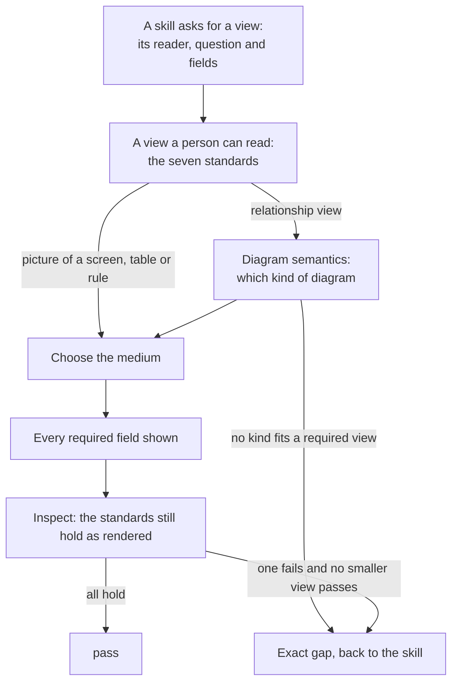

# Readable views standard: skill design

Part three of four: [requirements](requirements.md), [specification](specification.md), skill design, [skill verification](skill-verification.md). Which files change, what the new section says, and the runs that carry it.

## Targets and runs

Owner plugin: `sunstack-dev`. Two runs, each with one target:

1. **Run 1, U2: `update` `plugins/sunstack-dev/shared-references/diagram-rendering-and-fallbacks.md`.** Behavior-changing.
   - Trigger: none. A shared reference has no description, and every consuming skill's description is retained.
   - Main path: the new section, the opening, the expected inputs, the completion line, and two lines trimmed so each meaning has one home.
   - Depth: one new load, of `diagram-semantics.md`, for relationship views.
   - Proof: in [skill verification](skill-verification.md).
   - Rides along (repository docs, not skills): the ownership sentence in `docs/architecture/skill-system.md:80`, in `plugins/sunstack-dev/docs/diagram-vocabulary.md:3` and in `AGENTS.md:114`.
2. **Run 2, U2b: `update` `plugins/sunstack-dev/shared-references/diagram-semantics.md:3`.** Mechanical: the consumer list gains `shared-references/diagram-rendering-and-fallbacks.md`. Metadata only; no teaching, call, input, return or completion changes.

## Where does the standard act when a skill draws a view?

The skill that asks for a view names its reader, question and fields. The new section sits between that request and the choice of medium, and its standards are checked again once the view is rendered.



## What changes in the reference, line by line

1. **Opening (`:3`).** Add the standards to what it owns: "…It owns each view's medium, rendering fallback, semantic-preservation inspection, visual-check result, and the standards a view meets so a person can read it. The consuming skill selects the views: their predicates, readers and questions, required semantic fields, and UI moments."
2. **Expected inputs (`:5`).** View requests contain "the fired predicate plus required semantic fields, and the view's reader and question when the consuming skill names them".
3. **New section, `## A View a Person Can Read`,** placed before `## Choose Each View's Medium` (`:63`), because the kind of diagram is chosen before its medium. Its proposed text is below.
4. **Preserve Semantics (`:77-83`).** Keep `:79`. Delete the `Good:` line (`:81`) and the `Bad:` line (`:83`): their meanings move to standards 2, 5 and 7 and the new section's cases, and the dropped-field case is `:79` itself.
5. **Inspect and Fall Back (`:92`).** Replace "the view adds decision clarity rather than decoration" with "each standard in A View a Person Can Read still holds in the rendered view".
6. **Complete when (`:118`).** "…and every fired view has a `pass` result: it meets each standard in A View a Person Can Read, with all required semantic fields preserved and readable, or the caller receives an exact gap that blocks its artifact-completion step."

The Return Shape (`:99-116`) doesn't change (decision D3).

## Proposed text for the new section

`skill-creation` writes the final words from this; the seven standard sentences are the ones you confirm.

```markdown
## A View a Person Can Read

Every view this reference renders meets these standards, whatever its medium. The consuming skill names a view's reader, question and fields; these standards say what makes the view readable for that reader.

IF a view request is a relationship view, load `diagram-semantics.md` with the view's question and return its primary family with the reason, and its stop/simplify result. A view the consuming skill requires is never simplified away: when no family fits it, return the exact gap to that skill, not prose or a table marked pass.

- Each view's heading or caption states the question the view answers.
- Each view shows one relationship, the one its question asks about.
- Each view stays at the level of detail of the document that holds it, leaving to a later document what that document owns.
- Each view names its parts in its reader's own words: the names the reader has used, or plain names where the reader has used none.
- Each view is the smallest view that answers its question.
- Each view sits beside the text it explains.
- Each view changes what its reader concludes, rather than restating a sentence beside it or decorating the page.

Bad: one picture of nested boxes for the parts of a system, with five kinds of dashed arrow crossing between the boxes, under a question about which records share a store. The reader can follow neither the nesting nor the arrows, and the store question has no view at all. Better: one view of what contains what, one of the references, and an entity view of the records the question names, each under its own question.

Bad: a dependency graph with four kinds of edge, three of them dashed in different ways. The reader decodes line styles before reading the graph. Better: draw the one kind of edge the question asks about, and keep the others one action away.

Bad: requirements as one table of eight rows and four columns, mixing what the user gets with how the work will be proven. Better: one short section per capability, each with its need in the reader's words and, where order matters, a small view of the experience.

Good: a decision path drawn as the reader's own question: each step a yes-or-no question in the reader's words, with where "no" goes, ending at the result. The reader confirms it is what they meant.
```

About fifteen lines of prose and seven list items: the reference grows from 118 lines to about 140, well under the 600-line smell.

## Calls

- **New, in the section:** `IF a view request is a relationship view, load diagram-semantics.md with the view's question and return its primary family with the reason, and its stop/simplify result.`
  - Form: one literal `IF <observable condition>, load`. The condition is observable: this reference already defines a relationship view (`:67`).
  - Where and what: `diagram-semantics.md`, to choose the family for the view's question.
  - What comes back and who uses it: the family picks the medium in Choose Each View's Medium and is what standard 2 is judged against; the stop/simplify result is handled by the next sentence, which turns "simplify to a table or prose" into an exact gap for a required view.
- **The callee's side:** `diagram-semantics.md` already expects "the concept to explain, the reader's current question, and the consuming skill's surface stance" and returns "the selected primary family with its reason, the disclosure sequence chosen, and the stop/simplify result" (`:5-7`). This call passes the question and uses the family and the stop/simplify result. It doesn't use the disclosure sequence: a design document's reading order belongs to `design-documents.md` and the page.
- **Unchanged:** the loads of `generated-document-visuals.md` (`:69`) and `mermaid-usage.md` (`:70`), the `presentation-html` route (`:20`, `:71`), and the mention of `markdown-presentation-baseline.md` (`:72`).
- **A double load, harmless:** on a design set's page, `presentation-html` step 2 also loads `diagram-semantics.md` for a relationship diagram. The same agent reads the same file for the same view and gets the same family; nothing changes there.

## The root's topics that apply

From `domain-skill-crafting`, each with what it governs here:

- **Change classes:** behavior-changing, with the surfaces named above; run 2 is mechanical, metadata only.
- **Generalization:** every standard and the gap rule carry two transfer cases and a passing verdict (specification).
- **Main path:** the new section owns a stage, so it says what to inspect (the standards), what good and bad look like (the cases) and when to stop (the completion line), as `calls-and-placement.md:18` asks.
- **Steering:** each standard says what to do, not what to avoid. The completion line is the repair for shallow legwork: `pass` now requires the standards. Every proposed sentence passes the deletion test: removing any standard drops one property from what a phase checks, and removing a case drops the only worked example of its standard.
- **Calls and placement:** one load in its literal form; one home per meaning (decisions D2 and D4); no shared shape changes (D3).
- **Proof claims:** a reference's proof shows the pointer reaching the right detail and the detail applied; until then this is "drafted from user intent; behavior not yet evaluated" (skill verification).
- **Descriptions and invocation:** not applicable; there is no description to write or change.
- **Platform:** the version and changelog surfaces, reported in Coordination.
- **Worked examples:** not loaded; this is an update and the reference's shape isn't contested.

## Sensitive surfaces

None. Both runs change prose only: no script, hook, command, network access, credential, third-party source, cache refresh or home-level write. The security gate's condition doesn't hold.

## Decisions taken (strike any)

| # | Default taken | Why |
| --- | --- | --- |
| D1 | The standards live in the rendering reference. | Every design phase already loads it at the moment it draws views, and it already owns the visual check. `diagram-semantics.md` isn't loaded by any phase; the principle is cited, not loaded, so it isn't read at the drawing moment. The spec leaves the home to the Lead. |
| D2 | Seven standards, re-cut from the spec's seven, one property each. | A rule judges one claim; spec 3 and spec 5 held two each, and the fields half of spec 3 already has its home at `:79`. |
| D3 | The Return Shape stays as it is; the completion line makes `pass` require the standards. | Per-view questions arrive with U3 to U6 and the runner's result with U9. A self-reported "standards kept" field now would be the agent's own word, which the spec says isn't enough, and every consumer would change twice. |
| D4 | Where commands, paths and identifiers go stays with `markdown-presentation-baseline.md:54`; it isn't restated. | One home per meaning. Cost: a design document in Markdown alone doesn't load the baseline, so that rule doesn't reach its views; standard 4 still rejects code names, since they aren't the reader's words. Alternative: a conditional load of the baseline when a label would carry an identifier, which adds a call and changes the baseline's consumer line. |
| D5 | The section's cases are written from your past views, naming no project. | The #166 lesson: incidents only as examples. The real views and your words stay in this design set. |
| D6 | You confirm the seven sentences before `skill-creation` writes them. | Settled decision 2: standards are talked through and confirmed by you, so you aren't asked again. |
| D7 | Run 1 also updates the three ownership sentences (architecture doc, vocabulary index, `AGENTS.md:114`). | When what a file owns changes, every description of it changes in the same change. `AGENTS.md` is the repository's operating map; the Lead may prefer to leave it to `docs-maintain`. |
| D8 | The `sunstack-dev` version bump and changelog entry land with the project's release unit (U11). | The governing spec puts release in U11. If run 1 ships on its own, it carries them. |

## Coordination

- **Base:** branch `skills/project-3-design-skill-rules` at `66e8adae` (stack layer C on PR #172, which sits on PR #171); main is `39957959`. The target was last changed by `52ab5cec` (focus 2's I4).
- **When files may change:** after this set is accepted, and after focus 2 merges (settled decision 1). Before editing, the run checks the target still matches `66e8adae`'s copy.
- **Pending edits on the same file:** U8.1 (markers on the seven sentences) and U9 (rule results beside the rendering result).
- **Strings the contract test pins in the reference** (`tests/skills/lib/spec-program-design-user-requirements-contract.test.ts:91-107`), all kept: "For a drawn view, that result is a gap, not a pass."; "selected medium: generated-image | mermaid | markdown-table | presentation-tui | fenced-plain-text"; "load `generated-document-visuals.md`"; "format override: honored"; "semantic preservation:"; "source-text inspection alone is never a visual pass"; "visual check: readable | unreadable | unverified"; "result: pass | gap". The vocabulary test (`:616`) needs `docs/diagram-vocabulary.md` to keep naming the reference as a consumer.
- **Version and changelog:** `sunstack-dev` is 2.101.0 (`.claude-plugin/plugin.json:3`); the bump and the dated entry land at U11 (D8). Platform report for this set: Claude plugin validation, Codex marketplace metadata and installed caches are not applicable now (no manifest change); they run at U11.

## Run status

- Run 1 (U2): proposed.
- Run 2 (U2b): proposed.

## Review record

None yet. The next step is `skill-review` at its design stage, by Sol xhigh reviewers reading against your words and the session logs (the spec's U2 row), and your confirmation of the seven sentences (D6).
