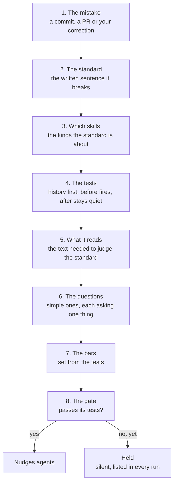

## How a rule gets made

A rule exists to catch a real mistake that skill text can show. It is built in this order, and each step uses the one before it.

1. **The mistake.** A real failure: a commit, a pull request or one of your corrections, with the text before and after the fix. A count or pattern check on a written standard, such as description length, names that standard instead.
2. **The standard.** The written sentence the mistake breaks, marked in its skill.
3. **Which skills.** The kinds of skills the standard is about. A rule about general skills never judges a product's own skill. How a skill's kind is known is in "Which skills a rule judges".
4. **The tests.** Real cases, from history first, written down before any question exists. Where they come from is in "Tests, bars and the gate".
5. **What it reads.** The text the rule needs to judge the standard, shown on real skills before a question is written. A standard about guidance as a whole reads the whole guidance, not one sentence.
6. **The questions.** Simple questions for Jev, each asking one thing, designed with `domain-decision-models`.
7. **The bars.** How sure Jev must be, set from the tests.
8. **The gate.** The rule passes its tests and starts nudging, or stays held.

A held rule goes back to its tests or to what it reads, and comes back to the gate when it has more tests or a fix.

This is the order `skill-rules` teaches. Nine of today's 18 rules were made the other way round, starting from "what can a model judge from one piece of text", and none of those nine names a mistake it exists for.
