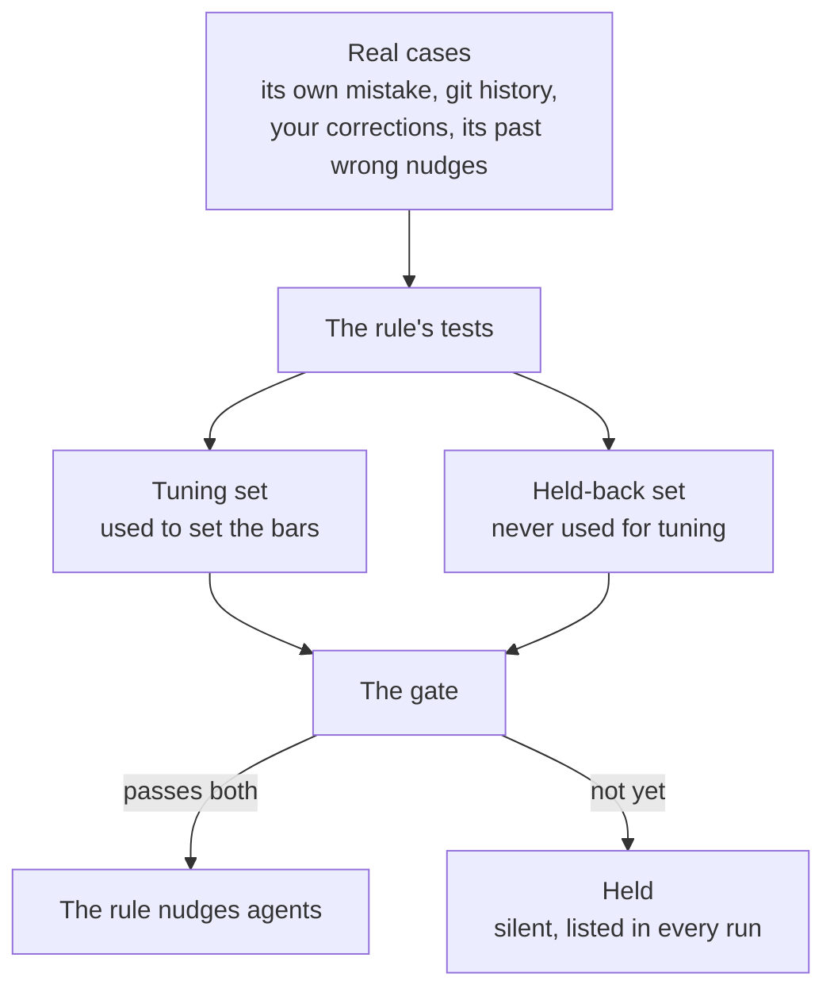

## Tests, bars and the gate

A rule earns its nudges by catching real mistakes and staying quiet on good text. Its tests show whether it does.

### Where the tests come from

- **Before and after a real fix.** The text before the fix must make the rule fire; the text after must keep it quiet. Descriptions alone have 167 rewritten lines in 125 commits of this repository.
- **Your corrections.** Where you made the fix, your fix is the answer; no one else labels it.
- **Its past wrong nudges.** The 195 wrong nudges from the 30 Oct run and the 56 from the 1 Nov run become tests the rule must stay quiet on.
- **Upstream skills,** only to fill a gap the other sources leave, and marked as such.
- **Labels.** Where you didn't make the fix, two labellers judge each case without seeing each other's answer, and every disagreement comes to you.

How many tests a rule needs before it may nudge is set per rule, once the history search shows what each rule has. The Advisor proposes starting with at least three real mistakes, three good texts and three near misses for each judged rule, plus a held-back group.

### The bars

A bar is how sure Jev must be before an answer counts. Today every rule uses 0.7 or more for yes and 0.3 or less for no, and none was ever tuned.

- Each rule sets its own bars, at the point where Jev's answers split its fire tests from its quiet tests.
- The bars, and the tests that set them, are recorded together.
- The held-back tests check the bars and never move them.
- Nothing overrides a rule's bars: not a skill, not a kind, not a config.

### The gate

A rule nudges no one until it passes its tests, both sets. Until then it is **held**: it still runs in test runs, and every run lists it with what it is missing. This replaces picking rules to ship one by one.

### What a rule reads

When a rule is wrong because of what it read, the fix is in what it reads, not in its question. Your words on `guidance.positive`: "this evicde problem not a problem with the rule".

- **`guidance.positive`** reads a whole list of guidance and asks whether it mostly says what to do, with what-to-avoid lines as its caveats. Today it reads one sentence at a time; 10 of its 27 wrong nudges had the "do" in the next sentence.
- **`completion.criterion`** accepts a step's "done" state in any words. Today a plain check accepts only a literal `Completion:` line: 78 of its 99 wrong nudges said "done" in other words, and writers padded steps with the label to satisfy it, which you rejected in #183.
- **`reference.teaching-depth`** reads a reference with its outline (24 wrong nudges came from missing the rest of the file) and treats command lists as lookups (31 came from its wording).
- **`branch.condition`** reads the block after a line that ends in ":" (5 wrong nudges).
