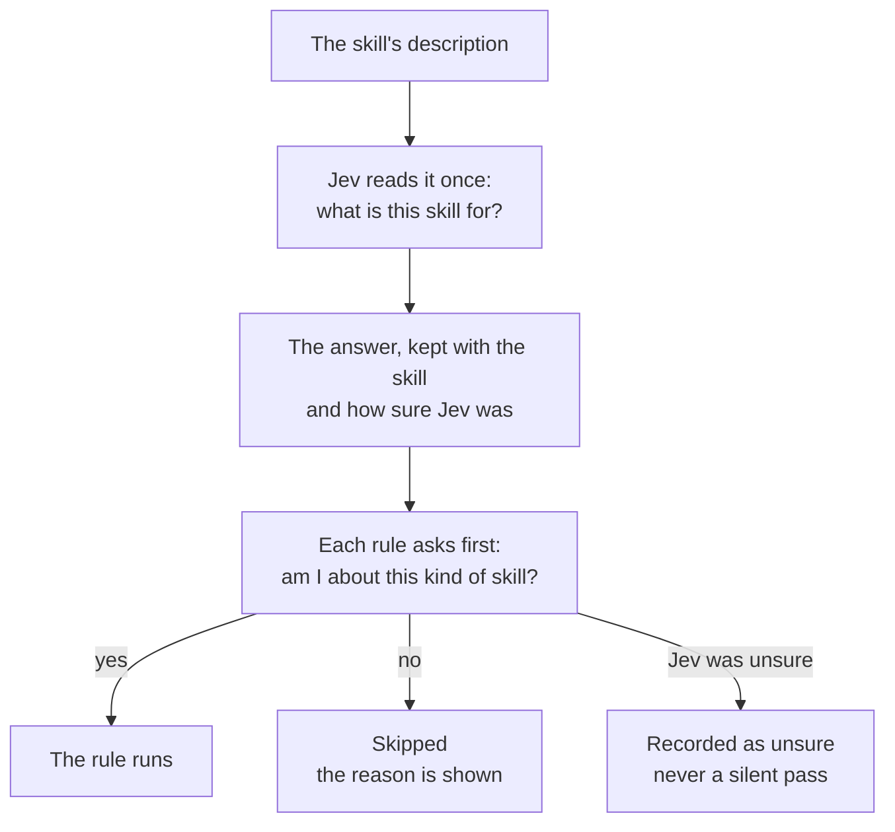

## Which skills a rule judges

Not every rule fits every skill. Placement says "a general skill doesn't send agents into one product's own commands". It should never judge a product's own skill, like the AgentStudio skill, where talking about AgentStudio is the whole point.

**Settled with you (2 Nov).**
- Jev reads each skill's description once and says what the skill is for.
- Every rule that cares about the kind takes that answer as input, and says which kinds it judges.
- The run shows each skill's answer and how sure Jev was.
- Description rules check every skill, hidden ones too. The description now also decides which rules apply, so its quality matters for every rule.

**What the Advisor found (2 Nov, from the engine's source and three probes on the released 0.6.0 engine).** The engine can't "judge once and hand the answer to every rule, on every part of the skill" with configuration alone. A skill's reference files are the hard part: nothing today connects a reference file's text to its skill's description. Today's model gate can only keep or drop a piece; it gives no answer that rules can read. So this needs a new engine feature: an answer kept with the skill, which each rule reads before its own checks. It goes into the engine's own design, in `sunstack-tools`.

**Still open.**
- **The answers Jev can give.** The Advisor suggests asking what the work is for: work in any repository, using one named tool or platform, or one application's own procedures.
- **What a rule does when Jev is unsure.** Not a silent pass, and not a silent skip; the exact behavior is open.
- **The filter's own tests.** The 78 skills on main, each labelled by hand first, before the filter runs.

**A case to watch.** `ops-observability-stack`'s description names AgentStudio, Agent VM and OpenClaw. It also says "the shared local … stack" and "any repo that emits OTLP", so it should be judged general. Placement then still reads its body, where AgentStudio's own debug loop sits. If the filter wrongly calls it a product's skill, that loop is never judged.
