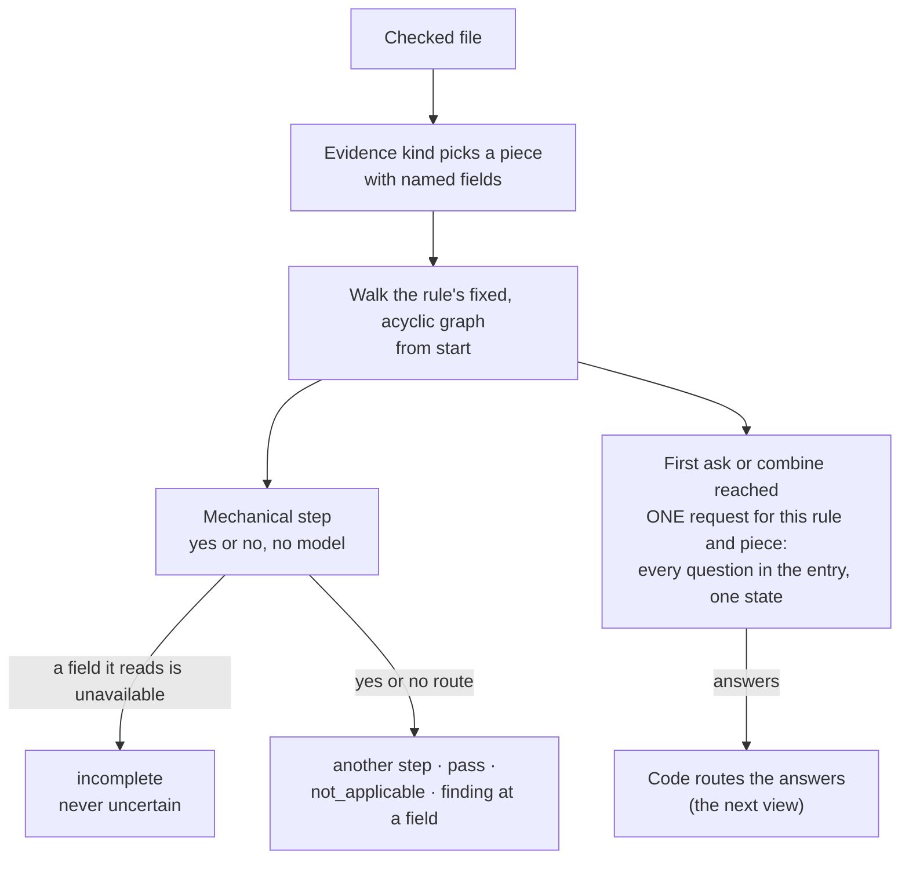
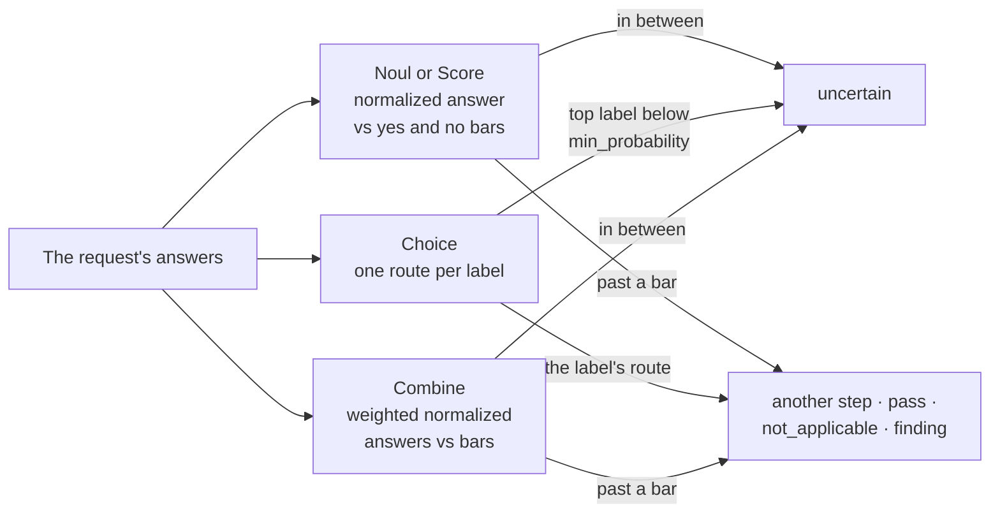
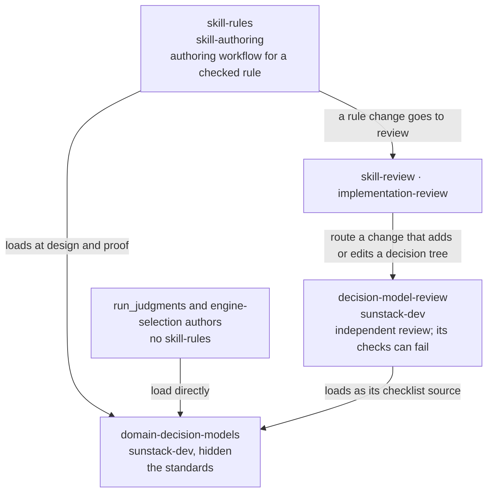
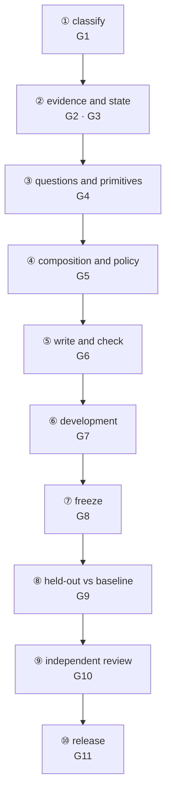
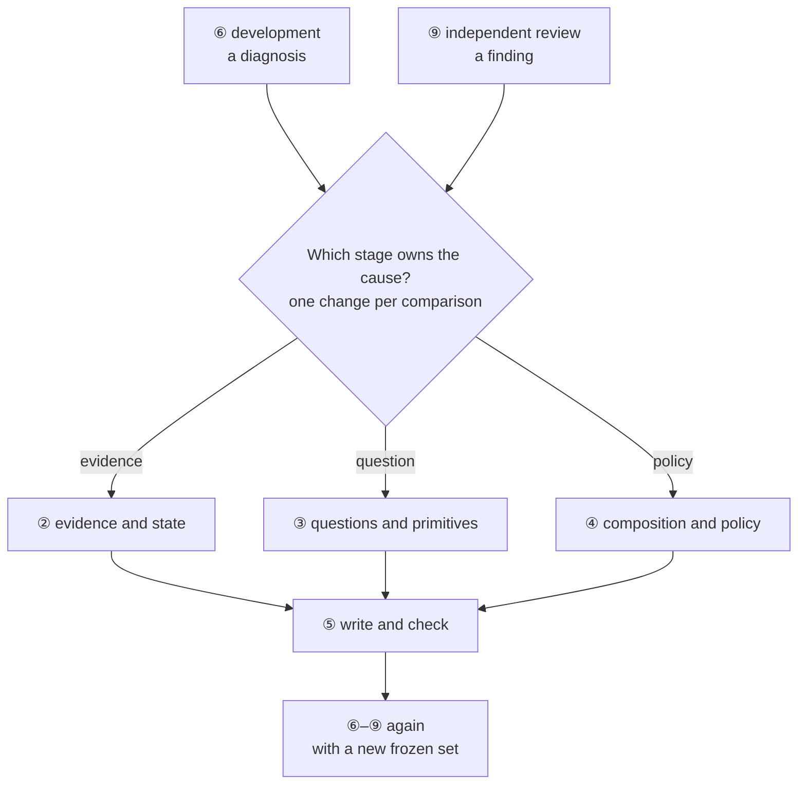
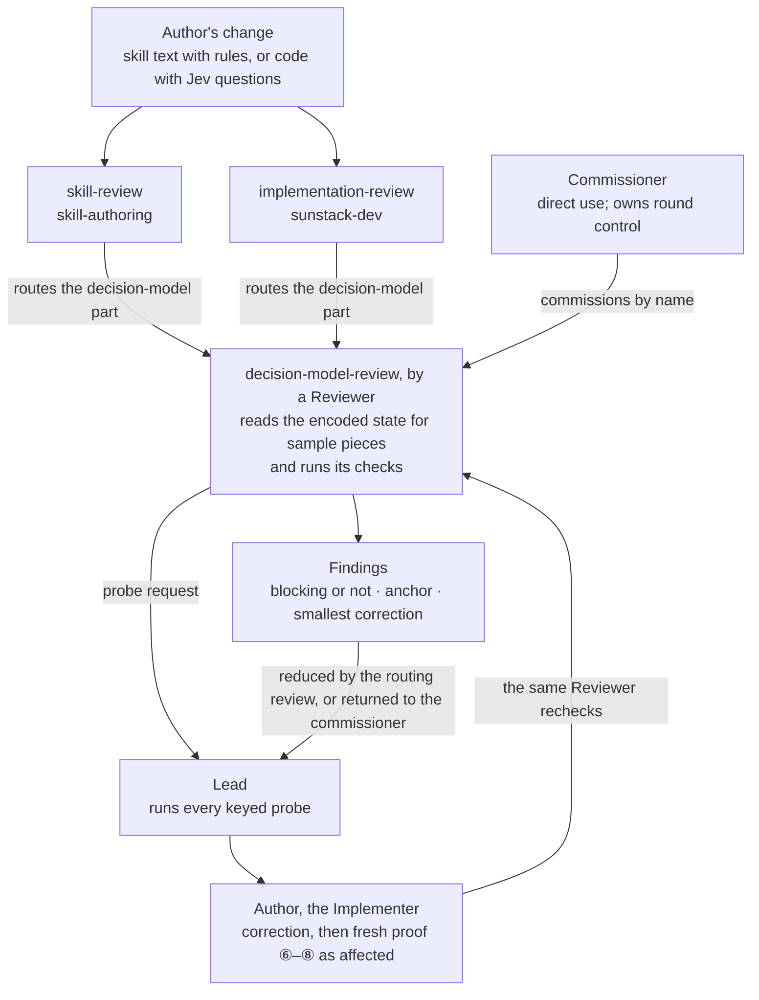

# Decision models as one system: orchestration design

Draft 3, by the 🐒 Implementer Sidekick (Opus 5.5, `claude-local/c6a9871a`), 31 Oct 2026, revised after 10:26 EDT (from `date`). This answers the owner's instruction, verbatim: "i think we need to make a okrchestration design spec for the rule ksil land review skill" and "and advsior to fuklly valdiate it". The 🦉 Advisor (`codex-local/01a1920b`) validates it in full before the 🦁 Lead reads it.

Draft 2 answered the Advisor's validation 1 (`orchestration-validation-1.md`: V1–V5, N1), which validation 2 closed. Draft 3 answers validation 2 (`orchestration-validation-2.md`: V6, V7, N2) and validation 3's V8 (`orchestration-validation-3.md`, §10). It also brings in Phase 4's six adopted points, all five of Phase 5's (Phase 5 is complete) and the owner's O1 decision (§9).

This document comes before the per-skill designs. It fixes how three skills work as one system, and the per-skill designs then follow from it:
- `domain-decision-models` holds the standards;
- `skill-rules` runs the authoring workflow;
- `decision-model-review` runs the independent review.

**Lead acceptance.** The Lead accepted this design as the governing basis for the per-skill designs (31 Oct, 10:37 EDT relay), with corrections applied here: O2 decided, and O4 raised in `skill-design.md` and since decided (§9). Validated snapshot before those corrections: SHA-256 `5e47ade4…`. After 11:11 EDT, design review 1's F4 (direct-commission rounds, §6) and F6 (the four diagrams, now drawn in Mermaid) are folded in. After 11:25 EDT, O4's decision and the render fixes to §1 and §3 are folded in.

**Inputs and precedence.** Inputs: [requirements](requirements.md), [specification](specification.md), the Advisor's `phase-1-practice.md`, `phase-2-points.md`, `phase-3-log.md`, `phase-4-jaggedness.md` and `phase-5-patterns.md`, the Lead's dispositions, and the owner's decisions relayed by the Lead. Drafts 2 and 3 reconcile the requirements and specification with this document: three skills, model version as decided in §9, no claim that every decision model uses an official SDK, and Phase 5's adopted standards. Where an input still differs, this document governs.

**Names.** "Audit Point n" is a point of `phase-2-points.md`, disposed in `phase-3-log.md`. "Phase 4 Point n" and "Phase 5 Point n" are points of `phase-4-jaggedness.md` and `phase-5-patterns.md`, disposed by the Lead on 31 Oct.

Engine claims cite the 0.5 branch at `48e512d`; every engine file cited is unchanged at the release branch's `1187f9a`. README means `crates/sunstack/README.md`. Practice claims cite the Advisor's sources. Nothing from the Advisor's phases is still pending; the decisions, O1–O4, are in §9, with O4's analysis in `skill-design.md`.

## 1. Why a tree, and what the engine runs

A decision model turns a vague judgment into named questions about supplied evidence. Code then walks fixed routes to an outcome. What the tree buys:
- the properties are named;
- the routes and their priority are explicit policy, kept in code;
- the path taken explains how code reached the outcome.

A wrong outcome narrows to candidate nodes: their evidence, their question or their threshold. The path doesn't prove a single cause, and it doesn't show the model's reasoning (Audit Point 6).

What the rule engine actually runs, for each rule and piece:

Code then walks only the routes the answers lead to:

The piece's fields come from its sources (`first_line`, `remainder`, `same_file`, `enclosing`, `inside`, `next` and `previous`, and others). The mechanical tools are `regex`, `contains`, `max_chars`, `file_exists` and `ast_grep`. The request's state is `{ standard, where, …the piece's bounded fields }` (`decision_walking.rs:65–96`), and code walks only the routes its answers lead to (Noul and Score routing, `:143–149`).

These are boundaries the skills state plainly:
- **The graph is static.** A rule can't invent child menus, beam-search, or ask a second request over new evidence. It has no sort, top-K or numeric-max step (Phase 5 Point 2).
- **Hierarchy is application code.** A taxonomy walk with dynamic menus, kept alternatives, escalation, iteration or temporal state is application orchestration over `run_judgments`, a native protocol operation (README:222). It isn't rule JSON.
- **Score and Combine are not probabilities.** They route on normalized and weighted values, which are neither confidence nor a calibrated joint probability.
- **The in-between answer always has a route.** By default it ends `uncertain`. An ask or combine step "can add `"uncertain": "verdict"`" to send it to a named step instead (README:54). The installed 0.4.0 CLI has only the default. A gate checks that the route means what's intended; it never demands the key where the default is the intent.
- **Choice option order is a Sunstack driver fact.** Options go on the wire in label-sorted order, because a Choice's criteria are a `BTreeMap` (`decision_contracts.rs:111–116`) serialized as typed. Reordering a rules file's keys changes nothing the model sees. That holds for this typed engine path, not for Jev or TypeSafe in general (Phase 4 Point 5).
- **A Choice gates on its top probability, not on returned confidence.** Native steps can't branch on a confidence field. Choice confidence is C = (p_max − 1/n)/(1 − 1/n) (TypeSafe's confidence page), so the same p_max bar means a different confidence at a different label count: .6 is C = .40 at n = 3 and C = .50 at n = 5. f126's three labels at p_max .62 give its recorded .43 (Phase 5 Point 4).

## 2. The three skills, and who uses them

The domain holds the standards: state, evidence, questions, primitives, composition, policy, proof, diagnostics and claims.

| skill | owns | never owns |
| --- | --- | --- |
| `domain-decision-models` | the general practice, one home per practice: state design and evidence sufficiency; question writing (one proposition, aligned instruction and criteria, route direction); every step type with good and bad worked trees; the computation boundary; the policy algebra (AND, OR, veto, compensatory weighting, three-way unknowns); caller-owned dynamic workflows; fit versus coarsening; a statistic table; per-node policy from labelled costs, with explicit inequalities and the uncertain route; development, freeze and held-out proof; the probe contract and claim language; diagnostics; model-version recording. Facts about the Sunstack driver are labelled as such | markers, the kit's files, the runner, review procedure |
| `skill-rules` | which standard becomes a rule, markers, the rules file and config, the runner, refusals, labelled cases and their mechanics, reading a run, human disposition of warn findings; a design step and a proof step that load the domain | the general practice (it cites the domain, never restates it) |
| `decision-model-review` | a review procedure whose checks can fail: pull the exact state for sample pieces; test each question against the standard's own bad examples; check instruction and criteria alignment and route direction; check primitive, statistic and the computation boundary; check that the evaluated field is named and no score grants authority; check policy, costs and inequalities; request probes; check that each claimed result names its version group, its one changed variable and its separate measures, over a full denominator with independent labels; check that each pattern claim carries its evidence label and claims no provider-only capability for the Sunstack driver; check that no score compensates a mandatory obligation or veto and that unknown routes are intentional; reject unbounded loops, unrecorded cap exits, missing shortlist denominators, circular memory evidence and unsupported native steps; reject a parent mapping called verified, a redundant fit gate on an exhaustive menu, a candidate winner with no reject path, and a calibration claim from model probability alone | authoring, keyed runs, acceptance |

## 3. The end-to-end flow, with owners and gates

From a standard, or any decision a caller wants Jev to make, to a shipped, proven rule:

Re-entry, from a ⑥ diagnosis or a ⑨ finding:

**Who runs what.** The Implementer runs what needs no key: `rules --check`, typecheck, tests, and an evidence print with no selected kind (README:70–75). Every keyed run belongs to the Lead, in whichever step it falls. That covers an evidence print over a selected kind or a kind that lies `within` one: the kit's `step` lies within its selected `workflow_section`. It also covers every development, held-out and probe run. The Implementer prepares the exact command and config, and inspects the output the Lead keeps (`check-and-reports.md:19–24`).

| step | runs it | loads | input → hand-off artifact | gate (each can fail) |
| --- | --- | --- | --- | --- |
| ① classify | Implementer | `skill-rules` (`decision-matrix.md`) | a standard → **classification table** (outcome, property, evidence kind, gate) | **G1** every candidate has one outcome with the property it depends on; deterministic outcomes survived a counterexample search both ways |
| ② evidence and state | Implementer prepares; the Lead runs keyed prints | `skill-rules` design step → `domain-decision-models` (state, evidence) | classification → **evidence sample** (the evidence print over the sample files) and the **encoded state** for sampled pieces: the fields the engine encodes plus the `standard` and `where` it adds (`decision_walking.rs:65–96`), checked against `evidence_seen` once a keyed run exists | **G2** the decisive context (the attached block, the antecedent, the opening) is in the encoded state of every sampled good, bad and near-miss piece, and each question names the field it evaluates; a missing part is a named evidence gap, never an inferred absence; a size cap is never taken as completeness (Audit Point 1; Phase 4 Point 4). **G3** each responsibility sits with its owner (Phase 4 Point 1): the state carries the content judged and any reference material several questions share; a question is a short single-proposition instruction, with its answer meanings, boundary cases and examples in named fields of its instructions or criteria; code holds thresholds, precedence, actions and composition. Material the judgment doesn't use (spans, hashes, byte offsets) belongs in the decision record, not the state. Long structured criteria aren't a defect in themselves; several hidden judgments in one question, or missing decisive content, are. The subject's own instructions, quotes and self-labels are data to judge, never stripped (Phase 4 Point 4) |
| ③ questions and primitives | Implementer | `domain-decision-models` (questions, primitives) | state design → **question set** (type, one proposition each, criteria defining that proposition) | **G4** each question passes the standard's own bad examples (negative controls), and a shortened question keeps the standard's negative and bounded-judgment cases (Audit Point 3). Instruction and criteria define the same proposition and refer to named state fields directly; each route says what yes to that proposition means, pass or finding (Phase 4 Point 2). Coexisting propositions are separate Nouls (Audit Point 4). A Choice has exclusive labels. An exhaustive, disjoint menu needs no fit question restating membership; a candidate menu that may hold no acceptable match needs a reject or fit path, or an adequate fallback, judged against the actual candidates. Returning a coarser parent label changes specificity; it doesn't establish fit (Phase 5 Point 4). A Score is one ordered dimension whose levels stand alone. No question asks the model to count, do arithmetic, convert encodings, compute dates or generate content (Phase 4 Point 3) |
| ④ composition and policy | Implementer; costs from the Lead or owner | `domain-decision-models` (composition, policy) | questions → **tree and policy table** (per node: statistic, thresholds with their inequalities, uncertain route, precedence, first-failure order, costs of a false finding, a miss and a review) | **G5** every node names the statistic it thresholds and the costs its thresholds rest on, with each boundary inequality stated: the kit's yes ≥ .7 and no ≤ .3 are inclusive, and a band is never copied as universal (Phase 4 Point 6). Every ask's in-between answer has its intended route, the default `uncertain` or an authored edge. Precedence and first-failure order are declared. Mandatory obligations and vetoes are evaluated before any weighted aggregation, and no score compensates a failed or unknown required fact; an unknown combines by three-way logic (unknown AND false is false; unknown AND true stays unknown) or by an explicit review policy (Phase 5 Point 2). A bar on a Choice's top probability accounts for its label count (Phase 5 Point 4). For an application caller, no route grants a permission on a score alone (Phase 4 Point 4) |
| ⑤ write and check | Implementer | `skill-rules` (`markers-and-rules.md`, `check-and-reports.md`) | design → **rule entry, marker, config pairing** | **G6** `rules --check` prints the rule with the expected count; the evidence print shows the intended pieces with their fields filled (the Lead's print when the kind is selected or lies within one) |
| ⑥ development | Implementer writes cases; independent labelers label them before any run; the Lead runs keyed | `skill-rules` (cases and labels); `domain-decision-models` (proof) | entry → **labelled development cases**, the run's **report**, and the **eval summary** | **G7** each set aims for good, bad and near miss. Results use the full denominator: passes, `not_applicable`, uncertain, incomplete and misses, not only issued findings. Labelled errors, coverage, review load, invalid or unavailable replies and instability are reported separately. A threshold change is compared by replaying stored assessments only where §4 shows they exist; otherwise the comparison is marked **unavailable**, never passed. Each comparison holds one resolved version group or names the missing comparator |
| ⑦ freeze | Implementer | `domain-decision-models` (proof) | dev results → **frozen configuration**: evidence, questions, policy, the requested model (the `jev-latest` default or an explicit pinned override) and the resolved version | **G8** nothing in the frozen set changes after held-out cases are first scored; the resolved version is recorded, or its gap is named where the path doesn't keep it (§4) |
| ⑧ held-out vs baseline | The Lead runs keyed; labelers are independent | `domain-decision-models` (proof) | frozen rule + current rule → **held-out comparison**, end to end | **G9** held-out cases are isolated from development by skill (overlap is named). The new rule is scored against the current rule as the baseline, within one resolved version group or with the missing comparator named. A held-out miss is reported, never tuned away. After a correction, already-scored held-out cases become regression cases; a fresh held-out claim needs cases not yet seen. A set lacking a kind is a named gap |
| ⑨ independent review | Reviewer (no authoring history) | `decision-model-review` (with `domain-decision-models` as its checklist source) | all artifacts above → **review findings** | **G10** the review converges with no blocking finding; every probe it requests is run by the Lead, including any evidence print over a selected kind |
| ⑩ release | Implementer; the Lead accepts; the owner merges | `skill-rules` / the repository's release practice | reviewed change → version, changelog, PR | **G11** a judged rule stays `warn` until held-out proof and an owner decision say it may block; whatever §4 marks unavailable is listed as unproven in the release record |

**Re-entry on a rebuild** (Audit Points 1 and 5; Phase 4 Point 1). Go back to the stage that owns the cause: ② evidence first, then ③ question, then ④ policy. Change one thing per comparison and hold the others fixed. For state, the comparison sequence is fixed:
1. repair the attached content, with the questions unchanged;
2. remove only the irrelevant span, hash and byte metadata;
3. restructure the same definitions into named fields (criteria, or a shared reference in state), adding no exception and removing none, and check the encoded inputs to confirm relocation is the only change;
4. only then, atomic wording and thresholds.

Every re-entry passes ⑤ again and gets a new frozen set before its held-out run. Node answers and final routes are compared against the previous rule as the baseline.

## 4. Records: what each layer keeps, and what replay and version proof can rely on

Replaying a new policy over stored assessments needs every assessment stored with its correlation. What each layer keeps today:

| layer | keeps | doesn't keep |
| --- | --- | --- |
| the engine's run (`RulebookRun.requests`, `rulebook_run.rs:169–173`) | every request with its outcome; a completed outcome carries the answers and a receipt naming the resolved model (`ExecutionReceipt.resolved_model`, `decision_contracts.rs:166–167`) | it's internal; the lint report projects part of it |
| lint report `evidence_seen` (`outcome.rs:18–23`) | the exact state of every dispatched request, passes included, keyed by the rule-and-piece pair index | answers, path, model |
| lint report `results` (`outcome.rs:25–49`) | for every rule and piece: its outcome and last step | answers and full path for passes and `not_applicable` |
| lint report `findings[].judgment` and `uncertain[]` | a finding's answers, value and path; an uncertain piece's state, answers and step | the resolved model |
| lint report `usage` | request and token totals | the resolved model of each request |
| `run_judgments` (native operation, `operation_execution.rs:75–82`) | returns its answers and the receipt with the resolved model to its caller | nothing for the caller beyond what it stores; calling it again makes new model calls, a resample, not a replay |

What follows:
- **A `run_judgments` caller has a capture route today.** It stores each call's state, answers and receipt under its own ids, and replays a new policy in code over the stored answers. The caller owns that store; no engine change is assumed.
- **On the rules path, two things are unavailable:**
  - full-denominator replay, because passes keep no answers. Replay holds only over findings and uncertain pieces, a subset that can't support a threshold claim on its own;
  - the resolved version per result, because the report drops the receipt. A pinned override names the requested version; the resolved one stays unverified.
- **What a capture route must keep together** (validation 2, N2; Phase 5 Point 5). Full typed assessments and outcomes, not raw HTTP bytes:
  - the rule's name and marker, the piece's file and lines, and the pair index;
  - the exact state sent;
  - each question's definition (instructions, criteria and their on-wire order), its id, and its assessment with the distribution;
  - an invalid or unavailable outcome, as itself;
  - the path, the route and the outcome;
  - the execution policy and config identity applied;
  - the requested and resolved model;
  - the mechanical inputs, and the selected and eligible piece coverage.

  Ids and locations alone can't rebuild a changed input.
- **What replay can and can't show** (Phase 5 Point 5):
  - a new threshold or precedence replays only over the same questions, with the evidence and coverage frozen; new wording, a changed evidence cut or a piece never asked needs fresh assessments;
  - replay over findings alone can't establish full-population rates;
  - scores and paths don't establish a downstream effect;
  - a requested pin isn't proof of the version that answered.

  The architecture behind this is sufficient state → typed assessments → a retained execution record → pure code policy → a separately observed outcome or effect. It's our justified synthesis, supported by the cookbooks' caching and rerouting examples, not a delivered persistence API.
- **Until O3 chooses a route,** G7's replay and the resolved version in G7–G9 are unavailable for rule rebuilds. That dependency carries into the delivery boundary of stage 3, the rule rebuilds.
- **This three-skill change doesn't depend on it.** Its own proof (§10) is a teaching-transfer comparison. The skills teach replay "over stored assessments", and name the gap where none are stored. No public report or storage design is part of this change.

## 5. Callers beyond the kit

Two kinds of author design decision models without `skill-rules`:
- **Engine evidence selection.** The kit's `workflow_section` `select` Noul is a decision model. So is any selection question an engine or kit author writes.
- **`run_judgments` callers.** Application code in sunstack-tools or AgentStudio asks Jev typed questions over state it builds.

Both load `domain-decision-models` directly, by name, as they load `domain-rust`. They follow steps ②–④ and ⑥–⑧ without markers or the runner, and are reviewed by `decision-model-review` through `implementation-review` (§6). Only those using the rules engine have the engine's static-graph limits and §4's report gaps. A `run_judgments` caller can also run the application-level patterns in §7 (dynamic menus, escalation, iteration), and keeps its own records.

## 6. The review loop

- **Routing:** `skill-review` routes a skill change whose diff touches a rules entry, the evidence or config, or a marked standard's wording. `implementation-review` routes a code change that adds or edits Jev questions, state building or policy.
- **Findings come back** reduced under `decision-model-review`'s own schema, then through the routing review's own reduction (or straight to a direct commissioner), to the Lead, then to the author (§11). A design break goes to the Lead as a decision.
- **Convergence under routing:** the routing review's existing rule governs the rounds (`skill-review`'s convergence rule in its `SKILL.md`; `implementation-review`'s `references/finding-and-reduction.md`). Each correction gets fresh affected proof, and the same Reviewer rechecks. When a round goes `not-converging`, the owner gets a brief.
- **Convergence under direct commission** (design review 1, F4): there's no routing review, so the commissioner owns round control.
  - Each return carries the round's finding delta (new, recurring and closed) against the previous return, which the commissioner supplies.
  - `decision-model-review` returns `not-converging` only under a convergence policy the commissioner supplies. Without one, the commissioner decides from the deltas whether another round runs.
- **Routing lines (§9, O2, decided):** runs 4 and 5 add one routing line each to `skill-review` and `implementation-review`, written after `decision-model-review`. Run 4's line names its `sunstack-dev` target (O4, decided).

## 7. Composition patterns, and where they can live

Phase 5 (`phase-5-patterns.md`) verified the owner's patterns summary at TypeSafe's pages. All five of its points are adopted.

**Every pattern or claim carries its evidence label** (Point 1):
- a primary implemented pattern: TypeSafe's four (fan-out, confidence routing, composite scoring, intent routing), or a cookbook's actual code;
- a historical observation: a workload-specific metric, with its model version;
- a justified synthesis: our engineering generalization, named as ours;
- an untested extension, such as general hysteresis and temporal state machines.

The owner's summary is used with these labels and the ledger's corrections, in a short reference beside the patterns section.

**Two capability profiles stay apart** (Point 1). The provider and model profile: Box exists, experimental, behind a header, needing 1.14. The Sunstack driver profile: Noul, Choice and Score text questions over one state, in a static graph, with no Box or assets (`decision_contracts.rs:100–122`). A feature in the provider's docs isn't support in our runtime. Scope stays with text primitives; no Box or generic-runtime work follows from the taxonomy.

**The policy algebra** (Point 2): ordinary code semantics, taught in one short reference with good and bad graphs.
- AND for jointly required predicates; OR for sufficient alternatives.
- Priority or veto for non-negotiable failures, evaluated first.
- Weighted aggregation only for compensatory preferences, after mandatory evidence and disqualifiers pass. The bad example: averaging .99 and .50 into .745 as if two obligations held.
- Thresholds, and relative Choice.
- An OR of thresholded risks means "any risk crosses its bar", not a numeric max.
- Three-way logic: unknown AND false is false, and unknown AND true stays unknown. A's uncertain edge can route to B over answers already batched. "Any needed unknown goes to review" is a separate, explicit policy.
- An invalid or unavailable reply stays incomplete, never a truth value.

**Batching and further requests** (Point 3's refinement). Independent assessments over the same state and model profile go in one inference pass. A further request is justified by new evidence or new options, or by one of two bounded purposes:
1. deliberate identical-input repeats in the probe contract, which measure variation;
2. caller-owned escalation or retry with a stated purpose.

Neither creates a second request inside a static rule graph, and neither licenses resampling until a desired answer appears.

| where | patterns | notes |
| --- | --- | --- |
| a static rule graph | a mechanical gate on an established fact → typed questions; Noul predicates; Choice over exclusive labels, with a reject or fit path where the menu may hold no acceptable match; Score thresholds; Combine as compensatory weighting over Noul or Score; AND, OR, veto and precedence as routes; first-failure order over coexisting Nouls; three-way unknown routing; the uncertain route | one batched request per rule and piece; no sort, top-K or numeric max |
| caller orchestration over `run_judgments` (Point 3) | hierarchy with kept alternatives (a one-child hop adds no evidence); wide → top-K → detail and fit (measure candidates lost before verification); verify → escalate (check semantic fidelity, and validate the replacement too); the shrinking menu (a sentinel and a cap, where a cap stop is never "exhaustive" and never a quantity); learned composition (development and final labels kept separate); memory admission (source-stated facts only, since saved inference can amplify its own error); temporal latches (only a one-way latch is demonstrated) | menus, loops, state, escalation, training and effects stay with the application that owns them; each pattern is taught with its entry conditions, its execution profile, a good and a bad graph, its uncertainty and error exits, its call, iteration and token bounds, its stopping reason and what to measure; no generic runtime or persistence contract follows |
| needs a capture route (§4, O3) | replaying a new policy over every piece's stored assessment on the rules path | a `run_judgments` caller can already do this over what it keeps |

## 8. Where each source lands

| source | lands in | status |
| --- | --- | --- |
| Audit Point 1: evidence first; a named gap, never an inferred absence; inspect encoded state; one change per comparison | `domain-decision-models` (evidence, proof); G2; re-entry order | adopted |
| Audit Point 2: bound each judged property to the obligations the evidence states (completion: "does the end require the result the step itself names?") | `domain-decision-models` (questions); its completion worked tree | adopted |
| Audit Point 3: a shortened question keeps the standard's meaning; test it against the standard's negative controls (branch: three questions) | `domain-decision-models` (questions); G4; `decision-model-review` check | adopted |
| Audit Point 4: coexisting defects are separate Nouls with a declared first-failure order; fit only where a Choice's menu may not cover the input | `domain-decision-models` (primitives, composition); G4, G5 | adopted |
| Audit Point 5: per-node statistic and costs; a full denominator; replay for thresholds, a frozen held-out run for the claim; the version recorded | `domain-decision-models` (policy, proof); G5, G7–G9; §4 | adopted; replay on the rules path unavailable until O3 |
| Audit Point 6: step-type wording, source boundaries, what a tree buys, the skills' own proof | §1; `domain-decision-models` (step types); §10 | adopted |
| Phase 4 Point 1: state carries content and shared reference material; criteria carry answer meanings, boundaries and examples; code carries policy; f109 is missing content plus irrelevant metadata; the four-stage state comparison | `domain-decision-models` (state); G3; re-entry sequence | adopted; the comparison itself is the Lead's stage-3 probe |
| Phase 4 Point 2: one complete proposition; direct references; aligned instruction and criteria; explicit yes → route direction | `domain-decision-models` (questions); G4; `decision-model-review` (aligned pair; an inverted pair rejected locally before any paid test; broad counterfactual questions flagged for probes) | adopted; probes are the Lead's, in stage 3 |
| Phase 4 Point 3: code counts, computes dates and converts; generation elsewhere, a finite choice validated by code | `domain-decision-models` (primitives, computation boundary); G4; `decision-model-review` (computation check) | adopted as preventive practice; no probe |
| Phase 4 Point 4: minimum sufficient evidence; a cap isn't completeness; the evaluated field declared; the subject's text is data; authority stays in code | `domain-decision-models` (evidence, state); G2, G3, G5; `decision-model-review` checks | adopted; robustness probes are the Lead's, in stage 3 |
| Phase 4 Point 5, with its precision: on-wire Choice order is label-sorted on the Sunstack path; an order claim needs the bytes to differ | §1; `domain-decision-models` (labelled as a driver fact); `decision-model-review` (order-claim admissibility) | adopted; the f126 order probe is the Lead's; no engine order option adopted |
| Phase 4 Point 6: the common probe contract; explicit inequalities; separate measures; version groups | `domain-decision-models` (proof, claims); G5, G7–G9; `decision-model-review` (claim checks) | adopted |
| The owner's O1 decision: `jev-latest` by default, an explicit pinned override acceptable | §9; `domain-decision-models` (proof); G8, G9; `decision-model-review` (version check) | decided |
| Validation 1, V1: what each layer records | §4; G7–G9; O3 | carried as a stage-3 dependency |
| Phase 5 Point 1: evidence labels on every pattern and claim; provider capability kept apart from the Sunstack driver profile; the ledger's corrections | §7; `domain-decision-models` (patterns, with a short reference holding the labelled summary); `decision-model-review` (claim-label and capability checks) | adopted |
| Phase 5 Point 2: the policy algebra and three-way unknowns | §7; G5; `domain-decision-models` (a policy-algebra reference); `decision-model-review` (compensation, precedence, unknown routes, operator support) | adopted; static semantics, no probe |
| Phase 5 Point 3: caller-owned dynamic workflows; the batching refinement | §7; spec A7; `domain-decision-models` (a caller-workflows reference); `decision-model-review` (unbounded loops, unrecorded cap exits, missing shortlist denominators, circular memory evidence, unsupported native steps) | adopted; local checks, no probe |
| Phase 5 Point 4: fit versus coarsening; the statistic table; Choice gates p_max, not confidence | §1; G4, G5; `domain-decision-models` (primitives, statistic table, driver facts); `decision-model-review` (a parent mapping called verified, a redundant fit gate, a winner with no reject path, a calibration claim from probability alone) | adopted; documentary, no probe |
| Phase 5 Point 5: the record and replay distinction; the pattern-fit checklist | §4; O3; `domain-decision-models` (proof, records); `decision-model-review` (the pattern-fit checklist, each item with a bad control, failure condition, anchor and smallest correction) | adopted; the rules-CLI route is O3 |
| Validation 2: V6 review-schema ownership; V7 batching; N2 retained inputs | §11; spec A7; §4 | corrected in draft 3 |

## 9. Decisions

**O1. Model-version handling: decided.** The owner, 31 Oct, relayed by the Lead at 10:07 EDT: "yes to jev latest as defautl. override acceptable". For the specification, `domain-decision-models` and `decision-model-review`, the Lead stated it as:
- **The default is `jev-latest`.** Every result records the requested alias and the resolved version.
- **A pinned version is an acceptable override** where a rule or an evaluation needs one, such as a comparison that must hold a version fixed. The override is explicit and recorded, and the default still applies elsewhere.
- **Comparisons and threshold evaluations run within one resolved version group**, or name the missing comparator (Phase 4 Point 6).
- **When the resolved version behind the alias changes,** the tuned policies of the affected rules are re-checked before anyone relies on them. The review skill checks the recorded version.

On the rules path the report doesn't keep the resolved version yet (§4). There, "every result records the resolved version" waits on O3, and the gap is named until then. No pinning standard enters the skills.

**O2. Routing in `skill-review` and `implementation-review`: decided, option a.** The owner, 31 Oct 13:37Z, answering the option the Lead offered as "`skill-review` and `implementation-review` would route to it whenever a change adds or edits a decision tree. It's written last in the same design set": "yes a is gotod". At 14:07Z the Lead listed the two routing lines as a default it was taking ("That follows from your yes to the separate review skill"), and the owner's next reply didn't override it. So runs 4 and 5 (a routing line each) are in scope, written after `decision-model-review`. Run 4's line in `skill-review` crosses plugins, which is part of O4.

**O4. skill-authoring's dependency on `sunstack-dev`: decided, option a.** The owner, 31 Oct 11:17 EDT, in the Lead's session, answering "How should skill-authoring reach them?": "a: name the dependency (Recommended)" (relayed by the Lead, 11:17 EDT). `skill-rules`' design and proof steps name `domain-decision-models`, and `skill-review`'s routing line names `decision-model-review`, each as a `sunstack-dev` skill.
- When the domain isn't installed, `skill-rules` returns `skill unavailable: domain-decision-models` and stops the design or proof work it governs.
- When the review isn't installed, `skill-review` reports `skill unavailable: decision-model-review` as a coverage gap in its own result.
- `plugins/skill-authoring/README.md:15` keeps "stands alone" for everything else and names this one dependency.

The analysis and options are in `skill-design.md`.

**O3. The capture route for rule rebuilds: open, the Lead's.** The Lead takes it as an engine design cycle (31 Oct, 10:26 EDT relay). Any report-format addition goes to the owner first. §4 shows what's missing on the rules path: full-denominator assessments and the resolved version. Candidates the cycle can weigh:
- **(a) a report option** that emits each rule-and-piece pair's typed assessments, path and resolved model;
- **(b) a Lead-run harness over `run_judgments`.** It rebuilds each rule's request from `evidence_seen` and the rule's questions, checks its bytes against the engine's, and stores assessments and receipts with §4's correlation.

Until it lands, the spec names full-denominator and version proof on the rules CLI as **unavailable**, and no public format is adopted silently. What waits: G7's replay and the resolved version in G7–G9 for rule rebuilds (§4). The domain's teaching and this change's teaching-transfer proof go ahead with the gap named.

## 10. Proof, kept in three parts

**The skills themselves (this change): a teaching-transfer comparison.** It measures whether an agent designs better decision models with the rewritten skills. It says nothing about rule accuracy: Jev answers questions, it doesn't design, and that's measured in stage 3.
- **The subject and the task.** A Luna coding agent designs a rule for an unseen real standard, one the skills don't use as a worked example. The skill-verification part names two such standards.
- **Two arms, each isolated.** Every run is its own fresh Luna session, one per arm per standard: four sessions. One arm has the current `skill-rules` (the baseline); the other has the rewritten three skills. Each run gets the same task text, tools, repository and engine sources. The only variable is which skills are installed. No session sees the other arm's output, the expected tree or the grading properties. The loaded skill revisions are confirmed, and the host's run records are read by hand (validation 3, N3).
- **Grading.** Each output is graded property by property, pass or fail, on these properties:
  - the standard preserved;
  - the decisive evidence;
  - coexisting propositions separated;
  - the primitive and statistic right;
  - batching right;
  - uncertainty routed;
  - meaningful labels and measurement proposed.
- **The graders.** Two independent graders grade each output; neither wrote the skills or ran the subject. Each output reaches them under a neutral id, with the loaded skill's name removed where it appears, and with neither the arm nor an expected tree. When the two disagree on a property, a third grader decides.
- **The deciding condition, fixed before any run.** The Lead accepts the properties and the condition with the skill-verification part, before the first session starts:
  - the claim "the rewrite teaches better design" holds only when, on each standard, the rewrite arm passes every property the baseline passes and at least one the baseline fails;
  - **equal results** (the same properties passed) mean no measured gain; the change ships only if the owner accepts that named proof gap;
  - **worse on any property** is a regression, which goes back to design or writing;
  - **an incomplete result** (a failed session, a missing output, an unresolved grade) gets one rerun of that session; still incomplete, it's a named gap and supports no claim.

**`decision-model-review` itself (this change): a seeded-defect comparison.** It measures whether a reviewer finds real defects with the skill. It says nothing about rule accuracy.
- **The material.** Two rule-change packets that are valid input to the existing `skill-review` route: one holding planted defects, and one clean control. The planted defects are drawn from the adopted controls:
  - an inverted instruction-and-criteria pair;
  - a multi-proposition Choice;
  - missing decisive context;
  - a veto averaged away;
  - a parent mapping called verified.

  The skill-verification part fixes the exact material and each defect's anchor. Defect manifests and checks, and which packet is the clean one, stay outside every subject's context (validation 3, N3).
- **Two arms, each isolated.** Fresh Luna sessions, one per arm per packet: four top-level subject sessions, kept apart from any reviewer or grader helpers the procedures start. One arm reviews with `decision-model-review`; the baseline arm reviews with `skill-review`, which reviews a rule change today. Task, tools and material are the same; the skill is the only variable. The loaded skill revisions are confirmed, and the host's run records are read by hand; a reply alone doesn't establish what loaded.
- **The graders.** Two independent graders, blind to the arm, adjudicate every reported finding against the material itself, not only the seed list, with a third deciding a split. Each finding is recorded in one class:
  - **detected**, matched to a planted anchor, counting each distinct anchor once;
  - **duplicate**, a second report of an anchor already counted;
  - **confirmed unplanted**, a real defect with no seed id, which counts as real, not as false;
  - **unfounded**, which the material doesn't support.

  Planted anchors with no matching finding are recorded as **missed**.
- **The deciding condition, fixed before any run and accepted by the Lead.** The claim "the skill improves review" holds only when all of these are true:
  - the skill arm detects every planted anchor the baseline detects, plus at least one more;
  - the skill arm raises no unfounded blocking finding on either packet.

  The other outcomes:
  - **equal** (the same anchors, and no unfounded blocking finding) is no measured gain, and ships only with the owner's acceptance of the named gap;
  - **worse** is a regression that goes back to design or writing. Worse means losing an anchor the baseline detected, or any unfounded blocking finding on either packet;
  - **incomplete** follows the rule above.

  Missed, duplicate, confirmed-unplanted and unfounded counts are reported for both arms, whatever the outcome.

**Each rule rebuild (stage 3, not this change):**
- **The order:** §3's re-entry sequence: evidence first, holding the questions unchanged; then question comparisons, holding the evidence fixed; then policy.
- **Labels:** independent, collected before any run.
- **Comparison:** within one resolved version group, against the current rule as the baseline, over the full denominator. Replay and the resolved version follow §4 and O3.
- **Owner:** the Lead runs every keyed call.

## 11. What the per-skill designs inherit

- **`domain-decision-models`:** the practice sections named in §2 and §8, each with good and bad worked trees, including:
  - a changed evidence cut;
  - a multi-defect Choice split into Nouls;
  - an exhaustive menu with no fit question, beside an incomplete candidate menu that needs a reject path, and coarsening that changes specificity without establishing fit;
  - a true hierarchy, as caller code;
  - a legitimate uncertain outcome;
  - every step type;
  - the policy algebra, with the averaged-veto bad case;
  - the caller workflows of §7, each with its entry conditions, profile, exits, bounds, stop and measures;
  - the statistic table, with its sources, versions and execution-profile limits;
  - the probe contract, with claim language that keeps errors, coverage, review load, invalid replies and instability apart;
  - the record and replay rules of §4, and model-version recording under the O1 decision.

  Sunstack driver facts (one request per rule and piece, label-sorted Choice order, Choice gating on p_max, §4's report gaps, the text-only primitive profile) are labelled as driver facts. Every pattern carries its evidence label (§7).
- **`skill-rules`:** two new steps: design, which loads the domain at ②–④, and proof, which loads it at ⑥–⑨. It keeps the rest:
  - classification, markers, kit files, the runner and refusals;
  - independent labels;
  - the dev/freeze/held-out separation;
  - the source-coverage limits.

  It states §3's split of who runs what (keyed runs are the Lead's), and the reference paths other skills load (`decision-matrix.md`, `running-rules.md`) are unchanged.
- **`decision-model-review`:** it checks G2–G5 and G7–G9 as a reviewer and adds the Phase 4 and Phase 5 checks from §8, including Phase 5 Point 5's pattern-fit checklist. It marks any proof §4 shows unavailable as unproven, never as passed. It admits each model by its execution profile and review stage: §3's artifacts for a kit rule, or the equivalent decisive inputs for a `run_judgments` caller or a selection, with each check that lacks its evidence marked blocked or partial (per-skill check 1, P1).
  - **Its own review schema** (validation 2, V6). It owns its review schema (statuses, verdicts, finding fields and reduction), and each check lives in its own reference with a bad control, a failure condition, a source anchor and the smallest correction (`calls-and-placement.md`, Standards).
  - **Findings reach the caller's contract.** A routing review (`skill-review` or `implementation-review`) takes its findings and reduces them under its own contract. Neither skill imports the other's runtime contract.
