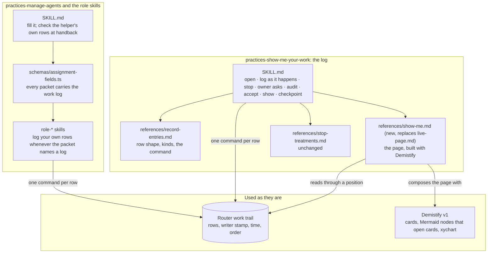
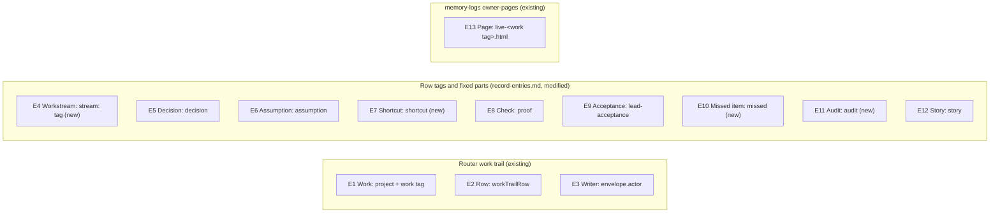
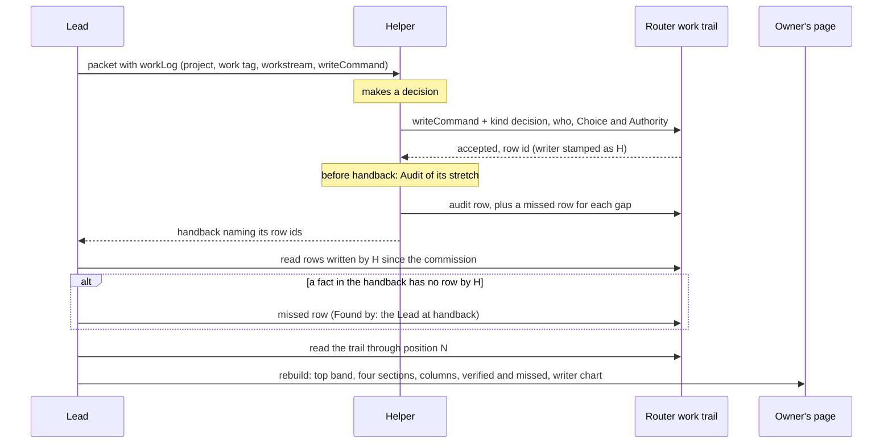

# Program Design: show me your work, who does what

This document says how the skills, the Router work trail and Demistify make the [Specification](specification/index.md) true. It uses the Specification's terms (E1–E13) and covers every obligation (R1–R24) in the trace table at the end, each row carrying its capability key. How each obligation is shown to hold on a real run is the Verification Design's.

## What changes, in one picture



Three things change and two stay as they are:
- **The log's guidance** (`practices-show-me-your-work`): three new kinds of row, a plain workstream label for each part of the design or plan, an audit step, and the show-me reference rewritten around the four sections.
- **The commission** (`practices-manage-agents`): every packet would name the log and a ready-to-run write command, and the Lead would check the helper's own rows at handback.
- **The role skills**: under this design, every helper would log its own rows whenever its packet names a log, whether or not it may post on a thread. Today `role-reviewer` and `role-verifier` load the logging skill only "IF posting is authorized". `role-researcher` loads it as a Sidekick; as a Worker, it contributes to its commissioner's trace. The gates are a likely reason no evaluator or reviewer wrote a row before 6 Nov; the counts show the absence, not its cause.
- **Unchanged:** the Router work trail, which stores, stamps and orders the rows; and Demistify v1, which draws the page.

## The choices, and why these

**Where the short write command lives (R3).** The crux: an agent must log in one cheap step without typing ids, and a retry must not duplicate.

| Option | Gains | Costs |
| --- | --- | --- |
| **A. A ready command in the packet (chosen).** The Lead fills the project id, subject, work tag and workstream into a two-step command in the packet. Step one mints and prints a request id and a row id for this row; step two writes with them, and the helper adds only the kind and the tags it takes, `who:`, the text and any row it closes. On an unclear result, it reruns step two with the same ids; a new row starts again at step one. | No new tool, nothing to install, works on every host that has the Router CLI and Node; the skill stays guides only; a retry rests on Router's own replay, seen once for a sequential resend | About 300 characters of fixed command per row; the helper must reuse the printed ids on a retry rather than mint new ones |
| **B. A `sunstack log` wrapper.** A TypeScript command in sunstack-tools that reads the work log from a file the packet points at, and saves a request id per row. | About 30 characters per row; retries safe by construction | A new tool to build, install on Codex and Claude hosts, and keep; the skill gains a dependency |
| **C. Defaults in the Router CLI.** The CLI reads the project and tag from a profile. | Shortest, and shared by every tool | The Router engine and its tools are protected in this change |

A is enough because Router replays a resend with the same request and row ids, so the only thing a wrapper adds is shorter text. That replay was seen for a sequential resend after the first send finished, on CLI 0.1.125 against a host at 0.1.119 (proof `01a1b2fd-19fc`). A resend while the first send is still in flight isn't proven; the Verification Design's O5 adds overlapping same-id resends, counted only where the clients' timing shows overlap, and reports "overlap not observed" otherwise. Whether Router processed both at once stays unverified; O5 shows the outcome, one row. O5 runs on whatever Router host the next run uses, which is the target. A helper writes tens of rows per commission, so A costs a few thousand tokens more than B. Reopen with B if V3 shows agents mangling the command, minting new ids on a retry, or skipping rows because the command is long.

The command, as the Lead fills it into `writeCommand`:

```text
step 1 (once per row):  node -e 'const c=require("node:crypto");console.log("request", c.randomUUIDv7(), "row", c.randomUUIDv7())'
step 2 (and any retry): agent-collaboration work-trail add --project-id <project> --actor self --subject '{"kind":"project"}' --request-id <request> --row-id <row> --tag <work tag> --tag stream:<workstream> --tag <kind> --tag who:<who> [--link '<the row it closes>'] --json "<text>"
```

Two plain commands, not one compound line, because some hosts refuse compound shell lines (this session's worktree guard does). Reading the trail stays useful to reconcile; it isn't the guarantee.

**Who audits (R18).** The audit is pstack's "audit the log against the transcript at the end of a run".

| Option | Gains | Costs |
| --- | --- | --- |
| **A. Each writer audits its own stretch (chosen)** at its handback (a helper) or checkpoint (the Lead), against its own session history and the packet's or plan's required checks | Cheap; the agent that has the history does it; every stretch gets an Audit or shows "not audited" | An agent can miss its own blind spots |
| B. A second agent on another model audits too, as pstack's cross-model review does | Catches blind spots | Another commission per stretch; a second reader of every transcript |

A, because the independent reviews this work already commissions (`implementation-review`, `spec-program-review`, Terra's page checks) are the second reader. A finding they make that the log missed becomes a Missed item. Reopen with B if a review or the owner finds missed items in a stretch whose own Audit found none.

**How the top counts open their items (R19).** Demistify v1's number tile can't hold a link, and xychart bars can't either. A Mermaid flowchart node whose id matches a card's id opens that card in the side panel: experiment `01a1b2d2-0983`, re-run with `flowchart TB` so the four counts sit in one row. Chosen: the top band is a `flowchart TB` of unconnected count nodes, each id matching the card that holds its items. The chart's bars can't link, so its exact values sit in a table under it, one row per writer and one cell per day. Each cell opens that writer's rows for that day in "Rows by writer", a fold at the end of the page (R22).

**No saved copy of the rows.** The Requirements left it to this document whether a page build saves the rows it read. Not needed: the work trail is append-only and can be read through any position at any time, so the page's stated position is enough to rebuild and check it.

## What the current system does

| Behavior | Where it lives today | What it does now |
| --- | --- | --- |
| Writing a row | `record-entries.md`, "Write it" | `agent-collaboration work-trail add --project-id <id> --actor self --subject '{"kind":"project"}' --tag … --json "<text>"`. The project id has no default and the subject is required unless the writer has a Router assignment. Router stamps the writer (`envelope.actor`), the time and the order. The skill says `--request-id` makes a retry safe, but alone it doesn't replay: a resend with the same request id and a new CLI-made row id returns `conflictingRequest`. Sent with the same `--row-id` as well, a resend returns the original row (proof `01a1b2fd-19fc`). |
| Kinds of row | `record-entries.md`, "The eight kinds" | action, decision, assumption, design-change, proof, lead-acceptance, owner-ask, story; tags `who:` and `part:` |
| Telling a helper where to log | `practices-manage-agents/schemas/assignment-fields.ts`, `JobBase` | nothing: the packet has outcome, sources, reads, limits, stop condition and return contract, but no log |
| Helpers logging | `role-implementer` loads the skill always; `role-reviewer` and `role-verifier` only "IF posting is authorized"; `role-researcher` as a Sidekick, and as a Worker it contributes to its commissioner's trace | 24 of 268 rows came from a helper; the first evaluator row came on 6 Nov, when commission 37 asked for it |
| Checking a handback | `practices-manage-agents` SKILL.md: "match each claim to the commit, file or output you opened" | no check of the helper's own rows |
| The page | `references/live-page.md` | Right now; Waiting for you; part by part; closed; the Lead's view. Built by hand with Demistify; no script in the skill (the guides-only change, #194) |
| Finding what was missed | nowhere | nothing |

## Where each term lives



| Term | Owner | Home | Shape at each boundary | Stored or derived |
| --- | --- | --- | --- | --- |
| E1 Work | the Lead, who opens it | existing: a Router project plus one work tag | in a packet: `workLog: { kind: "workTrail", projectId, workTag, workstream, writeCommand }` or `{ kind: "noRecord", gap }` | stored by Router |
| E2 Row | its Writer | existing: Router `workTrailRow`; the writer mints `rowId` and the request id | the CLI's JSON row: `rowId`, `envelope.request`, `envelope.actor`, `envelope.time.value`, `envelope.position.position.cursor`, `tags[]`, `links[]`, `text`, `redacted` | stored by Router; append-only |
| E3 Writer | Router | existing: `envelope.actor`, a session (endpoint and session id) or a human id | on the page: the role name from the Lead's commissioning `action` row, with the session's short id as text when two Writers share a role; counts, links and anchors key on the full endpoint and session id, never the role or a short form | stored by Router; the role is derived |
| E4 Workstream | the Lead, who names it | new tag `stream:<label>`; an `action` row at the start, and whenever a part begins, lists each Workstream with the part of the design or plan it carries out; old rows' `part:` tags read as their workstream | plain words, lower case, spaces as hyphens in the tag | stored as a tag and in that row |
| E5 Decision | its decider; written by whoever has it | existing kind `decision`; fixed parts `Choice:`, `Authority:`; `who:` names the decider | text lines in fixed order | stored |
| E6 Assumption | its maker | existing kind `assumption`; `Assumed:`, `What depends on it:`; `state:` and `next:` tags | as today | stored |
| E7 Shortcut | the agent that took it | new kind `shortcut`, replacing `design-change` for new rows; fixed parts `Planned:`, `Did instead:`, `Why:`, `Authority:` (`none` when uncovered); old `design-change` rows read as Shortcuts | text lines in fixed order | stored |
| E8 Check | the agent that ran it | existing kind `proof`; `Claim:`, `Check:`, `Result:`, `Not covered:`; plus `Ran by:` when the Writer didn't run it | text lines in fixed order | stored |
| E9 Acceptance | the Lead | existing kind `lead-acceptance` | commit or revision, checks read with results, what stays unverified | stored |
| E10 Missed item | whoever found it | new kind `missed`; fixed parts `Missed:`, `Found by:`, `Affects:`; first link the Row it concerns, when there is one | text lines in fixed order | stored |
| E11 Audit | the Writer whose stretch it covers | new kind `audit`; fixed parts `Stretch:` (from and to: positions, commits or times), `Compared against:`, `Couldn't see:`, `Found:` (a count, with the Missed rows linked) | text lines in fixed order | stored |
| E12 Story | the Lead | existing kind `story`; `Section:` takes one of the four sections | as today | stored |
| E13 Page | the Lead | existing: `projects/<yyyy>/<yyyy-mm-project>/owner-pages/live-<work tag>.html` in memory-logs, rebuilt by hand with Demistify | HTML; states the log position it covers | derived from the log |

The packet field, in the repository's TypeScript and zod convention (`assignment-fields.ts`):

```ts
export const WorkLog = z.discriminatedUnion("kind", [
  z.strictObject({
    kind: z.literal("workTrail").describe("The helper logs its own rows in this Router work trail"),
    projectId: RequiredText.describe("The Router project that holds the work's log"),
    workTag: RequiredText.describe("The tag every row of this work carries"),
    workstream: RequiredText.describe("The plain label the helper's rows go under, such as 'page experiments'"),
    writeCommand: RequiredText.describe("The two-step write: step one mints a request id and a row id per row; step two has project, subject, work tag and workstream filled in, and the helper adds the ids, kind, who and text, reusing the same ids on a retry"),
  }),
  z.strictObject({
    kind: z.literal("noRecord").describe("This work has no Router log"),
    gap: RequiredText.describe("Why, and where the helper returns its rows instead"),
  }),
]);
// JobBase gains: workLog: WorkLog
```

## Who does what

| Part | Its one job | Used by |
| --- | --- | --- |
| `practices-show-me-your-work` SKILL.md | every agent logs its own work as it happens, audits its stretch, checkpoints; the Lead accepts and shows | every role, phase and orchestrator |
| `record-entries.md` | one row's shape: kinds, tags, fixed parts, the command, closing, retrying | every writer and reader |
| `show-me.md` (new) | the owner's page with Demistify: top band, workstreams, four sections, columns, verified and missed, writer chart | the Lead |
| `stop-treatments.md` | which entries stop work and who acts next (unchanged) | every agent |
| `assignment-fields.ts` `WorkLog` | carries the log's address and write command into every packet | the Lead, every helper |
| `practices-manage-agents` SKILL.md | fills `workLog`; at handback, reads the helper's rows by writer stamp and logs each missing one as Missed | commissioners |
| `role-*` skills | load the logging skill whenever `workLog` is a work trail, and log their own rows | each helper |
| Router work trail | stores, stamps and orders rows (unchanged) | everyone |
| Demistify v1 | draws the page (unchanged; linkable tiles and bars are a request to the component Lead) | the Lead |

Each part changes only when its job does: a rule of the log, a row's shape, the page, the packet, a role.

One owner per truth: Router owns who wrote a row and when; the row's text owns what it says; the Lead owns the page and every story; each Writer owns its own Audit.

## The main path: a helper logs a decision, the Lead puts it on the page



What changes from today: the packet carries the log; the helper writes its own rows whatever its posting authority; the Audit and Missed rows are new; the Lead checks rows at handback; the page has new sections. What must stay as it is: a row is never edited, and the first link of a closing row names what it closes.

## When something goes wrong

| What goes wrong | How it's seen | What happens | Who fixes it |
| --- | --- | --- | --- |
| A write's outcome is unknown, such as an answer lost after Router accepted it | the command gives no readable Router answer: it times out, the connection drops after sending, or its output can't be read | rerun step two with the same request and row ids; Router returns the original row, or writes it if the first send never landed; reading the trail only reconciles | the Writer |
| Router refuses the write | a readable Router answer that isn't `accepted`: a recorded rejection such as `conflictingRequest`, a writer, lease or schema gate, or an access denial | no row exists, and resending the same ids returns the same refusal (Router's write contract: a recorded rejection replays). If the refusal follows an unknown first send, read the trail for the row id before anything else. Fix what the answer names, and write the row again from step one with new ids; for an access denial, keep the row for the handback with the exact answer, as when Router can't be reached, and never switch identity or transport to get past it | the Writer; the grant holder for a denial |
| A helper can't reach Router (a sandboxed Worker, say) | the write fails to connect | it lists its rows in the handback with the exact error; the commissioner writes them with `Ran by:` naming the helper, plus a Missed row for each saying the helper couldn't write it and why; the page shows them second-hand and missed | the commissioner |
| A row is wrong | someone notices | a correcting row closes it; the page shows both | whoever noticed |
| An Audit can't see the work, such as an unreadable transcript | the auditor says so in `Couldn't see:` | the page shows that stretch "not audited" | the Writer |
| The trail can't be read when building the page | the read fails | the page isn't rebuilt from memory; the exact gap goes in the checkpoint | the Lead |
| Two agents write at the same time | — | Router orders them; the page shows what's there through its stated position, and later rows appear at the next build | Router |

## Across the whole

- **Privacy.** A packet carries a project id and tags, not secrets. Rows keep the existing rule: no secrets, credential paths or account data.
- **Readability.** Demistify's themes give dark and light; every state carries a word or icon as well as a tone.
- **Cost.** About 300 characters of fixed command per row. One Audit per stretch, reading that stretch only.
- **Where things live.** The skill stays guides only: no script ships in it. The Lead counts rows per writer and day with a one-off command in its own scratch space; nothing it writes for that goes into the skill or a product repository.

## Trace

| U | R | E | Owner | Interface | Shape and home | State | Failure | Proof |
| --- | --- | --- | --- | --- | --- | --- | --- | --- |
| U8 | R1 (logging): the actor writes the Row before dependent work | E2 E3 E5–E8 | each Writer | `writeCommand` | Router row; writer in `envelope.actor` | — | written by another Writer or late: a Missed row | seam: writer stamp and time against the agent's own history |
| U8 | R2 (logging): packet names the log; handback checked | E1 E3 E4 | the Lead, via `practices-manage-agents` | `JobBase.workLog`; handback row check | `WorkLog` in `assignment-fields.ts` | — | missing rows become `missed` rows | seam: packet, handback and the trail by writer |
| U10 | R3 (logging): the agent supplies only kind, workstream, text, closing row and minted ids | E2 E3 | the Lead fills `writeCommand` | step one mints a request id and a row id; step two writes | `WorkLog.writeCommand`; `--request-id`, `--row-id` | — | unclear result: rerun step two with the same ids, and Router replays | seam: commands as run, and each row's `envelope.request` after a retry |
| U9 | R4 (logging): every Story line is backed | E12 E2 | the Lead | `story` rows; `show-me.md` | `story` fixed lines, links | current → replaced | an unbacked line is dropped | seam: each Story's links |
| U11 | R5 (logging): the peer logs in its own Work | E1 | the peer Lead | its own packet `workLog` | its own project | — | — | seam: the peer's project and this trail |
| U1 | R6 (decisions): every Decision reachable | E5 E3 | the Lead | `show-me.md` sections and fold | `decision` rows | current → replaced | — | seam: the page's anchors against the trail's decisions |
| U1 | R7 (decisions): two columns | E5 | the Lead | `show-me.md`: the own-call rule's four conditions | `decision`, `who:`, `core`, and what the choice touches | — | a design fill-in or departure placed among own calls | seam: the page's two columns |
| U1 U5 | R8 (decisions; missed shares it): no authority means worth your look, and Missed | E5 E10 | the Lead | `show-me.md` sorting | `Authority:` line and its source | — | an inferred authority counts as none | seam: decisions with no or inferred authority |
| U2 | R9 (assumptions): open Assumptions shown | E6 | the Lead | `show-me.md` | `assumption` with `state:`/`next:` | open → closed | — | seam: open assumptions on the page |
| U2 | R10 (assumptions): owner-only assumption logged before dependent work, shown with its decision page | E6 E5 E13 | the maker; the Lead for the decision page | `stop-treatments.md`; `owner-decision-brief` | `assumption` with `next:owner`, decision-page link | open (owner) → closed by a decision | logged late is a Missed item | seam: row time against the next dependent row or commit |
| U2 | R11 (assumptions): silence never decides | E6 | the Lead | `show-me.md` sorting | closing link rules | stays open | — | seam: assumptions closed only by `resolves` |
| U3 | R12 (shortcuts): the taker logs a Shortcut | E7 E3 | the agent that took it | `writeCommand` with kind `shortcut` | `Planned:`, `Did instead:`, `Why:`, `Authority:` | taken → approved or reversed | — | seam: shortcut rows by writer |
| U3 | R13 (shortcuts): Shortcuts shown; uncovered ones marked | E7 E10 | the Lead | `show-me.md` | `Authority: none` | — | logged by someone else is also a Missed item | seam: the page's shortcut cards |
| U4 | R14 (verification): the runner logs a Check; second-hand shown | E8 E3 | the agent that ran it | `writeCommand` with kind `proof` | `Ran by:` when the Writer didn't run it | passed, failed or partial | written by another Writer, even when the runner couldn't reach Router: second-hand and a Missed row | seam: proof rows' writer against `Ran by:` and the Missed rows |
| U4 | R15 (verification): finished work with Checks and acceptance status | E8 E9 | the Lead | `show-me.md` | `proof`, `lead-acceptance` | — | none recorded shows "no acceptance recorded" | seam: the verified section |
| U4 | R16 (verification): accepted only with an Acceptance | E9 | the Lead | `SKILL.md` accept step | `lead-acceptance` | accepted → reopened | — | seam: acceptance rows by commit |
| U5 | R17 (missed): What was missed shown | E10 E11 | the Lead | `show-me.md` | `missed` rows | open → closed | — | seam: missed rows on the page |
| U5 | R18 (missed): audit status per Writer stretch | E11 E3 | each Writer audits its stretch | `SKILL.md` audit step; `audit` rows | `Stretch:`, `Compared against:`, `Couldn't see:`, `Found:` | done | can't see: "not audited" | seam: audit rows per writer against the page |
| U12 | R24 (going-on): each Workstream with done, next and evidence | E4 E12 E8 E9 | the Lead | `show-me.md`: "What's done / what's next" grouped by Workstream | `stream:` tags; the Workstream list `action` row; stories per Workstream; their Checks and Acceptances | active → finished | a started part with no Workstream: a Missed row at the next checkpoint | seam: the section's Workstreams against the design's or plan's started parts |
| U6 | R19 (attention): top band; each count opens its items | E13 E6 E7 E10 E9 | the Lead | `show-me.md`: a `flowchart TB` of count nodes whose ids match cards | `ex-mermaid` node ids equal to `ex-card` ids | — | — | seam: clicking each node in a headless render |
| U6 | R20 (attention): the four sections, routine folded | E13 E12 | the Lead | `show-me.md` | `story` `Section:` | — | — | seam: the page's section order |
| U7 | R21 (attention): one full copy of each item | E13 | the Lead | `show-me.md`: one anchor per item, links elsewhere | `#entry-<id>` anchors | — | — | seam: duplicate-text check on the page |
| U7 | R22 (attention): visual, clickable; writer chart | E13 E3 E2 | the Lead | `show-me.md`: xychart, its values table, and the "Rows by writer" fold | `xychart-beta` bars, one per Writer session; a values table whose cells link to `#writer-<endpoint>-<full session id>-<day>`; the role shown as the label, with a short session id only as text | — | two Writers share a role, or even a short id: the label adds the short id, and the full id keeps their targets apart | seam: the chart and table against writer stamps; clicking each cell |
| U7 | R23 (attention): the reference teaches the page | E13 | the skill's author | `show-me.md` with a worked example from this log | the reference itself | — | — | seam: the Lead's next real page built from the reference alone |

## Open

- **A linkable number tile and linkable chart bars** would let the tiles replace the Mermaid nodes and the bars open their rows directly. That's a request to the component Lead, not a dependency. The legend's overlap on labels longer than about ten characters goes with it.
- **Option B for the command** stays on the shelf unless V3 fails.
