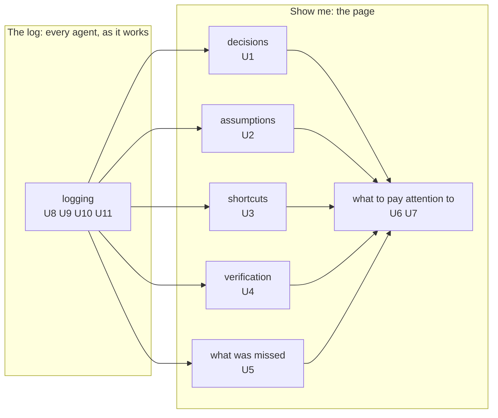

# Requirements: show me your work, the log agents keep and what the owner sees

## The change

- **Target:** `sunstack-dev` / `practices-show-me-your-work`, as merged at `02965db8` (guides only, sunstack-dev 2.104.0), with the skills that commission or record work (`practices-manage-agents`, the `role-*` skills, the phase and orchestrator skills that call it).
- **Kind:** update, behavior-changing.
- **Baseline:** the 4 Nov design set (`docs/wip/skills-authoring/2026-11-04-show-me-your-work/`), accepted great at `0111a3ef`, shipped in #194. Its success definition is the accepted requirements set this change keeps: during design, planning and implementation the owner opens one page and sees, without reading transcripts, (1) what has happened; (2) how the design is carried out, part by part; (3) each decision, who made it and on whose authority; (4) each assumption and which wait for him; (5) what changed from the design; (6) what is proven and what is still unverified; (7) what finished work the Lead accepted. Every agent records these as they happen.
- **Why change it:** the skill says all of that, but the first real record kept under it carries much less, and what it carries was often written late. A page built from it shows mostly what the Lead did. The owner wants to see the decisions, assumptions, shortcuts and verification of every agent, so he can trust their decisions and see what was missed.

## Words used here

- **The log:** the project's Router work trail, filtered by the work's tag: simple rows that agents write as they work. The owner never reads it raw; the page shows it.
- **Shortcut:** anything done the quick way or off the plan: a check skipped, a step cut, a departure from the design or plan. The record's kind for a departure today is `design-change`.
- **Verification:** a check that ran, its result, and what it didn't cover; finished work the Lead accepted is verification he signed for (the record's kind for it is `lead-acceptance`).
- **What was missed:** something that happened but wasn't logged, a claim with weak or no evidence, or a check that should have run and didn't.
- **Specification:** the next document of this design: what must be observably true for each requirement, and what decides pass or fail.

## Who is affected

| Class | Role here | What they need |
| --- | --- | --- |
| The owner | reads the page; decides what waits for him | to trust the agents' decisions and know what was missed or decided, without reading transcripts or raw rows |
| Agents doing the work (Lead, Sidekicks, reviewers, evaluators) | log their own work as it goes | logging that's easy and low-token, so they do it in the moment |
| The Lead | interprets the log for the owner and owns what it says | everyone's rows, on time, to put together |
| A peer Lead working on part of this work from its own project | logs in its own project's record | nothing copied between records |

## The need, in the owner's words

- 3 Nov: "Show me your work is about the assumptions. It's about making sure what work we've done is locked, with decisions logged. Proof of the work, what verifications are done. It should function and show me what's going on and also work through HTML."
- 3 Nov: "'Show me your work' should work while the design process is done and implementations happening, to show all the design breaks and all the decisions the agent made so I know what's going on."
- 3 Nov: "i want all deiciosn to be recorded with sho wme kyour work. then i want to maek srue all assumed deicons are logge dand check in weith me"
- 30 Oct, scrape: "do html of what was accoplsiehd any shortcuts anything off the plan or rails"
- 6 Nov, confirming the point: "eys and i knwo what was deiceded and hwat is goign on", pointing to pstack's show-me-your-work skill.
- 6 Nov, the shape: "thers 2 parts the main skill. refrences on how to show me the skill. main skill is log. refrence is show me. how to log is conencted"; "reference file shoudl explain to kuse demsytify hwo to repsernese the ifnoramtion i want to see so i can trust the agent deicion an dknwo what was msied or decided"
- 6 Nov, the page: "the layout we have is ncie to kwno what to pay attention to what to do"; "lgos can be csv with ntoes, bukt i want to have display beyodn that with demsytify"; "i want to knwo dieciosn!"; "presetsation is what i care about. iw ant to to know the dicions ands assukmptiosn and shortcuts what bvericiaotn is done"
- 6 Nov, the log: "agent sure, but lead does the itneropoaltion and ownership"; "in its own record"; "yes worktrail with simle rows"; "i dont need to dif i cannot read a csvs"; "the lgos and memroy logs or related md fiels to log you decide is easy dx for agents is good what ever ise low token and easy"; "agen tlog is for teh agen tot log its owrk as it goes, not sue any memeories the process later"; after asking whether CSV or JSONL would be better: "ok do ign it with router is good then lets mvoe on, its about display then no?"
- 6 Nov, on the page experiments: "lets try diffrent ways so i can visualizie and see what soging on and clicn ok thigns not a toc"; "its nto to regurgitate teh same information"; "i dkunno what pecies is"

## What the record shows today

Router project `01a1635f-5d9d-70e4-bfc7-6d96c1a210e7`, tag `design-documents`: a snapshot of 245 entries, the last `01a1b22f-b524` at position 2:1020, counted by kind and tag. Counts by `who:` tag use each entry's first one; one entry (`01a1a731-16a9`) carries both `who:lead` and `who:sidekick`, so raw tag counts give 29 Sidekick entries rather than 28. A tag records who an entry is attributed to. Router's writer stamp, kept on every row, records who wrote it; the "who wrote it" row counts that stamp at a later read (row `01a1b2b4-d29e`). Work outside this record is not counted.

| Owner's word | Entries in this record | What it shows |
| --- | --- | --- |
| assumptions | 29 tagged `assumption`: 28 `who:lead`, 1 `who:sidekick` | the agents doing the work rarely log an assumption here |
| check in with me | the owner's two open choices of 6 Nov became waiting entries (`01a1b108-5e71`, `-5fa7`, 08:24) about 51 minutes after the first was asked in chat (07:33, row `01a1b0e0-0c8b`) and 23 minutes after the second arose (row `01a1b0f3-2a00`, 08:01) | G4 was asked in chat before its waiting entry; G10's waiting entry followed the reviewer's recorded hold by 23 minutes |
| decisions | 55 tagged `decision`; 12 are the Lead's own calls | logged, mostly attributed to the Lead |
| shortcuts | 4 tagged `design-change` in three days; the #194 merge skipped the repository's test suite and two tests went red (row `01a1b226-4508`), which the log recorded only after the component Lead found it | few shortcuts are logged when taken |
| verification | 52 tagged `proof`, mostly evaluator checks of page looks; 0 tagged `lead-acceptance` | checks are logged, but not always the ones that matter, and no acceptance is |
| as it goes | many Lead rows were written in batches from a file after the events, for example one row covering five evaluator checks across an hour | rows are often written from memory later |
| part by part | 120 tagged `part:run-1`; 70 have no `part:` tag | the grouping tags don't tell the owner anything |
| who | 150 `who:lead`; 67 `who:owner` (owner decisions the Lead recorded); 28 `who:sidekick` by first tag | most of the record is attributed to the Lead |
| who wrote it | by Router's writer stamp, 258 rows at position 2:1072 on 6 Nov: the Lead wrote 234, one Sidekick 24, and no evaluator or reviewer wrote any | the Lead wrote even the rows about other agents' checks |

### The page today

The skill's live page as built on 5 Nov from 149 rows of this record (`owner-pages/live-design-documents.html` in memory-logs). It lists counts, then entries by section and by the record's part tags. It doesn't show what each agent decided, assumed, cut short or checked.

## Capabilities

Taken from the owner's own words above; each requirement has one home. Six are what the owner sees; one is what the agents do so he can see it.

| Key | Owner's words | What the owner gets |
| --- | --- | --- |
| `decisions` | "i want to knwo dieciosn!" | every decision made in the work, who made it, why, and on whose authority |
| `assumptions` | "the dicions ands assukmptiosn" | every assumption, and the ones only he can settle brought to him |
| `shortcuts` | "shortcuts"; "any shortcuts anything off the plan or rails" | every corner cut and anything off the plan, with what was skipped or changed and why |
| `verification` | "what bvericiaotn is done" | what was checked, the result, what wasn't checked, and what finished work the Lead accepted |
| `missed` | "knwo what was msied" | what was missed: things that happened but weren't logged, weak evidence, checks that didn't run |
| `attention` | "what to pay attention to what to do" | a page that opens on what needs his attention and what to do, in a Demistify display beyond the raw log |
| `logging` | "log its owrk as it goes" | a true log: every agent's own rows, written as it works, so the page has something true to show |

The log feeds the page; the page shows what matters to the owner, not every row.

## Requirements

Each requirement is an outcome the owner asked for; how agents get there is the Specification's and Program Design's. All rows are `authorized` by the words quoted; the priority is proposed by the Lead, and the owner assigns it.

### What the owner sees

| ID · priority | Need or outcome | In the record today | The owner's words |
| --- | --- | --- | --- |
| U1 · 1 | `decisions`: The owner sees every decision made in the work: what was chosen, who chose it, why, and on whose authority. | 55 decisions, mostly attributed to the Lead | "i want to knwo dieciosn!"; "i want all deiciosn to be recorded" |
| U2 · 1 | `assumptions`: The owner sees every assumption, and an assumption only he can settle reaches him as waiting for him when it comes up; his answer closes it. | 28 of 29 assumptions attributed to the Lead; two open choices became waiting entries late | "the dicions ands assukmptiosn"; "maek srue all assumed deicons are logge dand check in weith me" |
| U3 · 1 | `shortcuts`: The owner sees every shortcut and anything off the plan: what was skipped, cut or changed, and why. | 4 entries tagged `design-change`; the #194 test-suite skip was logged only after it surfaced | "shortcuts"; "any shortcuts anything off the plan or rails"; "show all the design breaks" |
| U4 · 1 | `verification`: The owner sees what verification was done: what was checked, the result, what wasn't checked, and which finished work the Lead accepted. | 52 proofs, mostly page looks, none written by the evaluator who checked; 0 tagged `lead-acceptance` | "what bvericiaotn is done"; "Proof of the work, what verifications are done"; "what work we've done is locked" |
| U5 · 1 | `missed`: The owner sees what was missed: what happened but wasn't logged, a claim with weak or no evidence, and a check that should have run but didn't. | nothing on any page today shows gaps | "knwo what was msied or decided" |
| U6 · 1 | `attention`: The page opens on what needs the owner's attention and what to do, in the layout he kept (For you to decide; What's done / what's next; What changed and why; What was verified). | the four-section layout of page O | "the layout we have is ncie to kwno what to pay attention to what to do" |
| U7 · 2 | `attention`: The page is a Demistify display beyond the raw log: visual and clickable, not a list or a table of contents, and it doesn't say the same thing twice. The skill's reference teaches agents how to build it with Demistify. | pages I to Q; the owner turned down list views and a map that repeated the stories | "display beyodn that with demsytify"; "reference file shoudl explain to kuse demsytify hwo to repsernese the ifnoramtion"; "not a toc"; "its nto to regurgitate teh same information" |

### The log

| ID · priority | Need or outcome | In the record today | The owner's words |
| --- | --- | --- | --- |
| U8 · 1 | `logging`: Every agent logs its own work as it goes, at the moment something happens, not from memory later. | the Lead wrote 234 of 258 rows and no evaluator or reviewer wrote one; many Lead rows written in batches after the events | "agent sure"; "agen tlog is for teh agen tot log its owrk as it goes, not sue any memeories the process later" |
| U9 · 1 | `logging`: The Lead interprets the log for the owner and owns what the log and the page say. | the Lead wrote the stories and pages alone, from its own rows | "lead does the itneropoaltion and ownership" |
| U10 · 1 | `logging`: Logging is easy and low-token for agents: simple rows in the Router work trail; the owner never has to read raw rows, CSV or diffs. | a row needs the project id, the writer's session, and request and row ids before any words; the Lead built itself a helper, other agents had none; a write that succeeded but reported an error was retried and wrote a second row (`01a1b2b7-c46b`) | "yes worktrail with simle rows"; "do ign it with router is good"; "i dont need to dif i cannot read a csvs"; "easy dx for agents ... low token and easy" |
| U11 · 2 | `logging`: A peer Lead working on part of this work from its own project logs in its own record. | the component Lead's work on this project's components sits in its own project | "in its own record" |

Every accepted item of the 4 Nov success definition keeps a home: (1) U6 with U1–U5; (2) U6; (3) U1; (4) U2; (5) U3; (6) U4; (7) U4.

## Shape (owner decision)

The skill has two parts, connected through the log: the main skill teaches logging (U8–U11); a reference teaches showing the owner with Demistify (U1–U7). What isn't logged can't be shown, so the log's shape is what the reference reads. Owner decisions `01a1b28e-70e8` and `01a1b28e-c5e5`.

The log is Router's work trail, not a CSV or JSONL file: Router stamps who wrote each row and when, keeps one order across agents, sessions and worktrees, and keeps rows append-only. A page build may save the rows it read as a JSONL snapshot so the page can be rebuilt and checked; agents don't write that file. With the log settled, most of the remaining design is the display. Owner decision `01a1b2b5-df88`.

## Goal boundary (confirmed by the owner on 6 Nov)

- **Goal:** the owner can trust the agents' decisions and know what was missed or decided: the page shows the decisions, assumptions, shortcuts and verification of every agent, and what was missed, opening on what needs his attention and what to do. Confirmed: "eys and i knwo what was deiceded and hwat is goign on" (`01a1b28e-6ff6`) and "yes" to the Lead's full reflection (`01a1b2ae-3e80`).
- **Reuse:** the Router work trail as the log, with simple rows (`01a1b291-488f`, `01a1b2b5-df88`); the stop treatments; the rule for what reaches the owner; decision pages; Demistify for the page; the four-section layout.
- **Missing:** every agent logging its own work as it goes; shortcuts and acceptances logged; what was missed found and shown; a page that shows the four things and what was missed, visually.
- **May change:** `practices-show-me-your-work` and the skills that commission or record work in `sunstack-dev`; how agents log is the Lead's call (`01a1b291-488f`).
- **Protected:** the Router engine and its storage; Demistify's components (the component Lead's).
- **Non-goals:** CSV files or diffs for the owner; a CSV or JSONL log for agents to write; the Jev check of which entries are important (a later run); fresh-agent behavior runs and pressure tests (later, with evals); the component Lead's work-record helper itself; design documents phase one; rewriting past entries.
- **Acceptable evidence:** on the next real piece of work, every agent that worked on it logged its own rows as it went, and the owner can say from the page, without transcripts, what was decided, assumed, cut short and verified, and what was missed.

## Open

- **Grouping.** The owner doesn't know what "pieces" are (`01a1b28e-743f`), so the word is dropped. The Lead will group rows by a plain phase or workstream label, as pstack's `phase` does; this is logging mechanics, the Lead's call, and the Specification states it for the owner to correct.
