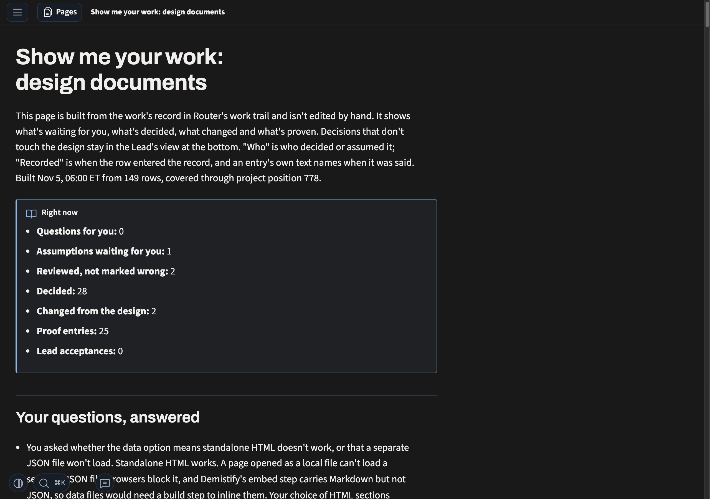
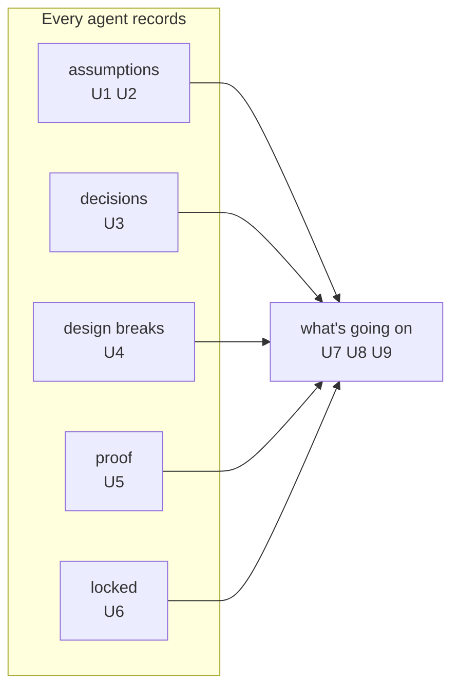

# Requirements: show me your work, the record agents keep and what the owner sees

## The change

- **Target:** `sunstack-dev` / `practices-show-me-your-work`, as merged at `02965db8` (guides only, sunstack-dev 2.104.0), with the skills that commission or record work (`practices-manage-agents`, the `role-*` skills, the phase and orchestrator skills that call it).
- **Kind:** update, behavior-changing.
- **Baseline:** the 4 Nov design set (`docs/wip/skills-authoring/2026-11-04-show-me-your-work/`), accepted great at `0111a3ef`, shipped in #194. Its success definition is the accepted requirements set this change keeps: during design, planning and implementation the owner opens one page and sees, without reading transcripts, (1) what has happened; (2) how the design is carried out, part by part; (3) each decision, who made it and on whose authority; (4) each assumption and which wait for him; (5) what changed from the design; (6) what is proven and what is still unverified; (7) what finished work the Lead accepted. Every agent records these as they happen.
- **Why change it:** the skill says all of that, but the first real record kept under it carries much less. Most of its entries are the Lead's; few are tagged as other agents' assumptions, departures from the design or Lead acceptances; and most sit under one catch-all part. A page built from it shows mostly what the Lead did, not what the other agents did, which is what the owner asked about on 6 Nov.

## Words used here

- **The record:** the project's Router work trail, where agents write one entry per fact as they work.
- **Design break:** a place where an agent departed from the design or the plan; the record's kind for it is `design-change`.
- **Locked:** finished work the Lead has accepted, recorded at its commit with the checks it read, so it can't change without a new, visible entry; the record's kind for it is `lead-acceptance`.
- **Piece:** one part of the design or plan that the work follows, such as a requirement or a plan slice; the record's tag for it is `part:<id>`.
- **Specification:** the next document of this design: what must be observably true for each requirement, and what decides pass or fail.

## Who is affected

| Class | Role here | What they need |
| --- | --- | --- |
| The owner | reads the record through the live page; decides what waits for him | to trust work agents do without him, without reading transcripts |
| Agents doing the work (Lead, Sidekicks, reviewers, evaluators, peer Leads working on the same pieces) | write the record as they work | to know what to record, where, and against which piece |
| The Lead | accepts finished work; keeps the owner's picture current | the same, plus a check that helpers recorded before their work is accepted |

## The need, in the owner's words

- 3 Nov: "Show me your work is about the assumptions. It's about making sure what work we've done is locked, with decisions logged. Proof of the work, what verifications are done. It should function and show me what's going on and also work through HTML."
- 3 Nov: "'Show me your work' should work while the design process is done and implementations happening, to show all the design breaks and all the decisions the agent made so I know what's going on." and "the idea is all the design changes, modifications, and assumptions are always logged during the implementation process as well."
- 3 Nov: "i want all deiciosn to be recorded with sho wme kyour work. then i want to maek srue all assumed deicons are logge dand check in weith me"
- 4 Nov: "show me your work is duign the proscess ofimplemenation what has happed how is the disng bieng implemetned what ar eteh dicsion and assumpitosn."
- 6 Nov, on the page experiments: "how will a part help my udentanding of what agents are doing?"; "lets try diffrent ways so i can visualizie and see what soging on and clicn ok thigns not a toc"; and earlier "its nto to regurgitate teh same information".

## What the record shows today

Router project `01a1635f-5d9d-70e4-bfc7-6d96c1a210e7`, tag `design-documents`: a snapshot of 245 entries, the last `01a1b22f-b524` at position 2:1020, counted by kind and tag. "Who" counts use each entry's first `who:` tag; one entry (`01a1a731-16a9`) carries both `who:lead` and `who:sidekick`, so raw tag counts give 29 Sidekick entries rather than 28. Tags record who an entry is attributed to; they don't prove who wrote it, and work outside this record is not counted.

| Owner's word | Entries in this record | What it shows |
| --- | --- | --- |
| assumptions | 29 tagged `assumption`: 28 `who:lead`, 1 `who:sidekick` | the agents doing the work rarely record an assumption here |
| check in with me | the owner's two open choices of 6 Nov became waiting entries (`01a1b108-5e71`, `-5fa7`, 08:24) about 51 minutes after the first was asked in chat (07:33, row `01a1b0e0-0c8b`) and 23 minutes after the second arose (row `01a1b0f3-2a00`, 08:01) | G4 was asked in chat before its waiting entry; G10's waiting entry followed the reviewer's recorded hold by 23 minutes |
| decisions | 55 tagged `decision`; 12 are the Lead's own calls | recorded, mostly attributed to the Lead |
| design breaks | 4 tagged `design-change` in three days | few entries are tagged as a change from the design |
| proof | 52 tagged `proof`, mostly evaluator checks of page looks; the #194 merge proof did not run the repository's test suite, and two tests went red (row `01a1b226-4508`) | checks are recorded, but not always the ones that matter |
| locked | 0 tagged `lead-acceptance` | no entry here is tagged as a Lead acceptance (other kinds weren't checked for acceptance) |
| part by part | 120 tagged `part:run-1`; 70 have no `part:` tag | the tags don't name pieces of a design |
| who | 150 `who:lead`; 67 `who:owner` (owner decisions the Lead recorded); 28 `who:sidekick` by first tag | most of the record is attributed to the Lead |

### The page today

The skill's live page as built on 5 Nov from 149 rows of this record (`owner-pages/live-design-documents.html` in memory-logs). It lists counts, then entries by section and by the record's part tags. It doesn't show what each agent did, and its parts are whatever tags the entries carried.

## Capabilities

Taken from the owner's own words above; each requirement has one home.

| Key | Owner's words | What the owner gets |
| --- | --- | --- |
| `assumptions` | "about the assumptions" | every assumption an agent makes, when it makes it, and the ones only he can settle brought to him |
| `decisions` | "with decisions logged" | every decision, by whoever made it, with its authority |
| `design-breaks` | "all the design breaks" | every departure from the design or plan, with what it said, what changed and why |
| `proof` | "Proof of the work" | what was checked, what ran, the result, and what was not covered |
| `locked` | "what work we've done is locked" | finished work recorded as accepted, so it can't change silently |
| `whats-going-on` | "show me what's going on" | a page he can see and click through, piece by piece, that shows what the agents are doing |

The record feeds the page. The page brings to the owner what matters to him, by the rule the skill already has for what reaches him (anything that changes or fills in the design, and what waits for him), not every entry.

## Requirements

Each requirement is an outcome the owner asked for; how agents get there is the Specification's and Program Design's. All rows are `authorized` by the words quoted; the priority is proposed by the Lead, and the owner assigns it.

Proposed by the Lead, not authorized: that the agent who assumes, decides, departs or checks is the one who records it, rather than the Lead relaying. It is the Lead's proposal for how to meet the owner's "all", and the Specification and Program Design decide it.

### assumptions

| ID | Need or outcome | In the record today | The owner's words |
| --- | --- | --- | --- |
| U1 · priority 1 | Every assumption made in the work is recorded when it is made. | 28 of 29 assumptions are attributed to the Lead | "Show me your work is about the assumptions" (3 Nov) |
| U2 · priority 1 | An assumption only the owner can settle reaches him as waiting for him when it is made, and his answer closes it. | two open choices became waiting entries 23 and 51 minutes late | "maek srue all assumed deicons are logge dand check in weith me" (3 Nov) |

### decisions

| ID | Need or outcome | In the record today | The owner's words |
| --- | --- | --- | --- |
| U3 · priority 2 | Every decision made in the work is recorded, with who made it and its authority. | 55 decisions; 28 entries in all are attributed to Sidekicks | "i want all deiciosn to be recorded with sho wme kyour work" (3 Nov) |

### design-breaks

| ID | Need or outcome | In the record today | The owner's words |
| --- | --- | --- | --- |
| U4 · priority 1 | Every departure from the design or plan is recorded when it happens: what the design said, what changed, and why. | 4 entries tagged `design-change` in three days | "to show all the design breaks"; "all the design changes, modifications, and assumptions are always logged during the implementation" (3 Nov) |

### proof

| ID | Need or outcome | In the record today | The owner's words |
| --- | --- | --- | --- |
| U5 · priority 2 | Every check is recorded: what it claimed, what ran, the result, and what it didn't cover, including the repository's own required checks. | 52 proofs; the #194 merge proof missed the test suite and two failing tests | "Proof of the work, what verifications are done" (3 Nov) |

### locked

| ID | Need or outcome | In the record today | The owner's words |
| --- | --- | --- | --- |
| U6 · priority 1 | Finished work the Lead accepts is recorded as accepted at its commit, with the checks read; changing it later is a new, visible entry. | 0 entries tagged `lead-acceptance` | "making sure what work we've done is locked" (3 Nov) |

### whats-going-on

| ID | Need or outcome | In the record today | The owner's words |
| --- | --- | --- | --- |
| U7 · priority 1 | The owner sees the work piece by piece, where each piece is a part of the design or plan the work follows, with what was assumed, decided, broken and proven for it. | 120 entries tagged `part:run-1`, 70 untagged | "how is the disng bieng implemetned" (4 Nov); the map shows the parts (6 Nov decision `01a1b21a-1780`); see H1 |
| U8 · priority 1 | The owner can tell what the agents are doing: what each one did, assumed and decided, what waits for him first, and whether it matches what he asked. | the 4–6 Nov pages showed the Lead's stories, not each agent | "how will a part help my udentanding of what agents are doing?" (6 Nov); "so I know what's going on" (3 Nov) |
| U9 · priority 2 | The owner sees it visually and clicks into it, not as a list or a table of contents, and the page doesn't say the same thing twice. | pages I to Q; the owner turned down list views and a map that repeated the stories | "visualizie and see what soging on and clicn ok thigns not a toc"; "its nto to regurgitate teh same information" (6 Nov) |

Every accepted item of the 4 Nov success definition keeps a home: (1) U8; (2) U7; (3) U3; (4) U1, U2; (5) U4; (6) U5; (7) U6.

## Goal boundary (proposed, not yet confirmed by the owner)

- **Goal:** the owner can trust work agents do without him, because the record carries what was assumed, decided, broken from the design, proved and accepted, against the pieces of the design, and the page shows him what matters.
- **Reuse:** the Router work trail as the record; the entry kinds and fixed parts shipped in #194; the stop treatments; the rule for what reaches the owner; decision pages; Demistify for the page.
- **Missing:** assumptions, departures and acceptances recorded by whoever makes them; pieces that name parts of the design; a page that answers what the agents are doing, piece by piece, visually.
- **May change:** `practices-show-me-your-work` and the skills that commission or record work in `sunstack-dev`.
- **Protected:** the Router engine and its storage; Demistify's components (the component Lead's); the entry kinds and fixed parts already shipped, except where a requirement here needs more.
- **Non-goals:** the Jev check of which entries are important (a later run); fresh-agent behavior runs and pressure tests (later, with evals); the component Lead's work-record helper itself; design documents phase one; rewriting past entries.
- **Acceptable evidence:** on the next real piece of work, the record carries entries from the agents that worked on it, for its assumptions, decisions, departures, proof and acceptance, each tagged to a piece of its design; and the owner can say from the page, without transcripts, what each agent did and what waits for him.

## Open

- **H1, what a piece is when the work has no design.** U7's pieces come from the design or plan. This project's page experiments had none, which is how one catch-all tag happened. Candidate: for such work, the owner's asks become the pieces. Owner meaning, not yet given.
- **H2, peers in other projects.** When a peer Lead works on a piece of this work from its own project (as the component Lead did), whether its entries belong in this record or are linked from it. Owner meaning, not yet given.
- **The goal boundary above** is the Lead's restatement of the owner's words; it needs his confirmation or correction before the Specification is written.
