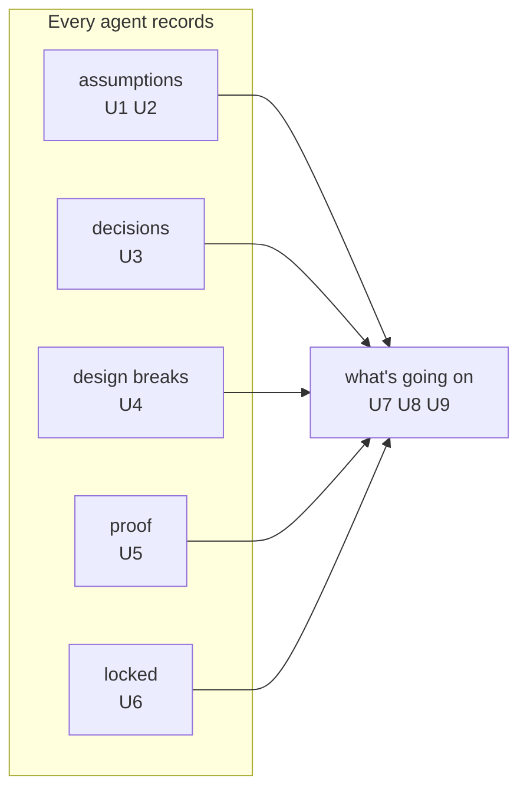

# Requirements: show me your work, the record agents keep and what the owner sees

## The change

- **Target:** `sunstack-dev` / `practices-show-me-your-work`, as merged at `02965db8` (guides only, sunstack-dev 2.104.0), with the skills that commission or record work (`practices-manage-agents`, the `role-*` skills, the phase and orchestrator skills that call it).
- **Kind:** update, behavior-changing.
- **Baseline:** the 4 Nov design set (`docs/wip/skills-authoring/2026-11-04-show-me-your-work/`), accepted great at `0111a3ef`, shipped in #194. Its success definition is the accepted requirements set this change keeps: during design, planning and implementation the owner opens one page and sees, without reading transcripts, (1) what has happened; (2) how the design is carried out, part by part; (3) each decision, who made it and on whose authority; (4) each assumption and which wait for him; (5) what changed from the design; (6) what is proven and what is still unverified; (7) what finished work the Lead accepted. Every agent records these as they happen.
- **Why change it:** the skill says all of that, but the first real record kept under it does not carry it. The record is mostly the Lead narrating; the agents doing the work barely record their assumptions, departures from the design, or accepted work; and its parts are one catch-all tag. So no page built from it shows the owner what agents are doing, which is what the owner asked on 6 Nov.

## Who is affected

| Class | Role here | What they need |
| --- | --- | --- |
| The owner | reads the record through the live page; decides what waits for him | to trust work agents do without him, without reading transcripts |
| Agents doing the work (Lead, Sidekicks, reviewers, evaluators, peer Leads working on the same pieces) | write the record as they work | to know exactly what to record, where, and against which piece of the design |
| The Lead | accepts finished work; keeps the owner's picture current | the same, plus a check that helpers recorded before their work is accepted |

## The need, in the owner's words

- 3 Nov: "Show me your work is about the assumptions. It's about making sure what work we've done is locked, with decisions logged. Proof of the work, what verifications are done. It should function and show me what's going on and also work through HTML."
- 3 Nov: "'Show me your work' should work while the design process is done and implementations happening, to show all the design breaks and all the decisions the agent made so I know what's going on." and "the idea is all the design changes, modifications, and assumptions are always logged during the implementation process as well."
- 3 Nov: "i want all deiciosn to be recorded with sho wme kyour work. then i want to maek srue all assumed deicons are logge dand check in weith me"
- 4 Nov: "show me your work is duign the proscess ofimplemenation what has happed how is the disng bieng implemetned what ar eteh dicsion and assumpitosn."
- 6 Nov, on the page experiments: "how will a part help my udentanding of what agents are doing?"; "lets try diffrent ways so i can visualizie and see what soging on and clicn ok thigns not a toc"; and earlier "its nto to regurgitate teh same information".

## What the record shows today

Router project `01a1635f-5d9d-70e4-bfc7-6d96c1a210e7`, tag `design-documents`, 245 entries through 6 Nov, counted by the Lead from the work trail:

| Owner's word | What the record holds | What that means |
| --- | --- | --- |
| assumptions | 29 assumption entries; 28 written by the Lead, 1 by a Sidekick | the agents doing the work almost never record what they assume |
| check in with me | the owner's two open choices of 6 Nov (G4, G10) lived only in a spec for hours before the Lead recorded them as waiting | an assumption only the owner can settle did not reach him as one |
| decisions | 55 decision entries; 12 are agents' own calls | recorded, mostly by the Lead |
| design breaks | 4 design-change entries in three days | departures are rarely recorded |
| proof | 52 proof entries, mostly evaluator checks of page looks; the #194 merge proof missed the repository's test suite and turned two tests red | proof is recorded, but not always what matters |
| locked | 0 Lead acceptance entries | accepted work is not recorded as accepted |
| part by part | 120 entries tagged `part:run-1`, 70 with no part tag | the parts do not name pieces of a design, so "part by part" shows nothing |
| who writes | 150 entries by the Lead, 67 owner decisions recorded by the Lead, 28 by Sidekicks | the record reads as the Lead's diary |

### The page today

The skill's live page as built on 5 Nov from 149 rows of this record (`owner-pages/live-design-documents.html` in memory-logs). It lists counts, then entries by section and by the record's part tags. It does not show what each agent did, and its parts are whatever tags the entries carried.

## Capabilities

Taken from the owner's own words above; each requirement row has one home.

| Key | Owner's name | What the owner gets |
| --- | --- | --- |
| `assumptions` | "the assumptions" | every assumption any agent makes, when it makes it, and the ones only he can settle brought to him |
| `decisions` | "decisions logged" | every decision, by whoever made it, with its authority |
| `design-breaks` | "the design breaks" | every departure from the design or plan, with what it said, what changed and why |
| `proof` | "proof of the work" | what was checked, what ran, the result, and what was not covered |
| `locked` | "locked" | finished work recorded as accepted, so it can't change silently |
| `whats-going-on` | "show me what's going on" | a page he can see and click through, piece by piece, that shows what the agents are doing |

## Requirements

Authority state is `authorized` when the owner's words above settle the need; priority is proposed by the Lead and assigned by the owner.

| ID | Capability | Need or outcome | Why it matters | Evidence | Authority | Priority (proposed) |
| --- | --- | --- | --- | --- | --- | --- |
| U1 | `assumptions` | Every agent on the work records what it assumes, at the moment it assumes it; helpers record their own, the Lead does not relay them. | The owner said show me your work "is about the assumptions"; an unrecorded assumption is the one that surprises him later. | 28 of 29 assumptions are the Lead's | authorized (3 Nov) | 1 |
| U2 | `assumptions` | An assumption only the owner can settle reaches him as waiting for him as soon as it is made, and his answer closes it. | "make sure all assumed decisions are logged and check in with me" | G4 and G10 sat only in a spec for hours | authorized (3 Nov) | 1 |
| U3 | `decisions` | Every decision any agent makes is recorded by that agent, with its authority. | "i want all decisions to be recorded" | 55 decisions; Sidekicks wrote 28 entries in all | authorized (3 Nov) | 2 |
| U4 | `design-breaks` | Every departure from the design or plan is recorded when it happens, by the agent who departs: what the design said, what changed, and why. | "show all the design breaks"; "all the design changes ... always logged during the implementation" | 4 design-change entries in three days | authorized (3 Nov) | 1 |
| U5 | `proof` | Every check is recorded by the agent who ran it: what it claimed, what ran, the result, and what it did not cover, including the repository's own required checks. | "Proof of the work, what verifications are done" | 52 proofs; the #194 merge proof did not run the test suite and missed two failing tests | authorized (3 Nov) | 2 |
| U6 | `locked` | Finished work the Lead accepts is recorded as accepted at its commit, with the checks read; changing it later is a new, visible entry. | "making sure what work we've done is locked" | 0 Lead acceptance entries | authorized (3 Nov) | 1 |
| U7 | `whats-going-on` | The owner sees the work piece by piece, where each piece is a part of the design or plan the work follows, and each piece shows what was assumed, decided, broken and proven for it. | "how is the design being implemented"; the map shows the parts (6 Nov decision `01a1b21a-1780`) | 120 entries in one catch-all part, 70 untagged; "how will a part help my udentanding of what agents are doing?" | authorized (4 and 6 Nov); see H1 | 1 |
| U8 | `whats-going-on` | The owner can tell what the agents are doing: what each one did, assumed and decided, what waits for him first, and whether it matches what he asked. | "how will a part help my udentanding of what agents are doing?"; "so I know what's going on" | the page experiments of 4–6 Nov showed the Lead's stories, not the agents | authorized (3 and 6 Nov) | 1 |
| U9 | `whats-going-on` | The owner sees it visually and clicks into it, not as a list or a table of contents, and the page does not repeat the same information twice. | "visualizie and see what soging on and clicn ok thigns not a toc"; "its nto to regurgitate teh same information" | pages I to Q; the owner rejected list views and a map that repeated the stories | authorized (6 Nov) | 2 |

Every accepted item of the 4 Nov success definition keeps a home: (1) U8; (2) U7; (3) U3; (4) U1, U2; (5) U4; (6) U5; (7) U6.

## Goal boundary (proposed, not yet confirmed by the owner)

- **Goal:** the owner can trust work agents do without him, because the record carries what every agent assumed, decided, broke from the design, proved and had accepted, against the pieces of the design, and the page shows it.
- **Reuse:** the Router work trail as the record; the entry kinds and fixed parts shipped in #194; the stop treatments; decision pages; Demistify for the page.
- **Missing:** helpers writing their own entries; departures and acceptances recorded; parts that name pieces of the design; a page that answers what the agents are doing, piece by piece, visually.
- **May change:** `practices-show-me-your-work` and the skills that commission or record work in `sunstack-dev`.
- **Protected:** the Router engine and its storage; Demistify's components (the component Lead's); the entry kinds and fixed parts already shipped, except where a requirement here needs more.
- **Non-goals:** the Jev check of which entries are important (a later run); fresh-agent behavior runs and pressure tests (later, with evals); the component Lead's work-record helper itself; design documents phase one; rewriting past entries.
- **Acceptable evidence:** on the next real piece of work, the record carries entries from every agent that worked on it, for its assumptions, decisions, departures, proof and acceptance, each tagged to a piece of its design; and the owner can say from the page, without transcripts, what each agent did and what waits for him.

## Open

- **H1, what a piece is when the work has no design.** U7's pieces come from the design or plan. Work like this project's page experiments had none, which is how one catch-all tag happened. Candidate: the owner's asks become the pieces for such work. Owner meaning, not yet given.
- **H2, peers in other projects.** When a peer Lead works on a piece of this work from its own project (as the component Lead did), whether its entries belong in this record or are linked from it. Owner meaning, not yet given.
- **The goal boundary above** is the Lead's restatement of the owner's words; it needs his confirmation or correction before the Specification is written.
