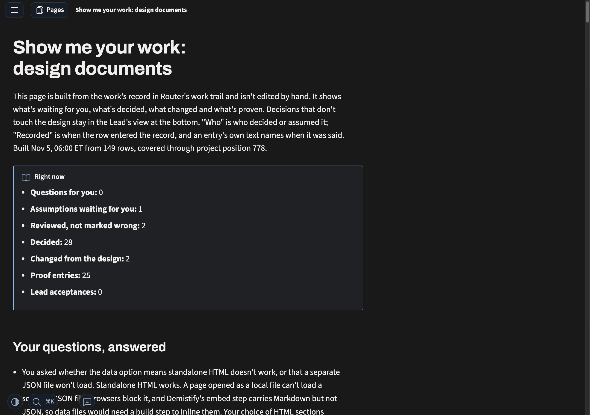

# Evidence: the owner's words, and today's record

## The need, in the owner's words

- 3 Nov: "Show me your work is about the assumptions. It's about making sure what work we've done is locked, with decisions logged. Proof of the work, what verifications are done. It should function and show me what's going on and also work through HTML."
- 3 Nov: "'Show me your work' should work while the design process is done and implementations happening, to show all the design breaks and all the decisions the agent made so I know what's going on."
- 3 Nov: "i want all deiciosn to be recorded with sho wme kyour work. then i want to maek srue all assumed deicons are logge dand check in weith me"
- 3 Nov, on which decisions he sees (owner selection q4-each-agent, comment recorded in row `01a1a1b9-1c38`): "I don't want to see every decision that any model made ... I want the lead to see it and I want to see what's important"
- 30 Oct, scrape: "do html of what was accoplsiehd any shortcuts anything off the plan or rails"
- 6 Nov, confirming the point: "eys and i knwo what was deiceded and hwat is goign on", pointing to pstack's show-me-your-work skill.
- 6 Nov, the shape: "thers 2 parts the main skill. refrences on how to show me the skill. main skill is log. refrence is show me. how to log is conencted"; "reference file shoudl explain to kuse demsytify hwo to repsernese the ifnoramtion i want to see so i can trust the agent deicion an dknwo what was msied or decided"
- 6 Nov, the page: "we need columsn for low value dicions agent make vs once i look at i wnat to be clear"; "yeah routine stuff is hidding within each secion?"; "the layout we have is ncie to kwno what to pay attention to what to do"; "lgos can be csv with ntoes, bukt i want to have display beyodn that with demsytify"; "i want to knwo dieciosn!"; "presetsation is what i care about. iw ant to to know the dicions ands assukmptiosn and shortcuts what bvericiaotn is done"
- 6 Nov, the log: "agent sure, but lead does the itneropoaltion and ownership"; "in its own record"; "yes worktrail with simle rows"; "i dont need to dif i cannot read a csvs"; "the lgos and memroy logs or related md fiels to log you decide is easy dx for agents is good what ever ise low token and easy"; "agen tlog is for teh agen tot log its owrk as it goes, not sue any memeories the process later"; after asking whether CSV or JSONL would be better: "ok do ign it with router is good then lets mvoe on, its about display then no?"
- 6 Nov, on the page experiments: "lets try diffrent ways so i can visualizie and see what soging on and clicn ok thigns not a toc"; "its nto to regurgitate teh same information"; "i dkunno what pecies is"

## What the record shows today

Router project `01a1635f-5d9d-70e4-bfc7-6d96c1a210e7`, tag `design-documents`: a snapshot of 245 entries, the last `01a1b22f-b524` at position 2:1020, counted by kind and tag. Counts by `who:` tag use each entry's first one; one entry (`01a1a731-16a9`) carries both `who:lead` and `who:sidekick`, so raw tag counts give 29 Sidekick entries rather than 28. A tag records who an entry is attributed to. Router's writer stamp, kept on every row, records who wrote it; the "who wrote it" row counts that stamp at a later read (row `01a1b2b4-d29e`). Work outside this record is not counted.

| Owner's word | Entries in this record | What it shows |
| --- | --- | --- |
| assumptions | 29 tagged `assumption`: 28 `who:lead`, 1 `who:sidekick` | the agents doing the work rarely log an assumption here |
| check in with me | the owner's two open choices of 6 Nov became waiting entries (`01a1b108-5e71`, `-5fa7`, 08:24) about 51 minutes after the first was asked in chat (07:33, row `01a1b0e0-0c8b`) and 23 minutes after the second arose (row `01a1b0f3-2a00`, 08:01) | G4 was asked in chat before its waiting entry; G10's waiting entry followed the reviewer's recorded hold by 23 minutes |
| decisions | 55 tagged `decision`; 12 are the Lead's own calls | logged, mostly attributed to the Lead |
| shortcuts | 4 tagged `design-change` in three days; the #194 merge skipped the repository's test suite and two tests went red (row `01a1b226-4508`), which the log recorded only after the component Lead found it | the one skipped check found later wasn't logged when it was skipped; how many other shortcuts went unlogged isn't known |
| verification | 52 tagged `proof`, mostly evaluator checks of page looks; 0 tagged `lead-acceptance` | checks are logged, but not always the ones that matter, and none is tagged as an acceptance (other kinds weren't checked for one) |
| as it goes | Lead rows written in batches from a file after the events, for example one row covering five evaluator checks across an hour | at least some rows were written from memory later; how often isn't counted |
| part by part | 120 tagged `part:run-1`; 70 have no `part:` tag | the grouping tags don't tell the owner anything |
| who | 150 `who:lead`; 67 `who:owner` (owner decisions the Lead recorded); 28 `who:sidekick` by first tag | most of the record is attributed to the Lead |
| who wrote it | by Router's writer stamp, 258 rows at position 2:1072 on 6 Nov: the Lead wrote 234, one Sidekick 24, and no evaluator or reviewer wrote any | the Lead wrote even the rows about other agents' checks |

The skill's live page as built on 5 Nov from 149 rows of this record (`owner-pages/live-design-documents.html` in memory-logs). It lists counts, then entries by section and by the record's part tags. It doesn't show what each agent decided, assumed, cut short or checked.

