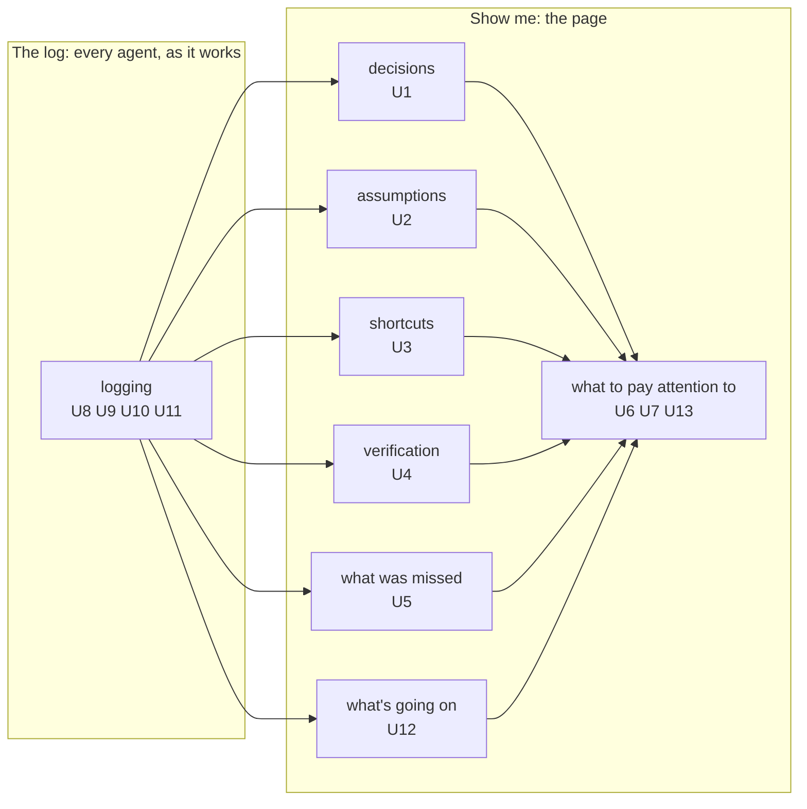

# Requirements: show me your work

The Requirements entry. Its chunks, in reading order:

1. [Why this changes, and its boundary](why-and-boundary.md): what changes and for whom, what the owner confirmed, and what is out of scope.
2. [What the owner sees](show-me.md): U1–U7, U12 and U13, the page.
3. [The log](the-log.md): U8–U11, what agents do so the page has something true to show.
4. [Evidence](evidence.md): the owner's words in full, and the counts from today's record that each need rests on.

## Capabilities

Taken from the owner's own words; each requirement has one home. Seven are what the owner sees; one is what the agents do so he can see it.

- `decisions` · "i want to knwo dieciosn!"; "I want to see what's important" · every decision logged; the ones that matter to him in the open, and the agents' low-value calls in their own column; each with who made it, why, and on whose authority
  - [U1](show-me.md)
- `assumptions` · "the dicions ands assukmptiosn" · every assumption, and the ones only he can settle brought to him
  - [U2](show-me.md)
- `shortcuts` · "shortcuts"; "any shortcuts anything off the plan or rails" · every corner cut and anything off the plan, with what was skipped or changed and why
  - [U3](show-me.md)
- `verification` · "what bvericiaotn is done" · what was checked, the result, what wasn't checked, and what finished work the Lead accepted
  - [U4](show-me.md)
- `missed` · "knwo what was msied" · what was missed: things that happened but weren't logged, weak evidence, checks that didn't run
  - [U5](show-me.md)
- `going-on` · "hwat is goign on"; "show me what's going on" · how each workstream of the design or plan is being carried out: what's done, what's next, and the checks behind it
  - [U12](show-me.md)
- `attention` · "what to pay attention to what to do" · the page he approved (page O, with the Map as one tree in a panel), opening on what needs his attention, with every story in his everyday words
  - [U6, U7, U13](show-me.md)
- `logging` · "log its owrk as it goes" · a true log: every agent's own rows, written as it works, so the page has something true to show
  - [U8, U9, U10, U11](the-log.md)

The log feeds the page; the page shows what matters to the owner, not every row.

