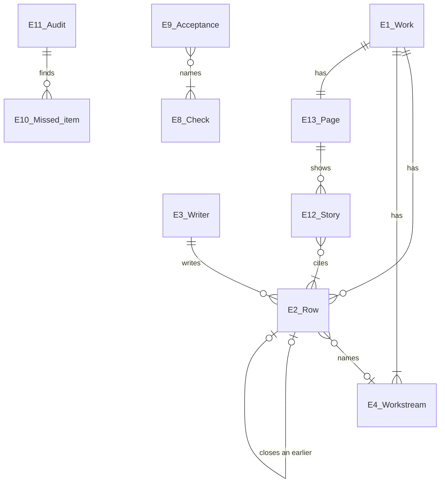

# Entities

Each term below is a noun the obligations are written over, defined by what makes two of it the same. None of these definitions names a tag, file, type or command; Program Design binds those.

Every Row is one kind: E5 Decision, E6 Assumption, E7 Shortcut, E8 Check, E9 Acceptance, E10 Missed item, E11 Audit or E12 Story.

## What makes the hardest cases decidable

- **Writer versus decider.** An owner decision the Lead writes down has the owner as decider and the Lead as Writer. Both show; neither replaces the other.
- **A Shortcut nobody logged.** When someone other than the agent that took it finds it, it is one Shortcut (taken by that agent) and one Missed item (it wasn't logged when taken), not two Shortcuts.
- **A Check written second-hand.** A Check the Lead writes about an evaluator's run is still one Check, run by the evaluator; the page shows it as reported by the Lead, and it is a Missed item, because the agent that ran it didn't log it. That holds even when the evaluator couldn't reach the log; the Missed item says why.

## The terms

**E1 Work.** One piece of work the owner follows.
- Same when: the same Router project and work tag. A peer Lead's work in its own project is a different Work, even on the same subject.
- Relationships: has many Rows, one Page, and one or more Workstreams.
- Always true: every Row of a Work carries its tag.
- States: open → done.
- Replaces: "the record", "the trace". Basis: U8, U11; the shipped skill's record.

**E2 Row.** One fact in the log.
- Same when: the same Router row id. A retry that reuses the original request is the same Row. Two writes with different requests are two Rows, even when the words match; a correction says which to count.
- Relationships: belongs to one Work; written by one Writer; has one kind; names at most one Workstream; may close one earlier Row.
- Always true: never edited. Its writer and time are what Router stamped, not what its text says.
- States: open → closed (a later Row closes it).
- Replaces: "entry", "log line"; excludes the page's text about it. Basis: U8, U10.

**E3 Writer.** Who wrote a Row.
- Same when: the same agent session (endpoint and session id), or the owner.
- Relationships: writes many Rows; acts in one role per Work, named by its commission.
- Always true: never taken from a `who` label. Who *decided* something is a separate fact the Row states.
- States: none.
- Replaces: "author"; excludes "who decided". Basis: U8, U9; the writer count in the Requirements.

**E4 Workstream.** One part of the design or plan being carried out, under a plain label.
- Same when: the same label within one Work, ignoring case and spacing.
- Relationships: names one part of the governing design or plan, such as a requirement group, a plan slice or a PR; a Work has one or more; a Row names at most one; a Story covers one.
- Always true: a label the owner can read, such as "Requirements", "page experiments" or "PR #194". The Lead names each one when work starts or a new part begins.
- States: active → finished.
- Replaces: "part" and "piece", which the owner didn't recognize. Basis: U12 (the accepted 4 Nov item 2), U8; the Requirements' open item on grouping.

**E5 Decision.** A choice made in the Work.
- Same when: one Row that makes a choice. A later choice that changes it is a new Decision that replaces it.
- Relationships: made by one decider (the owner, the Lead or a named helper); may close one Assumption; may replace one Decision.
- Always true: its authority is named from its source: the owner's words with where they were said, an existing contract, or "own call". Silence, "not marked wrong" or a review verdict is never the owner's decision.
- States: current → replaced.
- Replaces: "call", "choice". Basis: U1.

**E6 Assumption.** Something taken as true and not settled.
- Same when: one Row that takes it as true; each later change of state is a new Row that closes it.
- Relationships: may be closed by one Decision or correction.
- Always true: never shown as decided until a Decision closes it.
- States: open and waiting for the owner, or open and being checked by a named agent → closed.
- Replaces: "assumed decision", "open question" (one only the owner can settle). Basis: U2.

**E7 Shortcut.** A departure from the plan, the design or a required step.
- Same when: one departure, by one agent, at one time. Found twice, it's still one.
- Relationships: taken by one agent; may be approved or reversed by one later Row.
- Always true: says what the plan, design or rule said, what was done instead, and why. A change from the design is a Shortcut.
- States: taken → approved, or reversed.
- Replaces: "design break", "design change", "off the plan", "corner cut". Basis: U3.

**E8 Check.** One verification that ran.
- Same when: one run of one check on one revision. A rerun is a new Check.
- Relationships: run by one agent; concerns one claim about one piece of finished work; may be read by an Acceptance.
- Always true: says the claim, what ran and on which revision, the result, and what it didn't cover.
- States: passed, failed or partial.
- Replaces: "proof", "verification". Basis: U4.

**E9 Acceptance.** The Lead's sign-off on finished work.
- Same when: one sign-off on one commit or document revision. Reopening it is a new Row.
- Relationships: names the Checks the Lead read; may be reopened by a later Row.
- Always true: names the commit or revision, each Check read with its result, and what stays unverified.
- States: accepted → reopened.
- Replaces: "locked", "done". Basis: U4.

**E10 Missed item.** Something the log should have held and didn't, or a claim it can't back.
- Same when: one missed thing. Found by two audits, it's still one.
- Relationships: concerns one Row or one event; found by one Audit or review; may be closed by one later Row.
- Always true: says what was missed, how and by whom it was found, and what it affects.
- States: open → closed.
- Replaces: "gap", "what was missed". Basis: U5.

**E11 Audit.** A comparison of one Writer's stretch of work against what actually happened.
- Same when: one Writer, one stretch (from one point to another).
- Relationships: belongs to one Writer and one Work; finds zero or more Missed items.
- Always true: names what it compared against, and what it couldn't see.
- States: done.
- Replaces: pstack's "audit the log against the transcript". Basis: U5; the owner's pointer to pstack's skill (6 Nov). How an audit is done, and by whom, is Program Design's.

**E12 Story.** The Lead's account of one subject, for the owner.
- Same when: one subject in one Workstream. A rewrite is a new version that replaces the old.
- Relationships: written by the Lead; cites the Rows it covers, naming every one in a covered-Rows list and linking up to 16 of them, because one Row carries at most 16 links (Router; probe, 7 Nov); sits in one section of the Page; belongs to one part of the work in the Map.
- Always true: every line is said by a Row it cites, in the owner's everyday words (R25).
- States: current → replaced.
- Replaces: "summary". Basis: U6, U9, U13.

**E13 Page.** The owner's view of one Work.
- Same when: one per Work, rebuilt at each checkpoint, never edited by hand.
- Relationships: shows one Work through one log position; links the decision pages.
- Always true: shows only what the log holds, and says which position it covers.
- States: rebuilt at each checkpoint; no other states.
- Replaces: "the live page". Basis: U6, U7.
