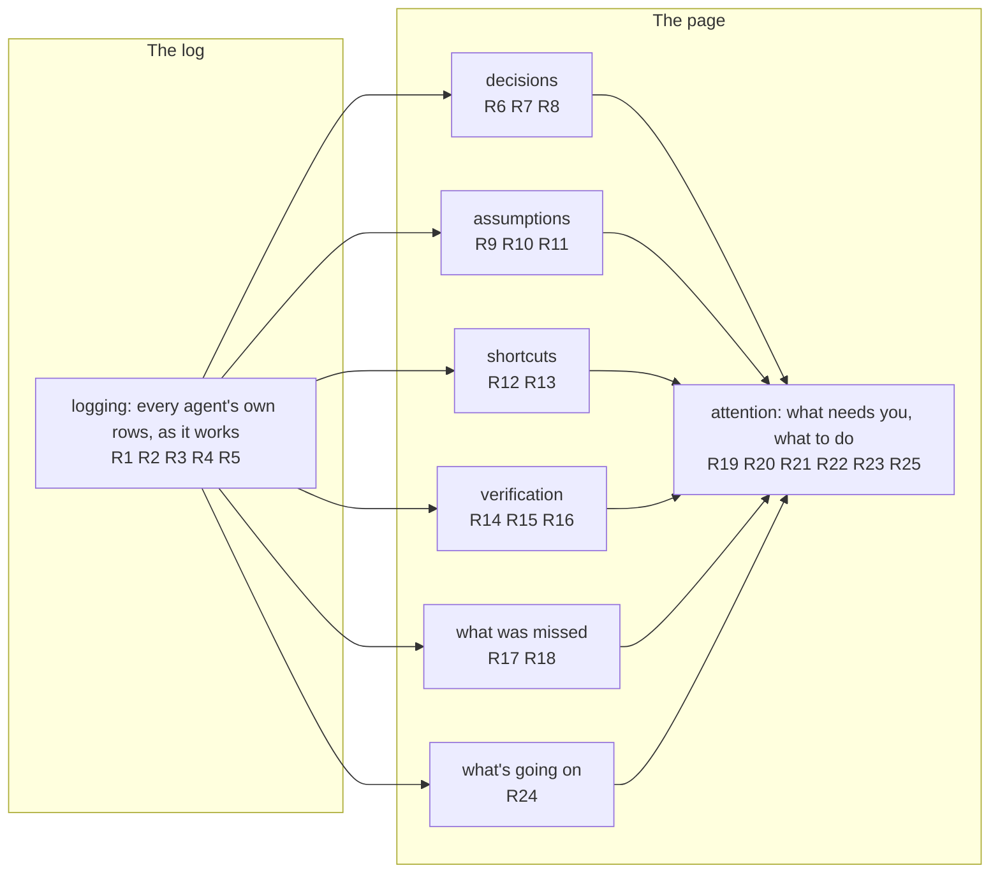
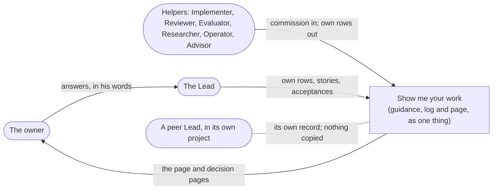

# Obligations

The system here is one opaque thing: the skill's guidance as agents follow it, the log they write, and the page the Lead builds. The obligations below talk only about what the owner and the agents can see from outside it: rows in the log, commissions, the page and decision pages.

## Capability map

Each capability from the Requirements, with the obligations (R rows) that make it true. The log feeds every view; what needs the owner, in the first section and the Map, draws from all of them.

## Who sees what, and where

Outside the system, and staying outside: the owner needn't read raw rows, CSV or diffs; no row or page goes in a product repository; the Router engine and Demistify's components are used as they are.

## The obligations, by capability

Each obligation names the entities it's about, the requirement it serves, what passing looks like, and what would show it failing. "Before work that builds on it continues" means before that agent's next row, commit, message or handback that depends on the fact.

### The log (logging)

**R1 · U8 · E2 E3 E5 E6 E7 E8.** When an agent decides, assumes, takes a shortcut or runs a check, that agent writes the Row itself, before work that builds on it continues.
- Passes when each such Row's Writer is the agent that acted, and its Router time comes before the agent's next dependent action.
- Fails when the Row is written by another Writer, or after work built on it; either is a Missed item when found (R17).

**R2 · U8 · E1 E3 E4.** Every commission to a helper names the Work's log, the Workstream it logs under, and what it must log (decisions, assumptions, shortcuts, checks). The Lead doesn't accept a handback until the helper's own Rows for it are in the log, or each missing one is logged as a Missed item.
- Fails when a helper's handback is accepted while its own Rows are missing and no Missed item names them.

**R3 · U10 · E2 E3.** Writing one Row asks the agent for only its kind, its Workstream, its text and, when it closes or answers an earlier Row, that Row. The project, the work tag and the Writer are filled in for the agent, and the ids a write needs come from one command it's given, minted once per Row. A retry of the same Row reuses those ids and never lands twice; a new Row gets new ones.
- Passes when an agent's write needs no id it had to look up, and a retry after an unclear result leaves exactly one Row.
- Fails when an agent has to look up a project id or session, a retry leaves two Rows, or two different Rows share one write's ids.

**R4 · U9 · E12 E2.** The Lead writes the Stories, and every claim a Story makes is said by a Row it cites. A Story cites exactly the Rows its covered-Rows list names (E12), whether or not the Story row also links them; each one is found in the Work's log through the page's position, with its text and its Writer. On the page, each claim leads to its Row in the Story's folded Rows, where the Row's Writer shows.
- Fails when a Story says something no cited Row says, names a Row that isn't in the Work's log through the page's position, or the page shows a claim without the Row behind it.

**R5 · U11 · E1.** A peer Lead working on part of this work from its own project logs in its own Work. This Work's page copies none of its Rows. Where this Work depends on the peer's work, the page says where the peer's record is.

### Decisions

**R6 · U1 · E5 E3.** Every Decision of the Work is in the log and can be reached from the page. Each shows what was chosen, who decided, why, its authority, and who wrote the Row.
- Fails when a Decision in the log can't be reached from the page, or one of those five things is missing.

**R7 · U1 · E5.** Decisions show in two columns. The owner asked for these on 6 Nov ("we need columsn for low value dicions agent make vs once i look at i wnat to be clear"), refining his 3 Nov rule ("I don't want to see every decision that any model made ... I want the lead to see it and I want to see what's important").
- "Yours, or worth your look" is shown in the open. It holds the owner's decisions, decisions that change or fill in the design or plan, and decisions that depart from anything already decided.
- "Agents' own calls" holds the rest: made without asking, inside existing authority, changing nothing decided. The Lead reviews them; the owner sees the column's count and can open it.
- What goes in which column follows the shipped skill's own-call rule (its four conditions, in the live-page reference's "Sorting the record"); keeping the own calls reachable is the Lead's reading of "columns", not the owner's words.
- Fails when a decision that changes the design or plan, or departs from something decided, sits among the own calls.

**R8 · U1 U5 · E5 E10.** If a Decision names no authority, or names an authority inferred from a plan, a review or a page, the page puts it under "worth your look", marked "no authority named", and it is a Missed item.

### Assumptions

**R9 · U2 · E6.** The page shows every open Assumption with what is assumed, what depends on it, and who acts next. A closed one shows beside the Row that closed it.

**R10 · U2 · E6 E5 E13.** When an agent makes an assumption only the owner can settle (by the skill's stop treatments), it logs it as waiting for the owner before work that builds on it continues. At the next page build it shows under "For you to decide" as a choice the owner answers on the page: each option offered, the Lead's recommendation shown apart from his answer, and any longer brief one Details away. His answer reaches the Lead through Comments' Copy or Export, and his answer, quoted in his words, closes it.
- Fails when such an assumption first reaches the log after dependent work went ahead, the page shows it anywhere but "For you to decide" while it's open, or its options are shown as text he can't select.

**R11 · U2 · E6.** If the owner is silent, doesn't mark an assumption wrong, or a review passes, then the assumption stays open on the page; only a Decision that closes it makes it decided.

### Shortcuts

**R12 · U3 · E7 E3.** The agent that takes a shortcut logs it when it takes it: what the plan, design or rule said; what it did instead; why; and the authority, if any, that allowed it.

**R13 · U3 · E7 E10.** The page shows every Shortcut under "What changed and why". One that no owner decision or existing authority covers is marked for the owner's look: its Story's For you row says what to look at, and the Map names that Story under what needs the owner (R22). A Shortcut first logged by someone other than the agent that took it also shows as a Missed item.

### Verification

**R14 · U4 · E8 E3.** The agent that runs a check logs it: the claim, what ran and on which revision, the result, and what it didn't cover. A Check written by any other Writer shows as reported second-hand, naming both the agent that ran it and the Writer.

**R15 · U4 · E8 E9.** The page shows, under "What was verified", each piece of finished work with its Checks, their results, what wasn't covered, and whether an Acceptance is in the log. Finished work with none shows "no acceptance recorded"; the page doesn't claim a sign-off didn't happen elsewhere.

**R16 · U4 · E9.** The page shows work as accepted only when an Acceptance in the log names its commit or revision, each Check the Lead read with its result, and what stays unverified. A helper's success report, a green check or a review verdict alone doesn't make work accepted.

### What was missed

**R17 · U5 · E10 E11.** The page shows "What was missed" inside "What was verified": each Missed item with what was missed, how and by whom it was found, what it affects, and whether it's closed. Missed items include:
- an event that happened with no Row, or a Row written after work built on it;
- a Decision with no authority (R8);
- a claim that work is done with no Check behind it;
- a required check, from the plan or the repository's rules, that didn't run;
- a Row about an agent's act written by another Writer, with why the acting agent didn't write it (for example, it couldn't reach the log).

**R18 · U5 · E11 E3.** The page shows, for each Writer, which stretches of its work were audited and which weren't. A stretch with no Audit, or one whose Audit couldn't see the work (for example, an unreadable transcript), shows "not audited", never "nothing missed". How and when audits happen is Program Design's.
- Fails when the page says nothing was missed for a stretch with no Audit, or doesn't mark that stretch "not audited".

### What's going on (going-on)

**R24 · U12 · E4 E12 E8 E9.** Each part of the work that has started appears in the Map under "Where the work is", with its state, and has a Story under "What's done / what's next" saying what's done, what's next and the Checks and Acceptance behind it. A part with nothing new shows when it last moved; a finished one says so.
- Passes when each part of the governing design or plan that work has started on appears in the Map with its state and in a Story with its done, next and evidence.
- Fails when a part the work has started on is missing from the Map, when the section shows events tied to no part, or when "done" stands without the Check behind it.

### What needs the owner (attention)

The approved page is the reference for R19–R25: `p1b-approved-2026-11-07.html` in the work's owner pages, sha256 `ece32b0cdb2a6fe4…`, which the owner approved on 7 Nov ("this is the deisgn i wnat").

**R19 · U6 · E13 E6 E12.** The page is page O. It opens on what needs the owner, in his four sections, in this order:
1. For you to decide, where every Assumption waiting for him and every choice only he can make comes first;
2. What's done / what's next;
3. What changed and why, ending with the two decision groups;
4. What was verified, and what was missed.

Each section's header shows its count, stays on screen while its Stories scroll, and has an expand/collapse control on the right. A routine Story folds under one "smaller" row at the end of its section, as the owner asked ("yeah routine stuff is hidding within each secion?", 6 Nov).

**R20 · U6 · E12.** Each Story shows, in order: its title with its subject and time; one headline; the rows Happened, For you and Next; at most one picture or table; a closed More fold; and a closed fold of every Row it cites, each opening to its text. Stories start open; their Rows start closed.
- Fails when a Story is a wall of text, drops a row, or shows more than one picture or table.

**R21 · U7 · E13.** Each item appears in full in one place on the page; anywhere else it's named, it's a link to that place. No section restates another's content.
- Fails when the same Story, Decision, Shortcut or Check text appears in full twice.

**R22 · U7 · E13 E12 E4.** The page has a Map: one tree in a panel that opens from the right like Comments, from a map button or the M key, and never stays open with Comments. The tree shows, in order:
1. what needs the owner: the Stories in For you to decide, and any Story with a Shortcut marked for his look (R13);
2. "Where the work is": each part of the work, with each Story in it marked by its state (done, needs a fix, waiting on him);
3. the other three sections, with their Stories.

Every row opens its Story on the page, with any fold around it. On a narrow screen the panel covers the page, and closes when a row is followed. Who wrote each Row shows beside it in the Story's folded Rows; whether Rows came as the work happened comes from the audits (R18).
- Fails when a row doesn't open its Story, the tree repeats a Story's content instead of naming it, or the panel and Comments stay open together.

**R23 · U7 · E13.** The skill's show-me reference teaches an agent how to build this page from the log's Story rows with Demistify's parts and no script, with the approved page as the worked example.
- Passes when the Lead's next real page, built by following the reference and nothing else, matches the approved page's sections, Story shape and Map and meets R6–R22 and R25. A build by a fresh agent waits for the evals, outside this change.

**R25 · U13 · E12.** Every Story line says what it means for the owner, in his everyday words and in few words. It names things the way he does, not by the agents' working labels: no run numbers, packets, keyed rules, correction rounds or role titles he hasn't used.
- Fails when a line can only be understood by someone who watched the agents work.

## Across the whole

- **Privacy.** Rows, Stories and pages carry no secrets, credential paths or account data. Pages are local files the owner opens on his own machine; nothing is published.
- **Where things live.** The log lives in Router; pages live in the work's memory-logs folder; neither goes in a product repository.
- **Freshness.** The page says which log position it covers and when it was built, and is rebuilt from the log at every checkpoint. If the log can't be read, the page isn't rebuilt from memory; the gap is reported.
- **Readability.** The page reads in dark and light themes, at desktop and phone widths. Color is never the only signal; every state also has a word or an icon.
- **Cost to agents.** Logging a Row costs an agent one short command (R3); writing what happened at the moment, rather than later, is the cheap path.

## What decides pass and fail

Each obligation's reference is where the right answer comes from. Verification Design chooses how each is checked on a real run.

| Proof | For | Reference | A wrong result that fails it |
| --- | --- | --- | --- |
| V1 | R1, R12, R14 | each agent's own transcript, and Router's writer stamp and time on each Row | the Lead writes a helper's decision; a Row arrives after the commit that used it |
| V2 | R2 | the commissions sent, and the log at each handback | a handback accepted with none of the helper's Rows and no Missed item |
| V3 | R3 | the command an agent runs to log, and the log after a retry of the same Row with an unclear first result | an agent looks up a project id; a retry with new ids leaves two Rows; two Rows share one write's ids |
| V4 | R4 | each Story's covered-Rows list, each Row read from the log with its text and Writer | a Story line that no cited Row says; a cited Row missing from the log; a line dropped because its only Row is cited but not linked |
| V5 | R5 | the peer's project and this Work's log | a peer's Row copied into this Work |
| V6 | R6, R7, R8 | the log's Decisions and the own-call rule (four conditions, from the live-page reference) | a design change sitting among the own calls; a Decision missing from the page |
| V7 | R9, R10, R11 | the stop treatments, the log's Assumptions with their times, and the owner's words | an owner-only assumption logged after dependent work; one shown as decided after silence |
| V8 | R13 | the log's Shortcuts and the owner's decisions | an unapproved shortcut not marked for his look, or missing from the Map's branch of what needs him |
| V9 | R15, R16 | the log's Checks and Acceptances, and the repository at the named revision | work shown as accepted with no Acceptance in the log; work shown as never signed off when the log only lacks a record |
| V10 | R17, R18 | the log's Audits and Missed items, and what each Audit says it compared against | an unaudited stretch shown as "nothing missed"; an audited stretch where the #194 kind of skipped test suite is in the plan's required checks but never appears |
| V11 | R19, R20, R21, R22 | the log through the page's stated position, and the approved page (sha256 `ece32b0cdb2a6fe4…`) | a section out of order or missing; a Story missing a row or carrying two pictures; one item in full twice; a Map row that doesn't open its Story; the Map panel open with Comments |
| V12 | R23 | the Lead's next real page, built by following the reference alone, compared with the approved page | that page fails V6–V11 or V15, or needed something the reference doesn't say |
| V15 | R25 | each Story's lines, read by someone who didn't watch the agents work | a line naming a run number, packet, keyed rule, correction round or another working label the owner hasn't used |
| V14 | R24 | the parts of the governing design or plan that work has started on, the packets' Workstreams, and the log's Checks and Acceptances per Workstream | a "done" section of events with no Workstream; a started part missing; "done" with no Check |
| V13 | U6–U8 and U12 together | the owner's own reading of the page on the next real piece of work | he can't say from the page, without transcripts, what was decided, assumed, cut short, verified and missed |

## Coverage

| Requirement | Entities | Obligations | Proof |
| --- | --- | --- | --- |
| U1 decisions | E5 E3 | R6 R7 R8 | V6 |
| U2 assumptions | E6 E5 E13 | R9 R10 R11 | V7 |
| U3 shortcuts | E7 E3 E10 | R12 R13 | V1 V8 |
| U4 verification | E8 E9 E3 | R14 R15 R16 | V1 V9 |
| U5 missed | E10 E11 E5 | R8 R17 R18 | V10 |
| U12 going-on | E4 E12 E8 E9 | R24 | V14 V13 |
| U6 attention | E13 E12 E6 | R19 R20 | V11 V13 |
| U7 attention | E13 E12 E4 | R21 R22 R23 | V11 V12 |
| U13 attention | E12 | R25 | V15 |
| U8 logging | E2 E3 E4 | R1 R2 | V1 V2 V13 |
| U9 logging | E12 E2 | R4 | V4 |
| U10 logging | E2 E3 | R3 | V3 |
| U11 logging | E1 | R5 | V5 |

Every entity is used: E1 (R2, R5), E2–E3 (R1, R3, R4), E4 (R2, R22, R24), E5–E13 as listed.

## Open

- **Workstream labels** (E4): the Lead names them when work starts and when new work arises, in plain words; the owner corrects any he can't read. This replaces "pieces", which he didn't recognize.
- **How audits happen** (R18): Program Design decides who audits, when, and against what. pstack's choices are the starting point: the agent audits its own log against its transcript at the end of a run, and a reviewer on another model flags what it sees. Neither is required by the owner's words; both are means to U5.
- **The short command** (R3): Program Design decides where it lives. It must not change the Router engine or its storage, and the skill itself stays guides only.
- **The Map's tree** (R22): Demistify v1's tree draws a leave-the-page arrow for every link and starts every branch open. The Demistify Lead is building an in-page link icon and a way to start a branch folded, with the rest of the approved page's parts (commission, 7 Nov). Until those ship, the Map uses the tree as it is.
