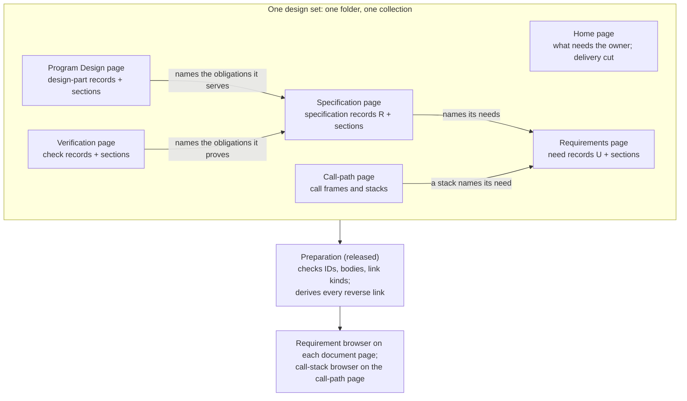

# Skill design: the four-document design workflow as an HTML system

Draft, 7 Nov 2026; revised after the design review (DR-H1 to DR-H4) and again that night around the owner's lab components (Q069–Q074) and the Demistify Lead's integration contract. Which skill changes where, in which order, under which root standards. Every target was read at main `bd571d78` in this worktree; the line-level evidence for each is in the Researcher's impact inventory (memory-logs `skills/authoring/2026-11-07-design-workflow-html/impact-inventory.md`, 147 quoted lines, sha256 a753ba18…). The lab and its data contract were read at sunstack-tools `5d8d113` (the merged PR #130 head); the integration contract at the Demistify Lead's `feat-demistify-design-documents` worktree, based on main `9b4d85a`.

## The model, in one picture

Each phase writes its own page: sections at stable IDs, and one record per row it owns, naming only what that row serves. Preparation, released by the Demistify Lead, checks the set and derives the reverse links; the browsers show any need with its specification, program design and verification. The lens for every run: *the page is the design, and each link is written once*.

## Targets and runs

Owner plugin: `sunstack-dev`. Each run names exactly one skill; a shared reference or test the run must change is named as that run's collateral, and keeps its single home. Order matters because each later run consumes the contract the earlier ones state.

**Admission, every run:** the Demistify Lead's release of the browsers, the record contract and preparation, at a published binding whose guide documents them (O11, O13a), with O13b–d confirmed in that release or recorded as named gaps the runs teach around, and the security gate's required proof holding: the guide documents preparation's write boundary (the named folder only) and that it validates the whole set before writing (Sensitive surfaces, below). Until then no run starts, and nothing in the skills names the demo app's private elements (D15).

| Run | Skill | Collateral | What changes | Obligations |
| --- | --- | --- | --- | --- |
| 1 | `orchestrator-design` | `shared-references/design-documents.md` | The contract: a document is a page; sections and records with stable IDs replace chunks as the unit; one home per fact; the set is one collection in one folder with a home page that is also the agent entry; which records each document owns and what each names (O5a); links written once and derived (O6), growing by phase (O6a); deliverables (below). "Keep the Markdown Complete" and "Humans Read the Page" go; "Put the Human Part First" stays, applied to sections; the worked set is rewritten as pages. In `orchestrator-design` itself, the design terminal gains the deliverable stage for work that has deliverables. | O1–O4, O5a, O6, O6a, O7, O7a–O7c, O8, O12 |
| 2 | `presentation-html` | `shared-references/diagram-rendering-and-fallbacks.md` | The medium: a design document is always an HTML page with the released browser and its record block; "the page is the source", with inline islands in sections and bodies; a diagram lives in the section or body that owns it; preparation and the collection index re-run after any record, heading, path or walkthrough change. In `presentation-html` (`SKILL.md` step 1, `engineering-documents.md`, `views.md`, `patterns.md`): composing a design page from the released guide (browser, record block, bodies, sections for facts with no record kind); owner confirmations as choices; a deliverable page as links into the browser. | O1, O3–O5b, O7b, O9–O11 |
| 3 | `spec-design` | none | Requirements and Specification written as pages: before the first need, the Requirements page is ordinary HTML holding the capability list, with each capability's purpose, and the owner's confirmation choice; with the first need it gains the browser and its record block, one need record per `U` with its capability; the Specification's one record per `R` naming its needs, each body marking the parts the guide's table names for its kind (such as the rule), with entities and the other identifiers as sections; pictures in bodies where the user's experience matters; the capability list and goal boundary confirmed on the page. The Requirements-only return writes the page and leaves downstream documents unwritten. | O1, O2, O5a, O6, O6a, O10 |
| 4 | `discuss-pathfinding` | none | `references/user-requirements-extraction.md`: the confirmed capability list goes onto the Requirements page, as each need's capability and a section of purposes, instead of "a nested Markdown list"; the confirmation is asked on the page. | O1, O10 |
| 5 | `program-design` | none | Program Design written as a page: one design-part record per part naming the obligations it serves, its body marking the parts the guide names for its kind (such as the sketch); the binding and trace tables as sections; the call paths as call stacks and frames on the call-path page, each stack naming its need and frames, and a frame naming the need it directly serves whenever one is declared, whether or not it is also supporting or reused across stacks, and none otherwise; no attribution is invented. | O1, O5a, O6a |
| 6 | `verification-design` | none | Verification Design written as a page: one check record per row naming the obligations it proves, its body holding the "proven by" line, passing condition, reference, target and what stays unverified, with the parts the guide names marked (such as the procedure); no result written (O5b). | O1, O5a, O5b, O6a |
| 7 | `spec-program-review` | none | `references/lanes/artifact-navigation.md` checks a set by phase state: preparation passes; one home per fact; no page carrying a whole document; no link written twice; downstream documents unwritten only where the phase state says so; at a four-document review, every need served in each document; a deliverable page states no fact of its own. | O2–O4, O6, O6a, O7b, O9 |
| 8 | `docs-maintain` | none | Upkeep edits the section or record body that owns a fact, then re-runs preparation and the collection index; a reader built from external includes is regenerated as today. | O3, O9 |
| 9 | `plan-implementation` | `shared-references/canonical-implementation-plan.md`; `plan-implementation/README.md`; `tests/skills/lib/contracts/minimal-planning-delivery-contract.test.ts` (L56, L203) | A plan is a page: `plan path` names the plan's page; the plan page and its deliverable page link to each other; a plan may be scoped to one deliverable's needs, given by the delivery cut. The contract test moves with the plan record, keeping its single-plan and authority checks. | O7, O7c |

The earlier deferred runs 10 and 11 (story-free sections on design pages) are dropped: the browsers compose the document pages, so long section-scroll pages, the reason for those runs, no longer exist (D7-r2).

Maintainer documentation (`docs/architecture/skill-system.md`, `plugins/sunstack-dev/docs/diagram-vocabulary.md`, the plugin README) is reconciled at ship, through `docs-maintain`, in the same change.

## What each record holds, by phase (O5a)

| Phase | Records | Each names | Body holds | Sections beside the browser |
| --- | --- | --- | --- | --- |
| Requirements (`spec-design`) | one need per `U` | its capability | the need in the owner's words, its outcome, pictures where UX matters | the capability list with purposes; open owner confirmations |
| Specification (`spec-design`) | one specification per `R` | the needs it serves | the obligation, its threshold, target constraints and reference | entities; the other Specification identifiers |
| Program Design (`program-design`) | one design part per part | the obligations it serves | its responsibility, interface and diagram | the binding table; the trace table |
| Program Design, call paths | call stacks and frames | a stack its need and frames; a frame the need it directly serves, whenever one is declared (being supporting or shared doesn't change that); none otherwise | in the record: name, source, responsibility, statement | none |
| Verification Design (`verification-design`) | one check per row | the obligations it proves | "proven by", passing condition, reference, target, unverified | shared observations described once |

The record kinds and field names here are the lab's (`collection-data.ts` at `5d8d113`); the runs teach the released names, which the Demistify Lead chooses. Each body marks the parts its kind shows, as the released guide's per-kind parts table names them, and the skills cite that table, never restate it. Example: in the job-submission design below, R9 ("a job that ran twice is billed once") is one specification record naming U2 and U5; U2's Specification view shows R9 with "also serves U5", and nothing is written on U2.

## Deliverables (O7a–O7c), taught by run 1

Owner: `orchestrator-design`'s design terminal, with the contract in `design-documents.md`. It runs only for work delivered in more than one deliverable, as the owner directed for large designs (Q004, Q022).

1. **Inputs.** The reviewed overall design (its pages, review `ready`) and the owner's delivery direction (his 2 and 4 Nov words: an overall design, then each deliverable as a design document plus a plan).
2. **The delivery cut.** The Lead writes, on the overall home page, each deliverable with the needs (`U` rows) it delivers and what it waits on. The cut is the Lead's call, like the plan's other grouping (`canonical-implementation-plan.md`); it adds no stop. It reaches the owner with the first deliverable's plan, under the gate `orchestrator-design` already has: for a new feature he approves or changes that plan, cut included; for improvement work the work proceeds unless he objects.
3. **The deliverable page.** For the first deliverable, `orchestrator-design` loads `presentation-html` to compose its page: its needs, each linked into the browser at the need and the document view that answers the reader's question, each link saying what is there. The page states no fact of its own. A fact only this deliverable needs, such as an order constraint between two of its needs, is written into the overall document that owns that kind of fact and reviewed there, then reached through the browser.
4. **The plan.** `orchestrator-design` loads `plan-implementation` with the four reviewed identities and the deliverable's needs as its scope; the plan page and the deliverable page link to each other.
5. **Review basis.** The overall design keeps its four-document review; a fact added in step 3 goes through that document's phase and a refreshed review of the affected anchors; the deliverable page gets the navigation check (run 7) that it states nothing of its own; the plan and the cut go through `orchestrator-design`'s existing plan gate.
6. **Completion.** The first deliverable has its confirmed place in the cut, its page and its plan page, linked both ways. The next deliverable's page and plan are written when its turn comes.

Worked case: a job-submission design whose owner confirmed two deliverables. Deliverable 1, "submit and run jobs", delivers U1–U4; deliverable 2, "bill finished jobs", delivers U5–U6 and waits on deliverable 1. Deliverable 1's page links U1–U4, each to its view in the browser, which shows their obligations R1–R9, the submission API and lease design parts, and their checks. The entity *Job* is a section on the Specification page, linked, never restated. R9 serves U2 and U5; the browser shows it under U2 with "also serves U5", and deliverable 1's page restates nothing. An order constraint, "worker leases ship before resubmission", is written into the lease design part's body and reviewed there. Deliverable 2's page and plan wait until deliverable 1 lands.

## Surface allocation

| Run | Trigger | Main path | Depth | Proof |
| --- | --- | --- | --- | --- |
| 1 | unchanged | the design terminal's deliverable stage | `design-documents.md` (collateral) | static; review; the next real design with deliverables |
| 2 | unchanged | step 1's human-entry rule | three references; `diagram-rendering-and-fallbacks.md` (collateral) | static; review; the next real design |
| 3 | unchanged | step 9's artifact rule and the Requirements-only return | views table unchanged | static; the next real design |
| 4 | unchanged | none | the extraction reference | static; the next pathfinding run |
| 5 | unchanged | the artifact step | none | static; the next real design |
| 6 | unchanged | the write step | none | static; the next real design |
| 7 | unchanged | none | the navigation lane | static; the next design review |
| 8 | unchanged | the page-upkeep step | none | static |
| 9 | unchanged | the plan input (deliverable scope) | `canonical-implementation-plan.md` (collateral); the contract test | the test; static |

## Trigger

Invocation decision: unchanged for every target. No description changes: the change sits in bodies and references, and each skill still loads on the same situations (`domain-skill-crafting`'s descriptions topic).

## Main path, per run

- **Lens, runs 1–2:** *the page is the design, and each link is written once.* A reader of that phrase can predict the route: write each fact once, in its section or record body; name in each record only what it serves; let preparation and the browsers show the rest. It replaces today's lens, *one Markdown source, two entries*.
- **Route:** each phase keeps its steps; only the artifact step changes, from "write the Markdown and let the page compose it" to "write your records and sections on your page, naming what each serves, then prepare the set". Order matters only where it does today (Requirements before Specification before Program Design before Verification Design).
- **Branches added:** a page that includes an external file keeps the embed route and its freshness check (run 2, condition: the page has an `src` include); work delivered in more than one deliverable runs the deliverable stage (run 1, condition: the delivery cut names more than one deliverable).
- **Completion boundary, each phase:** preparation passes on the set; the page passes the checker at its binding; every record and section the phase owns has a stable ID; each record names what it serves and nothing else; no fact is restated outside its home; downstream documents not yet written show as not yet written; the views the phase's table requires are present or returned as an exact gap. At the design terminal, every need is served in each document.

## Call sites

Unchanged in form: each phase keeps `MUST load ../../shared-references/design-documents.md` and its call into `diagram-rendering-and-fallbacks.md`. Changed: each call's returned result names the page, its record IDs and section IDs, and the preparation result, instead of Markdown paths and `index.md`. New in `orchestrator-design`: at the design terminal, IF the work is delivered in more than one deliverable, load `presentation-html` to compose the first deliverable's page and return its path; then load `plan-implementation` with that deliverable's scope and return its plan page. `presentation-html` step 1's design-set branch loads `engineering-documents.md` for authoring, not presenting. No new reference, script or schema is added; the record contract and preparation are the released library's, read from its guide.

## References

| Reference | Its job | Caller and contract | Taught from |
| --- | --- | --- | --- |
| `design-documents.md` | what a design set is; which records each document owns and what each names; where each fact lives; how links are written once and grow by phase; deliverables | every phase and `orchestrator-design`; returns identities as page paths with record and section IDs | the owner's words (Q003, Q049, Q050, Q004, Q040, Q071–Q073); the lab's data contract; today's identity, token and through-line rules, kept |
| `diagram-rendering-and-fallbacks.md` | the medium, island use, where a diagram lives, preparation and freshness | every phase and `presentation-html`; returns the medium and page proof | today's reference, with "the page is the source" in place of two entries |
| `engineering-documents.md` | how a design page and a deliverable page are composed from the released browser, records, bodies and sections | `presentation-html` step 1 on a design set; returns the pages, their records, sections and views | the released guide; the lab's pages and the Luna probe's inputs |
| `canonical-implementation-plan.md` | the plan record | `plan-implementation`, `plan-update` and implementation callers; returns the plan page path and its scope | the owner's Q004 and Q046 |

## Root topics that apply

- **Change classes:** behavior-changing for every run (each alters a reference's rules or an artifact step).
- **Main path:** runs 1, 3, 5, 6, 8 and 9 change a step's wording and completion; run 1 adds the deliverable branch.
- **Calls and placement:** results of unchanged calls change (page paths, record and section IDs, the preparation result); one meaning per home holds when "Keep the Markdown Complete" goes from `design-documents.md` and its echo goes from `diagram-rendering-and-fallbacks.md` in the same change, with no forwarding stub; the record contract's single home is the released guide, which the skills cite and never restate.
- **Steering:** the deletion test on every changed sentence before review; the lens is a leading phrase; each run's table row carries its owning skill.
- **Generalization:** the six standards in the specification, each with two transfer cases.
- **Proof claims:** drafted from user intent; behavior not yet evaluated.
- **Platform:** a sunstack-dev minor version and a changelog entry at ship.

## Sensitive surfaces

History, not backdated: revision 2 at `5ae66790` outlined the preparation step (O9; runs 2, 7 and 8; the completion boundary) under "None in scope", with no decision; the design review found it (DR-R2-1). The decision below was recorded at 22:51 EST on 7 Nov, after that outline and before any skill file of this change exists, in memory-logs `skills/authoring/2026-11-07-design-workflow-html/security-gate-decision.md` (`skill-design`'s security gate, `domain-skill-crafting`'s security standards).

- **Surfaces:** shell commands and network access. The skills teach running the released Demistify CLI's preparation (and, as today, its index and check), fetched from the page's binding and run with `pnpm dlx` or `npx --yes`, as `presentation-html` `references/demistify.md:49-70` already teaches for embed, index and check.
- **Entry points:** the artifact steps of `spec-design`, `program-design` and `verification-design`; `docs-maintain` upkeep; `presentation-html` step 5; `spec-program-review`'s navigation lane (check and prepare as validation).
- **Untrusted inputs:** the design set's agent-written HTML pages (record blocks, bodies, sections) and the folder path.
- **Privileged actions:** fetching and running the CLI from the binding's host; writing pages in place inside the design set's folder. No credentials, no home-level writes, no other subprocess, no write outside that folder.
- **Third-party source:** none adopted; Demistify is the owner's own library, run from its published release; nothing is copied into the skills, which cite the guide's route.
- **Decision: allowed, scoped:** only the CLI at the page's own binding base, by the route the matching guide documents; only on the design set's own folder inside the repository; preparation validates the whole set before writing and writes nothing outside that folder.
- **Required proof:** at admission, the released guide documents preparation's write boundary and validate-before-write behaviour (the Demistify Lead's draft states both); in each run's review, the skill text cites the guide's route and adds no host, command form or path outside the design folder.
- **Public-safe constraints:** no credentials, tokens, account details or local cache paths in skill text.
- **Review route:** this design review and each run's implementation review; no dedicated security scan, since none was asked for.

## Decisions

Defaults taken, each with its reason; strike any row. A superseded row stays, marked with what replaced it and when.

| # | Decision | Reason |
| --- | --- | --- |
| D1 | A design's text lives on its pages; no Markdown file holds the design. | The owner's decision (Q049, Q050, Q046 28–29 Oct; Q003 6 Nov), not a default. |
| D2 (superseded 7 Nov, revision 2, by D2-r2) | Agents read the pages directly, finding sections by ID from the home page and the Map. | Default for the owner's question 1; the other answer, a read-out command rebuilt from each page and never edited, would need a new tool before shipping. |
| D2-r2 (7 Nov, revision 2) | Agents read the pages directly: each page's records for what exists and what it serves, the body at each ID for its text. | The owner's decision, 7 Nov 23:15 EST (his question 1, row 01a1b95e-4f7f); the other answer was a read-out command printing a need with everything linked to it. |
| D3 (superseded 7 Nov, revision 2, by D3-r2) | The standard forward and back links on every need; nothing added until the owner answers question 2. | The links are his decision (Q040, 31 Oct); B and C wait for his answer, B only as an experiment. |
| D3-r2 (7 Nov, revision 2) | The through-line is the owner's requirement browser; no other view of a need is added. | His decision (Q071–Q073) answers his 3 Nov question of how needs link through (Q018); the earlier question 2 (a side-by-side view or the Map) is closed. |
| D4 | Plans become pages too (run 9). | His words name plans with designs (Q046, Q050, Q004). |
| D5 | skill-authoring's own design-set format stays out of this change. | It is a separate four-part workflow in another plugin; his 26 Oct words (Q051) point at changing it, as its own change. |
| D6 | Existing Markdown design sets stay readable; nothing is migrated; new sets are pages. | A hard cutover for authoring without rewriting accepted history. |
| D7 (superseded 7 Nov, revision 2, by D7-r2) | Of the parts released in Demistify 1.20.0 (7 Nov), the Map comes in now as each design page's navigation (run 2); sections wait for a mode without a story count (deferred run 10); stories on a design's home page are an experiment there. | His two stages (Q008); a section on a design page reads "· 0" today because sections count stories (prototype, receipts.md). |
| D7-r2 (7 Nov, revision 2) | Stories, story sections and the Map stay off document pages; the earlier deferred runs 10–11 are dropped. | The browsers compose the document pages, so the long section scroll those parts were to tame no longer exists; the Demistify Lead's contract bundles no story-free section. |
| D8 (superseded 7 Nov, revision 2, by D8-r2) | Sections are the unit; a document spans more than one page only when today's split test passes for a capability. | Keeps the reader-and-reason split test, moved from files to pages. |
| D8-r2 (7 Nov, revision 2) | Records and sections are the units; a document is one page. | The owner's page set has one page per document (the lab, Q073). |
| D9 (superseded 7 Nov, revision 2, by D9-r2) | One island per section's prose, never per document; Markdown in islands where it carries the text best. | His "markdown islaodns for snppets or secions" (Q050). |
| D9-r2 (7 Nov, revision 2) | Markdown islands carry a section's or body's text where Markdown carries it best, never a whole document. | His Q050 words; inside a record body per O13d, in the Demistify Lead's draft contract. |
| D10 | The home page is the agent entry; `index.md` goes. | Follows from D1 and D2-r2. |
| D11 | Maintainer docs are reconciled in the same change. | One owner per fact, with no stale description of the model. |
| D12 (superseded 7 Nov, revision 2, by D12-r2) | A deliverable's page is a composed view that states no fact; a fact only that deliverable needs is written into the overall document that owns its kind. | His 2 Nov direction accepted that day (Q022): the deliverable document zooms into and links the overall design, without a second full copy. |
| D12-r2 (7 Nov, revision 2) | A deliverable's page links into the browser at each of its needs and states no fact; a fact only that deliverable needs is written into the overall document that owns its kind. | His 2 Nov direction (Q022); the browser's need and view addresses make the zoom-in a link, with no new part. |
| D13 (superseded 7 Nov, design review, by D13-r2) | The delivery cut lives on the overall home page and the owner confirms it there before any deliverable page or plan is written. | It decides what each plan builds, which is his to confirm (O10). |
| D13-r2 (7 Nov, design review) | The delivery cut lives on the overall home page as the Lead's call and reaches the owner with the first deliverable's plan under `orchestrator-design`'s existing plan gate; no new stop. | Design review: no owner decision or contract authorizes a separate hold; his words settle overall design plus deliverable pages and plans (Q004, Q022). |
| D14 | The workflow is built on the owner's lab components: the requirement browser on every document page and the call-stack browser, in the layout he decided, released by the Demistify Lead. | His decision, 7 Nov (Q071–Q074); the Demistify Lead's contract keeps that form. |
| D15 | No run starts before the release; the skills teach no interim page form. | The owner's decision, 7 Nov 23:15 EST (his question 2, row 01a1b95e-516b): one cutover instead of two, since an interim form would rewrite the same nine skills twice and teach links by hand that the browsers derive; it settles how his 4 Nov two-stage words (Q008) apply now. |
| D16 | Each record names only what it serves; reverse links are derived. | His decided browser derives them this way (`requirement-stages.ts`), and it lets each phase add its links without editing earlier pages (O6a). |
| D17 | Facts with no record kind are sections at stable IDs beside the browser; no new record kind is asked for. | No owner word asks for entity or capability records; asking for one would widen the Demistify Lead's release (O13c asks only for a home). |
| D18 | A design's checks carry no result; recording observed results on the Verification page is a later change. | Results come from the Verifier after a build; the lab shows a missing result as not run, and none is invented. |

## Coordination

- Base: branch `skills/design-workflow-html` at main `bd571d78`; implementation, when admitted, branches from current main.
- Pending edits: none in skill files; this design set only.
- Dependency: the Demistify Lead (codex-local/01a1452d) owns the release named in the admission line and O13; this design set is sent to it before review, with O13b–d as asks.
- Version and changelog at ship: a sunstack-dev minor version in its manifests and the Claude marketplace entry; one dated changelog entry; cache refresh only if the owner scopes it.

## Run status

| Run | Status |
| --- | --- |
| 1 | implemented (its run-1 commit on this branch). Deviations: (a) D12-r2's wording: the released guide (Demistify 1.21.0) documents no need or view address, so a deliverable page links each need on its owning document page with the need's ID in the link text, and `design-documents.md` says deep links wait for a documented address (the Lead's decision 1 in the implementer commission); (b) a one-concern set has one capability named for its concern, because every released `need` record names a capability; (c) O7's "one collection in one folder" reads as the home page and document pages as the prepared collection, with plan pages in the existing `plans/` folder beside them, since preparation reads sibling pages only (CLI experiment, trail row 01a1bdfa-ca85); (d) only need records carry the capability key, and other records reach it through the needs they name, replacing the per-document key table; (e) the generated `plugins/sunstack-dev/docs/phase-composition.md` and its embedded page were regenerated because `orchestrator-design` gained a load, which the phase-composition contract test requires. |
| 2 | implemented (its run-2 commit on this branch). Deviations: (a) D12-r2's wording, as in run 1: a deliverable page links each need on its owning document page with its ID in the link text; (b) Walkthrough stops are pages and sections, because no released address reaches one need's record; (c) the concept section becomes a line on the home page linking the idea's owning section and picture, matching run 1; (d) on design pages the browsers stand in for the capability map, coverage table, trace, "proven by" cards and coverage rows, whose `views.md` rows stay for other pages; (e) the CLI route is cited, never written as a new literal command, and the stale `pnpm dlx` cache route stays unverified (the Lead's decision, trail row 01a1bdfc-5450); (f) run 2 addition: `references/demistify.md` (not in the surface allocation) now runs the CLI archive at the exact URL the matching guide documents, with one `<cli-archive-url>` placeholder in its embed, index and check examples, because the mutable `/v1/demistify-cli.tgz` URL is the stale-cache defect and the Demistify Lead is moving to a content-addressed archive the guide prints (the Lead's push 01a1be15-6d19); (g) the requirement browser filters its needs by capability (a selector, All needs or one capability) rather than grouping them, so every changed skill says it narrows or filters (release source `requirement-browser.ts` at 8594ab5b, `visibleNeeds`). |
| 3 | implemented (its run-3 commit on this branch). Deviations: (a) `references/artifact-and-self-review.md` changed beyond the surface allocation (which names `SKILL.md` only): its capability grouping and its call to `design-documents.md`'s chunk test pointed at text run 1 removed, so they now say each `R` names every need it serves and a separate home is a section of the Specification page; (b) an obligation with no direct `U` row names the needs whose behavior it constrains, because every released `specification` record names at least one need; (c) the generated phase-composition map was regenerated for the changed line count. |
| 4 | implemented (its run-4 commit on this branch). Deviations: (a) the durable pathfinding record moves from `docs/specs/<slug>/user-requirements.md` to the set's Requirements page, `requirements.html`, each row a need record whose body carries its authority state and evidence anchor, since the run row puts the confirmed list on the Requirements page, D1 says no Markdown file holds a design's text, and a separate record would be a second Requirements home beside the page `spec-design` reads (confirmed by the Lead, push 01a1be13-1baf); (b) a one-concern record names its one capability on every need, as in run 1's deviation (b); (c) a chat-only run shows the list in the response and takes the answer there. |
| 5 | implemented (its run-5 commit on this branch). Deviations: (a) a design with no runtime path writes no call-path page, since the guide makes later owner pages optional (O13b); (b) a current-to-proposed call-path comparison stays a view in the changed design part's body, beside the call stacks; (c) the generated phase-composition map was regenerated for the changed line count. |
| 6 | implemented (its run-6 commit on this branch). Deviations: (a) the skill keeps "observation" for a planned way of observing, and the write step names the released `observation` kind (an observed Pass, Fail or Partial result) as the record never written at design time, so the two senses don't merge (the Lead's run 1 correction, push 01a1be07-fec9); (b) a shared planned observation is a section at a stable ID that each check links to; (c) the generated phase-composition map was regenerated for the changed line count. |
| 7 | implemented (its run-7 commit on this branch). Deviations: (a) `references/reviewing-four-document-design.md`'s Capability Through-Lines walk (beyond the surface allocation) is rewritten as a hard cutover to the derived chain, capability, need records, specification records naming those needs, design parts and trace rows for those `R`, checks naming those `R`, with the same walk-every-capability and stop-and-route rules and a new worked broken copy; it is where run 7's "every need served in each document" check lives (approved by the Lead, push 01a1be18-2a87); (b) the navigation lane stays read-only: the reviewer runs the static check and reads the author's preparation result, and only a reviewer granted writes in the set's own folder prepares again, where a changed page shows a stale preparation; (c) a deliverable page's missing deep link into a need's view is no finding, since no address is released (the Lead's decision 1); (d) the stale `pnpm dlx` route stays unverified, as in run 2. |
| 8–9 | admitted (Demistify 1.21.0 published; the Lead's admission precheck 1 passed); not started |

## Review record

- Design review at `65634525`: targeted-revision, DR-H1 to DR-H4, all corrected at `06fa306f`; an unauthorized delivery-cut hold dropped at `e79b8069` (D13-r2).
- Verification at `e79b8069`: **great**, design-stage decision `accepted-to-implement` (report `design-review/report.md`, record `design-review/correction-1-verification.md` in memory-logs `skills/authoring/2026-11-07-design-workflow-html/`). Post-acceptance corrections verified at `fbc2eefb`.
- Revised the night of 7 Nov for the owner's decision to build on his lab components (Q069–Q074) and the Demistify Lead's integration contract: success definition, O1–O13, standard 6, every run's content, the admission line, D2–D3, D7–D9, D12 and D14–D18. The earlier acceptance does not cover this revision; it goes back through `skill-review`'s design stage.
- Revision-2 design review at `5ae66790` (review lead codex-local/01a1a6f7, Sol xhigh reviewers with skill-review and skill-creation 0.12.0; report memory-logs `design-review/revision-2-report.md`): targeted-revision, revise-first, two accepted findings, both verified by the Lead at their anchors. DR-R2-1 (blocker): preparation taught with "Sensitive surfaces: none" and no gate decision; corrected in Sensitive surfaces with the decision recorded at 22:51 EST and its history stated, plus the admission line. DR-R2-2 (important): every call frame forced to name a need, against the lab's optional frame link (`collection-data.ts:15`); corrected in O5a, run 5, the record table and the model diagram. The process note on decision history (superseded rows removed) is corrected in the Decisions table. Folded in the same correction, from sources after the freeze: the Demistify Lead's draft acceptance of O13b–d, explicit body parts by the guide's per-kind table (O5a, runs 3, 5, 6), the ordinary Requirements page before the first need (O5a, run 3; shipped `design-documents.md:31`), and exact owner quotes (requirements.md, O6).
- Correction 1 verified at `74f7eda7` (report `design-review/revision-2-correction-1-verification.md`): DR-R2-1 and the original DR-R2-2 closed; the process note and folded changes inside the boundary; one new important finding, DR-R2-3: the correction had turned the frame's optional need into "supporting or shared frames name none", while the lab shows a declared need independent of the supporting flag (`execution-markup.ts:30,55`) and a reused frame may still directly serve one need. Corrected in O5a, run 5, the record table and the Requirements evidence: a frame names the need it directly serves whenever one is declared, whether or not it is supporting or reused, none otherwise, never an invented one. The owner's answers of 7 Nov 23:15 EST (agents read the pages directly; one cutover at the release; success definition confirmed) are recorded in requirements.md, O8, D2-r2, D15 and the page.
