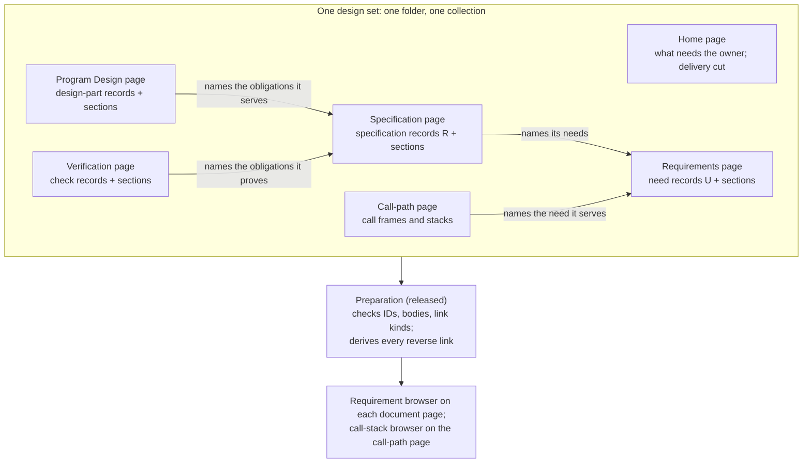

# Skill design: the four-document design workflow as an HTML system

Draft, 7 Nov 2026; revised after the design review (DR-H1 to DR-H4) and again that night around the owner's lab components (Q069–Q074) and the Demistify Lead's integration contract. Which skill changes where, in which order, under which root standards. Every target was read at main `bd571d78` in this worktree; the line-level evidence for each is in the Researcher's impact inventory (memory-logs `skills/authoring/2026-11-07-design-workflow-html/impact-inventory.md`, 147 quoted lines, sha256 a753ba18…). The lab and its data contract were read at sunstack-tools `5d8d113` (the merged PR #130 head); the integration contract at the Demistify Lead's `feat-demistify-design-documents` worktree, based on main `9b4d85a`.

## The model, in one picture

Each phase writes its own page: sections at stable IDs, and one record per row it owns, naming only what that row serves. Preparation, released by the Demistify Lead, checks the set and derives the reverse links; the browsers show any need with its specification, program design and verification. The lens for every run: *the page is the design, and each link is written once*.

## Targets and runs

Owner plugin: `sunstack-dev`. Each run names exactly one skill; a shared reference or test the run must change is named as that run's collateral, and keeps its single home. Order matters because each later run consumes the contract the earlier ones state.

**Admission, every run:** the Demistify Lead's release of the browsers, the record contract and preparation, at a published binding whose guide documents them (O11, O13a), with O13b–d settled in that release or recorded as named gaps the runs teach around. Until then no run starts, and nothing in the skills names the demo app's private elements (D15).

| Run | Skill | Collateral | What changes | Obligations |
| --- | --- | --- | --- | --- |
| 1 | `orchestrator-design` | `shared-references/design-documents.md` | The contract: a document is a page; sections and records with stable IDs replace chunks as the unit; one home per fact; the set is one collection in one folder with a home page that is also the agent entry; which records each document owns and what each names (O5a); links written once and derived (O6), growing by phase (O6a); deliverables (below). "Keep the Markdown Complete" and "Humans Read the Page" go; "Put the Human Part First" stays, applied to sections; the worked set is rewritten as pages. In `orchestrator-design` itself, the design terminal gains the deliverable stage for work that has deliverables. | O1–O4, O5a, O6, O6a, O7, O7a–O7c, O8, O12 |
| 2 | `presentation-html` | `shared-references/diagram-rendering-and-fallbacks.md` | The medium: a design document is always an HTML page with the released browser and its record block; "the page is the source", with inline islands in sections and bodies; a diagram lives in the section or body that owns it; preparation and the collection index re-run after any record, heading, path or walkthrough change. In `presentation-html` (`SKILL.md` step 1, `engineering-documents.md`, `views.md`, `patterns.md`): composing a design page from the released guide (browser, record block, bodies, sections for facts with no record kind); owner confirmations as choices; a deliverable page as links into the browser. | O1, O3–O5b, O7b, O9–O11 |
| 3 | `spec-design` | none | Requirements and Specification written as pages: one need record per `U` with its capability, and the capability list with each capability's purpose as a section; the Specification's one record per `R` naming its needs, with entities and the other identifiers as sections; pictures in bodies where the user's experience matters; the capability list and goal boundary confirmed on the page. The Requirements-only return writes the page and leaves downstream documents unwritten. | O1, O2, O5a, O6, O6a, O10 |
| 4 | `discuss-pathfinding` | none | `references/user-requirements-extraction.md`: the confirmed capability list goes onto the Requirements page, as each need's capability and a section of purposes, instead of "a nested Markdown list"; the confirmation is asked on the page. | O1, O10 |
| 5 | `program-design` | none | Program Design written as a page: one design-part record per part naming the obligations it serves; the binding and trace tables as sections; the call paths as call frames and stacks on the call-path page, each frame naming the need it serves. | O1, O5a, O6a |
| 6 | `verification-design` | none | Verification Design written as a page: one check record per row naming the obligations it proves, its body holding the "proven by" line, passing condition, reference, target and what stays unverified; no result written (O5b). | O1, O5a, O5b, O6a |
| 7 | `spec-program-review` | none | `references/lanes/artifact-navigation.md` checks a set by phase state: preparation passes; one home per fact; no page carrying a whole document; no link written twice; downstream documents unwritten only where the phase state says so; at a four-document review, every need served in each document; a deliverable page states no fact of its own. | O2–O4, O6, O6a, O7b, O9 |
| 8 | `docs-maintain` | none | Upkeep edits the section or record body that owns a fact, then re-runs preparation and the collection index; a reader built from external includes is regenerated as today. | O3, O9 |
| 9 | `plan-implementation` | `shared-references/canonical-implementation-plan.md`; `plan-implementation/README.md`; `tests/skills/lib/contracts/minimal-planning-delivery-contract.test.ts` (L56, L203) | A plan is a page: `plan path` names the plan's page; the plan page and its deliverable page link to each other; a plan may be scoped to one deliverable's needs, given by the delivery cut. The contract test moves with the plan record, keeping its single-plan and authority checks. | O7, O7c |

The earlier deferred runs 10 and 11 (story-free sections on design pages) are dropped: the browsers compose the document pages, so long section-scroll pages, the reason for those runs, no longer exist (D7-r2).

Maintainer documentation (`docs/architecture/skill-system.md`, `plugins/sunstack-dev/docs/diagram-vocabulary.md`, the plugin README) is reconciled at ship, through `docs-maintain`, in the same change.

## What each record holds, by phase (O5a)

| Phase | Records | Each names | Body holds | Sections beside the browser |
| --- | --- | --- | --- | --- |
| Requirements (`spec-design`) | one need per `U` | its capability | the need in the owner's words, its outcome, pictures where UX matters | the capability list with purposes; open owner confirmations |
| Specification (`spec-design`) | one specification per `R` | the needs it serves | the obligation, its threshold, target constraints and reference | entities; the other Specification identifiers |
| Program Design (`program-design`) | one design part per part | the obligations it serves | its responsibility, interface and diagram | the binding table; the trace table |
| Program Design, call paths | call frames and stacks | a frame its need; a stack its need and frames | in the record: name, source, responsibility, statement | none |
| Verification Design (`verification-design`) | one check per row | the obligations it proves | "proven by", passing condition, reference, target, unverified | shared observations described once |

The record kinds and field names here are the lab's (`collection-data.ts` at `5d8d113`); the runs teach the released names, which the Demistify Lead chooses. Example: in the job-submission design below, R9 ("a job that ran twice is billed once") is one specification record naming U2 and U5; U2's Specification view shows R9 with "also serves U5", and nothing is written on U2.

## Deliverables (O7a–O7c), taught by run 1

Owner: `orchestrator-design`'s design terminal, with the contract in `design-documents.md`. It runs only for work delivered in more than one deliverable, as the owner directed for large designs (Q004, Q022).

1. **Inputs.** The reviewed overall design (its pages, review `ready`) and the owner's delivery direction (his 2 and 4 Nov words: an overall design, then each deliverable as a design document plus a plan).
2. **The delivery cut.** The Lead writes, on the overall home page, each deliverable with the needs (`U` rows) it delivers and what it waits on. The cut is the Lead's call, like the plan's other grouping (`canonical-implementation-plan.md`); it adds no stop. It reaches the owner with the first deliverable's plan, under the gate `orchestrator-design` already has: for a new feature he approves or changes that plan, cut included; for improvement work the work proceeds unless he objects.
3. **The deliverable page.** For the first deliverable, `orchestrator-design` loads `presentation-html` to compose its page: its needs, each linked into the browser at the need and the document view that answers the reader's question, each link saying what is there. The page states no fact of its own. A fact only this deliverable needs, such as an order constraint between two of its needs, is written into the overall document that owns that kind of fact and reviewed there, then reached through the browser.
4. **The plan.** `orchestrator-design` loads `plan-implementation` with the four reviewed identities and the deliverable's needs as its scope; the plan page and the deliverable page link to each other.
5. **Review basis.** The overall design keeps its four-document review; a fact added in step 3 goes through that document's phase and a refreshed review of the affected anchors; the deliverable page gets the navigation check (run 7) that it states nothing of its own; the plan and the cut go through `orchestrator-design`'s existing plan gate.
6. **Completion.** The first deliverable has its confirmed place in the cut, its page and its plan page, linked both ways. The next deliverable's page and plan are written when its turn comes.

Worked case: a job-submission design whose owner confirmed two deliverables. Deliverable 1, "submit and run jobs", delivers U1–U4; deliverable 2, "bill finished jobs", delivers U5–U6 and waits on deliverable 1. Deliverable 1's page links U1–U4, each to its view in the browser, which shows their obligations R1–R9, the submission API and lease design parts, and their checks. The entity *Job* is a section on the Specification page, linked, never restated. R9 serves U2 and U5; the browser shows it under U2 with "also serves U5", and deliverable 1's page restates nothing. An order constraint, "worker leases ship before resubmission", is written into the lease design part's body and reviewed there. Deliverable 2's page and plan wait until deliverable 1 lands.

## Surface allocation

| Run | Trigger | Main path | Depth | Proof |
| --- | --- | --- | --- | --- |
| 1 | unchanged | the design terminal's deliverable stage | `design-documents.md` (collateral) | static; review; the next real design with deliverables |
| 2 | unchanged | step 1's human-entry rule | three references; `diagram-rendering-and-fallbacks.md` (collateral) | static; review; the next real design |
| 3 | unchanged | step 9's artifact rule and the Requirements-only return | views table unchanged | static; the next real design |
| 4 | unchanged | none | the extraction reference | static; the next pathfinding run |
| 5 | unchanged | the artifact step | none | static; the next real design |
| 6 | unchanged | the write step | none | static; the next real design |
| 7 | unchanged | none | the navigation lane | static; the next design review |
| 8 | unchanged | the page-upkeep step | none | static |
| 9 | unchanged | the plan input (deliverable scope) | `canonical-implementation-plan.md` (collateral); the contract test | the test; static |

## Trigger

Invocation decision: unchanged for every target. No description changes: the change sits in bodies and references, and each skill still loads on the same situations (`domain-skill-crafting`'s descriptions topic).

## Main path, per run

- **Lens, runs 1–2:** *the page is the design, and each link is written once.* A reader of that phrase can predict the route: write each fact once, in its section or record body; name in each record only what it serves; let preparation and the browsers show the rest. It replaces today's lens, *one Markdown source, two entries*.
- **Route:** each phase keeps its steps; only the artifact step changes, from "write the Markdown and let the page compose it" to "write your records and sections on your page, naming what each serves, then prepare the set". Order matters only where it does today (Requirements before Specification before Program Design before Verification Design).
- **Branches added:** a page that includes an external file keeps the embed route and its freshness check (run 2, condition: the page has an `src` include); work delivered in more than one deliverable runs the deliverable stage (run 1, condition: the delivery cut names more than one deliverable).
- **Completion boundary, each phase:** preparation passes on the set; the page passes the checker at its binding; every record and section the phase owns has a stable ID; each record names what it serves and nothing else; no fact is restated outside its home; downstream documents not yet written show as not yet written; the views the phase's table requires are present or returned as an exact gap. At the design terminal, every need is served in each document.

## Call sites

Unchanged in form: each phase keeps `MUST load ../../shared-references/design-documents.md` and its call into `diagram-rendering-and-fallbacks.md`. Changed: each call's returned result names the page, its record IDs and section IDs, and the preparation result, instead of Markdown paths and `index.md`. New in `orchestrator-design`: at the design terminal, IF the work is delivered in more than one deliverable, load `presentation-html` to compose the first deliverable's page and return its path; then load `plan-implementation` with that deliverable's scope and return its plan page. `presentation-html` step 1's design-set branch loads `engineering-documents.md` for authoring, not presenting. No new reference, script or schema is added; the record contract and preparation are the released library's, read from its guide.

## References

| Reference | Its job | Caller and contract | Taught from |
| --- | --- | --- | --- |
| `design-documents.md` | what a design set is; which records each document owns and what each names; where each fact lives; how links are written once and grow by phase; deliverables | every phase and `orchestrator-design`; returns identities as page paths with record and section IDs | the owner's words (Q003, Q049, Q050, Q004, Q040, Q071–Q073); the lab's data contract; today's identity, token and through-line rules, kept |
| `diagram-rendering-and-fallbacks.md` | the medium, island use, where a diagram lives, preparation and freshness | every phase and `presentation-html`; returns the medium and page proof | today's reference, with "the page is the source" in place of two entries |
| `engineering-documents.md` | how a design page and a deliverable page are composed from the released browser, records, bodies and sections | `presentation-html` step 1 on a design set; returns the pages, their records, sections and views | the released guide; the lab's pages and the Luna probe's inputs |
| `canonical-implementation-plan.md` | the plan record | `plan-implementation`, `plan-update` and implementation callers; returns the plan page path and its scope | the owner's Q004 and Q046 |

## Root topics that apply

- **Change classes:** behavior-changing for every run (each alters a reference's rules or an artifact step).
- **Main path:** runs 1, 3, 5, 6, 8 and 9 change a step's wording and completion; run 1 adds the deliverable branch.
- **Calls and placement:** results of unchanged calls change (page paths, record and section IDs, the preparation result); one meaning per home holds when "Keep the Markdown Complete" goes from `design-documents.md` and its echo goes from `diagram-rendering-and-fallbacks.md` in the same change, with no forwarding stub; the record contract's single home is the released guide, which the skills cite and never restate.
- **Steering:** the deletion test on every changed sentence before review; the lens is a leading phrase; each run's table row carries its owning skill.
- **Generalization:** the six standards in the specification, each with two transfer cases.
- **Proof claims:** drafted from user intent; behavior not yet evaluated.
- **Platform:** a sunstack-dev minor version and a changelog entry at ship.

## Sensitive surfaces

None in scope. No script, credential, write outside the repository or new third-party dependency is added. Pages keep the Demistify binding `presentation-html` already teaches; preparation is the released library's command.

## Decisions

Defaults taken, each with its reason; strike any row.

| # | Decision | Reason |
| --- | --- | --- |
| D1 | A design's text lives on its pages; no Markdown file holds the design. | The owner's decision (Q049, Q050, Q046 28–29 Oct; Q003 6 Nov), not a default. |
| D2-r2 | Agents read the pages directly: each page's records for what exists and what it serves, the body at each ID for its text. | Default for the owner's question 1; the other answer, a read-out command printing a need with everything linked to it, would be a new released tool. |
| D3-r2 (supersedes D3) | The through-line is the owner's requirement browser; no other view of a need is added. | His decision (Q071–Q073) answers his 3 Nov question of how needs link through (Q018); the earlier question 2 (a side-by-side view or the Map) is closed. |
| D4 | Plans become pages too (run 9). | His words name plans with designs (Q046 "hmtl for plan and deisgn files"; Q050; Q004). |
| D5 | skill-authoring's own design-set format stays out of this change. | It is a separate four-part workflow in another plugin; his 26 Oct words (Q051) point at changing it, as its own change. |
| D6 | Existing Markdown design sets stay readable; nothing is migrated; new sets are pages. | A hard cutover for authoring without rewriting accepted history. |
| D7-r2 (supersedes D7) | Stories, story sections and the Map stay off document pages; the earlier deferred runs 10–11 are dropped. | The browsers compose the document pages, so the long section scroll those parts were to tame no longer exists; the Demistify Lead's contract bundles no story-free section. |
| D8-r2 (supersedes D8) | Records and sections are the units; a document is one page. | The owner's page set has one page per document (the lab, Q073). |
| D9 | Markdown islands carry a section's or body's text where Markdown carries it best, never a whole document. | His "markdown islaodns for snppets or secions" (Q050); inside a body, pending O13d. |
| D10 | The home page is the agent entry; `index.md` goes. | Follows from D1 and D2-r2. |
| D11 | Maintainer docs are reconciled in the same change. | One owner per fact, with no stale description of the model. |
| D12-r2 (supersedes D12) | A deliverable's page links into the browser at each of its needs and states no fact; a fact only that deliverable needs is written into the overall document that owns its kind. | His 2 Nov direction (Q022); the browser's need and view addresses make the zoom-in a link, with no new part. |
| D13-r2 | The delivery cut lives on the overall home page as the Lead's call and reaches the owner with the first deliverable's plan under `orchestrator-design`'s existing plan gate; no new stop. | Design review: no owner decision or contract authorizes a separate hold; his words settle overall design plus deliverable pages and plans (Q004, Q022). |
| D14 | The workflow is built on the owner's lab components: the requirement browser on every document page and the call-stack browser, in the layout he decided, released by the Demistify Lead. | His decision, 7 Nov (Q071–Q074); the Demistify Lead's contract keeps that form. |
| D15 | No run starts before the release; the skills teach no interim page form. | One cutover instead of two: an interim form would rewrite the same nine skills twice and teach links by hand that the browsers derive. Asked as the owner's question 2, because his 4 Nov two-stage words (Q008) could favor shipping pages first. |
| D16 | Each record names only what it serves; reverse links are derived. | His decided browser derives them this way (`requirement-stages.ts`), and it lets each phase add its links without editing earlier pages (O6a). |
| D17 | Facts with no record kind are sections at stable IDs beside the browser; no new record kind is asked for. | No owner word asks for entity or capability records; asking for one would widen the Demistify Lead's release (O13c asks only for a home). |
| D18 | A design's checks carry no result; recording observed results on the Verification page is a later change. | Results come from the Verifier after a build; the lab shows a missing result as not run, and none is invented. |

## Coordination

- Base: branch `skills/design-workflow-html` at main `bd571d78`; implementation, when admitted, branches from current main.
- Pending edits: none in skill files; this design set only.
- Dependency: the Demistify Lead (codex-local/01a1452d) owns the release named in the admission line and O13; this design set is sent to it before review, with O13b–d as asks.
- Version and changelog at ship: a sunstack-dev minor version in its manifests and the Claude marketplace entry; one dated changelog entry; cache refresh only if the owner scopes it.

## Run status

| Run | Status |
| --- | --- |
| 1–9 | proposed; admitted when the release lands |

## Review record

- Design review at `65634525`: targeted-revision, DR-H1 to DR-H4, all corrected at `06fa306f`; an unauthorized delivery-cut hold dropped at `e79b8069` (D13-r2).
- Verification at `e79b8069`: **great**, design-stage decision `accepted-to-implement` (report `design-review/report.md`, record `design-review/correction-1-verification.md` in memory-logs `skills/authoring/2026-11-07-design-workflow-html/`). Post-acceptance corrections verified at `fbc2eefb`.
- Revised the night of 7 Nov for the owner's decision to build on his lab components (Q069–Q074) and the Demistify Lead's integration contract: success definition, O1–O13, standard 6, every run's content, the admission line, D2–D3, D7–D9, D12 and D14–D18. The earlier acceptance does not cover this revision; it goes back through `skill-review`'s design stage.
