# Shravan Dev Workflow

Shravan's development workflow skills for moving from shared understanding to spec, plan, implementation, review, handoff, debugging, docs, and operations work.

The plugin is built around one idea: each workflow phase should have a clear owner, a clear artifact boundary, and a clear next handoff. Day-to-day work should use the narrower phase skills here.

## Mental Model

```text
shared understanding
  -> orchestrator-implementation-goal: implementation planning, execution/proof, review, and delivery
       -> orchestrator-design: one design cycle with the owner's three checkpoints
       -> spec-design: separate Requirements and Specification
       -> program-design: structural How, with a seam and observation point per rule
       -> test-design: the Implementer's regression tests
       -> verification-design: independent proof on the real surface
       -> design-review: independent review of the documents and their ties
       -> stop at a reviewed design or explicit gap; never enter planning automatically
  -> plan-implementation: one canonical plan + proof mapping
  -> implement-plan: approved immutable plan + implementation proof
  -> implementation-review: ordered checks in one independent 🔎 Reviewer session + rails reduction
       -> stop before corrections and PR work
```

`handoff` means portability. It does not mean the phase is approved, complete, or ready for the next phase. A handoff packet makes context transferable so a future agent, another CLI, or another machine can continue without guessing.

Design-bearing planning is admitted only from a `ready` design review that is current for the design documents. Until the planner work lands, `plan-implementation` admits the Requirements, Specification, and Program Design under its existing three-artifact plan basis, and Test Design and Verification Design reach delivery through the Implementer and the Verifier. A handoff preserves that evidence; it does not create it. The only direct planning bypass is work positively classified as implementation-mechanics-only with no new design-bearing decision.

## Namespace Map

```text
Namespace            Concern                      Skills
-------------------  ---------------------------  ----------------------------
discuss-*            shared understanding          discuss-clarify-mental-models
                                                  discuss-pathfinding
manage-*             subordinate agents            manage-agents
practices-*          always-on practices           practices-collaboration
                                                  practices-show-me-your-work
                                                  practices-research
orchestrator-*       bounded workflow routing      orchestrator-implementation-goal
                                                  orchestrator-design
spec-* / *-design    design documents and review   spec-design
                                                  program-design
                                                  test-design
                                                  verification-design
                                                  design-review
                                                  spec-handoff
plan-*               planning and portability     plan-implementation
                                                  plan-handoff
                                                  plan-improve-repo
implement-*          approved-plan execution      implement-plan
implementation-*     implementation judgment and lifecycle  implementation-review
                                                  implementation-pr-wrapup
                                                  implementation-handoff
ops-*                external operational systems  ops-security-review
                                                  ops-linear-tracking
debug-*              root-cause investigation      debug-investigation
docs-*               durable documentation         docs-maintain
presentation-*       surface-matched presentation  presentation-tui
                                                  presentation-webui
```

## Workflow Flow

```mermaid
flowchart LR
    pathfinding["discuss-pathfinding<br/>extract tacit or unmade understanding"]
    mentalModels["discuss-clarify-mental-models<br/>mental model reconvergence"]
    deliveryGoal["orchestrator-implementation-goal<br/>plan, implement, prove, review, deliver"]
    designCycle["orchestrator-design<br/>reviewed design coordination"]

    specDesign["spec-design<br/>separate Requirements and Specification"]
    programDesign["program-design<br/>structural How"]
    testDesign["test-design<br/>regression tests that go red"]
    verificationDesign["verification-design<br/>independent proof on the real surface"]
    designReview["design-review<br/>independent review of all five"]
    specHandoff["spec-handoff<br/>portable spec context"]

    planImplementation["plan-implementation<br/>reviewed design to canonical plan"]
    planHandoff["plan-handoff<br/>portable plan context"]

    implementPlan["implement-plan<br/>ready delivery-plan execution"]
    implementationReview["implementation-review<br/>independent implementation and proof review"]
    implWrap["implementation-pr-wrapup<br/>finish PR lifecycle"]
    implHandoff["implementation-handoff<br/>portable code state"]

    pathfinding --> specDesign
    mentalModels --> specDesign
    deliveryGoal -.->|"first unproven gate"| designCycle
    deliveryGoal -.-> planImplementation
    deliveryGoal -.-> implementPlan
    deliveryGoal -.-> implementationReview
    deliveryGoal -.-> implWrap
    designCycle -.->|"first phase"| specDesign
    designCycle -.->|"follows phase-selected routes"| programDesign
    designCycle -.->|"one design review"| designReview
    designCycle -.->|"only for unmade owner meaning"| pathfinding

    specDesign --> programDesign
    programDesign --> testDesign
    programDesign --> verificationDesign
    testDesign --> designReview
    verificationDesign --> designReview
    specDesign --> specHandoff
    programDesign --> specHandoff
    designReview --> specHandoff
    designReview --> specDesign
    designReview --> programDesign
    designReview --> planImplementation
    planImplementation --> planHandoff
    planImplementation -.->|"ready delivery context"| implementPlan
    planHandoff -.->|"when exact approval is preserved"| implementPlan
    implementPlan --> implementationReview
    implementationReview -.->|"accepted implementation correction"| implementPlan
    implementationReview --> implWrap
    implementPlan --> implHandoff
    implementationReview --> implHandoff
    implWrap --> implHandoff
```



## Core Phase Skills

### Shared understanding

Use `discuss-clarify-mental-models` when the shared picture is unstable before artifact work: terms, boundaries, assumptions, source-of-truth questions, or tradeoffs need to be made inspectable. It stays read-only, checks bounded evidence, maps branches, names the countercase, and routes only after the model is confirmed or explicitly open. It is not the old one-forcing-question grill.

`discuss-pathfinding`: Extract unwritten understanding from the user — user and stakeholder requirements, tacit process knowledge, domain terms, design decisions — via batched grilling with attached reads, live challenge, and records as they crystallize. User-requirements extraction separates evidence from row-level authority, preserves direct users and non-operating stakeholders, forces priority ownership, and captures user-job sequence inputs for later specification views.

Codex display titles use the `Category: Action` form (for example, `Discuss: Pathfinding` and `Spec: Design`). Skill IDs remain kebab-case for invocation. Cursor can load these plugin directories through its explicit `agent --plugin-dir <path>` path; this repository does not provide a separate Cursor marketplace.

Use `practices-research` when the next step is to gather evidence: local code/docs, sibling repos, DeepWiki-style repository research, current web/docs, Reader sources, memory, or session logs. It frames bounded research questions, walks source classes in order, labels claim quality, and writes tmp research ledgers for substantial runs. Substantial runs use source-class coverage, primary anchors, and a verified research ledger. It ends with a phase return token for the next owner instead of naming a phase.

Skills are layered: orchestrators, then phases, then practices (with `ops-*` and `presentation-*`), then tool manuals. Skills in one layer may name each other freely; none names a higher layer. Work sent upward returns a token from `shared-references/phase-return-tokens.md`, which the orchestrator (or the Lead, for a direct phase) maps to the next owner without widening the requested task. Every phase opens or resumes the trace through `practices-show-me-your-work` at entry and checkpoints at completion.

Use `manage-agents` when subordinate AI-agent mechanics are the work: spawning, calling, resuming, steering, queueing, monitoring, or reducing advisors, sidekicks, workers, operators, subagents, and swarms. The Lead remains the default conversation and author of governing design and implementation plans. After a ready plan, each workstream's 🐒 Implementer executes its work and associated proof directly by default, and its 🔬 Verifier proves the delivered behavior independently; the owner may start direct contact with an Implementer without transferring authority or execution ownership, and helpers never start owner contact themselves. Material design/plan or integration questions return to the Lead with evidence, while the Lead does not relay every internal progress turn. PR wrap-up may stay with the Implementer or run as a prescribed Operator procedure; the Lead retains acceptance and the user retains merge authority. Seats by role belong to `practices-collaboration`. `manage-agents` owns roles and their charters, classification, the catalog tables, and native, agent-router, or legacy ACPX routing; persistent sessions are ledgered before follow-ups; and child output remains candidate evidence until verified.

Use `orchestrator-design` when the user asks to run or resume the full design cycle as one bounded workflow. The Lead loads `spec-design`, `program-design`, `test-design`, and `verification-design` in its own session and writes every document; helpers bring evidence, and an explicitly requested Advisor may advise. The owner confirms the Requirements card, the structure, and the final reviewed set, and before asking the owner a factual question the Lead runs a bounded experiment. An independent Reviewer runs `design-review`, and the cycle returns a `CycleReturn` and stops before planning. Review rounds continue while they converge; when they stop converging, or a correction would change design meaning, the owner gets a brief. When prior review evidence is unavailable, the current review sets the baseline.

Use `orchestrator-implementation-goal` to carry implementation goals through Lead-authored planning, workstream implementation by an Implementer and Verifier pair, Lead assessment from the current-head Verifier report, independent review, accepted corrections, and the requested delivery boundary. Design stays with its own workflow when missing or contradicted. The default terminal is PR-ready and unmerged; merge requires explicit authority. Both orchestrators use `practices-show-me-your-work` for meaningful decision and evidence history, while checking current sources rather than replaying stored status. Direct one-phase requests bypass orchestration.

Use `practices-collaboration` at the start of a qualifying task to find the repository's board project and work thread, and whenever agents coordinate: seats, messages versus posts, waiting on another agent, and resolution. With no board project, helpers return `no-home` to their parent, the Lead names the gap once under Waiting on owner, and work continues.

Use `practices-show-me-your-work` at the start of a qualifying task to open or resume the work trace, while recording decisions, evidence, and outcomes, at every stop, or when the user asks to see the work. The trace lives in the work thread, or in a `docs/wip/work-trails/<date-label>/` folder marked unshared until a board exists, which the Lead then transfers. A qualifying task spans sessions, commissions another agent, crosses components, or makes a decision someone will later inspect; routine small edits get no trace unless one is requested.

### Spec boundary

Use `spec-design` to preserve two separate upstream concepts before program design or planning. Requirements owns WHY, for whom, and within what authorized boundary. Specification owns WHAT must be observably true and traces its normative obligations to Requirements. Requirements open with a card the owner confirms, one plain line per need with its source; agent ideas stay proposals until adopted. The Specification is checkable rules over defined entities, naming the reference when one defines correct. A changed screen is an Image Gen picture grounded in the current app. Ownership, calls, state, flow, failure, and trust are Mermaid. Normative meaning remains in prose and tables. For substantial file-backed work, the skill reuses or creates a separately identifiable Requirements home and creates a different Specification home; it never substitutes one combined `Requirements/spec` artifact. It keeps unresolved owner meaning visible and leaves internal component structure downstream.

Use `program-design` to define structural How against the settled specification: current-system constraints, alternatives and crux, component trees, singular ownership, interfaces, state, source-anchored call paths and flows, failure/recovery, concurrency/consistency, trust boundaries, compatibility/cutover, and a trace table giving every rule its owner, seam, and observation point. It answers seam requests from Test Design and Verification Design. A generated explanatory overview may aid the reader only after Lead-authored semantic composition and inspection; exact structural views and prose remain authoritative. It turns stack/trace evidence into implementable entrypoint-to-effect views and produces an executable mental model, not a task list.

Use `test-design` to plan the Implementer's regression tests: for each Specification rule, the scenarios worth protecting, the cheapest layer that observes them at a seam Program Design names, what stays real, and an assertion with an expected outcome from the Specification that goes red when the behavior is wrong.

Use `verification-design` to plan independent proof: for each requirement, one "proven by" line for the owner, a declared reference with version and entry point, the core outcome first on the real surface, where it is observed, what passes, and what stays unverified. The 🔬 Verifier challenges it before building and reports for the head commit it tested.

Use `design-review` to independently review whichever design documents exist. A 🔎 Reviewer, commissioned through `manage-agents`, reads everything whole, checks each document on its own, walks the ties both ways (missing, invented, unchecked), and returns findings routed to the owning skill with one `DesignReviewResult`. Prescribed proof commands go to a 🔧 Operator under an exact grant. It never edits or accepts the design; a wording-only edit keeps the existing coverage.

The old `orchestrator-goal`, `plan-creation-swarm`, `plan-review-swarm`, `implementation-execute-plan`, and `implementation-review-swarm` source trees are preserved under [`retired-skills/`](retired-skills/) for provenance and are not runtime entrypoints. The active `orchestrator-implementation-goal`, `plan-implementation`, `implement-plan`, and `implementation-review` are new minimal implementations, not aliases or revivals of those retired trees; they do not restore swarms, controller briefs, worker protocols, transition ledgers, or a separate plan-review layer.

Use `spec-handoff` to package spec/design context for a future session. It preserves decisions, non-goals, contracts, tradeoffs, evidence, security context, open questions, the five design document paths, the current review result or a pointer to it, and review freshness without creating an implementation plan. It names the next owner for a missing document (`spec-design`, `program-design`, `test-design`, or `verification-design`), routes an unreviewed or stale set to `design-review`, and routes a current `ready` review of all five to `plan-implementation`.

### Plan boundary

Use `plan-implementation` when the Lead translates one semantically current ready Requirements, Specification, and Program Design set into one repo-grounded canonical Markdown plan. Helpers may gather bounded repository/proof evidence, but the Lead authors every slice, dependency, proof row, and PR boundary. It stops before tickets, implementation, review, Git, or PR work.

Use `plan-improve-repo` to audit a repo for high-leverage improvements without editing source. Delegated audit work returns evidence and candidates; the Lead admits findings and authors any canonical plan. It retains direct authority over admitted repository-improvement findings, including source-proven implementation-mechanics-only work, without taking reviewed-design planning away from `plan-implementation`.

Use `plan-handoff` to package an existing implementation plan for another agent, CLI, machine, or future session. It preserves the exact canonical plan record, governing planning basis, delivery context, and current Lead's authorship. Only a named successor-Lead recipient, transferred planning scope, and explicit user direction transfer plan authorship. If no plan exists yet, use `spec-handoff` for portability or `plan-implementation` to create one from current ready design; never present design context as an existing plan.

### Implementation boundary

Use `implement-plan` to validate and execute one immutable-path canonical `draft` plan only after separate later owner approval names that exact path and current meaning. It re-anchors before edits, works inline by default, advances through the smallest ready proof-bearing slice, preserves proof gates, and stops with an exact semantic route when current reality breaks the plan or design. It stops before independent review and PR work.

Use `implementation-review` for independent product implementation and proof review after execution. It admits exact governing authority, ready plan, source, diff, and proof identities. A 🔎 Reviewer, commissioned through `manage-agents`, reads the whole map and walks spec-compliance, sequential overlapping chunk passes, proof challenge, dispel, and predicate-selected focused checks. It checks changed tests against Test Design, treats Test Design and Verification Design as rails alongside Requirements, Specification, and Program Design, and routes corrections by semantic cause without editing.

Use `implementation-pr-wrapup` to finish the GitHub PR lifecycle after implementation, typically after independent review on a delivery goal: push/open/update the PR, write a why-and-shape description, monitor checks and comments, process existing review threads, prove mergeability with current GitHub state, and merge only when user authorization exists. Fresh code-review discovery routes to `implementation-review`; PR wrap-up does not substitute for it. Independent-review coverage is not a wrap-up ready gate.

Use `implementation-handoff` when real implementation state exists: branch, diff, changed files, commits, validation output, failed commands, blockers, or risk. It is for continuation, audit, or manual review of work already in motion.

## Supporting Skills

- `debug-investigation`: diagnosis-first debugging before fixes. Use it for failing tests, flaky behavior, crashes, regressions, build failures, or unexpected behavior. For long-running infra or batch monitoring, it loads a background-monitoring reference for redacted JSONL/state watchers that are cheap, cancellable, and visible through the agent harness when available.
- `docs-maintain`: durable documentation maintenance after source-of-truth drift is identified. It keeps README human-facing, `AGENTS.md` compact, and workflow history in changelog/runbook docs.
- `ops-security-review`: routes explicit authorized security scans to the official Codex Security plugin workflows.
- `ops-linear-tracking`: manages Linear projects, milestones, issues, and dependencies while keeping docs as the design source of truth.
- `presentation-tui`: hybrid TUI + markdown presentation for monospace terminal/CLI surfaces — box-drawing skeleton with markdown atoms (inline code, fences, GFM tables by default for comparisons). Shares markdown baseline, diagram semantics, and Mermaid judgment with `presentation-webui` via `shared-references/`.
- `presentation-webui`: markdown-first presentation for rendered proportional-font chat surfaces — headings/lists/GFM tables as the skeleton, smallest-view media selection (pseudocode, call trees, file trees, diffs, Mermaid, fenced box layouts), and the same shared baseline and diagram judgment.

## External Counsel

Review workflows do not use broad multi-model counsel by default. The persistent 🔎 Reviewer, its ordered checks, and its model, runtime, history isolation, and authority are resolved through `manage-agents`.

```text
normal review path
  design-review
      -> independent review of the design documents and their ties
  implementation-review
      -> one complete independent implementation/proof review
```

## How To Use

Examples:

```text
Use discuss-clarify-mental-models to reconverge before writing a spec or plan.
Use discuss-pathfinding to grill me on tacit requirements or unmade decisions.
Use spec-design to preserve separate Requirements and Specification identities: authorized Why and observable What.
Use program-design to turn this specification into structural How.
Use test-design to plan the regression tests for this Specification.
Use verification-design to plan independent proof for these requirements on the real surface.
Use design-review to independently review these design documents and their ties.
Use spec-handoff to package this design for another agent without creating a plan.
Use orchestrator-implementation-goal to carry this goal through planning, implementation, proof, review, and PR readiness.
Use plan-implementation to create one repo-grounded proof-bearing plan from this reviewed design set.
Use implement-plan to execute this ready canonical plan at its immutable path, current meaning, and `pr-ready-unmerged` delivery context, then return fresh implementation proof without starting review or PR work.
Use implementation-review to independently review this implementation and proof without editing or starting PR lifecycle work.
Use practices-research to gather source-grounded evidence into a tmp ledger.
Use plan-improve-repo to audit this repo and write immutable canonical plan-only improvement plans. When delivery is requested later, route the admitted finding through plan-implementation to establish current delivery intent instead of upgrading the prior plan.
Use implementation-pr-wrapup to handle existing PR comments and prove merge readiness.
Use implementation-handoff to package this branch for another agent to continue.
Use docs-maintain to reconcile this README and AGENTS.md with current plugin state.
```

## Source And Maintainer Resources

- Skill source: [`skills/`](skills/)
- Shared runtime references: [`shared-references/`](shared-references/)
- Design-view vocabulary and ownership index: [`docs/diagram-vocabulary.md`](docs/diagram-vocabulary.md)
- Source inspiration catalog: [`docs/source-inspiration-catalog.md`](docs/source-inspiration-catalog.md)
- Release smoke and behavioral checks: [`../../docs/changelog/references/shravan-dev-workflow-smoke.md`](../../docs/changelog/references/shravan-dev-workflow-smoke.md)
- Release notes: [`../../docs/changelog/`](../../docs/changelog/)
- Maintainer guidance: [`../../AGENTS.md`](../../AGENTS.md)
