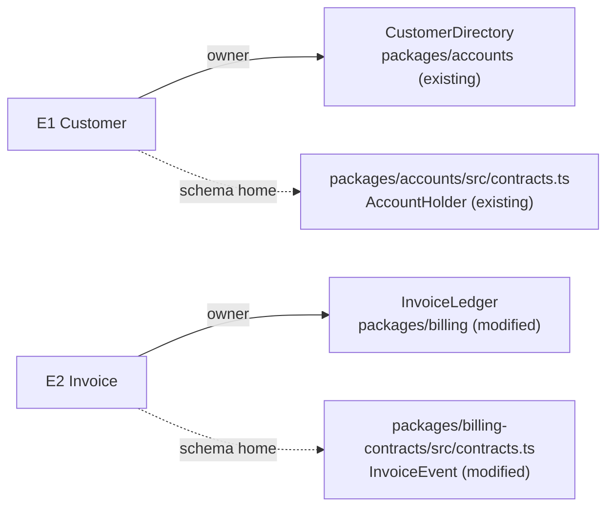

# Parts and Contracts

This reference owns how the parts are defined: binding each entity to an owner, a home, and a shape; one job per part; single ownership and dependency direction; interfaces as behavior with closed result variants; state and lifecycle; call paths from today to proposed; and migration phases.

Expected inputs: the chosen structure, the rules, the Specification's entities (`E`, with identity rules, relationships, invariants, and states), today's paths, and the constraints. Return, in order: the binding table with its code shapes and the type conventions found (or `none found`); the parts with their owners and dependency rules; the interface contracts; the state model; the call-path deltas and flows with the shape on each boundary-crossing edge; migration phases; and gaps.

Package detail stops at the binding table. Exact files and task order belong to planning.

## Entity Binding

An entity the Specification defined has to live somewhere before components can be composed around it. For each `E`, binding gives three separate answers: which component is responsible for its truth and invariants (semantic owner), which package or module its code lives in (home), and which module declares its shape (schema/type home). It adds whether the entity is `persisted | derived | cached` and what shape it has at every boundary it crosses.

Semantic owner, home, and schema/type home are different altitudes. The owner is a component; the home is where that code lives; the schema/type home is the single module every consumer imports the shape from. Two components in one package is normal. One entity with two schema copies is a defect.

### Find the type conventions

Look for the repository's written type rules, then for the pattern its existing schemas follow:

- root and package `AGENTS.md` or `CLAUDE.md`;
- rule files such as `.cursor/rules/` and language-rule files;
- the existing schemas in the packages the design touches: when every contract there is a Zod discriminated union with a `z.infer` type, that is the convention even if no file states it.

Record each rule or pattern with its source. When nothing is written and the touched packages show no pattern, record `none found` and write shapes as field lists with nullability and discriminant.

### What to inspect

- the Specification's entity table: every `E`, its identity rule, relationships, invariants, and states; the binding never redefines any of them;
- existing types and schemas for the same nouns in the current system, and the import paths consumers already use;
- package boundaries and import rules (workspace layout, package exports, lint boundaries, dependency direction);
- every place an entity crosses a process, service, storage, or queue boundary.

### Bind against existing code

- An existing type that carries an entity under a different name is a binding. Put the code name in the home or shape cell, mark it `existing`, and keep the Specification's term in design prose. Declaring a second schema for the same facts, or renaming the entity after the code type, breaks the one-owner rule.
- An identity or cardinality mismatch with existing code, such as a key that omits the account the Specification's identity rule includes, is a structural choice. Name the options and their cost. Return `owner-decision` when resolving it goes beyond the Requirements boundary.
- Only a noun the Specification never defined, or a meaning that conflicts with it, returns `specification-gap`.
- A design-only concept (a wait handle, an idempotency key, a cache entry) names the `E` or `R` it serves. A concept that serves none is deleted, not kept as scaffolding.

### Filled template

Disclose by depth: the map shows where each entity lives, the table gives every binding answer, and the code shape pins the contract. This example comes from a billing repository whose root `AGENTS.md` says Zod schemas own runtime types and variants are discriminated unions.



| E | Semantic owner | Package or module home | Schema/type home | Shape at each boundary | Disposition | Convention |
| --- | --- | --- | --- | --- | --- | --- |
| E1 Customer | `CustomerDirectory` | `packages/accounts` (existing; code name `AccountHolder`) | `packages/accounts/src/contracts.ts` (existing) | `customerId: string` on every billing event (existing) | persisted | Zod owns the type (root `AGENTS.md`) |
| E2 Invoice | `InvoiceLedger` | `packages/billing` (modified) | `packages/billing-contracts/src/contracts.ts` (modified) | `InvoiceEvent`, billing to notifications, below (new variants) | persisted | Zod discriminated union with `z.infer` (root `AGENTS.md`) |

```ts
export const invoiceEventSchema = z.discriminatedUnion("name", [
  z.object({
    name: z.literal("billing/invoice.settled"),
    data: z.object({
      invoiceId: z.string(),
      customerId: z.string(),
      settledAt: z.string().datetime(),
      amountMinor: z.number().int().nonnegative(),
    }),
  }),
  z.object({
    name: z.literal("billing/invoice.voided"),
    data: z.object({
      invoiceId: z.string(),
      customerId: z.string(),
      voidReason: z.enum(["duplicate", "customer-request", "fraud"]),
    }),
  }),
]);
export type InvoiceEvent = z.infer<typeof invoiceEventSchema>;
```

With `none found`, the same contract is a field list:

```text
billing/invoice.settled    discriminant: name
  invoiceId    string, required
  customerId   string, required
  settledAt    timestamp (ISO-8601), required
  amountMinor  integer >= 0, required
schema home: packages/billing-contracts (new variant)
```

Good: one schema home imported by every consumer; the owner named as a component and the home named separately; each boundary crossing showing its discriminant and nullable fields; an existing contract reused under its code name and marked `existing`; an open string the conventions forbid recorded with its closed replacement or a `gap: <why>`.

Bad: two copies of a payload schema in two packages; a package named as the semantic owner; a boundary shape described as "the event payload"; bullets where the table belongs; an entity redefined here with a different identity rule; a `new` contract where an `existing` one already carries the same facts; schema homes or payload fields deferred to planning.

Stop when every `E` has a row with every cell filled or marked `gap: <why>`, every boundary crossing has a shape in the found convention or a field list with nullability and discriminant, and every design-only concept names the `E` or `R` it serves.

## Integrated Overview

Build a walkable composition from the binding table:

```text
target system
  component A
    owns: truth / decision / invariant   (the E identifiers it owns)
    lives in: package or module (new | modified | existing)
    exposes: interface
    consumed by: callers
    changes when: one reason
  component B
    owns: truth / decision / invariant
    lives in: package or module (new | modified | existing)
    exposes: interface
    consumed by: callers
    changes when: one reason
```

Components are semantic owners, not directories, and each has one home. For UI work, show state-owning containers, pure views, derived state, and integration/effect boundaries.

Use a component tree when hierarchy/composition matters and a topology view when peer boundaries or dependency direction matter more than nesting. Label owners and consumers on the view; do not infer ownership from box position alone.

## Depth and Ownership

Apply the deletion test: if removing a component makes its complexity disappear rather than move to callers, it is probably pass-through. If callers must learn nearly all its policy, lifecycle, or failure rules, it is shallow.

For every truth, invariant, lifecycle, and side effect, name exactly one authoritative owner. Define allowed/forbidden edges and the detection or enforcement class.

## Behavioral Interfaces

Each load-bearing interface states:

```text
owner and consumers
inputs/preconditions
outputs/postconditions: a closed variant, with a discriminant and fields per variant
sync/async semantics
state and side effects
idempotency/order guarantees
errors/cancellation: a closed variant with a bounded reason set
version/compatibility
negative space
examples when ambiguous
```

Result and decision contracts are closed variants in the found conventions. A read distinguishes `found` from `not-found`; a conditional write distinguishes `updated`, `conflict`, and `not-found`; a policy decision names each outcome and a bounded reason set. Transport failures and invalid payloads are their own variants, never disguised as a business outcome.

```ts
type SettlementDecision =
  | { readonly kind: "settle"; readonly settledAt: string }
  | { readonly kind: "reject"; readonly reason: "amount-mismatch" | "already-settled" | "invoice-voided" };
```

Write one representative caller interaction before finalizing. Add a boundary for real variation, a trust or process boundary, a lifecycle owner, an observation boundary, an external or fallible dependency, or multiple consumers, not for abstraction aesthetics.

Good: interface hides owner policy and makes caller assumptions explicit; every variant a caller must branch on is a named member of the union.

Bad: signatures without semantics, “shared ownership,” one interface per current file, open strings for a result or reason, or variants that exist only in prose.

## State and Lifecycle

For each material state:

```text
owner and lifetime/storage
valid states
initiator and transition guard
before/after invariant
persisted vs derived vs cached
reset/cancel/dispose/recovery
illegal transitions and handling
```

Use a state machine when timing/order changes correctness; use a state table when compact. In UI, prefer render-derived values over synchronized copies when ownership permits.

## End-to-End Flow

Use a sequence view when participants and call order matter, a state machine when lifecycle and legal transitions matter, and a data/event flow when authority or transformation crosses storage, process, or service boundaries. Combine them only when one view stays readable and preserves each relationship.

Trace each requirement:

```text
consumer -> entry -> coordinator -> owner -> external boundary
            result / event / state change returns on named path
```

Include async callbacks, jobs, events, storage, caches, and test paths when they alter semantics. Separate control flow from data authority.

Every edge that crosses a process, service, storage, or queue boundary carries its shape from the binding table. In Mermaid, label the edge with the event or message name and put the fields in a note or an adjacent table; the reader should not have to leave the flow to learn what crosses it:

```text
edge: <producer> -> <consumer>
  name: <event or message name>
  discriminant: <field and value>
  fields: <name: type, nullable?> ...
  schema home: <module from the binding table>
  new | existing
```

An edge whose shape the design has not settled reads `gap: <why>`. A label such as "sends the payload" is not a shape.

## Compare Today's and Proposed Call Paths

For every material runtime-behavior group, pair the source-anchored current entrypoint-to-effect chain from `current-system.md` with the proposed chain. A first design records proposed-only and explicitly states that no predecessor exists. Requirements sharing one path may cite the same delta.

Compare by owner and caller/callee edge. Mark every added, removed, or changed owner, call, state read/write or external effect, and result/error edge. Also mark an unchanged edge when its preservation is requirement-critical, safety-critical, or contested:

```text
added
removed
changed
intentionally unchanged
```

Ordinary unaffected edges need no ceremony.

For each edge, keep the owning component, operation or event with its shape, sync/async/event semantics, input authority, state read/write or side effect, result/error propagation, and the requirement or failure obligation it realizes. Preserve current-source anchors and explain the consequence of every removed or changed edge.

Do not make a human mentally diff two separate prose sections or raw stack traces. Render the comparison as the smallest readable call graph, sequence, compact call tree, or delta table that keeps each applicable edge status visible.

Runtime call stacks and traces validate current execution; they are not copied as the target design. Normalize the target into a source-anchored call graph or sequence view that an implementer can follow from entrypoint to effect and back to the observable outcome. Branches, callbacks, retries, queue/event hops, cancellation, and partial failure stay visible when they change behavior.

Good: the current/proposed view makes ownership, boundary crossings, state authority, result/error propagation, and every changed edge unambiguous.

Bad: only boxes and arrows, separate current/target descriptions with no delta markers, a raw stack trace, signatures without call order, a removed edge hidden by omission, a boundary-crossing edge with no shape, or a happy path that hides async and failure returns.

## Migration and Cutover

For each coexistence phase, name:

```text
authoritative state
permitted readers/writers
compatibility/version skew
transition/reconciliation owner
cutover and rollback conditions
failure/recovery behavior
seam and observation point
```

A temporary dual path is one coordination boundary with an authority rule per phase, not two sources of truth.

## Complete When

Every entity is bound, with every cell filled or marked `gap: <why>`; every part earns its boundary, names its home, and has one job; ownership is singular and dependency direction enforceable; every result and decision contract is a closed variant; every material runtime-behavior group has a source-anchored today-to-proposed call-path delta, or is marked new with no predecessor, with added, removed, and changed edges explicit; every boundary-crossing edge names its shape or a `gap: <why>`; state writes cannot bypass their owner; and each migration phase has its authority, transition, rollback, failure handling, and seam.
