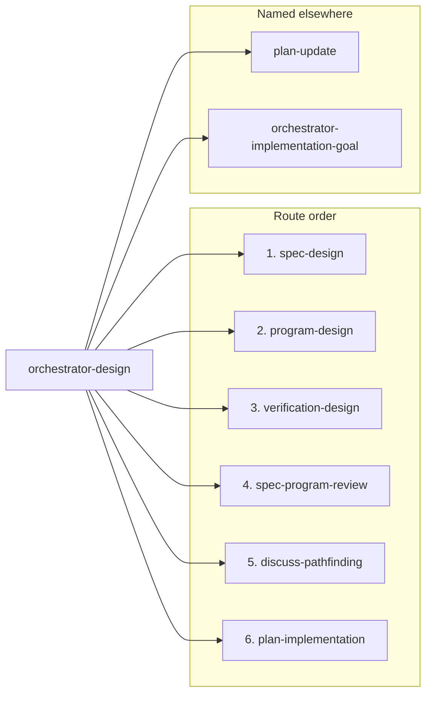
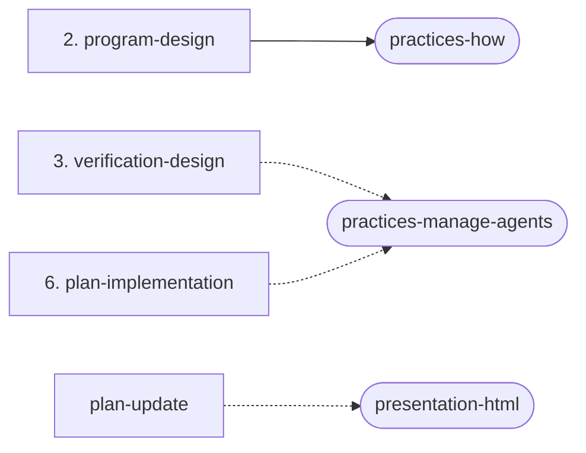
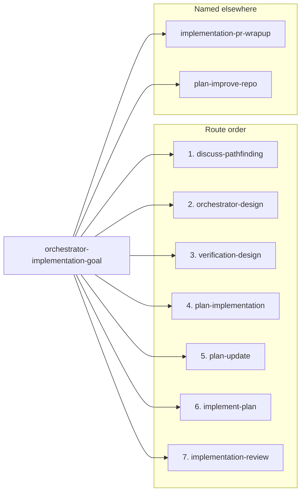
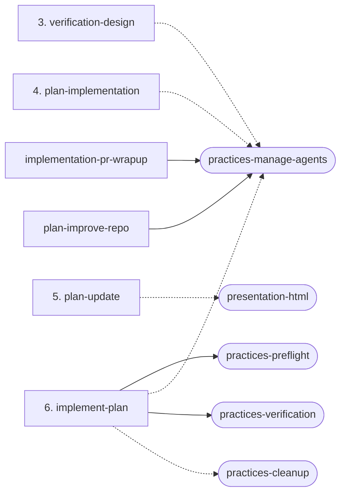

# Phase composition

What each orchestrator and phase in `sunstack-dev` is built from: the phases an orchestrator routes, and for each skill the practices, references and other skills it loads, the principles it cites and the tokens it returns. The map is generated from the skill files, so each skill's own text stays the only authority for what it does.

Regenerate it in the same change as any skill edit: run `pnpm --dir tests/skills phase-composition`, then embed it into `phase-composition.html` from its live source `phase-composition.source.html` with Demistify's `embed`. The contract test `tests/skills/lib/contracts/phase-composition-map-contract.test.ts` fails when this file, or the page's embedded copy of it, no longer matches the skill files.

## How the map is counted

- **Always loads:** a `MUST load` call with a backticked skill name or path and no IF before it in its sentence.
- **Loads when a condition holds:** a load call with an IF before it in its sentence, even when it says MUST.
- **Kinds:** a practice includes the always-available `presentation-`, `ops-` and `audit-` skills; an own reference sits in the skill's folder; a shared reference sits in `shared-references/`.
- **Named without a load call:** an active skill name, or a path that resolves to a file in the plugin, that the `SKILL.md` mentions in code formatting without a load call, including a load worded with neither MUST nor IF.
- **Phases an orchestrator routes:** the phase and orchestrator skills its `SKILL.md` route table names, in row order. A route table is a table whose last column is headed Owner or Next owner, or a list of `token` -> `owner` mappings. Phases its `SKILL.md` names only elsewhere follow, in the order it first names them.
- **Cites:** principle links, in `SKILL.md` and in the skill's `references/`.
- **Returns:** a token from `shared-references/phase-return-tokens.md` named in a sentence that returns it (a form of "return", or "carrying"), outside a token-to-owner mapping.
- **Lines:** the line count of `SKILL.md`. Fenced code and the frontmatter are not read for calls.

## Summary

| Skill | Lines | Always loads | Loads when a condition holds | Cites in `SKILL.md` | Returns |
| --- | --- | --- | --- | --- | --- |
| orchestrator-design | 99 | `design-documents`, `practices-show-me-your-work`, `practices-preflight`, `phase-return-tokens` | `practices-manage-agents`, `owner-decision-brief`, `orchestrator-implementation-goal` | none | `ready-for-implementation`, `ready-for-planning` |
| orchestrator-implementation-goal | 51 | `practices-manage-agents`, `practices-show-me-your-work`, `practices-preflight`, `goal-contract-and-routing`, `phase-return-tokens` | `implementation-pr-wrapup`, `plan-implementation`, `owner-decision-brief` | none | none |
| debug-investigation | 126 | none | `practices-cleanup`, `background-monitoring` | `refine-mental-models`, `read-ground-truth-first` | none |
| discuss-clarify-mental-models | 162 | `diagram-rendering-and-fallbacks` | `model-shapes`, `provenance-decomposition` | none | none |
| discuss-pathfinding | 189 | `question-craft`, `decisions-and-docs` | `design-documents`, `user-requirements-extraction`, `diagram-rendering-and-fallbacks` | none | none |
| docs-maintain | 119 | `doc-roles`, `staleness-and-purge` | `owner-decision-brief`, `humanizer`, `diagram-rendering-and-fallbacks`, `workflows`, `changelog-runbooks`, `source-inspiration-catalog` | none | none |
| implement-plan | 47 | `canonical-implementation-plan`, `execution-and-proof`, `practices-preflight`, `practices-verification` | `practices-manage-agents`, `implementer-verifier-pairing`, `practices-cleanup` | none | none |
| implementation-handoff | 94 | `handoff-template`, `copy-paste-prompts` | `canonical-implementation-plan` | none | none |
| implementation-pr-wrapup | 115 | `local-branch-state`, `public-artifact-safety`, `github-pr-state`, `monitor-loop`, `practices-manage-agents`, `code-review-feedback-handling`, `merge-gates` | `merge-cleanup`, `pr-outline-views` | none | none |
| implementation-review | 81 | `canonical-implementation-plan`, `coordination-and-chunking`, `lane-schema`, `spec-compliance`, `chunk-reviewer`, `dispel`, `finding-and-reduction` | `proof-challenge`, `focused-reviewer` | none | none |
| plan-handoff | 78 | `canonical-implementation-plan` | `handoff-template` | none | none |
| plan-implementation | 48 | `slice-and-proof-design`, `canonical-implementation-plan` | `practices-manage-agents`, `owner-decision-brief` | none | `verification-design-gap` |
| plan-improve-repo | 206 | `practices-manage-agents` | `canonical-implementation-plan`, `audit-lanes`, `improvement-plan-template`, `reconcile-backlog`, `validation-checklist` | `verify-before-accepting`, `write-tests-that-can-fail` | `verification-design-gap` |
| plan-update | 35 | `slice-and-proof-design`, `canonical-implementation-plan` | `owner-decision-brief`, `presentation-html` | none | `requirements-gap`, `specification-gap`, `program-design-gap`, `verification-design-gap` |
| program-design | 362 | `design-documents`, `practices-how`, `current-system-model`, `alternatives-and-crux`, `components-ownership-interfaces`, `state-calls-and-flows`, `failure-concurrency-recovery`, `cross-cutting-realization`, `proof-architecture-and-traceability`, `artifact-and-self-review` | `domain-<lang>`, `diagram-rendering-and-fallbacks`, `lane-schema` | `justify-the-complexity` | `specification-gap` |
| spec-design | 326 | `diagram-rendering-and-fallbacks`, `design-documents`, `authority-and-problem-framing`, `domain-entities`, `requirements-and-traceability`, `observable-contracts`, `artifact-and-self-review` | `owner-decision-brief` | none | none |
| spec-handoff | 83 | none | none | none | none |
| spec-program-review | 254 | `finding-and-reduction-schema`, `design-documents`, `coordination-and-chunking`, `lane-schema`, `mode-complete-reviewer`, `reviewing-common-method`, `dispel` | `classifying-review-requirement`, `chunk-reviewer`, `proof-challenge` | none | none |
| verification-design | 150 | `design-documents`, `choosing-the-observation`, `diagram-rendering-and-fallbacks` | `practices-manage-agents`, `owner-decision-brief` | `read-ground-truth-first`, `prove-it-works`, `verify-before-accepting`, `write-tests-that-can-fail`, `write-for-the-reader` | none |

## Orchestrators

### orchestrator-design routes

- Route order, from its `SKILL.md` route table: `spec-design`, `program-design`, `verification-design`, `spec-program-review`, `discuss-pathfinding`, `plan-implementation`
- Named only elsewhere in its `SKILL.md`, in the order it first names them: `plan-update`, `orchestrator-implementation-goal`

The practices its phases load: solid arrows load always, dashed arrows when a condition holds. A nested orchestrator's own loads are in its section.

### orchestrator-implementation-goal routes

- Route order, from its `SKILL.md` route table: `discuss-pathfinding`, `orchestrator-design`, `verification-design`, `plan-implementation`, `plan-update`, `implement-plan`, `implementation-review`
- Named only elsewhere in its `SKILL.md`, in the order it first names them: `implementation-pr-wrapup`, `plan-improve-repo`

The practices its phases load: solid arrows load always, dashed arrows when a condition holds. A nested orchestrator's own loads are in its section.

## Each orchestrator and phase

### orchestrator-design

- Lines: 99
- Always loads:
  - practice: `practices-show-me-your-work`, `practices-preflight`
  - shared reference: `../../shared-references/design-documents.md`, `../../shared-references/phase-return-tokens.md`
- Loads when a condition holds:
  - orchestrator: `orchestrator-implementation-goal`
  - practice: `practices-manage-agents`
  - shared reference: `../../shared-references/owner-decision-brief.md`
- Named without a load call: none
- Cites in `SKILL.md`: none
- Cites in its references: none
- Returns: `ready-for-implementation`, `ready-for-planning`

### orchestrator-implementation-goal

- Lines: 51
- Always loads:
  - practice: `practices-manage-agents`, `practices-show-me-your-work`, `practices-preflight`
  - shared reference: `../../shared-references/phase-return-tokens.md`
  - own reference: `references/goal-contract-and-routing.md`
- Loads when a condition holds:
  - phase: `implementation-pr-wrapup`, `plan-implementation`
  - shared reference: `../../shared-references/owner-decision-brief.md`
- Named without a load call: `practices-collaboration`
- Cites in `SKILL.md`: none
- Cites in its references: none
- Returns: none

### debug-investigation

- Lines: 126
- Always loads:
  - none
- Loads when a condition holds:
  - practice: `practices-cleanup`
  - own reference: `references/background-monitoring.md`
- Named without a load call: `practices-show-me-your-work`, `practices-manage-agents`, `docs-maintain`
- Cites in `SKILL.md`: `principle-refine-mental-models`, `principle-read-ground-truth-first`
- Cites in its references: none
- Returns: none

### discuss-clarify-mental-models

- Lines: 162
- Always loads:
  - shared reference: `../../shared-references/diagram-rendering-and-fallbacks.md`
- Loads when a condition holds:
  - own reference: `references/model-shapes.md`, `references/provenance-decomposition.md`
- Named without a load call: `practices-show-me-your-work`, `discuss-pathfinding`, `practices-research`, `presentation-tui`, `spec-design`, `program-design`, `verification-design`, `plan-implementation`, `implement-plan`, `implementation-review`
- Cites in `SKILL.md`: none
- Cites in its references: none
- Returns: none

### discuss-pathfinding

- Lines: 189
- Always loads:
  - own reference: `references/question-craft.md`, `references/decisions-and-docs.md`
- Loads when a condition holds:
  - shared reference: `../../shared-references/design-documents.md`, `../../shared-references/diagram-rendering-and-fallbacks.md`
  - own reference: `references/user-requirements-extraction.md`
- Named without a load call: `practices-show-me-your-work`, `program-design`, `verification-design`, `practices-research`, `spec-design`, `discuss-clarify-mental-models`, `presentation-tui`, `presentation-webui`, `docs-maintain`, `practices-manage-agents`
- Cites in `SKILL.md`: none
- Cites in its references: none
- Returns: none

### docs-maintain

- Lines: 119
- Always loads:
  - own reference: `references/doc-roles.md`, `references/staleness-and-purge.md`
- Loads when a condition holds:
  - shared reference: `../../shared-references/owner-decision-brief.md`, `../../shared-references/humanizer.md`, `../../shared-references/diagram-rendering-and-fallbacks.md`
  - own reference: `references/workflows.md`, `references/changelog-runbooks.md`
  - outside this plugin: `../../docs/source-inspiration-catalog.md`
- Named without a load call: `practices-show-me-your-work`, `spec-design`, `program-design`, `spec-program-review`, `spec-handoff`, `plan-handoff`, `implementation-handoff`, `implementation-review`, `implementation-pr-wrapup`, `debug-investigation`, `practices-manage-agents`
- Cites in `SKILL.md`: none
- Cites in its references: none
- Returns: none

### implement-plan

- Lines: 47
- Always loads:
  - practice: `practices-preflight`, `practices-verification`
  - shared reference: `../../shared-references/canonical-implementation-plan.md`
  - own reference: `references/execution-and-proof.md`
- Loads when a condition holds:
  - practice: `practices-manage-agents`, `practices-cleanup`
  - shared reference: `../../shared-references/implementer-verifier-pairing.md`
- Named without a load call: `practices-show-me-your-work`, `plan-update`, `implementation-review`, `implementation-pr-wrapup`
- Cites in `SKILL.md`: none
- Cites in its references: `principle-prove-it-works`, `principle-refine-mental-models`, `principle-justify-the-complexity`
- Returns: none

### implementation-handoff

- Lines: 94
- Always loads:
  - own reference: `references/handoff-template.md`, `references/copy-paste-prompts.md`
- Loads when a condition holds:
  - shared reference: `../../shared-references/canonical-implementation-plan.md`
- Named without a load call: `practices-show-me-your-work`, `plan-handoff`, `implementation-review`, `implement-plan`
- Cites in `SKILL.md`: none
- Cites in its references: none
- Returns: none

### implementation-pr-wrapup

- Lines: 115
- Always loads:
  - practice: `practices-manage-agents`
  - shared reference: `../../shared-references/code-review-feedback-handling.md`
  - own reference: `references/local-branch-state.md`, `references/public-artifact-safety.md`, `references/github-pr-state.md`, `references/monitor-loop.md`, `references/merge-gates.md`
- Loads when a condition holds:
  - own reference: `references/merge-cleanup.md`, `references/pr-outline-views.md`
- Named without a load call: `practices-show-me-your-work`, `implementation-review`, `references/pr-description.md`
- Cites in `SKILL.md`: none
- Cites in its references: `principle-verify-before-accepting`
- Returns: none

### implementation-review

- Lines: 81
- Always loads:
  - shared reference: `../../shared-references/canonical-implementation-plan.md`
  - own reference: `references/coordination-and-chunking.md`, `references/lanes/lane-schema.md`, `references/lanes/spec-compliance.md`, `references/lanes/chunk-reviewer.md`, `references/lanes/dispel.md`, `references/finding-and-reduction.md`
- Loads when a condition holds:
  - own reference: `references/lanes/proof-challenge.md`, `references/lanes/focused-reviewer.md`
- Named without a load call: `practices-show-me-your-work`, `practices-manage-agents`, `references/reviewing-implementation.md`, `implement-plan`
- Cites in `SKILL.md`: none
- Cites in its references: `principle-verify-before-accepting`, `principle-refine-mental-models`, `principle-justify-the-complexity`
- Returns: none

### plan-handoff

- Lines: 78
- Always loads:
  - shared reference: `../../shared-references/canonical-implementation-plan.md`
- Loads when a condition holds:
  - own reference: `references/handoff-template.md`
- Named without a load call: `practices-show-me-your-work`, `spec-handoff`, `plan-implementation`, `implementation-handoff`
- Cites in `SKILL.md`: none
- Cites in its references: none
- Returns: none

### plan-implementation

- Lines: 48
- Always loads:
  - shared reference: `../../shared-references/canonical-implementation-plan.md`
  - own reference: `references/slice-and-proof-design.md`
- Loads when a condition holds:
  - practice: `practices-manage-agents`
  - shared reference: `../../shared-references/owner-decision-brief.md`
- Named without a load call: `practices-show-me-your-work`, `plan-update`, `spec-program-review`, `plan-improve-repo`, `implement-plan`
- Cites in `SKILL.md`: none
- Cites in its references: `principle-write-tests-that-can-fail`
- Returns: `verification-design-gap`

### plan-improve-repo

- Lines: 206
- Always loads:
  - practice: `practices-manage-agents`
- Loads when a condition holds:
  - shared reference: `../../shared-references/canonical-implementation-plan.md`
  - own reference: `references/audit-lanes.md`, `references/improvement-plan-template.md`, `references/reconcile-backlog.md`, `references/validation-checklist.md`
- Named without a load call: `practices-show-me-your-work`, `plan-implementation`, `spec-design`, `program-design`, `verification-design`, `spec-program-review`, `implementation-review`, `plan-handoff`
- Cites in `SKILL.md`: `principle-verify-before-accepting`, `principle-write-tests-that-can-fail`
- Cites in its references: none
- Returns: `verification-design-gap`

### plan-update

- Lines: 35
- Always loads:
  - shared reference: `../../shared-references/canonical-implementation-plan.md`
  - another skill's file: `../plan-implementation/references/slice-and-proof-design.md`
- Loads when a condition holds:
  - practice: `presentation-html`
  - shared reference: `../../shared-references/owner-decision-brief.md`
- Named without a load call: `practices-show-me-your-work`, `implement-plan`, `verification-design`
- Cites in `SKILL.md`: none
- Cites in its references: none
- Returns: `requirements-gap`, `specification-gap`, `program-design-gap`, `verification-design-gap`

### program-design

- Lines: 362
- Always loads:
  - practice: `practices-how`
  - shared reference: `../../shared-references/design-documents.md`
  - own reference: `references/current-system-model.md`, `references/alternatives-and-crux.md`, `references/components-ownership-interfaces.md`, `references/state-calls-and-flows.md`, `references/failure-concurrency-recovery.md`, `references/cross-cutting-realization.md`, `references/proof-architecture-and-traceability.md`, `references/artifact-and-self-review.md`
- Loads when a condition holds:
  - domain: `../domain-<lang>/SKILL.md`
  - shared reference: `../../shared-references/diagram-rendering-and-fallbacks.md`
  - own reference: `references/lanes/lane-schema.md`
- Named without a load call: `practices-show-me-your-work`, `practices-manage-agents`, `spec-design`, `spec-program-review`, `../../shared-references/owner-decision-brief.md`, `docs-maintain`, `practices-research`, `presentation-html`, `verification-design`
- Cites in `SKILL.md`: `principle-justify-the-complexity`
- Cites in its references: `principle-separate-the-concerns`
- Returns: `specification-gap`

### spec-design

- Lines: 326
- Always loads:
  - shared reference: `../../shared-references/diagram-rendering-and-fallbacks.md`, `../../shared-references/design-documents.md`
  - own reference: `references/authority-and-problem-framing.md`, `references/domain-entities.md`, `references/requirements-and-traceability.md`, `references/observable-contracts.md`, `references/artifact-and-self-review.md`
- Loads when a condition holds:
  - shared reference: `../../shared-references/owner-decision-brief.md`
- Named without a load call: `practices-show-me-your-work`, `discuss-pathfinding`, `program-design`, `verification-design`, `spec-program-review`, `practices-research`, `docs-maintain`, `discuss-clarify-mental-models`, `presentation-html`, `practices-manage-agents`
- Cites in `SKILL.md`: none
- Cites in its references: `principle-define-the-domain-first`
- Returns: none

### spec-handoff

- Lines: 83
- Always loads:
  - none
- Loads when a condition holds:
  - none
- Named without a load call: `practices-show-me-your-work`, `spec-program-review`, `plan-implementation`, `program-design`, `verification-design`, `spec-design`, `implementation-handoff`, `docs-maintain`
- Cites in `SKILL.md`: none
- Cites in its references: none
- Returns: none

### spec-program-review

- Lines: 254
- Always loads:
  - shared reference: `../../shared-references/design-documents.md`
  - own reference: `references/finding-and-reduction-schema.md`, `references/coordination-and-chunking.md`, `references/lanes/lane-schema.md`, `references/lanes/mode-complete-reviewer.md`, `references/reviewing-common-method.md`, `references/lanes/dispel.md`
- Loads when a condition holds:
  - own reference: `references/classifying-review-requirement.md`, `references/lanes/chunk-reviewer.md`, `references/lanes/proof-challenge.md`
- Named without a load call: `practices-show-me-your-work`, `practices-manage-agents`, `spec-design`, `program-design`, `verification-design`, `discuss-pathfinding`
- Cites in `SKILL.md`: none
- Cites in its references: `principle-verify-before-accepting`, `principle-refine-mental-models`, `principle-justify-the-complexity`, `principle-design-for-failure`, `principle-design-for-concurrency`, `principle-write-tests-that-can-fail`
- Returns: none

### verification-design

- Lines: 150
- Always loads:
  - shared reference: `../../shared-references/design-documents.md`, `../../shared-references/diagram-rendering-and-fallbacks.md`
  - own reference: `references/choosing-the-observation.md`
- Loads when a condition holds:
  - practice: `practices-manage-agents`
  - shared reference: `../../shared-references/owner-decision-brief.md`
- Named without a load call: `practices-show-me-your-work`, `practices-verification`, `practices-verification-maintenance`, `plan-update`, `presentation-html`
- Cites in `SKILL.md`: `principle-read-ground-truth-first`, `principle-prove-it-works`, `principle-verify-before-accepting`, `principle-write-tests-that-can-fail`, `principle-write-for-the-reader`
- Cites in its references: `principle-write-tests-that-can-fail`
- Returns: none
