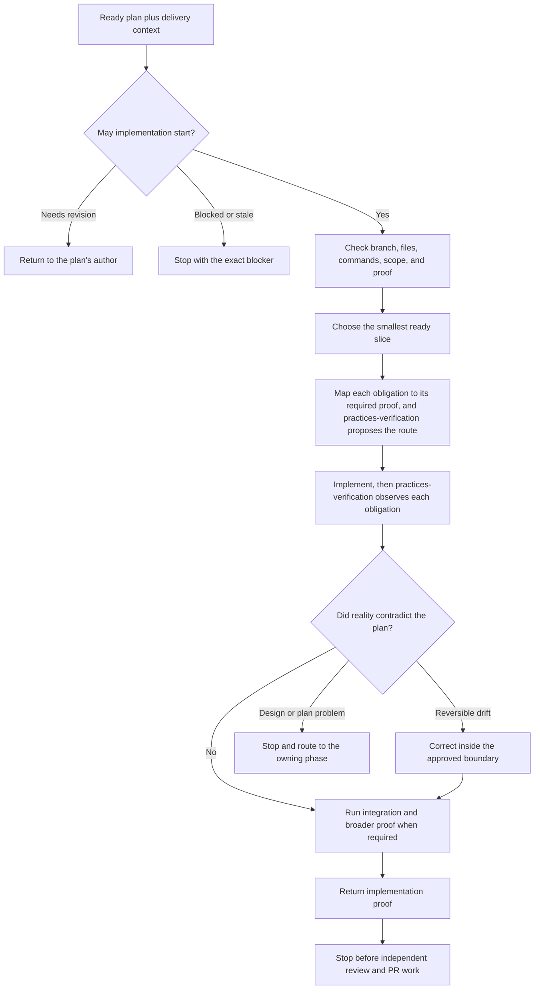

# Implement Plan

`implement-plan` executes one ready implementation plan whose delivery context authorizes implementation. It verifies the plan, governing basis, and delivery context against the current repository, completes the smallest safe slice, and returns fresh proof. It does not review its own work or manage the PR.

The runtime contract remains in [SKILL.md](./SKILL.md). Detailed execution and proof guidance lives in [execution-and-proof.md](./references/execution-and-proof.md).

## Workflow

## Important Branches

- A plan needing revision returns to the Lead for `plan-update`; a blocked plan stops at its named owner.
- Plan-only, missing, malformed, or stale governing basis/delivery context stops implementation.
- A design surprise returns to design instead of being patched around.
- A required proof gate is never weakened to make the run pass.
- This phase decides which obligation needs proof and at which gate; `practices-verification` decides how each one is observed and reports supported, unsupported or unknown.
- Independent implementation review happens afterward in `implementation-review`.

## Output

Changed files, each obligation's observation route, target and result, and fresh focused, integration and quality evidence as applicable. Progress and proof remain outside the plan itself.
