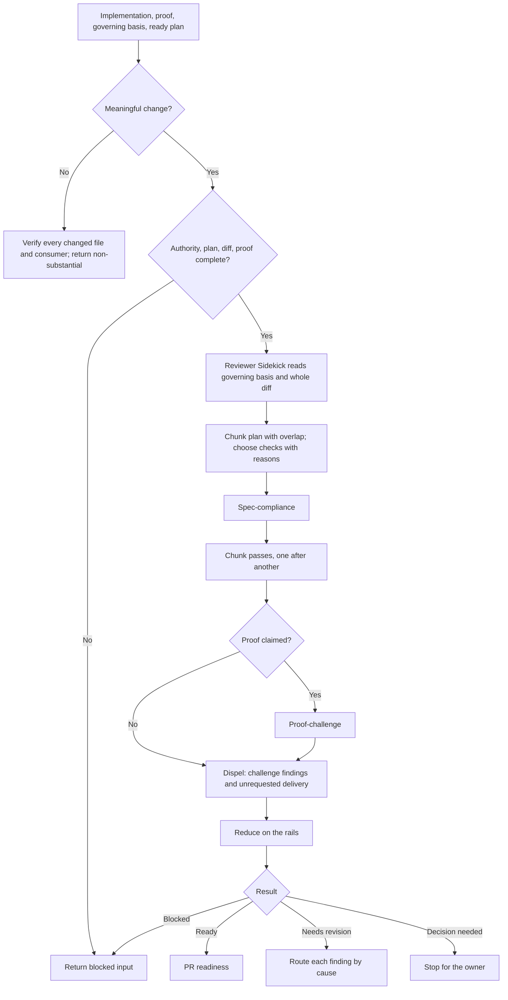

# Implementation Review

`implementation-review` independently checks implemented work and its proof. The caller commissions one 🔎 Reviewer Sidekick, which reads the governing sources and the whole diff itself, plans sequential chunk passes with deliberate overlap, walks every check in its own session, and verifies each candidate finding against the quoted rails before accepting it. The orchestrator then disposes and routes the result.

The runtime contract is [SKILL.md](./SKILL.md). Chunking and lane order are in [coordination-and-chunking.md](./references/coordination-and-chunking.md), the review method is in [reviewing-implementation.md](./references/reviewing-implementation.md), and rails-anchored reduction is in [finding-and-reduction.md](./references/finding-and-reduction.md).

## Workflow

## Important Branches

- Requirements or observable-behavior problems return to `spec-design`; structural problems to `program-design`; slice or proof-map problems to `plan-update`; code and proof problems to `implement-plan`.
- A reviewer proposal that adds unrequested scope is rejected; an unrequested element already in the diff gets removal or an owner decision.
- Corrected work inside the accepted boundary is reviewed again until the loop is ready or stops converging; a correction that changes design meaning goes to the owner as a brief first.

## Output

One result (ready, needs revision, blocked input, decision needed, or not converging) with rails-anchored findings, rejected findings with evidence, remaining uncertainty, and exact routes.
