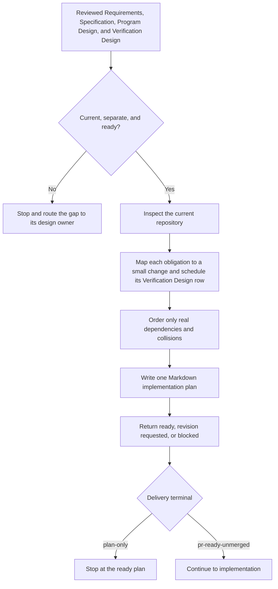

# Plan Implementation

`plan-implementation` lets the Lead turn reviewed design into one practical Markdown implementation plan. The Lead reads the Requirements, Specification, Program Design, and Verification Design, checks them against the current repository, and authors the small slices. Each slice earns the "proven by" rows the Verification Design assigns it; the plan decides when and with which commands. Helpers may gather bounded evidence; Implementer Sidekicks receive the finished plan rather than write it.

The runtime contract remains in [SKILL.md](./SKILL.md). Detailed slicing guidance lives in [slice-and-proof-design.md](./references/slice-and-proof-design.md).

## Workflow

## Important Branches

- Missing or stale design returns to the design owner; planning does not repair design. A missing or stale Verification Design returns `verification-design-gap`.
- Direct planning establishes `plan-only` versus `pr-ready-unmerged` at entry when intent is ambiguous. Goal orchestration supplies `pr-ready-unmerged` by default.
- A ready delivery plan continues to implementation without a generic post-plan approval stop; a `plan-only` plan stops at planning.
- Optional tickets may point to the plan, but they never become another plan.

## Output

One proportional Markdown plan that names the work, order, proof, integration points, and stop conditions. It contains no progress tracking, approval state, document digest, or PR state.
